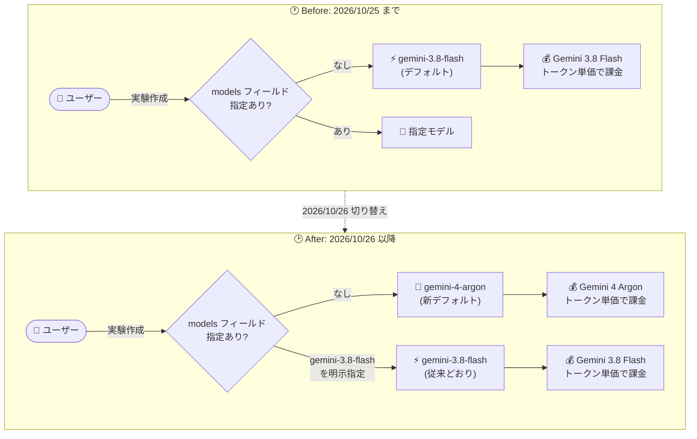

# Gemini Enterprise: AlphaEvolve のデフォルトモデルが 2026 年 10 月 26 日に Gemini 4 Argon へ変更

**リリース日**: 2026-10-22

**サービス**: Gemini Enterprise (AlphaEvolve)

**機能**: AlphaEvolve デフォルトモデルの Gemini 4 Argon への変更 (2026 年 10 月 26 日)

**ステータス**: Announcement (事前告知)

📊 [このアップデートのインフォグラフィックを見る](https://takech9203.github.io/google-cloud-news-summary/20261022-gemini-enterprise-alphaevolve-gemini-4-argon-default.html)

## 概要

2026 年 10 月 26 日より、Gemini Enterprise の AlphaEvolve において、新規実験 (Experiment) のデフォルトモデルが Gemini 3.8 Flash から Gemini 4 Argon に変更されることが発表されました。AlphaEvolve は、実験作成時に `generationSettings` の `models` フィールドでモデルを指定しなかった場合にデフォルトモデルを使用します。

この変更には課金への影響が伴います。10 月 26 日以降、デフォルトモデルを使用する新規実験は、Gemini 3.8 Flash のトークン単価ではなく Gemini 4 Argon のトークン単価で課金されます。Gemini 4 Argon は Google のフロンティアモデル (2026 年 10 月 13 日 GA) であり、AlphaEvolve では 2026 年 10 月 22 日から `models` フィールドで明示指定して利用可能になっていましたが、今回の告知により明示指定なしでもデフォルトで使用されるようになります。

引き続き Gemini 3.8 Flash を使用したい場合は、`models` フィールドに `gemini-3.8-flash` を明示的に指定する必要があります。なお、モデルは実験ごとに作成時の構成に記録されるため、2026 年 10 月 26 日より前に作成された既存の実験は影響を受けず、記録されたモデルを使い続けます。

**アップデート前の課題**

- AlphaEvolve のデフォルトモデルは Gemini リリースに合わせて更新される方針であり、2026 年 9 月 29 日以降のデフォルトは Gemini 3.8 Flash だった
- Gemini 4 Argon (2026 年 10 月 13 日 GA) を AlphaEvolve で使うには、`models` フィールドでの明示指定が必要だった

**アップデート後の改善**

- 2026 年 10 月 26 日以降、`models` フィールドを省略した新規実験は自動的に最新のフロンティアモデル Gemini 4 Argon を使用する
- 一方で、デフォルトモデル利用時の課金は Gemini 4 Argon のトークン単価に切り替わるため、コスト影響を避けたい場合は `gemini-3.8-flash` の明示指定というオプトアウト手段が用意されている
- 既存実験はモデルが構成に記録されているため、デフォルト変更の影響を受けない (挙動・課金とも従来どおり)

## アーキテクチャ図



2026 年 10 月 26 日を境に、`models` フィールドを省略した新規実験のデフォルトモデルと適用されるトークン単価が Gemini 3.8 Flash から Gemini 4 Argon に切り替わります。従来の単価を維持したい場合は `gemini-3.8-flash` を明示指定します。

## サービスアップデートの詳細

### 主要機能

1. **デフォルトモデルの変更 (Gemini 3.8 Flash → Gemini 4 Argon)**
   - 2026 年 10 月 26 日以降に作成される新規実験で、`generationSettings.models` を省略した場合に Gemini 4 Argon が適用される
   - デフォルトモデルは実験の「作成日」で決まり、作成後に変更されることはない
   - 切り替え日当日 (移行日) に作成された実験は、旧デフォルトと新デフォルトのどちらが割り当てられる可能性もある点に注意

2. **課金への影響**
   - 10 月 26 日以降、デフォルトモデルを使用する新規実験は Gemini 4 Argon のトークン単価で課金される
   - Gemini 3.8 Flash の単価を維持したい場合は `models` フィールドに `gemini-3.8-flash` を指定する

3. **既存実験への影響なし**
   - モデルは各実験の構成に記録されるため、デフォルトの変更は既存実験に影響しない
   - 実験に割り当てられたモデルは、実験構成または作成レスポンスの `generationSettings.models` で確認できる
   - 新しいデフォルトモデルを使うには、新規実験を作成する

### デフォルトモデルの変遷

公式ドキュメントに記載されている、実験作成日ごとのデフォルトモデルは以下のとおりです。

| 実験の作成日 | デフォルトモデル |
|------|------|
| 2026 年 10 月 26 日以降 | `gemini-4-argon` |
| 2026 年 9 月 29 日〜10 月 25 日 | `gemini-3.8-flash` |
| 2026 年 6 月 30 日〜9 月 28 日 | `gemini-3.5-flash` |
| 2026 年 6 月 30 日より前 | `gemini-2.5-flash` |

## 技術仕様

### AlphaEvolve のモデル選択 (`generationSettings.models`)

| 項目 | 詳細 |
|------|------|
| `models` フィールド | 省略可能。省略すると実験作成時にデフォルトモデルが設定される |
| 組み合わせ可能なモデル数 | 1 実験あたり最大 2 モデル (重複不可) |
| `weight` | 相対重み。有限かつ正の値。サーバー側で正規化されるため合計 1.0 にする必要はない |
| `thinkingLevel` | オプション。`LOW` / `MEDIUM` / `HIGH` (Gemini 3 以降のモデルが必要) |
| サポートモデル | `gemini-4-argon`、`gemini-3.8-flash`、`gemini-3.7-flash`、`gemini-3.5-flash` (いずれも global / us / eu)、`gemini-3.1-pro-preview` (global のみ) |
| バリデーション | 非対応モデル名やリージョン外のモデルは実験作成時に `INVALID_ARGUMENT` |

### Gemini 4 Argon の主な特徴 (参考)

| 項目 | 詳細 |
|------|------|
| GA 日 | 2026 年 10 月 13 日 |
| トークン上限 | 入出力合算で 1,048,576 トークン (統合リミット) |
| Thinking | `LOW` / `MEDIUM` (デフォルト) / `HIGH` (`MINIMAL` と `thinking_budget` はエラー) |
| サンプリングパラメータ | `temperature` / `top_p` / `top_k` の指定は無視される |
| コンテキストキャッシュ | 暗黙的キャッシュのみ対応 (明示的キャッシュ非対応) |
| 提供リージョン | global、us、eu |

### Gemini 3.8 Flash を使い続ける設定例

```json
{
  "generationSettings": {
    "models": [
      {
        "name": "gemini-3.8-flash",
        "weight": 1.0
      }
    ]
  }
}
```

## 設定方法

### 前提条件

1. Gemini Enterprise で AlphaEvolve (Discovery Engine API `v1alpha`) を利用していること
2. AlphaEvolve がサポートするロケーション (global、us、eu) で実験を作成すること

### 手順

#### ステップ 1: 既存実験・新規実験のモデルを確認する

実験構成または作成レスポンスの `generationSettings.models` を確認し、どのモデルが割り当てられているかを把握します。

```bash
# 実験の取得 (generationSettings.models を確認)
curl -X GET \
  -H "Authorization: Bearer $(gcloud auth print-access-token)" \
  "https://discoveryengine.googleapis.com/v1alpha/projects/PROJECT_ID/locations/LOCATION/collections/COLLECTION/engines/ENGINE/sessions/SESSION/alphaEvolveExperiments/EXPERIMENT_ID"
```

#### ステップ 2: Gemini 3.8 Flash を維持する場合はモデルを明示指定する

2026 年 10 月 26 日以降も Gemini 3.8 Flash の単価で実験を作成したい場合は、実験作成リクエストで `models` を明示指定します。

```bash
curl -X POST \
  -H "Authorization: Bearer $(gcloud auth print-access-token)" \
  -H "Content-Type: application/json" \
  "https://discoveryengine.googleapis.com/v1alpha/projects/PROJECT_ID/locations/LOCATION/collections/COLLECTION/engines/ENGINE/sessions/SESSION/alphaEvolveExperiments" \
  -d '{
    "config": {
      "title": "My Experiment",
      "problemDescription": "Optimize the custom_heuristic function.",
      "programLanguage": "python",
      "runSettings": {
        "maxPrograms": 250,
        "concurrency": 8
      },
      "generationSettings": {
        "models": [
          { "name": "gemini-3.8-flash", "weight": 1.0 }
        ]
      }
    }
  }'
```

`models` を省略した場合、10 月 26 日以降は `gemini-4-argon` が自動的に設定されます。

## メリット

### ビジネス面

- **最新フロンティアモデルの自動適用**: モデル指定の運用をしなくても、新規実験が Google の最新フロンティアモデル Gemini 4 Argon を利用できる
- **既存ワークロードの保護**: 既存実験は構成に記録されたモデルを使い続けるため、進行中の実験の挙動やコストが突然変わることがない

### 技術面

- **コーディング・推論性能の向上**: Gemini 4 Argon は複雑な実世界タスク (コーディングを含む) に強いフロンティアモデルであり、AlphaEvolve の候補プログラム生成 (mutation) の品質向上が期待できる
- **明示的なオプトアウト手段**: `models` フィールドの指定により、モデルと課金単価を実験単位で確定的にコントロールできる

## デメリット・制約事項

### 制限事項

- デフォルトモデルを使用する新規実験は、10 月 26 日以降 Gemini 4 Argon のトークン単価で課金される (Flash 系モデルとは単価が異なる)
- 切り替えは移行日 (10 月 26 日) を通して段階的に適用されるため、当日に作成した実験は旧・新どちらのデフォルトモデルが割り当てられる可能性もある
- 1 つの実験で組み合わせられるモデルは最大 2 つまで

### 考慮すべき点

- `models` を省略して実験を作成している自動化パイプラインは、10 月 26 日以降に生成コストが変化する可能性があるため、事前にコスト影響を評価する
- コストを固定したい場合は、IaC やスクリプト内の実験作成リクエストに `gemini-3.8-flash` を明示的に追加する
- デフォルトモデルは今後も新しい Gemini モデルのリリースに合わせて変更されるため、モデルを固定したい運用では常に `models` を明示指定するのが安全

## ユースケース

### ユースケース 1: 新規実験で最新モデルの性能を活用する

**シナリオ**: アルゴリズム最適化の実験で、候補プログラムの品質を最大化したい。モデル指定の管理コストは掛けたくない。

**実装例**:
```json
{
  "generationSettings": {
    "includeFullProgramInPrompt": true
  }
}
```

**効果**: 2026 年 10 月 26 日以降、`models` を省略するだけで新規実験が Gemini 4 Argon を使用し、フロンティアモデルによる高品質な mutation 生成が期待できる。

### ユースケース 2: コストを固定したまま実験を量産する

**シナリオ**: CI パイプラインから多数の AlphaEvolve 実験を自動作成しており、トークン単価の変動によるコスト増を避けたい。

**実装例**:
```json
{
  "generationSettings": {
    "models": [
      { "name": "gemini-3.8-flash", "weight": 1.0 }
    ]
  }
}
```

**効果**: デフォルトモデルの切り替え後も Gemini 3.8 Flash のトークン単価で課金され、コストの予測可能性を維持できる。

## 料金

AlphaEvolve の実験は、候補プログラムの生成に使用するモデルのトークン単価で課金されます。2026 年 10 月 26 日以降、デフォルトモデルを使用する新規実験は Gemini 3.8 Flash ではなく Gemini 4 Argon のトークン単価が適用されます。

各モデルの具体的なトークン単価は、Gemini Enterprise Agent Platform の料金ページを参照してください。

- [Gemini Enterprise Agent Platform の生成 AI 料金](https://cloud.google.com/gemini-enterprise-agent-platform/generative-ai/pricing)

## 利用可能リージョン

AlphaEvolve は global、us、eu の各ロケーションで利用できます。デフォルトモデルとなる `gemini-4-argon` および `gemini-3.8-flash` は、いずれも global、us、eu のすべてで提供されています。

## 関連サービス・機能

- **Gemini Enterprise Agent Platform**: Gemini 4 Argon / Gemini 3.8 Flash などのモデルを提供する基盤。AlphaEvolve はこれらのモデルを使用して候補プログラムを生成する
- **Discovery Engine API (v1alpha)**: AlphaEvolve 実験の作成・管理に使用する API。`generationSettings.models` でモデルを指定する
- **CodeMender**: 同じく Gemini Enterprise Agent Platform 上のエージェントで、Gemini 4 Argon (Preview) に対応している

## 参考リンク

- 📊 [インフォグラフィック](https://takech9203.github.io/google-cloud-news-summary/20261022-gemini-enterprise-alphaevolve-gemini-4-argon-default.html)
- [公式リリースノート](https://docs.cloud.google.com/release-notes#October_22_2026)
- [AlphaEvolve API リファレンス - デフォルトモデル](https://docs.cloud.google.com/gemini/enterprise/docs/alphaevolve/reference-guide/api-reference#default-model)
- [Gemini 4 Argon モデルページ](https://docs.cloud.google.com/gemini-enterprise-agent-platform/models/gemini/4-argon)
- [料金ページ](https://cloud.google.com/gemini-enterprise-agent-platform/generative-ai/pricing)

## まとめ

2026 年 10 月 26 日以降、AlphaEvolve の新規実験はモデル未指定時に Gemini 4 Argon を使用し、課金も同モデルのトークン単価に切り替わります。`models` を省略して実験を作成しているユーザーは、切り替え日前にコスト影響を評価し、単価を維持したい場合は `gemini-3.8-flash` の明示指定を実験作成フローに組み込むことを推奨します。既存実験は影響を受けないため、移行作業は新規実験の作成方法の見直しのみで完了します。

---

**タグ**: Gemini Enterprise, AlphaEvolve, Gemini 4 Argon, Gemini 3.8 Flash, デフォルトモデル, 課金, Announcement
