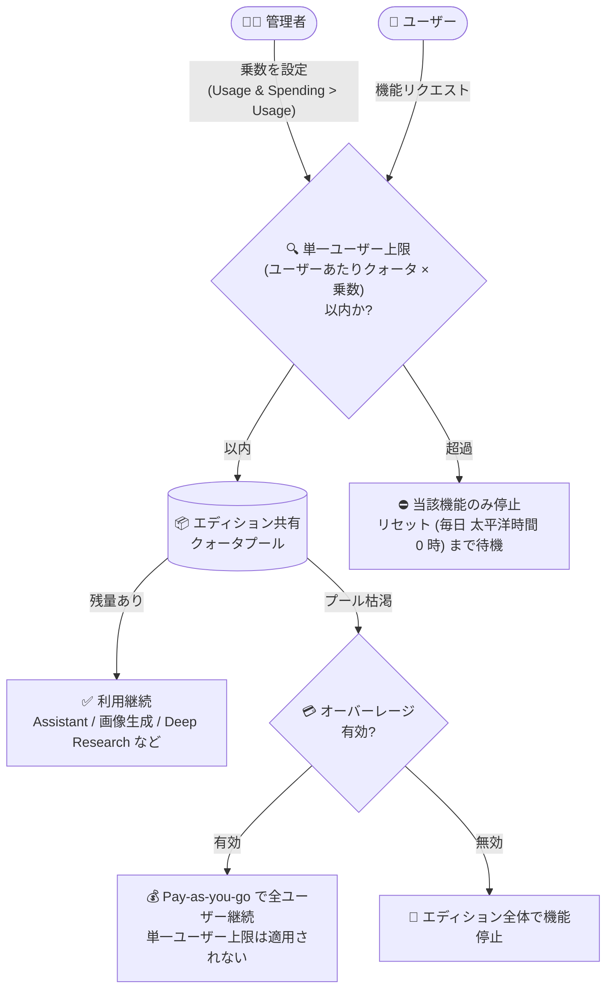

# Gemini Enterprise: 単一ユーザークォータ上限 (Single-user quota limits)

**リリース日**: 2026-10-22

**サービス**: Gemini Enterprise

**機能**: 単一ユーザークォータ上限 (Single-user quota limits)

**ステータス**: GA (一般提供)

📊 [このアップデートのインフォグラフィックを見る](https://takech9203.github.io/google-cloud-news-summary/20261022-gemini-enterprise-single-user-quota-limits.html)

## 概要

Gemini Enterprise の「単一ユーザークォータ上限 (Single-user quota limits)」が一般提供 (GA) になりました。Gemini Enterprise 管理者は、Google Cloud コンソールの **Usage & Spending > Usage** ページで、1 人のユーザーがエディションの共有サブスクリプションクォータプールを使い切ってしまうことを防ぐための上限を設定できます。

Gemini Enterprise では、ストレージとデータインデックス登録を除く機能クォータ (Assistant クエリ、画像生成など) が、プロジェクト・ロケーションごとに同一エディション内の全ユーザーでプール (共有) されます。今回の機能により、エディションおよびロケーションごとに単一ユーザークォータ上限を有効化し、クォータ乗数 (multiplier) を設定できるようになりました。対象は Gemini Enterprise Standard、Gemini Enterprise Plus、Gemini Enterprise Standard Emerging Market の 3 エディションです。

多数のライセンスを導入している組織の管理者にとって、一部のヘビーユーザーによるクォータの独占を防ぎ、全ユーザーに公平な利用機会を確保できる重要なガバナンス機能です。

**アップデート前の課題**

- 機能クォータはエディション内の全ユーザーで共有されるプール方式のため、デフォルトでは個人ごとの利用上限がなかった
- 1 人のユーザーが大量に利用すると、共有プールを使い切り、同じエディションの他のユーザーが機能を利用できなくなるリスクがあった

**アップデート後の改善**

- 管理者がコンソール上で「Limit any single-user's quota」を有効化し、個々のユーザーの消費量に上限を設定できるようになった
- エディションとロケーションごとにクォータ乗数 (1 以上の整数、デフォルト 10) を設定し、1 ユーザーあたりの最大利用量を「ユーザーあたりクォータ × 乗数」として制御できるようになった
- 上限は機能ごとに独立して追跡・適用されるため、例えば画像生成の上限に達しても Assistant クエリは引き続き利用できる

## アーキテクチャ図



管理者が設定した乗数に基づき、各ユーザーのリクエストはまず単一ユーザー上限のチェックを受け、上限内であれば共有プールから消費されます。プール枯渇時の挙動はオーバーレージ (従量課金) の有効/無効で変わります。

## サービスアップデートの詳細

### 主要機能

1. **単一ユーザークォータ上限の有効化**
   - コンソールの **Usage & Spending > Usage** ページの **Feature usage > Limit any single-user's quota** でトグルを有効化
   - エディションとロケーションの組み合わせごとに設定する
   - 上限はそのエディション・ロケーションの全ユーザーに一律に適用され、個別ユーザーごとのカスタマイズはできない

2. **クォータ乗数 (Multiplier)**
   - 1 以上の整数で指定し、未指定の場合はデフォルトで **10**
   - 1 ユーザーあたりの最大利用量 = その機能のユーザーあたりクォータ × 乗数
   - 例: Standard エディション 100 ライセンスの場合、共有プールは 1 日あたり 16,000 クエリ・画像 500 枚。乗数 5 を設定すると、各ユーザーは 1 日最大 800 クエリ (5 × 160)、画像 25 枚 (5 × 5) まで利用可能

3. **機能ごとの独立した適用**
   - 上限は機能ごとに独立して追跡・適用される (画像生成の上限到達後も Assistant クエリは利用可能)
   - 対象機能: Assistant クエリ、ノーコードエージェント作成ツール、動画生成、画像生成、Deep Research
   - **AI developer tools (Google Antigravity を含む) には適用されない**

4. **オーバーレージ (従量課金) との関係**
   - 単一ユーザー上限が制御するのはサブスクリプションの共有プールのみで、Pay-as-you-go のオーバーレージ利用は制限しない
   - プール枯渇後にオーバーレージが有効な場合、上限に達していたユーザーも含め全員が従量課金レートで利用を継続できる (月間支出上限の範囲内)
   - オーバーレージが無効の場合、プール枯渇後はエディション内の全ユーザーで該当機能が停止する

## 技術仕様

### 設定項目と動作

| 項目 | 詳細 |
|------|------|
| 対象エディション | Gemini Enterprise Standard / Plus / Standard Emerging Market |
| 設定単位 | エディション × ロケーションごと (ユーザー個別の設定は不可) |
| 乗数の値 | 1 以上の整数 (デフォルト: 10) |
| 1 ユーザーの上限 | ユーザーあたり機能クォータ × 乗数 |
| 適用範囲 | 機能ごとに独立して追跡・適用 |
| 適用外 | AI developer tools (Google Antigravity 含む)、Pay-as-you-go オーバーレージ利用 |
| クォータのリセット | 多くの機能は毎日太平洋時間 (PT) 午前 0 時にリセット |

### 必要なロールと権限

| ロール / 権限 | 用途 |
|------|------|
| `roles/discoveryengine.agentspaceAdmin` | Gemini Enterprise 管理者ロール (設定に必要) |
| `monitoring.timeSeries.list` | Usage タブでのクォータ使用量の表示 (欠けていると使用量が `0` と表示される) |
| `serviceconsumermanagement.quota.get` | クォータ上限値の表示 (欠けていると上限が `Unknown` と表示される) |

## 設定方法

### 前提条件

1. Gemini Enterprise 管理者 (`roles/discoveryengine.agentspaceAdmin`) であること
2. 有効な Gemini Enterprise サブスクリプションが 1 つ以上あること

### 手順

#### ステップ 1: Usage ページに移動

1. Google Cloud コンソールで **Gemini Enterprise > Usage & Spending** に移動
2. **Usage** タブを選択
3. ライセンスまたはサブスクリプションの**ロケーション**を選択
4. 同一ロケーションに複数のアクティブなエディションがある場合は、**Choose another tier** リストから対象エディションを選択

#### ステップ 2: 単一ユーザークォータ上限を設定

1. **Feature usage > Limit any single-user's quota** に移動
2. 次のいずれかを実施:
   - **有効化**: Status の **Enabled** トグルをオンにし、**Multiplier** フィールドに 1 以上の整数を入力 (デフォルト 10)
   - **更新**: Multiplier フィールドに新しい 1 以上の整数を入力
   - **無効化**: トグルをオフにして **Disabled** にする
3. **Save changes** をクリック

## メリット

### ビジネス面

- **公平な利用機会の確保**: 一部のヘビーユーザーによる共有クォータの独占を防ぎ、ライセンスを持つ全ユーザーが機能を利用できる状態を維持できる
- **コストガバナンスの強化**: サブスクリプションプールの消費ペースを制御でき、オーバーレージ (従量課金) 発生の抑制につながる

### 技術面

- **柔軟な粒度での制御**: エディション × ロケーションごとに乗数を設定でき、組織の利用実態に合わせた調整が可能
- **機能単位の独立適用**: 上限は機能ごとに独立して追跡されるため、1 つの機能の上限到達が他の機能の利用を妨げない
- **コンソールのみで完結**: 追加のツールやスクリプトなしで、管理者がコンソールから有効化・更新・無効化できる

## デメリット・制約事項

### 制限事項

- 対象は Standard / Plus / Standard Emerging Market の 3 エディションのみ
- 上限はエディション・ロケーション内の全ユーザーに一律適用され、個別ユーザーごとのカスタマイズはできない
- 乗数は 1 以上の整数のみ指定可能 (小数は不可)
- AI developer tools (Google Antigravity を含む) にはユーザークォータ乗数が適用されない

### 考慮すべき点

- 単一ユーザー上限はサブスクリプションプールのみを制御し、Pay-as-you-go のオーバーレージ利用は制限しない。プール枯渇後にオーバーレージが有効な場合、上限に達していたユーザーも従量課金で利用を継続できるため、支出管理には月間支出上限の設定を併用する必要がある
- 乗数を小さくしすぎると、正当な業務でのヘビーユースも制限される可能性があるため、利用実態 (Usage タブの使用量) を確認した上で値を決めることが望ましい

## ユースケース

### ユースケース 1: 大規模導入での公平な利用の担保

**シナリオ**: Gemini Enterprise Standard を 100 ライセンス導入している企業で、一部のユーザーが大量の Assistant クエリと画像生成を行い、共有プール (1 日あたり 16,000 クエリ・画像 500 枚) を圧迫している。

**実装例**:
```text
Usage & Spending > Usage > Feature usage > Limit any single-user's quota
  Status: Enabled
  Multiplier: 5
→ 各ユーザーの上限: Assistant 800 クエリ/日 (5 × 160)、画像 25 枚/日 (5 × 5)
```

**効果**: どのユーザーも 1 日あたり共有プールの一定割合までしか消費できなくなり、他のユーザーの利用機会が守られる。画像の上限に達したユーザーも Assistant クエリは引き続き利用できる。

### ユースケース 2: オーバーレージ費用の抑制

**シナリオ**: サブスクリプションプールの枯渇が頻発し、オーバーレージ (従量課金) 費用が増加している。原因は少数ユーザーの突出した利用。

**効果**: 単一ユーザー上限によりプールの消費ペースが平準化され、プール枯渇とそれに伴う従量課金の発生を抑制できる。オーバーレージの月間支出上限と組み合わせることで、支出の予見性が高まる。

## 料金

単一ユーザークォータ上限は、既存の Gemini Enterprise サブスクリプションに含まれる管理機能であり、設定自体の料金は公式ドキュメントに記載されていません。クォータ超過時の Pay-as-you-go 料金を含むエディション別のクォータと料金の詳細は、公式ドキュメントを参照してください。

- [Gemini Enterprise のクォータとオーバーレージ](https://docs.cloud.google.com/gemini/enterprise/docs/quotas-and-overages)

## 関連サービス・機能

- **オーバーレージ (Pay-as-you-go usage above quota)**: 共有プール枯渇後も従量課金で利用を継続できる機能。単一ユーザー上限とは独立して設定し、組み合わせて利用量と支出を制御する
- **Cloud Monitoring**: Usage タブのクォータ使用量表示は `monitoring.timeSeries.list` 権限 (Cloud Monitoring の時系列データ) に依存する
- **Google Antigravity (AI developer tools)**: Gemini Enterprise に含まれる AI 開発者ツール。単一ユーザークォータ乗数の適用対象外

## 参考リンク

- 📊 [インフォグラフィック](https://takech9203.github.io/google-cloud-news-summary/20261022-gemini-enterprise-single-user-quota-limits.html)
- [公式リリースノート](https://docs.cloud.google.com/release-notes#October_22_2026)
- [単一ユーザークォータ上限 (Quotas and overages)](https://docs.cloud.google.com/gemini/enterprise/docs/quotas-and-overages#single-user-quota-limits)
- [単一ユーザークォータ上限の設定 (Feature usage)](https://docs.cloud.google.com/gemini/enterprise/docs/feature-usage#configure-single-user-quota-limit)
- [オーバーレージの設定](https://docs.cloud.google.com/gemini/enterprise/docs/configure-overages#configure-single-user-quota-limit)

## まとめ

Gemini Enterprise の単一ユーザークォータ上限の GA により、管理者はコンソールから乗数を設定するだけで、共有クォータプールの独占を防ぎ、全ユーザーに公平な利用機会を確保できるようになりました。Standard / Plus / Standard Emerging Market エディションを大規模に導入している組織は、Usage タブで利用実態を確認した上で適切な乗数を設定し、オーバーレージの月間支出上限と組み合わせた利用・コストガバナンスの整備を推奨します。

---

**タグ**: #GeminiEnterprise #クォータ管理 #ガバナンス #GA #コスト管理
