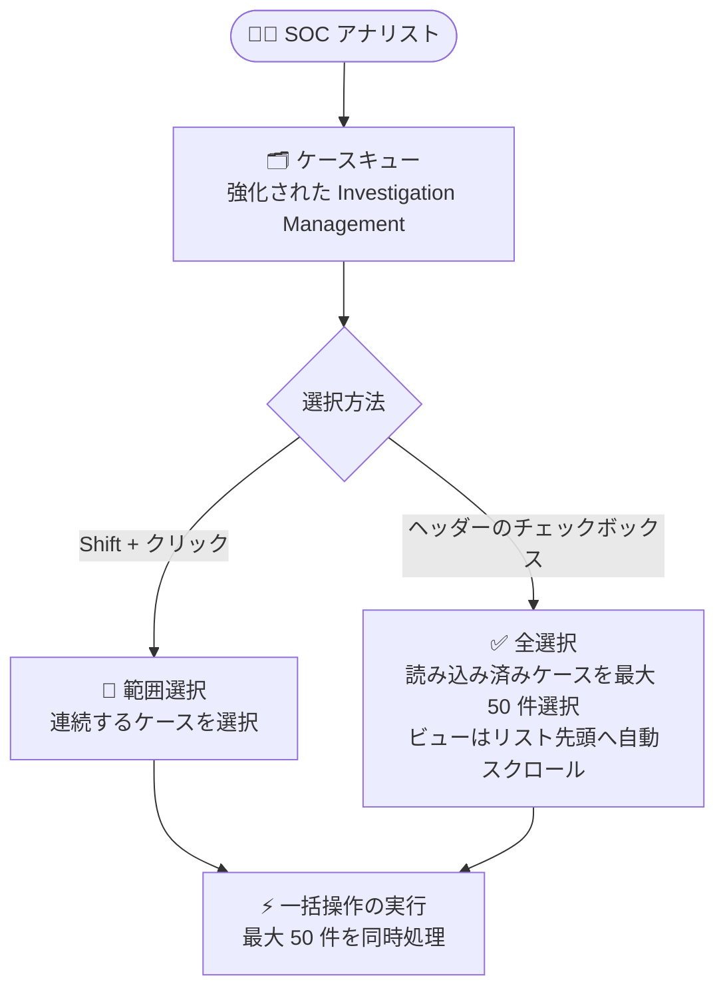

# Google SecOps: 強化された Investigation Management エクスペリエンスでのケース一括選択

**リリース日**: 2026-10-22

**サービス**: Google SecOps

**機能**: ケース一括選択 (Bulk case selection)

**ステータス**: Feature (強化された Investigation Management エクスペリエンスは Preview として提供)

📊 [このアップデートのインフォグラフィックを見る](https://takech9203.github.io/google-cloud-news-summary/20261022-google-secops-bulk-case-selection.html)

## 概要

Google SecOps の強化された Investigation Management エクスペリエンス (新しい Cases エクスペリエンス) において、ケースキューで最大 50 件のケースを一度に選択し、一括操作 (bulk operations) を実行できるようになりました。SOC アナリストや SOC マネージャーが、大量のケースを効率的にトリアージ・管理するためのコンソール UI 機能強化です。

今回のアップデートでは、2 つの選択方法が提供されます。1 つは **範囲選択** で、Shift キーを押しながらクリックすることで連続した範囲のケースをまとめて選択できます。もう 1 つは **全選択** で、ヘッダーのチェックボックスをクリックすると、読み込み済みのケースを最大 50 件まで選択できます。全選択を実行すると、ビューは自動的にリストの先頭までスクロールして戻ります。

強化された Investigation Management エクスペリエンスは、Google SecOps 統合 (unified) 顧客向けの新しいケース管理体験で、カスタマイズ可能なケーステーブル、列フィルタ、クイックアクション用サイドドロワーなどを備えています。今回の一括選択機能の追加により、新エクスペリエンスでも大量ケースの一括処理ワークフローが強化されました。

**アップデート前の課題**

- 強化された Investigation Management エクスペリエンスのケースキューでは、複数ケースをまとめて選択する操作手段が限られており、大量のケースに対する一括処理の効率が課題だった
- 連続する多数のケースを選択するには、個別にクリックして選択する必要があった

**アップデート後の改善**

- ケースキューで一度に最大 50 件のケースを選択し、一括操作を実行できるようになった
- Shift + クリックによる範囲選択で、連続するケースをまとめて選択できるようになった
- ヘッダーのチェックボックスによる全選択で、読み込み済みのケースを最大 50 件までワンクリックで選択できるようになった (選択後はビューが自動的にリスト先頭へスクロール)

## アーキテクチャ図



ケースキュー上での 2 つの選択方法 (範囲選択・全選択) と、選択したケースに対する一括操作の流れを示しています。

## サービスアップデートの詳細

### 主要機能

1. **一括選択 (最大 50 件)**
   - ケースキューで一度に最大 50 件のケースを選択可能
   - 選択したケースに対して一括操作を実行できる

2. **範囲選択 (Shift + クリック)**
   - Shift キーを押しながらクリックすることで、連続した範囲のケースをまとめて選択
   - 個別クリックの繰り返しが不要になり、トリアージ作業を高速化

3. **全選択 (ヘッダーのチェックボックス)**
   - ヘッダーのチェックボックスをクリックすると、読み込み済みのケースを最大 50 件まで選択
   - この操作を行うと、ビューは自動的にリストの先頭までスクロールして戻る

## 技術仕様

### 強化された Investigation Management エクスペリエンスの前提条件

公式ドキュメント ([Investigation and case management overview](https://docs.cloud.google.com/chronicle/docs/secops/investigate/investigation-management/investigation-management-overview)) によると、新しい Cases エクスペリエンスの利用には以下が必要です。

| 項目 | 詳細 |
|------|------|
| 提供ステータス | Preview (Pre-GA Offerings Terms の対象) |
| 対象顧客 | Google SecOps 統合 (unified) 顧客 |
| デプロイ構成 | 単一 SIEM デプロイのみサポート (フェデレーション構成・MSSP 環境は非サポート) |
| インフラ要件 | インスタンスが Google Cloud フレームワークへ完全移行済みであること |
| 必要な IAM 権限 | `chronicle.caseDetections.get`、`chronicle.caseEvents.get`、`chronicle.views.get` |
| 事前設定 | SOAR Settings > Case Data > Views でデフォルトビュー (New Default Alert View / New Default Case View) を設定 |

### 一括選択の仕様

| 項目 | 詳細 |
|------|------|
| 最大選択数 | 一度に 50 件まで |
| 範囲選択 | Shift キーを押しながらクリック |
| 全選択 | ヘッダーのチェックボックスをクリック (読み込み済みケースを最大 50 件選択) |
| 全選択時の挙動 | ビューが自動的にリストの先頭へスクロール |

## メリット

### ビジネス面

- **SOC 運用効率の向上**: 大量のケースをまとめて処理できるため、トリアージやケース整理にかかる時間を短縮し、アナリストが本来の調査業務に集中できる
- **対応の一貫性**: 同種のケース群に対して同じ操作を一括適用できるため、対応漏れや操作のばらつきを減らせる

### 技術面

- **操作ステップの削減**: Shift + クリックの範囲選択やヘッダーチェックボックスの全選択により、個別クリックの繰り返しが不要になる
- **一般的な UI 操作パターンの採用**: Shift + クリックによる範囲選択は多くのツールで使われる標準的な操作であり、学習コストが低い

## デメリット・制約事項

### 制限事項

- 一度に選択できるケースは最大 50 件まで
- 全選択の対象は「読み込み済み (loaded)」のケースに限られる
- 本機能は強化された Investigation Management エクスペリエンス (Preview) の機能であり、利用には前提条件 (単一 SIEM デプロイ、Google Cloud フレームワークへの移行、IAM 権限など) を満たす必要がある

### 考慮すべき点

- 強化された Investigation Management エクスペリエンスは Pre-GA 機能のため、サポートが限定される場合や、他の Pre-GA バージョンと互換性のない変更が入る可能性がある
- 環境でこの機能が表示されない場合は、[プレビュー機能の管理](https://docs.cloud.google.com/chronicle/docs/secops/preview-features-manage)を確認するか、システム管理者への問い合わせが必要

## ユースケース

### ユースケース 1: 誤検知ケースの一括クローズ

**シナリオ**: 検知ルールのチューニング不足により、同一ルールから大量の誤検知ケースがケースキューに蓄積している。フィルタで対象ケースを絞り込んだ後、まとめてクローズしたい。

**操作イメージ**:
```
1. ケースキューでフィルタを適用し、対象ルールのケースを絞り込む
2. ヘッダーのチェックボックスをクリックして読み込み済みケースを最大 50 件選択
   (または Shift + クリックで範囲選択)
3. 選択したケースに対して一括操作を実行
```

**効果**: 個別にケースを開いて処理する手間がなくなり、キューのクリーンアップを短時間で完了できる。

### ユースケース 2: シフト交代時のケース一括引き継ぎ

**シナリオ**: SOC のシフト交代時に、前シフトで未対応のまま残っている連続した一群のケースを、次のシフトの担当者へまとめて割り当て直したい。

**効果**: Shift + クリックの範囲選択で対象ケースをまとめて選択し、一括操作で処理することで、引き継ぎ作業の時間と操作ミスを削減できる。

## 関連サービス・機能

- **Google SecOps SOAR (ケース管理)**: ケースキューでは従来からソート、フィルタ、ビュー切り替え (リストビュー / サイドバイサイドビューなど) が提供されており、本機能は選択操作を強化するもの
- **ケースキューのフィルタ機能**: タイムフレーム、アラート名、アナリスト、優先度、ステージ、タグなどで絞り込んだうえで一括選択と組み合わせると効果的 ([Filter case and alert data](https://docs.cloud.google.com/chronicle/docs/soar/investigate/working-with-cases/apply-and-save-filters))
- **ケースに対するバッチアクション**: ケース管理では CSV エクスポート、クローズ、再オープン、優先度変更、割り当て、タグ追加、マージ、ステージ変更などのバッチアクションがドキュメント化されている ([What actions can you take on a case](https://docs.cloud.google.com/chronicle/docs/soar/investigate/working-with-cases/what-actions-can-you-take-on-a-case))

## 参考リンク

- 📊 [インフォグラフィック](https://takech9203.github.io/google-cloud-news-summary/20261022-google-secops-bulk-case-selection.html)
- [公式リリースノート](https://docs.cloud.google.com/release-notes#October_22_2026)
- [Investigation and case management overview (強化されたエクスペリエンス)](https://docs.cloud.google.com/chronicle/docs/secops/investigate/investigation-management/investigation-management-overview)
- [Manage cases from the case queue](https://docs.cloud.google.com/chronicle/docs/soar/investigate/working-with-cases/whats-on-the-case-queue-header)
- [What actions can you take on a case](https://docs.cloud.google.com/chronicle/docs/soar/investigate/working-with-cases/what-actions-can-you-take-on-a-case)

## まとめ

Google SecOps の強化された Investigation Management エクスペリエンスに、最大 50 件のケースを一度に選択できる一括選択機能 (Shift + クリックの範囲選択、ヘッダーチェックボックスの全選択) が追加されました。大量のケースを扱う SOC では、フィルタと組み合わせることでトリアージやキュー整理の効率を大きく改善できます。新しい Cases エクスペリエンスを利用中、または移行を検討しているチームは、前提条件 (単一 SIEM デプロイ、IAM 権限、デフォルトビュー設定) を確認のうえ活用を検討してください。

---

**タグ**: #GoogleSecOps #SOAR #CaseManagement #InvestigationManagement #SOC #SecurityOperations
