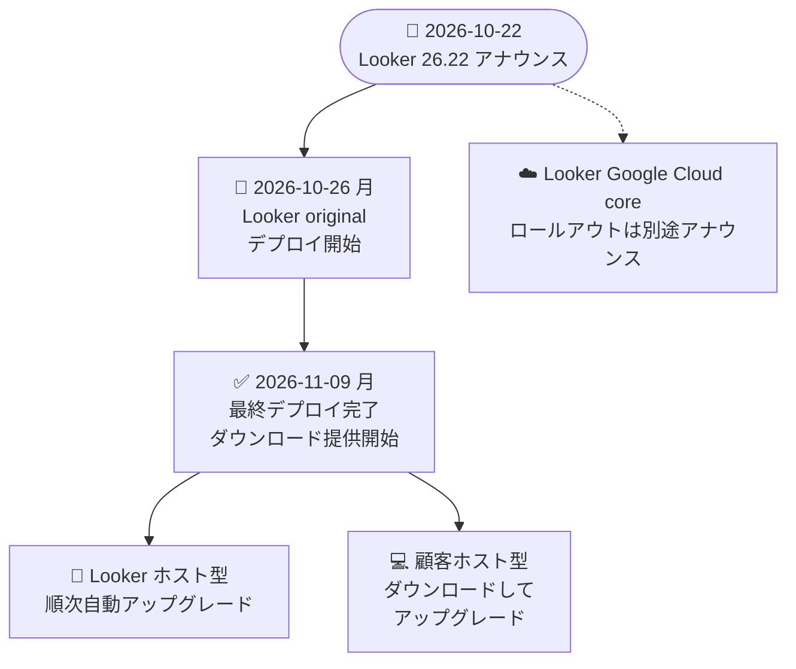

# Looker: Looker 26.22 リリース (Looker (original) 向けロールアウト)

**リリース日**: 2026-10-22

**サービス**: Looker

**機能**: Looker 26.22 リリース (アナウンス + 13 件の不具合修正)

**ステータス**: アナウンス (Announcement / Fixed)

📊 [このアップデートのインフォグラフィックを見る](https://takech9203.github.io/google-cloud-news-summary/20261022-looker-26-22-release.html)

## 概要

Looker 26.22 が Looker (original) インスタンス向けにロールアウトされることが発表されました。デプロイ開始は 2026 年 10 月 26 日 (月)、最終デプロイおよびダウンロード提供開始は 2026 年 11 月 9 日 (月) の予定です。Looker (Google Cloud core) 向けの 26.22 ロールアウトは別途アナウンスされます。

本リリースは新機能の追加ではなく、ダッシュボード・可視化・SQL Runner・System Activity・Conversational Analytics・SDK など広範囲にわたる 13 件の不具合修正が中心です。特に、テーブルの行グループ小計が平均や count distinct などの測定タイプで不正確な合計値を表示していた問題の修正や、System Activity の `query_metrics` Explore の計測精度向上は、BI 基盤の信頼性・運用監視に関わる重要な改善です。

Looker (original) の管理者、LookML 開発者、埋め込みダッシュボードや SDK を利用する開発者が対象です。顧客ホスト型 (customer-hosted) のインスタンスでは、2026 年 11 月 9 日以降にダウンロードしてアップグレードできます。

**アップデート前の課題**

Looker 26.22 より前のバージョンでは、以下の不具合が存在していました。

- テーブルの行グループ小計が、平均・count distinct・表計算などの測定タイプでも合計値を表示し、不正確な値が表示されていた
- ドリルダイアログの背面にテーブル列オプションメニューや検索ボックスが表示され、操作できなかった
- バックスラッシュを含む文字列ディメンションでフィルタした結果にドリルすると 0 行が返っていた
- System Activity の `query_metrics` で、接続プール内でキャンセルされたクエリの接続取得時間 (`acquire_connection`) やキャッシュロード時のモデル初期化時間が正確に記録されていなかった
- Conversational Analytics の DELETE エンドポイントが、存在しないリソースの削除時に HTTP 204 を返しており、削除対象の有無を判別できなかった
- TypeScript / JavaScript SDK で、省略可能パラメータのみを持つメソッドを空オブジェクトなしで呼び出すとコンパイルエラーまたは実行時エラーが発生していた

**アップデート後の改善**

- 行グループ小計は sum と count の測定のみに表示され、その他の測定タイプと表計算では不正確な合計値の代わりに空欄が表示されるようになった
- ドリルダイアログ、ドリル結果のフィルタリング、SQL Runner のピボットクエリ、カテゴリカルチャートのシリーズ追加などが期待どおりに動作するようになった
- `query_metrics` の計測 (`acquire_connection`、モデル初期化時間) が正確になり、パフォーマンス分析の信頼性が向上した
- Conversational Analytics の DELETE エンドポイントが存在しないリソースに対して HTTP 404 Not Found を返すようになり、API の挙動が明確になった
- TypeScript / JavaScript SDK で省略可能パラメータのみのメソッドを引数なしで安全に呼び出せるようになった

## アーキテクチャ図

Looker 26.22 の Looker (original) 向けロールアウトスケジュールです。Looker (Google Cloud core) 向けのロールアウトは別途アナウンスされます。

## サービスアップデートの詳細

### 修正内容 (13 件)

#### ダッシュボード・可視化関連

1. **ドリルダイアログ背面の UI 要素**
   - テーブル列オプションメニューと検索ボックスがドリルダイアログの背面に表示され、操作できなかった問題を修正

2. **行グループ小計の表示仕様変更**
   - 行グループ小計は sum と count の測定のみに表示されるように変更
   - 平均や count distinct などのその他の測定タイプと表計算では、不正確な合計値を表示する代わりに空欄を表示

3. **失敗したタイルの Show filters オプション**
   - 閲覧モードでデータの読み込みに失敗したダッシュボードタイルに Show filters オプションが表示されていた問題を修正

4. **カテゴリカルチャートのシリーズ追加**
   - 新しいピボット値の追加などでカテゴリカルチャートに新しいシリーズを追加すると、カテゴリのバーがグループ解除されて表示されることがあった問題を修正

5. **PDF エクスポートでのカスタム可視化タイルの切り詰め**
   - Expand tables to show all rows オプションが有効な場合に、ダッシュボードの PDF エクスポートでカスタム可視化タイルが切り詰められていた問題を修正

#### クエリ・ドリル関連

6. **バックスラッシュを含む文字列ディメンションのドリル**
   - バックスラッシュを含む文字列ディメンションでフィルタされた結果へのドリルが 0 行を返していた問題を修正

7. **SQL Runner のピボットクエリ**
   - SQL Runner のピボットクエリがレンダリングに失敗したり、予期せず再ピボットされることがあった問題を修正

8. **不要な派生テーブルの再ビルド**
   - LookML モデルの設定変更が不要な派生テーブルの再ビルドをトリガーすることがあった問題を修正

#### 埋め込み関連

9. **埋め込みダッシュボードの View オプション**
   - 閲覧モードの埋め込みダッシュボードのタイルアクションメニューに View (Expanded / Full Screen) オプションが表示されていた問題を修正

#### System Activity (運用監視) 関連

10. **キャンセルされたクエリの接続取得時間の記録**
    - System Activity の `query_metrics` Explore が、接続プールでの待機中にキャンセルされたクエリの接続取得時間 (`acquire_connection`) を記録するように修正

11. **キャッシュロード時のモデル初期化時間の記録**
    - キャッシュからロードされたモデルについて、`query_metrics` Explore がモデル初期化時間を正確に記録するように修正

#### API・SDK 関連

12. **Conversational Analytics DELETE エンドポイントのステータスコード**
    - 存在しないリソースの削除を試みた場合に、HTTP 204 No Content ではなく HTTP 404 Not Found を返すように修正

13. **TypeScript / JavaScript SDK の省略可能パラメータ**
    - 省略可能パラメータのみを持つメソッドを空オブジェクトを渡さずに呼び出すと、コンパイルエラーまたは実行時エラーが発生することがあった問題を修正

## 技術仕様

### ロールアウトスケジュール

| 項目 | 日程 |
|------|------|
| アナウンス日 | 2026 年 10 月 22 日 |
| Looker (original) デプロイ開始 (予定) | 2026 年 10 月 26 日 (月) |
| Looker (original) 最終デプロイ・ダウンロード提供 (予定) | 2026 年 11 月 9 日 (月) |
| Looker (Google Cloud core) ロールアウト | 別途アナウンス |

### Looker のリリースサイクル

公式ドキュメント ([Looker (original) release overview](https://docs.cloud.google.com/looker/docs/release-overview)) によると、Looker のリリースは以下の仕組みで運用されています。

| 項目 | 詳細 |
|------|------|
| バージョン番号 | X.Y.Z 形式 (X: 年の下 2 桁、Y: 月次バージョン、Z: パッチ番号)。26.22 は 2026 年のリリース |
| デプロイ期間 | 新しいマイナーバージョンは約 2 週間かけて順次デプロイ |
| リリースノート通知 | ユーザーはアカウント設定からオプトイン可能。Technical Contact に登録された管理者には自動通知 |
| ステージング環境 | Looker ホスト型・顧客ホスト型ともに、本番適用前のテスト用ステージング環境を利用可能 (Looker サポートへの問い合わせが必要) |

## デメリット・制約事項

### 考慮すべき点

- 行グループ小計の仕様変更により、平均・count distinct・表計算の小計はこれまでの (不正確な) 合計値表示から空欄表示に変わります。小計表示を前提としたダッシュボードは表示が変化する可能性があります
- Conversational Analytics の DELETE エンドポイントのステータスコード変更 (204 → 404) により、存在しないリソースの削除時に 204 を期待する自動化スクリプトやエラーハンドリングは影響を受ける可能性があります
- 記載のスケジュールは「予定 (Expected)」であり、変更される可能性があります
- Looker (Google Cloud core) インスタンスへの 26.22 ロールアウト時期は本アナウンスには含まれていません

## 関連サービス・機能

- **System Activity**: Looker インスタンスの利用状況・パフォーマンスを分析する組み込み機能。本リリースで `query_metrics` Explore の計測精度が向上
- **Conversational Analytics**: 自然言語でデータに質問できる機能。本リリースで DELETE エンドポイントの HTTP ステータスコードが修正
- **Looker SDK (TypeScript / JavaScript)**: Looker API を利用するアプリケーション開発用 SDK。本リリースで省略可能パラメータのみのメソッド呼び出しの問題が修正
- **Looker (Google Cloud core)**: Google Cloud コンソールから管理するマネージド版 Looker。26.22 のロールアウトは別途アナウンス

## 参考リンク

- 📊 [インフォグラフィック](https://takech9203.github.io/google-cloud-news-summary/20261022-looker-26-22-release.html)
- [公式リリースノート](https://docs.cloud.google.com/release-notes#October_22_2026)
- [Looker リリースノート](https://docs.cloud.google.com/looker/docs/release-notes)
- [Looker (original) リリース概要 (リリースプロセス)](https://docs.cloud.google.com/looker/docs/release-overview)
- [Looker (Google Cloud core) リリースプロセス](https://docs.cloud.google.com/looker/docs/looker-core-release-process)

## まとめ

Looker 26.22 は新機能よりも品質改善に重点を置いたリリースで、ダッシュボード表示、ドリル操作、System Activity の計測精度、SDK の安定性など 13 件の不具合が修正されます。Looker (original) の管理者は 10 月 26 日からのロールアウトに備え、特に行グループ小計の表示仕様変更と Conversational Analytics DELETE エンドポイントのステータスコード変更が既存のダッシュボードや自動化処理に影響しないかを確認することを推奨します。顧客ホスト型インスタンスは 11 月 9 日以降にダウンロード可能です。

---

**タグ**: #Looker #リリース #不具合修正 #BI #ダッシュボード #SystemActivity #SDK
