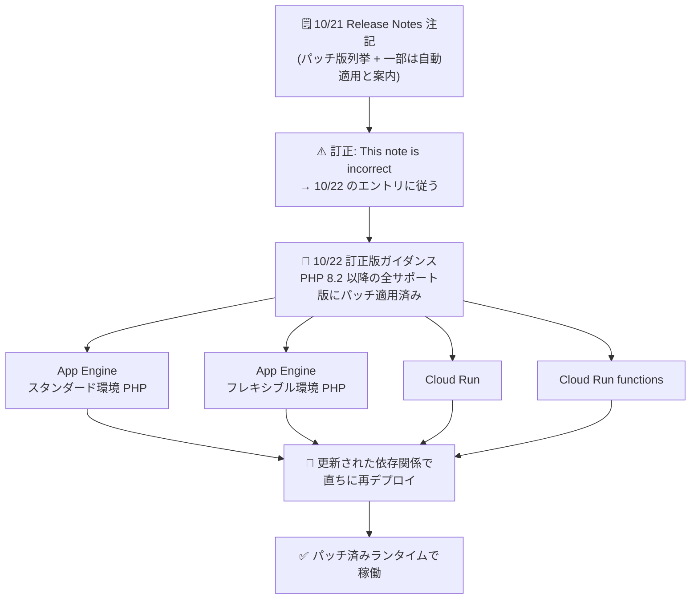

# App Engine / Cloud Run: PHP ランタイムセキュリティパッチ続報 — 10/21 の注記を訂正、全ワークロードで再デプロイを指示

**リリース日**: 2026-10-22

**サービス**: App Engine (スタンダード環境 / フレキシブル環境), Cloud Run, Cloud Run functions

**機能**: PHP ランタイムのセキュリティパッチ (CVE-2026-109618 / CVE-2026-109619) — 10 月 21 日の Release Notes 注記の訂正

**ステータス**: セキュリティアップデート (訂正版ガイダンス)

📊 [このアップデートのインフォグラフィックを見る](https://takech9203.github.io/google-cloud-news-summary/20261022-php-runtime-security-patches-update.html)

## 概要

2026 年 10 月 22 日、Google Cloud は PHP コア脆弱性 **CVE-2026-109618 / CVE-2026-109619** (いずれも Critical、CVSS 9.2) への対応について、**訂正版のセキュリティ注記** を Release Notes に掲載しました。対象は App Engine スタンダード環境 (PHP)、App Engine フレキシブル環境 (PHP)、Cloud Run、Cloud Run functions の 4 サービスで、4 件とも同一の文面です。前日 10 月 21 日に掲載された各サービスの注記には「**This note is incorrect; follow guidance in the entry for October 22, 2026.** (この注記は正しくありません。2026 年 10 月 22 日のエントリのガイダンスに従ってください)」という訂正が付記されました。

訂正後の 10 月 22 日の注記は次の内容です: 「**サポート対象の PHP 8.2 以降のすべてのバージョンにパッチが適用されています。更新された依存関係でリソースを再デプロイし、直ちに保護措置を講じてください。**」。10 月 21 日の注記にあった具体的なパッチバージョンの列挙 (8.5.12 / 8.4.27 / 8.3.36 / 8.2.35) や、「App Engine スタンダード環境は自動的にパッチ適用済み」「自動ベースイメージ更新が有効な Cloud Run / Cloud Run functions はすでにパッチ適用済み」といった自動適用の記述は、訂正版には含まれていません。訂正版は 4 サービスすべてのユーザーに対して一律に「更新された依存関係での再デプロイ」という即時アクションを求めています。

当サイトでは 10 月 21 日の注記に基づくレポート ([2026-10-21-php-runtime-security-patches.md](./2026-10-21-php-runtime-security-patches.md)) を公開済みですが、その元となった Release Notes の注記が公式に「incorrect」とマークされたため、本レポートが訂正後の最新ガイダンスとなります。Google Cloud 上で PHP ワークロードを運用するすべてのユーザーは、本レポート (10 月 22 日の注記) に従ってください。

**アップデート前の課題 (10/21 の注記の問題点)**

- 10 月 21 日の注記は「App Engine スタンダード環境の PHP ワークロードは自動的にパッチ適用済み (アクション不要)」「自動ベースイメージ更新が有効な Cloud Run / Cloud Run functions はすでにパッチ適用済み」と案内しており、これを信じたユーザーは再デプロイを省略し、保護されていない可能性があった
- 具体的なパッチバージョン (8.5.12 / 8.4.27 / 8.3.36 / 8.2.35) が列挙されていたが、この注記自体が後に「incorrect」とマークされた
- サービスごとに「自動適用」と「要再デプロイ」の案内が分かれており、必要なアクションの判断が複雑だった

**アップデート後の改善 (10/22 の訂正版ガイダンス)**

- サポート対象の PHP 8.2 以降のすべてのバージョンにパッチが適用済みであることが明確化された
- 4 サービスすべてで同一・一律のガイダンスとなり、判断が単純化された: **更新された依存関係でリソースを再デプロイする**
- 10 月 21 日の各注記に訂正文が付記され、古いガイダンスに従うリスクが排除された

## アーキテクチャ図



10 月 21 日の注記が訂正され、4 サービスすべてのユーザーが「更新された依存関係での再デプロイ」という同一アクションを直ちに実行するよう求められていることを示しています。

## サービスアップデートの詳細

### 10/21 注記と 10/22 訂正版の比較

| 項目 | 10/21 の注記 (訂正済み・無効) | 10/22 の訂正版 (有効) |
|------|------------------------------|----------------------|
| パッチ対象 | 具体的なバージョンを列挙 (8.5.12 / 8.4.27 / 8.3.36 / 8.2.35) | 「サポート対象の PHP 8.2 以降のすべてのバージョン」 |
| App Engine スタンダード環境 | 「自動的にパッチ適用済み」(アクション不要と読める記述) | 更新された依存関係で再デプロイ |
| App Engine フレキシブル環境 | 再デプロイが必要 (カスタムランタイムは依存関係更新) | 更新された依存関係で再デプロイ |
| Cloud Run / Cloud Run functions | 自動ベースイメージ更新が有効なら「適用済み」、それ以外は再デプロイ | 更新された依存関係で再デプロイ |
| 注記の状態 | 「This note is incorrect; follow guidance in the entry for October 22, 2026.」が付記 | 現行の公式ガイダンス |

### 主要なポイント

1. **4 サービスで同一の訂正版注記**
   - App Engine スタンダード環境 PHP、App Engine フレキシブル環境 PHP、Cloud Run、Cloud Run functions に同一文面のセキュリティ注記が掲載された
   - 文面: "All supported versions of PHP 8.2 and later are patched. Take immediate protective action by redeploying your resources with updated dependencies."

2. **一律の即時アクション: 再デプロイ**
   - 訂正版では「自動適用済みのためアクション不要」という区分がなくなり、すべてのユーザーに「更新された依存関係での再デプロイ」が指示されている
   - 10/21 の注記に従って「対応不要」と判断していた場合も、改めて再デプロイを実施すべき

3. **PHP 8.1 以前はパッチ対象外 (変更なし)**
   - セキュリティブログの案内どおり、PHP 8.1 以前は EOL のため修正版が提供されない
   - 該当バージョンの利用者は PHP 8.2 以降へアップグレードしたうえで再デプロイが必要

## 技術仕様

### 脆弱性の詳細 (セキュリティブログより)

| 項目 | 詳細 |
|------|------|
| CVE-2026-109618 (GHSA-w8hw-w9fx-j79w) | OOM (メモリ不足) 処理が、PHP の内部リクエストデータが部分的にしか初期化されていない状態で割り込み、リクエストのクリーンアップ処理が不正なデータを有効なものとして扱う可能性がある |
| CVE-2026-109619 (GHSA-6wmf-4rv5-p3rp) | リクエストが所有する内部状態がメモリ解放後も残存し、同一ワーカー上の後続リクエストが古い状態を使用する可能性がある (use-after-free 型) |
| 深刻度 | いずれも Critical (CVSS 9.2) |
| 想定される影響 | 認証不要のリモートコード実行 (RCE)、メモリ開示 |
| 影響を受けるバージョン | PHP 5.4 〜 8.5.11 |
| パッチ対象 (Google Cloud の 4 サービス) | サポート対象の PHP 8.2 以降のすべてのバージョン |
| パッチ対象外 | PHP 8.1 以前 (EOL のため修正なし。PHP 8.2 以降へのアップグレードが必要) |
| 開示 | PHP プロジェクトと Wiz Research による協調的開示 (2026-10-21)。Google Cloud セキュリティ速報 GCP-2026-070 |

なお、関連するセキュリティブログも更新が重ねられており、10 月 22 日に Security Command Center と Cloud Armor に関するガイダンスが改訂され、10 月 23 日には Mandiant Consulting による監視・パッチ適用・修復に関する追加ガイダンスが追記されています。

## 設定方法

### 前提条件

1. 利用中の PHP バージョンがサポート対象 (PHP 8.2 以降) であることを確認する。PHP 8.1 以前の場合は、まずランタイムを PHP 8.2 以降へアップグレードする
2. アプリケーションの依存関係 (composer.lock など) を最新のパッチ済みバージョンに更新する

### 手順

#### ステップ 1: App Engine (スタンダード / フレキシブル環境) — 再デプロイ

```bash
# 依存関係を更新したうえでソースから再デプロイ
gcloud app deploy
```

フレキシブル環境でカスタムランタイムを利用している場合は、イメージ内の PHP 依存関係を更新してから再デプロイします。

#### ステップ 2: Cloud Run — 再デプロイ

```bash
# ソースからサービスを再デプロイ (パッチ済みランタイムでビルドされる)
gcloud run deploy SERVICE --source .
```

#### ステップ 3: Cloud Run functions — 再デプロイ

```bash
# 関数を再デプロイ
gcloud run deploy FUNCTION --source . --function FUNCTION_ENTRYPOINT
```

## メリット

### ビジネス面

- **ガイダンスの一本化による対応漏れ防止**: サービスごとに異なっていた案内が「全員が再デプロイ」に統一され、「自分は対応不要」という誤認による未対応リスクが解消される
- **迅速な訂正**: 誤りのあった注記が翌日に訂正され、古い注記にも訂正文が明示されたため、誤った情報に基づく運用が続くことを防げる

### 技術面

- **PHP 8.2 以降の全サポートバージョンがパッチ済み**: 再デプロイするだけで修正版ランタイムを取り込める状態が 4 サービスすべてで整っている
- **シンプルな復旧手順**: 必要なアクションは「依存関係の更新 + 再デプロイ」のみで、特別な設定変更は不要

## デメリット・制約事項

### 制限事項

- PHP 8.1 以前のランタイムには修正版が提供されない (EOL)。PHP 8.2 以降へのアップグレードが必須
- 再デプロイはユーザー自身が実施する必要があり、実施するまでワークロードは保護されない可能性がある
- 自前でビルドしたコンテナイメージ (GKE 上の PHP コンテナなどを含む) の再ビルド・再デプロイはユーザーの責任で行う必要がある

### 考慮すべき点

- **10/21 の注記に基づいて「対応不要」と判断した場合も、訂正版に従って再デプロイを実施すること**。App Engine スタンダード環境や自動ベースイメージ更新が有効な Cloud Run / Cloud Run functions も、訂正版では一律に再デプロイが指示されている
- Cloud Armor のマネージドルール (File Upload / RFI カテゴリの有効化、巨大なリクエストボディのブロック) は緩和策として有効だが、パッチ適用 (再デプロイ) の代替にはならない
- 影響範囲の確認には On-Demand Scanning API / Artifact Analysis によるイメージスキャンや Security Command Center の脅威検出が活用できる

## ユースケース

### ユースケース 1: 10/21 の注記を見て「対応不要」と判断していたチームの再対応

**シナリオ**: App Engine スタンダード環境で PHP 8.3 アプリを運用しており、10/21 の注記の「自動的にパッチ適用済み」という記述を見て対応を見送っていた。

**実装例**:
```bash
# 依存関係を更新して再デプロイ
composer update
gcloud app deploy
```

**効果**: 訂正版ガイダンスに従った再デプロイにより、パッチ済みランタイムでの稼働が確実になり、CVSS 9.2 の RCE / メモリ開示リスクへの対応が完了する。

### ユースケース 2: 複数の Cloud Run サービスの一斉再デプロイ

**シナリオ**: 複数の PHP 製 Cloud Run サービスを `gcloud run deploy --source` で運用している。

**効果**: 各サービスを依存関係更新のうえ再デプロイすることで、すべてのサービスがパッチ済みランタイムに切り替わる。CI/CD パイプラインからの一括再実行でも対応できる。

## 関連サービス・機能

- **Cloud Armor**: マネージドルール (File Upload / RFI カテゴリ) により、パッチ適用までの間の緩和策として悪用の試みをブロックできる (10/22 にブログのガイダンスが改訂)
- **Security Command Center**: 外部公開された RCE 脆弱性の検出や、コンテナ / Cloud Run に対する脅威検出で悪用の兆候を監視できる (10/22 にブログのガイダンスが改訂)
- **Artifact Analysis / On-Demand Scanning API**: コンテナイメージをスキャンし、脆弱な PHP バージョンを含むイメージを特定できる
- **Google Security Operations**: Mandiant Frontline Threats ルールパックに本脆弱性関連のキュレート済み検出ルールが追加されている

## 参考リンク

- 📊 [インフォグラフィック](https://takech9203.github.io/google-cloud-news-summary/20261022-php-runtime-security-patches-update.html)
- [公式リリースノート (2026-10-22)](https://docs.cloud.google.com/release-notes#October_22_2026)
- [Google Cloud Blog: Responding to core PHP vulnerabilities CVE-2026-109618, CVE-2026-109619](https://cloud.google.com/blog/products/identity-security/responding-to-core-php-vulnerabilities-cve-2026-109618-cve-2026-109619)
- [Google Cloud セキュリティ速報 GCP-2026-070](https://docs.cloud.google.com/support/bulletins#gcp-2026-070)
- [App Engine フレキシブル環境 PHP サポートスケジュール](https://docs.cloud.google.com/appengine/docs/flexible/lifecycle/support-schedule#php)
- [前日レポート (10/21 の注記ベース・Release Notes 側で訂正済み)](./2026-10-21-php-runtime-security-patches.md)

## まとめ

PHP コア脆弱性 CVE-2026-109618 / CVE-2026-109619 への対応について、10 月 21 日の Release Notes 注記は公式に「incorrect」とマークされ、10 月 22 日の訂正版が最新のガイダンスとなりました。訂正版は App Engine (スタンダード / フレキシブル環境)、Cloud Run、Cloud Run functions の PHP ワークロードすべてに対し、**サポート対象の PHP 8.2 以降はパッチ済みであること、そして更新された依存関係での即時再デプロイ** を一律に指示しています。前日の注記で「対応不要」と判断していた場合も、必ず再デプロイを実施してください。PHP 8.1 以前の利用者は、パッチが提供されないため PHP 8.2 以降への移行が必須です。

---

**タグ**: #AppEngine #CloudRun #CloudRunFunctions #PHP #セキュリティ #CVE #訂正
