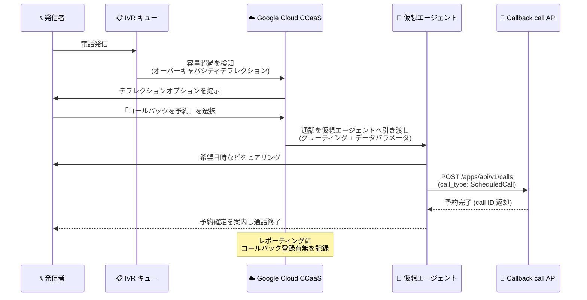

# Google Cloud CCaaS: プレリリースノート 6.26 (IVR オーバーキャパシティ向けスケジュールコールバック、Salesforce PKCE 対応)

**リリース日**: 2026-10-23

**サービス**: Google Cloud Contact Center as a Service (CCaaS)

**機能**: プレリリースノート 6.26 — IVR オーバーキャパシティ向けスケジュールコールバック、Salesforce PKCE / リフレッシュトークンローテーション対応

**ステータス**: Prerelease (次期バージョン 6.26 で提供予定の機能)

📊 [このアップデートのインフォグラフィックを見る](https://takech9203.github.io/google-cloud-news-summary/20261023-ccaas-prerelease-6-26.html)

## 概要

Google Cloud CCaaS (Contact Center as a Service) の次期バージョン 6.26 のプレリリースノートが公開されました。プレリリースノートは、次のバージョンがリリースされた際に提供が期待される新機能を事前に示すものです。

6.26 の目玉は 2 つの新機能です。1 つ目は **IVR キューのオーバーキャパシティ (容量超過) 時のデフレクションオプションとしてのスケジュールコールバック**です。キューが容量超過になった際、発信者はコールバックの予約を選択でき、CCaaS が通話を設定済みの仮想エージェントに引き渡し、仮想エージェントが Callback call API を通じてコールバックを予約します。2 つ目は **Salesforce の PKCE (Proof Key for Code Exchange) およびリフレッシュトークンローテーションへの対応**で、Salesforce が新規作成の接続アプリケーション (connected apps) と外部クライアントアプリで自動的に有効化するこれらのセキュリティ設定を要求するアプリにも、CCaaS を接続できるようになります。

このほか、ブランド発信者 ID ラベルの表示崩れや着信接続遅延をはじめとする多数の不具合修正が含まれています。なお、2 つの新機能はいずれも**デフォルトで無効**であり、インスタンスで有効化するには Google Cloud サポートへの連絡が必要です。

**アップデート前の課題**

- IVR キューのオーバーキャパシティデフレクションのコールバックオプションは、キュー内の順番を保持して先頭に達した時点でコールバックする方式であり、発信者が希望日時を指定してコールバックを予約する「スケジュールコールバック」は IVR のオーバーキャパシティオプションとして利用できなかった
- PKCE とリフレッシュトークンローテーションを必須とする Salesforce アプリには CCaaS を接続できなかった (Salesforce は新規作成の接続アプリと外部クライアントアプリで両設定を自動的に有効化するため、新規アプリとの連携に支障があった)
- エージェントアプリの言語がカナダフランス語の場合に Outbound Number セレクタでブランド発信者 ID ラベルが途中で切れる、エージェントへの割り当て後に着信接続が大幅に遅延するなどの不具合があった

**アップデート後の改善**

- キュー容量超過時に、発信者がコールバックの予約 (スケジュールコールバック) を選択できるようになった。CCaaS が通話を仮想エージェントに引き渡し、仮想エージェントが Callback call API 経由でコールバックを予約する
- 管理者はグローバルまたはキュー単位で、使用する仮想エージェント、任意のグリーティング、引き渡すデータパラメータを選択できる。レポーティングでは各発信者がコールバックを登録したか、登録せずに離脱したかを確認できる
- PKCE とリフレッシュトークンローテーションを要求する Salesforce アプリに CCaaS を接続可能になった。CCaaS は管理者・エージェント接続の認可時に PKCE を使用し、Salesforce が返す新しいリフレッシュトークンを保存することで、以降のトークン更新後も接続を維持する。CCaaS 側に新たな設定手順は不要で、これらの設定を使用しない既存の Salesforce アプリは従来通り動作する

## アーキテクチャ図



キュー容量超過時に発信者がコールバック予約を選択すると、CCaaS が通話を仮想エージェントに引き渡し、仮想エージェントが Callback call API を通じてスケジュールコールバックを予約するフローです。

## サービスアップデートの詳細

### 主要機能

1. **IVR オーバーキャパシティ向けスケジュールコールバック**
   - キューが容量超過になった際のデフレクションオプションとして、スケジュールコールバックが利用可能に
   - 発信者がコールバック予約を選択すると、CCaaS が通話を設定済みの仮想エージェントに引き渡し、仮想エージェントが Callback call API でコールバックを予約
   - 管理者は仮想エージェント、任意のグリーティング、引き渡すデータパラメータを、グローバルまたはキュー単位で設定可能
   - レポーティングで各発信者のコールバック登録有無 (登録した / 登録せず離脱した) を確認可能
   - 設定場所: グローバルは **Settings > Call > Overcapacity Deflection**、キュー単位は **Settings > Queue > IVR (Interactive Voice Response) > Edit / View > [QUEUE] > Overcapacity Deflection > Configure**

2. **Salesforce: PKCE とリフレッシュトークンローテーション対応**
   - PKCE (Proof Key for Code Exchange) とリフレッシュトークンローテーションを要求する Salesforce アプリへの接続が可能に
   - Salesforce は新規作成の接続アプリ (connected apps) と外部クライアントアプリで両設定を自動的に有効化するため、新規アプリとの連携に対応
   - CCaaS は Salesforce の管理者接続・エージェント接続の認可時に PKCE を使用
   - Salesforce が返す新しいリフレッシュトークンを保存し、以降のトークン更新後も接続を維持
   - これらの設定を使用しない Salesforce アプリは従来通り動作し、CCaaS 側に新たな設定手順は不要

3. **主な不具合修正** (一部抜粋)
   - エージェントアプリの言語がカナダフランス語の場合に、Outbound Number セレクタでブランド発信者 ID ラベルが途中で切れる問題を修正
   - エージェントへの割り当て後に着信の接続が大幅に遅延する問題を修正
   - ウィスパーアナウンスが複数回再生され、エージェントデスクトップの通話パネルの読み込みが遅い問題を修正
   - ノルウェー・デンマーク・スウェーデンの固定電話番号へのコールバックが誤って +1 プレフィックスでダイヤルされ失敗する問題を修正
   - キューが Auto-Answer 設定でも仮想エージェントのコールバック通話が手動応答を要求する問題を修正
   - このほか、Agent Assist 使用時の通話接続安定性、Salesforce ケース作成遅延、レポーティング精度などに関する多数の修正を含む (詳細はリリースノート参照)

## 技術仕様

### Callback call API の概要

スケジュールコールバックの予約・キャンセルをプログラムから実行できる API です。認証は Basic 認証を使用します。

| 操作 | エンドポイント |
|------|----------------|
| コールバックの予約 | `POST https://<subdomain>.<domain>/apps/api/v1/calls` |
| 予約のキャンセル | `PATCH https://<subdomain>.<domain>/apps/api/v1/calls/scheduled/{id}/cancel` |
| 複数予約の一括キャンセル | `PATCH https://<subdomain>.<domain>/apps/api/v1/calls/scheduled/cancel` |

**予約リクエストの例:**

```json
{
  "call_type": "ScheduledCall",
  "menu_id": 12345,
  "end_user_number": "+18005550100",
  "scheduled_at": "2025-09-02T14:30:00Z"
}
```

成功すると、call ID を含む call オブジェクトが返されます。

### オーバーキャパシティデフレクションのオプション

オーバーキャパシティデフレクションは、セッション開始時に推定待ち時間が設定したしきい値を超えた場合にトリガーされます。キュー単位の設定では以下のオプションから選択できます。

| オプション | 動作 |
|-----------|------|
| Message | 設定したメッセージを再生して通話を終了 |
| Queue | 別のキューメニューに転送 |
| Phone Number / SIP | 指定した電話番号または SIP URI に転送 |
| Voicemail | ボイスメールの録音に誘導 |
| Callback | キュー内の順番を保持して通話を終了し、順番が来たらコールバック |
| Keep Waiting | そのままキューで待機 |
| Scheduled Callback (6.26 で追加) | 仮想エージェントが Callback call API 経由でコールバックを予約 |

## 設定方法

### 前提条件

1. 本機能 (スケジュールコールバック、Salesforce PKCE 対応) はデフォルトで無効のため、Google Cloud サポートに連絡してインスタンスで有効化する
2. スケジュールコールバックには、コールバック予約を処理する仮想エージェントの設定が必要
3. オーバーキャパシティデフレクションのメッセージは **Settings > Languages & Messages** で設定しておく (オプションの追加・削除時は発信者向け案内メッセージの更新も必要)

### 手順

#### ステップ 1: グローバル設定 (全キュー共通)

1. CCaaS ポータルで **Settings > Call** に移動
2. **Overcapacity Deflection** でスケジュールコールバックを設定
3. 使用する仮想エージェント、任意のグリーティング、引き渡すデータパラメータを選択

#### ステップ 2: キュー単位の設定 (特定キューのみ)

1. CCaaS ポータルで **Settings > Queue** に移動
2. **IVR (Interactive Voice Response)** ペインで **Edit / View** をクリック
3. 対象のキューを選択し、**Overcapacity Deflection > Configure** をクリック
4. スケジュールコールバックのオプションを設定して保存

#### ステップ 3: Salesforce PKCE 対応 (該当環境のみ)

CCaaS 側の追加設定は不要です。サポートによる有効化後、PKCE とリフレッシュトークンローテーションを要求する Salesforce アプリ (新規作成の接続アプリ・外部クライアントアプリ) との接続が可能になります。

## メリット

### ビジネス面

- **放棄呼の削減と顧客体験の向上**: ピーク時にキューが容量超過しても、発信者は離脱せずにコールバックを予約でき、機会損失を減らせる
- **デフレクション効果の可視化**: レポーティングで各発信者のコールバック登録有無を確認でき、オーバーキャパシティ対策の効果測定が可能

### 技術面

- **仮想エージェントによる自動化**: コールバック予約の対話を仮想エージェントが処理し、Callback call API 経由で予約が完結するため、人手を介さない運用が可能
- **柔軟な設定粒度**: グローバル・キュー単位の両方で仮想エージェント、グリーティング、データパラメータを設定可能
- **Salesforce の最新セキュリティ標準に追従**: PKCE とリフレッシュトークンローテーションに対応し、Salesforce が新規アプリで自動有効化するセキュリティ強化設定下でも接続を維持できる

## デメリット・制約事項

### 制限事項

- 本内容はプレリリースノートであり、次期バージョン 6.26 のリリース時に提供が「期待される」機能を示すもの。正式リリース時に内容が変わる可能性がある
- スケジュールコールバックと Salesforce PKCE 対応は、いずれもデフォルトで無効。有効化には Google Cloud サポートへの連絡が必要

### 考慮すべき点

- スケジュールコールバックの利用には、コールバック予約の対話を担う仮想エージェントの設計・設定が必要
- CRM (Salesforce / Zendesk / ServiceNow) 連携環境では、スケジュールコールバックのレコードステータス (クローズ済みレコードの扱いなど) に応じた動作設定を確認しておくとよい (Settings > Operation Management > CRM Record Creation Details)
- オーバーキャパシティのオプション案内メッセージ (Languages & Messages) を更新しないと、発信者が新しい選択肢の存在に気づけない

## ユースケース

### ユースケース 1: ピーク時間帯の放棄呼対策

**シナリオ**: 月曜午前などの問い合わせピーク時にサポートキューの推定待ち時間がしきい値を超過し、長時間待たされた発信者が離脱してしまう。

**実装例**: 対象キューの Overcapacity Deflection でスケジュールコールバックを有効化し、予約対話用の仮想エージェントとグリーティングを設定。発信者は希望に応じてコールバックを予約し、仮想エージェントが Callback call API で予約を登録する。

**効果**: 発信者は待ち続ける必要がなくなり、放棄呼を削減。レポーティングでコールバック登録率を測定し、デフレクション設定を継続的に改善できる。

### ユースケース 2: Salesforce の新規接続アプリとの安全な連携

**シナリオ**: Salesforce 側で新規に作成した接続アプリ・外部クライアントアプリは PKCE とリフレッシュトークンローテーションが自動的に有効化されるため、これまで CCaaS との接続に支障があった。

**効果**: CCaaS が PKCE による認可とリフレッシュトークンの自動保存に対応したことで、追加設定なしで Salesforce の最新セキュリティ要件を満たすアプリと連携でき、トークン更新後も管理者・エージェント接続が維持される。

## 関連サービス・機能

- **Conversational Agents (仮想エージェント)**: スケジュールコールバックの予約対話を担当し、Callback call API を呼び出す
- **Callback call API**: コールバックの予約・キャンセルをプログラムから実行する CCaaS の API
- **Salesforce / Zendesk / ServiceNow 連携**: Callback call API は各 CRM 連携と組み合わせて利用可能。レコードステータスに応じたコールバック動作を設定できる
- **Agent Assist**: 本リリースで Agent Assist 使用時の通話接続安定性の修正が含まれる

## 参考リンク

- 📊 [インフォグラフィック](https://takech9203.github.io/google-cloud-news-summary/20261023-ccaas-prerelease-6-26.html)
- [公式リリースノート](https://docs.cloud.google.com/release-notes#October_23_2026)
- [CCaaS リリースノート (CCAI Platform)](https://docs.cloud.google.com/contact-center/ccai-platform/docs/release-notes)
- [Overcapacity deflection per-queue](https://docs.cloud.google.com/contact-center/ccai-platform/docs/overcapacity-deflection-per-queue)
- [Callback call API](https://docs.cloud.google.com/contact-center/ccai-platform/docs/callback-call-api)
- [Call settings (オーバーキャパシティデフレクション)](https://docs.cloud.google.com/contact-center/ccai-platform/docs/call-settings)
- [Salesforce integration guide](https://docs.cloud.google.com/contact-center/ccai-platform/docs/salesforce-integration-guide)

## まとめ

CCaaS 6.26 のプレリリースノートでは、IVR キューの容量超過時に仮想エージェントと Callback call API を組み合わせたスケジュールコールバックが追加され、ピーク時の放棄呼対策の選択肢が広がります。また、Salesforce の PKCE・リフレッシュトークンローテーション対応により、新規作成の Salesforce アプリとの連携も安全に継続できます。両機能ともデフォルトで無効のため、利用を検討する場合は正式リリース後に Google Cloud サポートへの有効化依頼と、仮想エージェント・デフレクションメッセージの準備を進めることを推奨します。

---

**タグ**: #GoogleCloud #CCaaS #ContactCenter #CCAIPlatform #IVR #Callback #VirtualAgent #Salesforce #PKCE #OAuth
