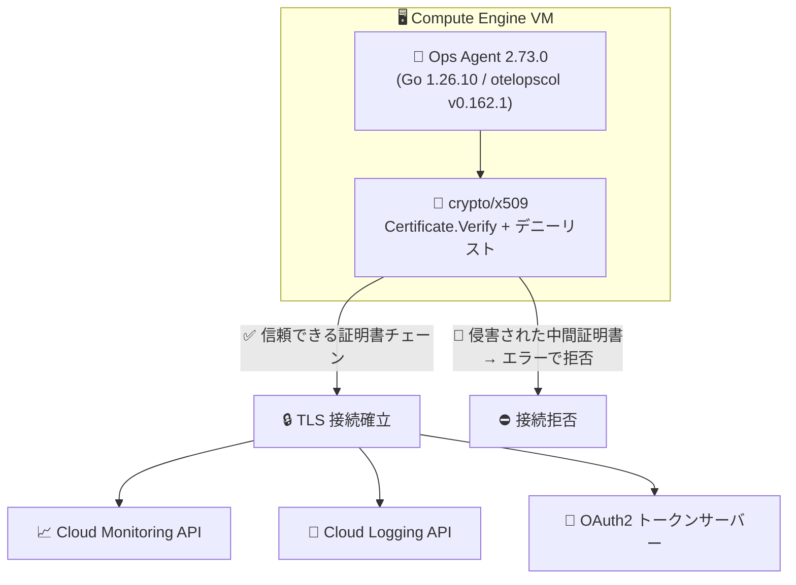

# Cloud Monitoring (Ops Agent): Ops Agent 2.73.0 セキュリティ修正 (CVE-2026-111943)

**リリース日**: 2026-10-23

**サービス**: Cloud Monitoring (Ops Agent)

**機能**: Ops Agent 2.73.0 - Go 脆弱性 (CVE-2026-111943) のパッチ適用

**ステータス**: Fixed / Security

📊 [このアップデートのインフォグラフィックを見る](https://takech9203.github.io/google-cloud-news-summary/20261023-cloud-monitoring-ops-agent-2-73-0-security-fix.html)

## 概要

Compute Engine VM のログ・メトリクス収集エージェントである Ops Agent のバージョン 2.73.0 がリリースされ、システムルート証明書に関連する Go の脆弱性 **CVE-2026-111943** のパッチが適用されました。あわせて Debian 向けセキュリティアドバイザリ **DLA-4845-1** のパッチも含まれています。

CVE-2026-111943 は Go 標準ライブラリの `crypto/x509` パッケージに関する脆弱性です。Go は多くのプラットフォームでシステムのルート証明書を使用しますが、一部の環境ではシステムのトラストストアが追加の対応なしには更新されないケースがあります。この残存リスクに対処するため、信頼できなくなったことが判明している中間証明書のデニーリスト (denylist) が `crypto/x509` に追加され、該当する中間証明書を使って `Certificate.Verify` を呼び出すとエラーが返されるようになりました。脆弱性の分類は CWE-299 (証明書失効の不適切なチェック) です。

Ops Agent は Google Cloud API (Monitoring API、Logging API、OAuth2 トークンサーバー) との通信を TLS で行うため、証明書検証の堅牢性はエージェントの通信セキュリティに直結します。Ops Agent を利用しているすべての Compute Engine ユーザーは、2.73.0 へのアップグレードを検討することが推奨されます。

**アップデート前の課題**

- Ops Agent 2.72.x 以前は、CVE-2026-111943 の影響を受ける Go バージョン (1.26.10 未満) でビルドされており、侵害が判明した中間証明書が検証時に拒否されない可能性があった
- 一部の環境ではシステムのトラストストアが自動更新されず、信頼できなくなった中間証明書への対処が OS 側の対応に依存していた

**アップデート後の改善**

- Ops Agent 2.73.0 ではリポジトリの Go バージョンが 1.26.10 に更新され、CVE-2026-111943 のパッチが適用された
- テレメトリ収集コンポーネント otelopscol も Go 1.26.10 でビルドされた v0.162.1 に更新された
- `crypto/x509` のデニーリストにより、信頼できないことが判明している中間証明書を使用した証明書チェーンは `Certificate.Verify` でエラーとなり、OS のトラストストア更新を待たずにエージェントレベルで防御される

## アーキテクチャ図



Ops Agent 2.73.0 は Go 1.26.10 の `crypto/x509` デニーリストにより、信頼できなくなった中間証明書を使う TLS 接続を証明書検証の段階で拒否し、Google Cloud API との通信の安全性を高めます。

## サービスアップデートの詳細

### 主要機能

1. **CVE-2026-111943 のパッチ適用 (Go 1.26.10 への更新)**
   - リポジトリの Go バージョンを 1.26.10 に更新し、システムルート証明書に関連する脆弱性に対処
   - `crypto/x509` に、信頼できないことが判明している中間証明書のデニーリストが追加され、該当証明書での `Verify` 呼び出しはエラーを返す
   - DLA-4845-1 (Debian LTS セキュリティアドバイザリ) のパッチも適用

2. **otelopscol v0.162.1 への更新**
   - Ops Agent のテレメトリ収集コンポーネント (OpenTelemetry ベースのコレクタ) を Go 1.26.10 でビルドされた v0.162.1 に更新

3. **Self Log シグナルの OTel Logging への移行 (機能追加)**
   - エージェント自身の主要なセルフログシグナルを OTel Logging へ移行 (confgenerator の変更)

このほか、依存パッケージ `github.com/klauspost/compress` の 1.18.2 から 1.18.7 への更新、Windows エージェントの GCS からのインストールのリトライ安全化、Windows Server 2012 関連コードの削除などの内部変更が含まれます。

## 技術仕様

### CVE-2026-111943 の概要

| 項目 | 詳細 |
|------|------|
| CVE ID | CVE-2026-111943 |
| タイトル | Distrust compromised intermediate certificates in crypto/x509 |
| 影響コンポーネント | Go 標準ライブラリ `crypto/x509` (`Certificate.Verify`) |
| 影響バージョン | Go 1.26.10 未満、および Go 1.27.0 以上 1.27.3 未満 |
| 脆弱性タイプ | CWE-299: Improper Check for Certificate Revocation (証明書失効の不適切なチェック) |
| 修正内容 | 信頼できなくなった既知の中間証明書のデニーリストを追加し、`Verify` 呼び出し時にエラーを返す |
| Go 脆弱性 DB | GO-2026-6809 |
| 公開日 | 2026-10-21 |

### Ops Agent 2.73.0 の主な構成要素

| 項目 | 詳細 |
|------|------|
| Ops Agent バージョン | 2.73.0 (2026-10-23 リリース) |
| Go バージョン | 1.26.10 (CVE-2026-111943 パッチ済み) |
| otelopscol | v0.162.1 (Go 1.26.10 ビルド) |
| 適用パッチ | CVE-2026-111943、DLA-4845-1 |

## 設定方法

### 前提条件

1. Compute Engine VM に Ops Agent がインストールされていること
2. VM から `packages.cloud.google.com` および `dl.google.com` へのアクセスが可能であること (インストール / アップグレード時)

### 手順

#### ステップ 1: 現在のバージョンを確認

```bash
# Linux (Debian/Ubuntu の例)
sudo dpkg-query --show --showformat '${Version}\n' google-cloud-ops-agent

# Linux (RHEL/CentOS などの例)
sudo rpm --query --queryformat '%{VERSION}\n' google-cloud-ops-agent
```

インストール済みの Ops Agent のバージョンを確認します。2.73.0 未満の場合はアップグレードを検討します。

#### ステップ 2: 最新バージョンにアップグレード

```bash
# インストールスクリプトを取得して最新バージョンをインストール (Linux)
curl -sSO https://dl.google.com/cloudagents/add-google-cloud-ops-agent-repo.sh
sudo bash add-google-cloud-ops-agent-repo.sh --also-install
```

詳細な手順 (Windows を含む) や、エージェントポリシーによるフリート単位での管理は、公式ドキュメントの [Ops Agent のインストール](https://docs.cloud.google.com/logging/docs/agent/ops-agent/install-index) を参照してください。

#### ステップ 3: エージェントの稼働を確認

```bash
# Linux
sudo systemctl status google-cloud-ops-agent"*"
```

アップグレード後にエージェントが正常に稼働していることを確認します。

## メリット

### ビジネス面

- **セキュリティコンプライアンスの維持**: 公開済み CVE への迅速なパッチ適用により、脆弱性管理ポリシーや監査要件への対応が容易になる
- **監視基盤の信頼性確保**: ログ・メトリクス収集経路の TLS 通信の安全性が強化され、observability パイプラインの改ざんリスクを低減できる

### 技術面

- **OS 非依存の防御**: システムのトラストストア更新に依存せず、Go ランタイムレベルのデニーリストで侵害済み中間証明書を拒否できる
- **コンポーネント全体の更新**: エージェント本体に加えて otelopscol も Go 1.26.10 ビルドに更新されており、収集パイプライン全体でパッチが適用される

## デメリット・制約事項

### 考慮すべき点

- デニーリストに登録された中間証明書を (意図的に) 利用している環境では、`crypto/x509` の `Verify` がエラーを返すため、該当する証明書チェーンの見直しが必要
- エージェントの自動更新を構成していない場合、各 VM で手動またはエージェントポリシー経由でのアップグレードが必要
- アップグレード時にはエージェントの再起動が発生するため、ごく短時間のテレメトリ収集の中断が起こりうる

## ユースケース

### ユースケース 1: フリート全体の脆弱性対応

**シナリオ**: 多数の Compute Engine VM で Ops Agent を運用しており、社内の脆弱性管理ポリシーに基づき CVE-2026-111943 への対応が求められている。

**効果**: 各 VM の Ops Agent を 2.73.0 にアップグレードすることで、OS のトラストストア更新を待たずに、エージェントの TLS 通信における侵害済み中間証明書のリスクへ対処できる。

### ユースケース 2: 監視パイプラインのセキュリティ強化

**シナリオ**: 規制対象ワークロードを運用しており、監視・ログ収集経路を含めた通信のセキュリティ強化を進めている。

**効果**: エージェントから Cloud Monitoring / Cloud Logging / OAuth2 エンドポイントへの TLS 接続において、信頼できなくなった中間証明書を使う接続が証明書検証段階で拒否され、収集経路の安全性が向上する。

## 料金

Ops Agent 自体の利用に追加料金はありませんが、エージェントが Google Cloud プロジェクトに送信するメトリクス、ログ、トレースに対して課金が発生する場合があります。今回のセキュリティ修正による料金体系の変更はありません。

詳細は [Google Cloud Observability の料金ページ](https://cloud.google.com/products/observability/pricing) を参照してください。

## 関連サービス・機能

- **Cloud Monitoring**: Ops Agent が収集したシステムメトリクス・アプリケーションメトリクスの送信先
- **Cloud Logging**: Ops Agent が収集したシステムログ・アプリケーションログの送信先
- **Compute Engine**: Ops Agent の実行環境。VM 上のログ・メトリクス収集に Ops Agent を使用する
- **VM Manager / エージェントポリシー**: フリート単位での Ops Agent のインストール・自動更新の管理に利用可能

## 参考リンク

- 📊 [インフォグラフィック](https://takech9203.github.io/google-cloud-news-summary/20261023-cloud-monitoring-ops-agent-2-73-0-security-fix.html)
- [公式リリースノート (2026-10-23)](https://docs.cloud.google.com/release-notes#October_23_2026)
- [Ops Agent 2.73.0 リリースノート (GitHub)](https://github.com/GoogleCloudPlatform/ops-agent/releases/tag/2.73.0)
- [CVE-2026-111943 (CVE Program)](https://www.cve.org/CVERecord?id=CVE-2026-111943)
- [GO-2026-6809 (Go Vulnerability Database)](https://pkg.go.dev/vuln/GO-2026-6809)
- [Ops Agent ドキュメント](https://docs.cloud.google.com/logging/docs/agent/ops-agent)
- [Ops Agent のインストール](https://docs.cloud.google.com/logging/docs/agent/ops-agent/install-index)
- [料金ページ (Google Cloud Observability)](https://cloud.google.com/products/observability/pricing)

## まとめ

Ops Agent 2.73.0 は、Go 標準ライブラリ `crypto/x509` の脆弱性 CVE-2026-111943 (侵害された中間証明書の不適切な信頼) に対するパッチを含むセキュリティリリースです。Ops Agent を利用しているすべての環境で、現在のバージョンを確認し、2.73.0 へのアップグレードを計画することを推奨します。多数の VM を運用している場合は、エージェントポリシーによる自動更新の活用も検討してください。

---

**タグ**: Cloud Monitoring, Cloud Logging, Ops Agent, セキュリティ, CVE-2026-111943, Go, crypto/x509, Compute Engine
