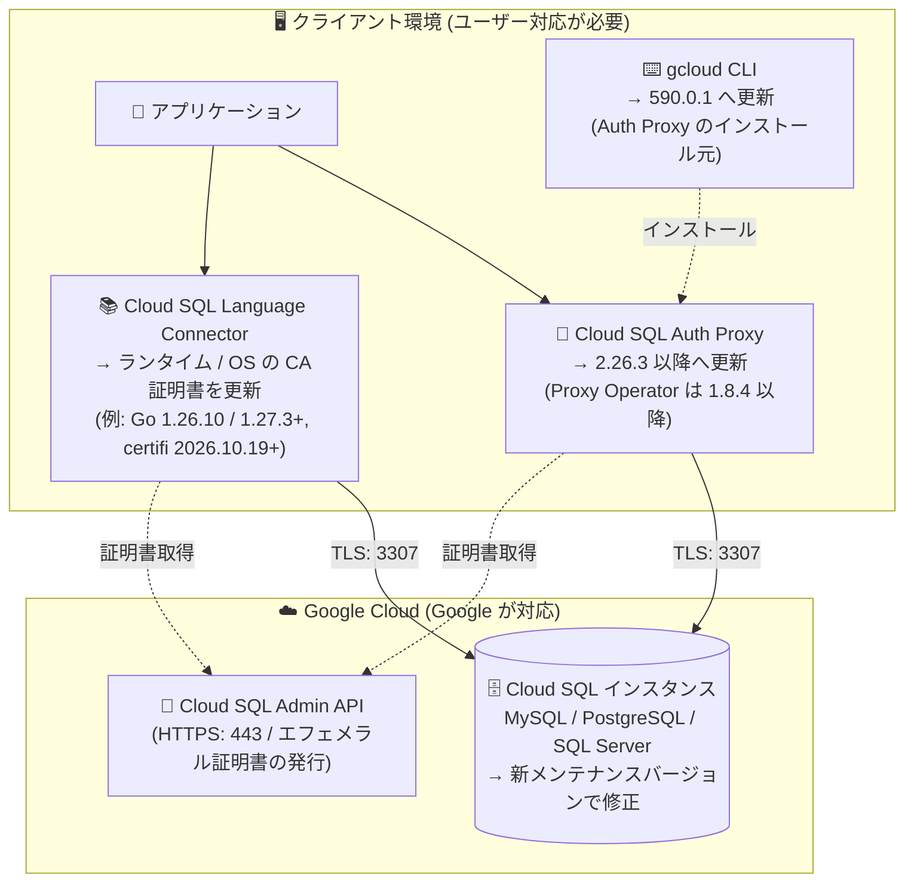

# Cloud SQL (MySQL / PostgreSQL / SQL Server): セキュリティ情報 GCP-2026-071 への対応 (eMudhra CA 証明書の侵害)

**リリース日**: 2026-10-23

**サービス**: Cloud SQL for MySQL / Cloud SQL for PostgreSQL / Cloud SQL for SQL Server

**機能**: セキュリティ情報 GCP-2026-071 に対応したマネージドコンポーネントの更新

**ステータス**: Security (セキュリティ修正)

📊 [このアップデートのインフォグラフィックを見る](https://takech9203.github.io/google-cloud-news-summary/20261023-cloud-sql-security-gcp-2026-071.html)

## 概要

セキュリティ情報 [GCP-2026-071](https://cloud.google.com/support/bulletins#gcp-2026-071) への対応として、Google は Cloud SQL のマネージドコンポーネントを更新しています。この対応は Cloud SQL for MySQL、Cloud SQL for PostgreSQL、Cloud SQL for SQL Server の 3 エディションすべてに共通して適用されます。Cloud SQL が管理するインスタンスについては、ユーザーによる証明書ストアの手動更新は不要です。

GCP-2026-071 (公開日: 2026-10-23、CVE-2026-111943、重大度: Medium) は、eMudhra (emSign) の下位認証局 (CA) 証明書 8 件 (AAA Certificate Services によるクロス署名を含む) の秘密鍵が、不十分な暗号学的乱数 (弱いエントロピー) で生成されていたために再構成可能であることが報告された問題です。この弱点により、ネットワークアクセスを持つリモート攻撃者が秘密鍵を復元して信頼された TLS 証明書を偽造し、これらの CA への信頼を削除していない TLS クライアント・コンテナ・SDK に対して中間者 (MitM) 攻撃を行うことが可能になります。Google Cloud のインフラストラクチャ自体は侵害されておらず、Google Cloud ワークロードに対する悪用の痕跡も確認されていませんが、該当 CA 証明書は失効処理が進められています。

インスタンス側の修正は新しいメンテナンスバージョンとして提供され、スケジュールされたメンテナンス時に適用されます。セルフサービスメンテナンスによる早期適用も可能になる予定で、利用可能になり次第アナウンスが公開されます。一方、クライアント側 (Cloud SQL Auth Proxy、Cloud SQL Language Connector、gcloud CLI) はユーザー自身による更新が必要です。

**アップデート前の課題**

- 侵害された eMudhra (emSign) 下位 CA を信頼したままの TLS クライアントは、外部 TLS 接続において MitM 傍受やトラフィック偽装のリスクに晒されていた
- Cloud SQL Auth Proxy や Cloud SQL Language Connector の旧バージョンは、侵害された CA への信頼を削除する修正を含んでいなかった

**アップデート後の改善**

- Cloud SQL が管理するインスタンスは、Google が新しいメンテナンスバージョンとして修正を配布するため、証明書ストアの手動更新が不要になった
- スケジュールされたメンテナンスを待たずに、セルフサービスメンテナンスで修正を早期適用できるようになる (アナウンスは追って公開)
- 更新版の Cloud SQL Auth Proxy (2.26.3 以降)、Cloud SQL Proxy Operator (1.8.4 以降)、gcloud CLI (590.0.1) により、クライアント側でも侵害された CA への信頼を排除できる

## アーキテクチャ図



Cloud SQL への接続経路のうち、Google が管理するインスタンス側 (右) はメンテナンスバージョンで自動的に修正される一方、クライアント側 (左) の Auth Proxy・Language Connector・gcloud CLI はユーザー自身による更新が必要です。

## サービスアップデートの詳細

### 主要なポイント

1. **マネージドインスタンスは Google が修正を配布**
   - Cloud SQL が管理するインスタンスでは、証明書ストアの手動更新は不要
   - 修正は新しいメンテナンスバージョンとして提供され、スケジュールされたメンテナンス時に適用される
   - セルフサービスメンテナンスによる早期適用も可能になる予定 (利用可能になり次第アナウンスが公開される)

2. **Cloud SQL Auth Proxy 利用者はクライアント更新が必要**
   - Cloud SQL Auth Proxy を 2.26.3 以降にアップグレードする
   - Cloud SQL Proxy Operator を 1.8.4 以降にアップグレードする
   - スタンドアロンのプロキシバイナリを実行している場合は、ホストの CA 証明書も更新する

3. **Cloud SQL Language Connector 利用者はランタイムと CA 証明書の更新が必要**
   - 言語ランタイムと OS の CA 証明書を更新する
   - 例: Go 1.26.10 または 1.27.3 以降、certifi (Python) 2026.10.19 以降

4. **gcloud CLI 経由で Auth Proxy をインストールしている場合**
   - gcloud CLI を 590.0.1 に更新する

### 脆弱性の背景 (GCP-2026-071)

2026 年 10 月 17 日、セキュリティ研究者から eMudhra の下位 CA 証明書 8 件 (AAA Certificate Services によるクロス署名を含む) に関連する秘密鍵の侵害が Google に報告されました。これらの秘密鍵は不十分な暗号学的乱数で生成されており、攻撃者による再構成が可能です。該当 CA 証明書は信頼が取り消され、失効処理が進められています。Cloud SQL のほか、gcloud CLI、GKE、Compute Engine、Cloud Run、AlloyDB など多数の Google Cloud / Firebase プロダクトが影響対象として挙げられています。

## 技術仕様

### 必要なクライアント側バージョン

| コンポーネント | 必要なバージョン | 補足 |
|------|------|------|
| Cloud SQL Auth Proxy | 2.26.3 以降 | スタンドアロンバイナリの場合はホストの CA 証明書更新も必要 |
| Cloud SQL Proxy Operator | 1.8.4 以降 | Kubernetes で Auth Proxy を運用している場合 |
| Go ランタイム | 1.26.10 または 1.27.3 以降 | Language Connector 利用時の例 |
| certifi (Python) | 2026.10.19 以降 | Language Connector 利用時の例 |
| gcloud CLI | 590.0.1 | Auth Proxy のインストールに gcloud を使用している場合 |

### 脆弱性情報

| 項目 | 詳細 |
|------|------|
| セキュリティ情報 | GCP-2026-071 (公開日: 2026-10-23) |
| CVE | CVE-2026-111943 |
| 重大度 | Medium |
| 内容 | eMudhra (emSign) 下位 CA 証明書 8 件の秘密鍵が弱いエントロピーで生成され、再構成可能。TLS 証明書の偽造と MitM 攻撃が可能 |
| インスタンス側の対応 | 新メンテナンスバージョンで修正 (手動の証明書ストア更新は不要) |
| サポート問い合わせ | Google Cloud サポートに Issue #576444463 を参照して連絡可能 |

## 設定方法

### 前提条件

1. 自環境での Cloud SQL への接続方式 (Auth Proxy / Language Connector / 直接接続) を把握していること
2. Auth Proxy や Language Connector のバージョンを確認できること

### 手順

#### ステップ 1: Cloud SQL Auth Proxy のバージョン確認と更新

```bash
# 現在のバージョンを確認
cloud-sql-proxy --version

# gcloud CLI でインストールしている場合は gcloud CLI を 590.0.1 に更新
gcloud components update
```

Auth Proxy を 2.26.3 以降に更新します。Kubernetes で Cloud SQL Proxy Operator を使用している場合は 1.8.4 以降に更新します。スタンドアロンバイナリを実行しているホストでは、OS の CA 証明書 (例: `ca-certificates` パッケージ) も更新します。

#### ステップ 2: Cloud SQL Language Connector 利用環境の更新

```bash
# 例: Python 環境で certifi を更新
pip install --upgrade "certifi>=2026.10.19"

# 例: Go ランタイムを 1.26.10 / 1.27.3 以降に更新してリビルド
go version
```

Language Connector を利用しているアプリケーションでは、言語ランタイムと OS の CA 証明書を更新します。

#### ステップ 3: インスタンス側の修正適用 (任意)

インスタンス側の修正はスケジュールされたメンテナンスで自動適用されます。早期に適用したい場合は、セルフサービスメンテナンスの利用が可能になった時点 (アナウンスが公開される) で、対象インスタンスにメンテナンスバージョンの更新を適用します。セルフサービスメンテナンスでは、プライマリインスタンスに対して実行するとリードレプリカにも自動的に適用されます。

## メリット

### ビジネス面

- **運用負荷の最小化**: マネージドインスタンス側の修正は Google が配布するため、ユーザーは証明書ストアの手動更新作業が不要
- **リスクの早期低減**: セルフサービスメンテナンス (提供開始後) により、次回のスケジュールメンテナンスを待たずに修正を適用できる

### 技術面

- **多層的な修正**: インスタンス側 (メンテナンスバージョン)、接続経路 (Auth Proxy / Connector)、ツールチェーン (gcloud CLI) のそれぞれで侵害された CA への信頼を排除できる
- **影響の封じ込め**: Google Cloud インフラストラクチャ自体は侵害されておらず、Google 管理環境では侵害された CA をブロック・不信頼化する事前対策が実施済み

## デメリット・制約事項

### 考慮すべき点

- クライアント側コンポーネント (Auth Proxy、Proxy Operator、Language Connector のランタイム / CA 証明書、gcloud CLI) の更新はユーザーの責任で実施する必要がある
- セルフサービスメンテナンスによる修正の提供時期は本リリースノート時点では未定で、別途アナウンスを待つ必要がある
- スタンドアロンのプロキシバイナリを使用している場合、プロキシ本体の更新に加えてホスト OS の CA 証明書更新も必要になる
- Compute Engine や GKE 上で自前管理している OS やカスタムコンテナイメージは、Cloud SQL 側の対応とは別に、OS ベンダー経由でトラストストアを更新する必要がある (GCP-2026-071 の全般ガイダンス参照)

## ユースケース

### ユースケース 1: GKE 上で Auth Proxy サイドカーを使うアプリケーション

**シナリオ**: GKE の Pod 内で Cloud SQL Auth Proxy をサイドカーコンテナとして実行し、Cloud SQL for PostgreSQL に接続している。

**実装例**:
```
1. Cloud SQL Proxy Operator を 1.8.4 以降に更新
2. Auth Proxy コンテナイメージを 2.26.3 以降に差し替えてロールアウト
3. アプリケーションコンテナ側の CA 証明書 (ベースイメージ) も独立して更新
```

**効果**: 接続経路全体から侵害された CA への信頼を排除し、MitM リスクを低減できる。

### ユースケース 2: Language Connector を組み込んだ Python / Go アプリケーション

**シナリオ**: Cloud Run 上の Python アプリケーションが Cloud SQL Python Connector (certifi 使用) で Cloud SQL for MySQL に接続している。

**実装例**:
```
1. requirements.txt で certifi>=2026.10.19 を指定して再デプロイ
2. Go 製サービスは Go 1.26.10 / 1.27.3 以降でリビルドして再デプロイ
```

**効果**: コンテナイメージに焼き込まれた古い CA バンドル経由のリスクを排除できる。

## 関連サービス・機能

- **Cloud SQL Auth Proxy**: IAM 認証とエフェメラル SSL 証明書で Cloud SQL への接続を保護するクライアント。今回の更新対象 (2.26.3 以降)
- **Cloud SQL Language Connectors**: Java / Python / Go / Node.js 向けに暗号化と IAM 認可を提供するライブラリ。ランタイムと CA 証明書の更新が必要
- **Cloud SQL セルフサービスメンテナンス**: スケジュールメンテナンスを待たずにメンテナンスバージョンを適用する機能。今回の修正の早期適用経路となる予定
- **gcloud CLI**: Auth Proxy のインストール手段。590.0.1 への更新が必要
- **GKE / Compute Engine / Cloud Run**: GCP-2026-071 の影響を受ける他のプロダクト。自前管理の OS・コンテナイメージはトラストストアの更新が別途必要
- **AlloyDB for PostgreSQL**: 同じく GCP-2026-071 の影響対象として挙げられているマネージドデータベース

## 参考リンク

- 📊 [インフォグラフィック](https://takech9203.github.io/google-cloud-news-summary/20261023-cloud-sql-security-gcp-2026-071.html)
- [公式リリースノート](https://docs.cloud.google.com/release-notes#October_23_2026)
- [セキュリティ情報 GCP-2026-071](https://cloud.google.com/support/bulletins#gcp-2026-071)
- [Cloud SQL セキュリティ情報](https://docs.cloud.google.com/sql/docs/security-bulletins)
- [Cloud SQL Auth Proxy について](https://docs.cloud.google.com/sql/docs/mysql/sql-proxy)
- [Cloud SQL Language Connectors](https://docs.cloud.google.com/sql/docs/mysql/language-connectors)
- [セルフサービスメンテナンス](https://docs.cloud.google.com/sql/docs/mysql/self-service-maintenance)

## まとめ

eMudhra 下位 CA の秘密鍵侵害 (GCP-2026-071 / CVE-2026-111943) に対し、Cloud SQL の 3 エディションすべてでインスタンス側の修正が新メンテナンスバージョンとして配布されます。インスタンス側は Google 任せで問題ありませんが、Cloud SQL Auth Proxy (2.26.3+)、Proxy Operator (1.8.4+)、Language Connector のランタイム / CA 証明書、gcloud CLI (590.0.1) といったクライアント側の更新はユーザーの対応が必須です。自環境の接続方式を棚卸しし、該当するコンポーネントを速やかに更新することを推奨します。

---

**タグ**: #CloudSQL #MySQL #PostgreSQL #SQLServer #セキュリティ #GCP-2026-071 #CVE-2026-111943 #AuthProxy #証明書
