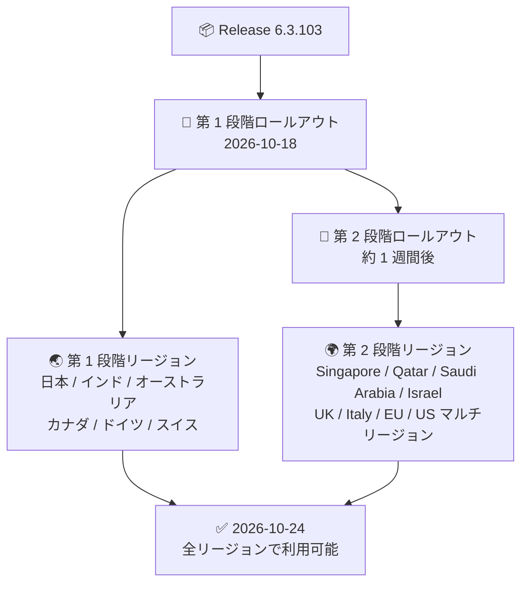

# Google SecOps SOAR: Release 6.3.103 が全リージョンで利用可能に

**リリース日**: 2026-10-24

**サービス**: Google SecOps SOAR

**機能**: Release 6.3.103 の全リージョン展開完了

**ステータス**: Announcement (ロールアウト完了)

📊 [このアップデートのインフォグラフィックを見る](https://takech9203.github.io/google-cloud-news-summary/20261024-google-secops-soar-6-3-103-all-regions.html)

## 概要

2026 年 10 月 24 日、Google SecOps SOAR の Release 6.3.103 が全リージョンで利用可能になりました。本リリースは 2026 年 10 月 18 日に第 1 段階のリージョン (日本、インド、オーストラリア、カナダ、ドイツ、スイス) へのロールアウトが開始されており、今回の発表により第 2 段階のリージョン (US / EU マルチリージョンなど) を含むすべてのリージョンへの展開が完了したことになります。

Release 6.3.103 には、アラートグルーピングに関する新機能と API の非推奨化が含まれています。第 2 段階リージョンを利用しているユーザーも、本日以降これらの変更が適用された環境を利用できます。

**アップデート前の課題**

- Release 6.3.103 の新機能 (クローズ済みケースの再オープン設定など) は、10 月 18 日以降、第 1 段階のリージョンでのみ利用可能だった
- 第 2 段階のリージョン (Singapore、Qatar、Saudi Arabia、Israel、UK、Italy、EU マルチリージョン、US マルチリージョン) のユーザーは利用できなかった

**アップデート後の改善**

- Release 6.3.103 がすべてのリージョンで利用可能になり、リージョン間の機能差が解消された
- 全リージョンのユーザーが Source Grouping Identifier によるグルーピング時のケース再オープン設定を利用できるようになった

## アーキテクチャ図

Google SecOps SOAR のリリースは 2 段階のロールアウトモデルを採用しており、第 1 段階リージョンへの展開から約 1 週間後に第 2 段階リージョンへ展開されます。今回の発表はこのロールアウトの完了を示すものです。

## サービスアップデートの詳細

### Release 6.3.103 に含まれる変更

1. **クローズ済みケースの再オープン設定 (新機能)**
   - Source Grouping Identifier によるアラートグルーピング時に、クローズ済みケースを再オープンするかどうかを指定できるようになった
   - このオプションを有効にすると、過去にクローズされたケースと同じ Source Grouping Identifier を持つ新しいアラートを受信した際に、Google SecOps がそのケースを再オープンする
   - 詳細: [Configure alert grouping](https://docs.cloud.google.com/chronicle/docs/soar/investigate/working-with-alerts/alert-grouping-mechanism-admin)

2. **ListCaseEvents API エンドポイントの非推奨化 (Deprecated)**
   - 2026 年 10 月 12 日付けで `ListCaseEvents` API エンドポイントが非推奨となった
   - 代わりに [`ListCaseEvidenceData`](https://docs.cloud.google.com/chronicle/docs/reference/rest/v1alpha/projects.locations.instances.cases.caseEvidenceDatas/list) API エンドポイントの使用が推奨される

### 段階的ロールアウトモデル

| 項目 | 詳細 |
|------|------|
| ロールアウト方式 | 2 段階 (第 1 段階 → 約 1 週間後に第 2 段階) |
| メンテナンスウィンドウ | 毎週日曜 13:00 - 17:00 (GMT+2) |
| 第 1 段階リージョン | 日本、インド、オーストラリア、カナダ、ドイツ、スイス |
| 第 2 段階リージョン | Singapore、Qatar、Saudi Arabia、Israel、UK (London)、Italy、EU (マルチリージョン)、US (マルチリージョン) |

## 考慮すべき点

- `ListCaseEvents` API を利用している場合は、`ListCaseEvidenceData` API への移行を計画する必要がある
- クローズ済みケースの再オープンはオプション設定であり、有効化するとクローズ済みケースの運用フロー (メトリクス、SLA 管理など) に影響する可能性があるため、アラートグルーピング設定を確認のうえ適用を判断することが推奨される
- 次バージョンの Release 6.3.104 は 2026 年 10 月 25 日に第 1 段階リージョンへのロールアウトが開始されている (別レポート参照)

## 利用可能リージョン

全リージョンで利用可能 (第 1 段階・第 2 段階のすべてのリージョンへの展開が完了)。

## 関連サービス・機能

- **Google SecOps (SIEM)**: SOAR 機能は Google SecOps プラットフォームの一部としても提供され、アラートのケース化・自動対応を担う
- **Chronicle API**: SOAR API から Chronicle API への移行が進行中 (移行期限は 2027 年 3 月 31 日まで延長済み)。今回非推奨となった `ListCaseEvents` の後継である `ListCaseEvidenceData` も Chronicle API の一部

## 参考リンク

- 📊 [インフォグラフィック](https://takech9203.github.io/google-cloud-news-summary/20261024-google-secops-soar-6-3-103-all-regions.html)
- [公式リリースノート (Google Cloud)](https://docs.cloud.google.com/release-notes#October_24_2026)
- [Google SecOps SOAR リリースノート](https://docs.cloud.google.com/chronicle/docs/soar/release-notes#October_18_2026)
- [Release plan for Google SecOps (段階的ロールアウト)](https://docs.cloud.google.com/chronicle/docs/soar/overview-and-introduction/soar-gradual-release)
- [Configure alert grouping](https://docs.cloud.google.com/chronicle/docs/soar/investigate/working-with-alerts/alert-grouping-mechanism-admin)

## まとめ

Google SecOps SOAR Release 6.3.103 の全リージョン展開が完了し、アラートグルーピング時のクローズ済みケース再オープン設定がすべてのユーザーで利用可能になりました。`ListCaseEvents` API を利用中のチームは、`ListCaseEvidenceData` API への移行を早めに進めることを推奨します。

---

**タグ**: #GoogleSecOps #SOAR #セキュリティ #リリース #アラートグルーピング
