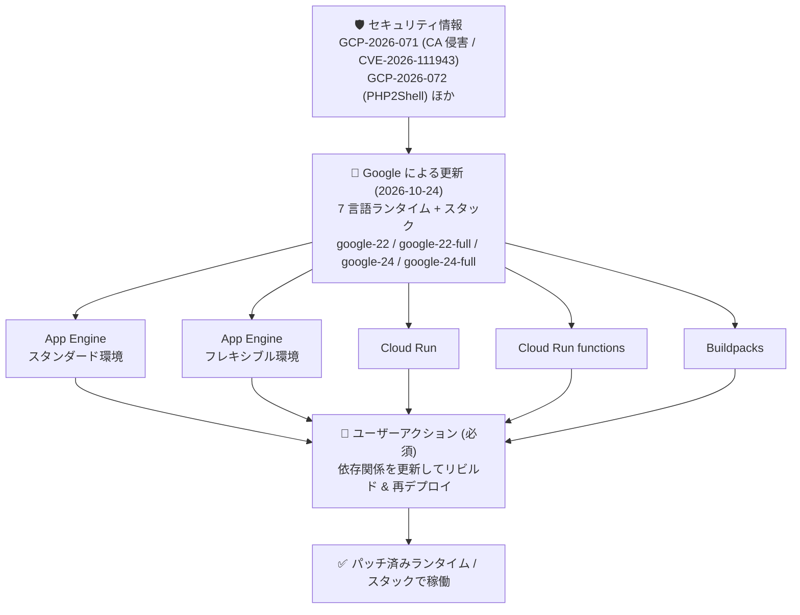

# サーバーレスコンピューティング全サービス: 全言語ランタイム・スタックの一斉セキュリティアップデート

**リリース日**: 2026-10-24

**サービス**: App Engine スタンダード環境 / App Engine フレキシブル環境 / Cloud Run / Cloud Run functions / Google Cloud's buildpacks

**機能**: 7 言語ランタイム (Go / Node.js / Java / PHP / Python / Ruby / .NET) とベースイメージスタック (google-22 / google-24 系) のセキュリティアップデート

**ステータス**: Security (セキュリティ修正)

📊 [このアップデートのインフォグラフィックを見る](https://takech9203.github.io/google-cloud-news-summary/20261024-serverless-runtimes-security-updates.html)

## 概要

2026 年 10 月 24 日、Google Cloud はサーバーレスコンピューティングの全サービス — **App Engine スタンダード環境 (Go / Java / Node.js / PHP / Python / Ruby)、App Engine フレキシブル環境 (.NET / Go / Java / Node.js / PHP / Python / Ruby)、Buildpacks、Cloud Run、Cloud Run functions** — に対して、同一文面のセキュリティ注記を一斉に掲載しました。サポート対象の 7 言語ランタイムすべてに重要なセキュリティアップデートが含まれ、さらにベースイメージのスタック (**google-22、google-22-full、google-24、google-24-full**) とその基盤 OS パッケージも更新されています。

注記が求めるユーザーアクションは一律で明確です: **「更新された依存関係でリソースをリビルドし、再デプロイすることで、直ちに保護措置を講じてください」**。詳細はリリースノート自体には記載されず、[Google Cloud のセキュリティ情報 (Security bulletins)](https://docs.cloud.google.com/support/bulletins) への参照が示されています。

セキュリティ情報ページで確認できる範囲では、今回の一斉更新は直近に公開された 2 件のセキュリティ情報と整合します。第一に、**GCP-2026-071** (2026-10-23 公開、CVE-2026-111943、重大度 Medium) — eMudhra (emSign) 下位 CA 証明書 8 件の秘密鍵侵害 — は影響プロダクトとして **App Engine、Cloud Run、Cloud Run functions** を明記しており、「サーバーレスランタイムなどのマネージドサービスにはフリート全体への更新を展開中で、詳細は各プロダクトのリリースノート等で公開する」と案内しています。同セキュリティ情報が推奨する **Go 1.26.10 / 1.27.3** は、今回の Go パッチバージョンと一致します。第二に、今回の PHP パッチバージョン (**8.2.35 / 8.3.36 / 8.4.27 / 8.5.12**) は、**GCP-2026-072** (2026-10-24 公開、重大度 Critical) および GCP-2026-070 が扱う PHP コア脆弱性「PHP2Shell」(CVE-2026-109618 / CVE-2026-109619) の修正バージョンと完全に一致します。

**アップデート前の課題**

- eMudhra 下位 CA の侵害 (GCP-2026-071) により、古い CA トラストストアを含むコンテナイメージやランタイムで動作するワークロードは、外部 TLS 接続で中間者 (MitM) 攻撃を受けるリスクがあった
- PHP コア脆弱性 PHP2Shell (CVE-2026-109618 / CVE-2026-109619、CVSS 9.2) は、脆弱な PHP バージョンで認証不要のリモートコード実行を許す状態だった
- 過去にビルドしたコンテナイメージには、ビルド時点の古いランタイム・OS パッケージ・CA バンドルが焼き込まれたまま残存する

**アップデート後の改善**

- サーバーレス全サービスで、サポート対象の全言語ランタイム (Go 1.24+ / Node.js 22+ / Java 17+ / PHP 8.2+ / Python 3.10+ / Ruby 3.3+ / .NET 6+) にパッチ済みバージョンが提供された
- ベースイメージのスタック (google-22 / google-22-full / google-24 / google-24-full) と基盤 OS パッケージも更新され、リビルドするだけで最新のセキュリティ修正を取り込める状態になった
- サービス・言語を問わず「リビルド + 再デプロイ」という単一のアクションで保護を完了できる

## アーキテクチャ図



公開中のセキュリティ情報に対応する形で、Google がサーバーレス全サービスのランタイムとスタックを更新し、ユーザーには「リビルドと再デプロイ」という単一の即時アクションが求められていることを示しています。

## サービスアップデートの詳細

### 対象サービスと対象ランタイム

| サービス | 対象ランタイム |
|------|------|
| App Engine スタンダード環境 | Go, Java, Node.js, PHP, Python, Ruby |
| App Engine フレキシブル環境 | .NET, Go, Java, Node.js, PHP, Python, Ruby |
| Cloud Run | 全対象言語 (ソースデプロイ / ベースイメージ利用時) |
| Cloud Run functions | 全対象言語 |
| Buildpacks | 全対象言語 + スタック (google-22 / google-24 系) |

5 サービスすべてに同一文面の Security 注記が掲載されており、内容・パッチバージョン・求められるアクションは共通です。

### 主要なポイント

1. **7 言語ランタイムの一斉パッチ**
   - サポート対象のすべての言語ランタイムに重要なセキュリティアップデートが含まれる
   - パッチバージョンの詳細は後述の「技術仕様」を参照

2. **スタック (ベースイメージの OS レイヤ) も更新**
   - google-22、google-22-full、google-24、google-24-full の 4 スタックと、その基盤 OS パッケージが更新された
   - スタックは Linux ディストリビューションのバージョンと OpenSSL や curl などのシステムパッケージで構成され、Google Cloud's buildpacks のベースイメージ (Ubuntu ベース) として、ソースデプロイや自動ベースイメージ更新の基盤になる

3. **求められるアクションは「リビルド + 再デプロイ」で統一**
   - 「更新された依存関係でリソースをリビルドし、再デプロイすることで、直ちに保護措置を講じる」ことが全サービス共通で指示されている
   - Cloud Run の自動ベースイメージ更新を有効にしている場合でも、Go や Java などのコンパイル言語の言語レベル修正を取り込むにはリビルドが必要になることが、公式ドキュメントで案内されている

4. **関連するセキュリティ情報**
   - GCP-2026-071 (eMudhra CA 侵害) は App Engine / Cloud Run / Cloud Run functions を影響プロダクトに明記し、サーバーレスランタイムへの更新展開をリリースノートで公開すると案内。推奨 Go バージョン (1.26.10 / 1.27.3) が今回のパッチと一致
   - 今回の PHP パッチバージョンは、GCP-2026-072 / GCP-2026-070 (PHP2Shell) の修正バージョン (8.2.35 / 8.3.36 / 8.4.27 / 8.5.12) と一致。PHP 8.1 以前には修正が提供されない

## 技術仕様

### パッチ済みランタイムバージョン一覧

| 言語 | 対象 | パッチ済みバージョン |
|------|------|------|
| Go | 1.24 以降 | 1.24.13, 1.25.14, 1.26.10, 1.27.3 |
| Node.js | 22 以降 | 22.23.4, 24.22.1, 26.12.1 |
| Java | 17 以降 | 17.0.20_101, 21.0.12_101.0.LTS, 25.0.5_8.0.LTS |
| PHP | 8.2 以降 | 8.2.35, 8.3.36, 8.4.27, 8.5.12 |
| Python | 3.10 以降 | 3.10.22, 3.11.17, 3.12.15, 3.13.15, 3.14.6 |
| Ruby | 3.3 以降 | 3.3.12, 3.4.11, 4.0.7 |
| .NET | 6 以降 | 6.0.428, 8.0.415, 10.0.100 |

### 更新されたスタック

| スタック | 説明 |
|------|------|
| google-22 / google-22-full | Ubuntu ベースのビルド / 実行スタック (full は追加のシステムパッケージを含む) |
| google-24 / google-24-full | 同上 (新しい世代のスタック) |

### 関連するセキュリティ情報

| 項目 | GCP-2026-071 | GCP-2026-072 |
|------|------|------|
| 公開日 | 2026-10-23 | 2026-10-24 |
| CVE | CVE-2026-111943 | CVE-2026-109618, CVE-2026-109619 |
| 重大度 | Medium | Critical |
| 内容 | eMudhra (emSign) 下位 CA 証明書 8 件の秘密鍵が弱いエントロピーで生成され再構成可能。TLS 証明書の偽造と MitM 攻撃が可能 | PHP コア脆弱性「PHP2Shell」。脆弱な PHP で認証不要のリモートコード実行が可能。PHP 8.2.35 / 8.3.36 / 8.4.27 / 8.5.12 で修正、8.1 以前には修正なし |
| 今回との関係 | App Engine / Cloud Run / Cloud Run functions を影響プロダクトに明記。推奨 Go バージョンが今回のパッチ (1.26.10 / 1.27.3) と一致 | 修正バージョンが今回の PHP パッチと完全に一致 |

なお、リリースノートの注記自体は特定のセキュリティ情報 ID を明記しておらず、「Security bulletins for Google Cloud を参照」とのみ案内しています。

## 設定方法

### 前提条件

1. 利用中のランタイムがサポート対象バージョン (上表の「対象」列) であることを確認する。End of Support に達したランタイムには言語・OS の自動パッチが提供されないため、まずサポート対象バージョンへアップグレードする
2. アプリケーションの依存関係 (go.mod、package-lock.json、composer.lock、requirements.txt など) を更新しておく

### 手順

#### ステップ 1: App Engine (スタンダード / フレキシブル環境) — 再デプロイ

```bash
# 依存関係を更新したうえでソースから再デプロイ
gcloud app deploy
```

再デプロイにより、パッチ済みのランタイムでアプリケーションが再ビルドされます。フレキシブル環境でカスタムランタイムを利用している場合は、イメージ内の依存関係とベースイメージを更新してから再デプロイします。

#### ステップ 2: Cloud Run — リビルドして再デプロイ

```bash
# ソースからサービスを再デプロイ (パッチ済みランタイム / スタックでビルドされる)
gcloud run deploy SERVICE --source .
```

自動ベースイメージ更新を有効にしているサービスでも、Go や Java などのコンパイル言語は自動ベースイメージ更新では再コンパイルされないため、言語レベルの修正を取り込むにはリビルドと再デプロイが必要です。

#### ステップ 3: Cloud Run functions — 再デプロイ

```bash
# 関数を再デプロイ
gcloud run deploy FUNCTION --source . --function FUNCTION_ENTRYPOINT
```

#### ステップ 4: Buildpacks を直接利用している場合 — イメージの再ビルド

```bash
# pack CLI などで最新のビルダー / スタックを使ってイメージを再ビルド
pack build IMAGE_NAME --builder gcr.io/buildpacks/builder
```

更新された google-22 / google-24 系スタックでイメージを再ビルドし、デプロイ先 (Cloud Run、GKE など) に再デプロイします。

## メリット

### ビジネス面

- **対応判断の単純さ**: サービス・言語を問わず「依存関係を更新してリビルド + 再デプロイ」という単一のアクションで対応が完了するため、複数サービスを運用する組織でも対応方針を一本化できる
- **マネージドランタイムの価値**: ランタイム本体と OS パッケージのパッチ作成・配布は Google が実施済みのため、ユーザーは脆弱性の調査やパッチ適用の作業自体を行う必要がない

### 技術面

- **ランタイムと OS の両レイヤをカバー**: 言語ランタイム (7 言語) とスタックの OS パッケージの両方が更新されており、再ビルドするだけで CA トラストストアを含む基盤レイヤの修正も取り込める
- **全サーバーレスサービスで同一基盤**: App Engine、Cloud Run、Cloud Run functions、Buildpacks が共通のスタック (google-22 / google-24 系) を基盤とするため、修正が一貫して展開される

## デメリット・制約事項

### 制限事項

- サポート対象外 (End of Support) のランタイムバージョンにはパッチが提供されない。該当する場合はサポート対象バージョンへのアップグレードが前提となる
- リビルドと再デプロイはユーザー自身が実施する必要があり、実施するまでワークロードは保護されない可能性がある
- Cloud Run の自動ベースイメージ更新は OS・ランタイムレイヤを自動更新するが、コンパイル言語 (Go / Java など) のアプリケーションは自動では再コンパイルされないため、今回のような言語レベルの修正には再ビルドが必要

### 考慮すべき点

- 注記は「直ちに (immediate)」の対応を求めている。定期リリースを待たず、臨時の再デプロイを計画すべき
- 自前でビルド・管理しているカスタムコンテナイメージ (GKE / Compute Engine 上のワークロードを含む) は今回のサーバーレス側更新の対象外であり、GCP-2026-071 のガイダンスに従って OS ベンダー経由でトラストストアを更新する必要がある
- CI/CD パイプラインでビルドキャッシュを利用している場合、古いランタイム・ベースイメージがキャッシュから再利用されないよう注意する

## ユースケース

### ユースケース 1: 多言語マイクロサービスを Cloud Run で運用するチームの一斉対応

**シナリオ**: Go、Node.js、Python のサービスを `gcloud run deploy --source` で複数運用している。

**実装例**:
```bash
# 各サービスの依存関係を更新してから一括再デプロイ (CI/CD の再実行でも可)
gcloud run deploy api-go --source ./services/api-go
gcloud run deploy web-node --source ./services/web-node
gcloud run deploy batch-py --source ./services/batch-py
```

**効果**: すべてのサービスがパッチ済みランタイムと更新済みスタックで再ビルドされ、CA 侵害 (MitM) リスクを含む既知の脆弱性への暴露を解消できる。

### ユースケース 2: 自動ベースイメージ更新を有効にした Go サービス

**シナリオ**: Cloud Run で `--base-image` と自動更新を有効にした Go サービスを運用しており、「自動更新があるから対応不要」と判断しそうになっている。

**効果**: 自動ベースイメージ更新は OS レイヤを自動更新するが、Go はコンパイル言語のため言語レベルの修正 (Go 1.26.10 / 1.27.3 など) は再ビルドしないと取り込まれない。今回の注記どおりリビルド + 再デプロイを実施することで、言語ランタイムレイヤまで含めて確実に保護される。

### ユースケース 3: App Engine スタンダード環境の PHP アプリケーション

**シナリオ**: PHP 8.3 で App Engine スタンダード環境のアプリケーションを運用しており、10/21〜10/22 の PHP2Shell 対応 (再デプロイ) は実施済み。

**効果**: 今回の注記は PHP (8.3.36) を含む全ランタイムとスタックの更新を対象とするため、改めて依存関係を更新して再デプロイすることで、PHP レイヤに加えて OS パッケージ・CA トラストストアのレイヤまで最新の修正を取り込める。

## 関連サービス・機能

- **Google Cloud's buildpacks**: サーバーレス全サービスのベースイメージ (google-22 / google-24 系スタック) を提供・維持する基盤。今回の更新対象
- **Cloud Run 自動ベースイメージ更新**: OS・ランタイムレイヤのセキュリティパッチを再デプロイなしで自動適用する機能。ただしコンパイル言語の言語レベル修正にはリビルドが必要
- **App Engine ランタイムサポートスケジュール**: GA サポート中のランタイムのみ言語・OS の自動パッチ対象。End of Support 後はセキュリティ更新が提供されない
- **Artifact Analysis / On-Demand Scanning**: コンテナイメージをスキャンし、脆弱なランタイム・パッケージを含むイメージを特定できる
- **Cloud SQL / GKE / Compute Engine**: GCP-2026-071 の影響を受ける他のプロダクト群。それぞれ個別の対応ガイダンスが公開されている (Cloud SQL は 10/23 のリリースノート参照)

## 参考リンク

- 📊 [インフォグラフィック](https://takech9203.github.io/google-cloud-news-summary/20261024-serverless-runtimes-security-updates.html)
- [公式リリースノート (2026-10-24)](https://docs.cloud.google.com/release-notes#October_24_2026)
- [Google Cloud セキュリティ情報 (Security bulletins)](https://docs.cloud.google.com/support/bulletins)
- [セキュリティ情報 GCP-2026-071 (eMudhra CA 侵害)](https://cloud.google.com/support/bulletins#gcp-2026-071)
- [Buildpacks スタックの概要](https://docs.cloud.google.com/docs/buildpacks/stacks)
- [Cloud Run 自動ベースイメージ更新](https://docs.cloud.google.com/run/docs/configuring/services/automatic-base-image-updates)
- [App Engine スタンダード環境 ランタイムサポートスケジュール](https://docs.cloud.google.com/appengine/docs/standard/lifecycle/support-schedule)
- [App Engine フレキシブル環境 ランタイムサポートスケジュール](https://docs.cloud.google.com/appengine/docs/flexible/lifecycle/support-schedule)
- [関連レポート: PHP ランタイムセキュリティパッチ続報 (2026-10-22)](./2026-10-22-php-runtime-security-patches-update.md)
- [関連レポート: Cloud SQL GCP-2026-071 対応 (2026-10-23)](./2026-10-23-cloud-sql-security-gcp-2026-071.md)

## まとめ

Google Cloud のサーバーレスコンピューティング全サービス (App Engine スタンダード / フレキシブル環境、Buildpacks、Cloud Run、Cloud Run functions) で、7 言語すべてのサポート対象ランタイムと google-22 / google-24 系スタックが一斉にセキュリティ更新されました。更新内容は、eMudhra CA 侵害 (GCP-2026-071) で予告されたサーバーレスランタイムへの展開、および PHP2Shell (GCP-2026-072) の修正バージョンと整合しています。Google 側のパッチ提供は完了しているため、残る対応はユーザー側の **「更新された依存関係でのリビルドと再デプロイ」** のみです。サーバーレス上の全ワークロードを棚卸しし、直ちに再デプロイを実施してください。自動ベースイメージ更新を有効にしている場合も、Go / Java などのコンパイル言語はリビルドしない限り言語レベルの修正が反映されない点に注意が必要です。

---

**タグ**: #AppEngine #CloudRun #CloudRunFunctions #Buildpacks #セキュリティ #ランタイム #GCP-2026-071 #CVE-2026-111943 #PHP2Shell #再デプロイ
