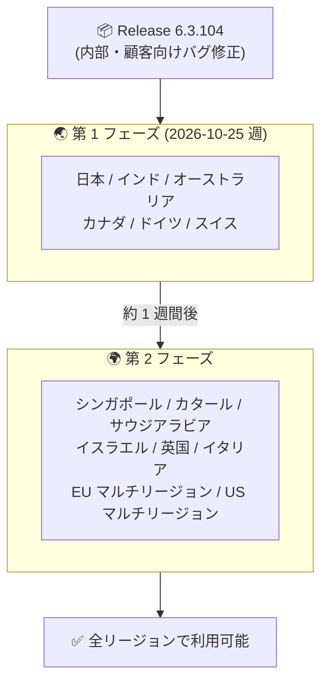

# Google SecOps SOAR: Release 6.3.104 第 1 フェーズリージョンへのロールアウト開始

**リリース日**: 2026-10-25

**サービス**: Google SecOps SOAR

**機能**: Release 6.3.104 (内部および顧客向けバグ修正)

**ステータス**: Announcement (段階的ロールアウト: 第 1 フェーズ)

📊 [このアップデートのインフォグラフィックを見る](https://takech9203.github.io/google-cloud-news-summary/20261025-google-secops-soar-6-3-104-rollout.html)

## 概要

Google SecOps SOAR の Release 6.3.104 が、段階的リリース (gradual release) の第 1 フェーズ対象リージョンへのロールアウトを開始しました。本リリースは内部バグ修正および顧客から報告されたバグ修正を含むメンテナンスリリースであり、新機能の追加は含まれません。

Google SecOps SOAR のリリースは 2 段階のロールアウトモデルに従って展開されます。アップデートは毎週日曜日のメンテナンスウィンドウ (13:00〜17:00 GMT+2) 中に適用され、第 2 段階のリージョンは第 1 段階のリージョンの 1 週間後にアップグレードされます。このモデルは、Google SecOps SOAR をスタンドアロンプラットフォームとして使用する顧客と、Google SecOps 内の SOAR コンポーネントを使用する顧客の両方に適用されます。

なお、前日の 2026-10-24 には前バージョンの Release 6.3.103 が全リージョンで利用可能になったことが発表されており、週次の段階的リリースサイクルが継続的に運用されていることが確認できます。

## アーキテクチャ図

Google SecOps SOAR の 2 段階ロールアウトモデルの流れを示しています。Release 6.3.104 は現在第 1 フェーズのリージョンに展開中で、第 2 フェーズのリージョンには約 1 週間後に展開されます。

## サービスアップデートの詳細

### 主要内容

1. **内部および顧客向けバグ修正**
   - Release 6.3.104 には内部バグ修正と顧客から報告されたバグ修正が含まれる
   - 新機能や仕様変更の発表は含まれない (個別の修正内容は公開されていない)

2. **段階的リリースモデルによる展開**
   - アップデートは毎週日曜日のメンテナンスウィンドウ (13:00〜17:00 GMT+2) 中に適用される
   - 第 1 フェーズのリージョンから展開を開始し、問題がなければ約 1 週間後に第 2 フェーズのリージョンへ展開される

## 技術仕様

### 段階的リリースの対象リージョン

| フェーズ | 対象リージョン |
|------|------|
| 第 1 フェーズ | 日本、インド、オーストラリア、カナダ、ドイツ、スイス |
| 第 2 フェーズ (約 1 週間後) | シンガポール、カタール、サウジアラビア、イスラエル、英国 (ロンドン)、イタリア、EU (マルチリージョン)、US (マルチリージョン) |

自身のリージョンがどちらのフェーズに割り当てられているか不明な場合は、Google SecOps の担当者に問い合わせることが推奨されています。

## 考慮すべき点

- バグ修正の個別の内容は公開されていないため、特定の既知の問題が修正されたかどうかはサポート経由で確認する必要がある
- 第 2 フェーズのリージョンを利用している場合、本リリースの適用は約 1 週間後になる
- アップデートは日曜日のメンテナンスウィンドウ (13:00〜17:00 GMT+2) 中に適用されるため、該当時間帯の運用への影響を考慮する
- 現在のプラットフォームバージョンは SOAR の設定画面 (Settings > License Management) で確認できる

## 関連サービス・機能

- **Google SecOps (旧 Chronicle)**: 本リリースは Google SecOps 内の SOAR コンポーネントにも適用される。スタンドアロンの SOAR プラットフォーム利用者と統合プラットフォーム利用者の両方が対象
- **Google Cloud Status Dashboard**: Google SecOps SOAR のステータスは [status.cloud.google.com/security](https://status.cloud.google.com/security/) で確認できる

## 参考リンク

- 📊 [インフォグラフィック](https://takech9203.github.io/google-cloud-news-summary/20261025-google-secops-soar-6-3-104-rollout.html)
- [公式リリースノート](https://docs.cloud.google.com/release-notes#October_25_2026)
- [Google SecOps SOAR リリースノート](https://docs.cloud.google.com/chronicle/docs/soar/release-notes)
- [段階的リリースプラン (Release plan for Google SecOps)](https://docs.cloud.google.com/chronicle/docs/soar/overview-and-introduction/soar-gradual-release)

## まとめ

Release 6.3.104 はバグ修正を中心としたメンテナンスリリースであり、第 1 フェーズのリージョン (日本を含む) から順次展開されます。SOAR 管理者は特別な対応は不要ですが、日曜日のメンテナンスウィンドウ後に動作を確認し、未解決の既知の問題がある場合は本リリースで修正されたかをサポートに確認するとよいでしょう。

---

**タグ**: Google SecOps, SOAR, セキュリティ, バグ修正, 段階的リリース, メンテナンスリリース
