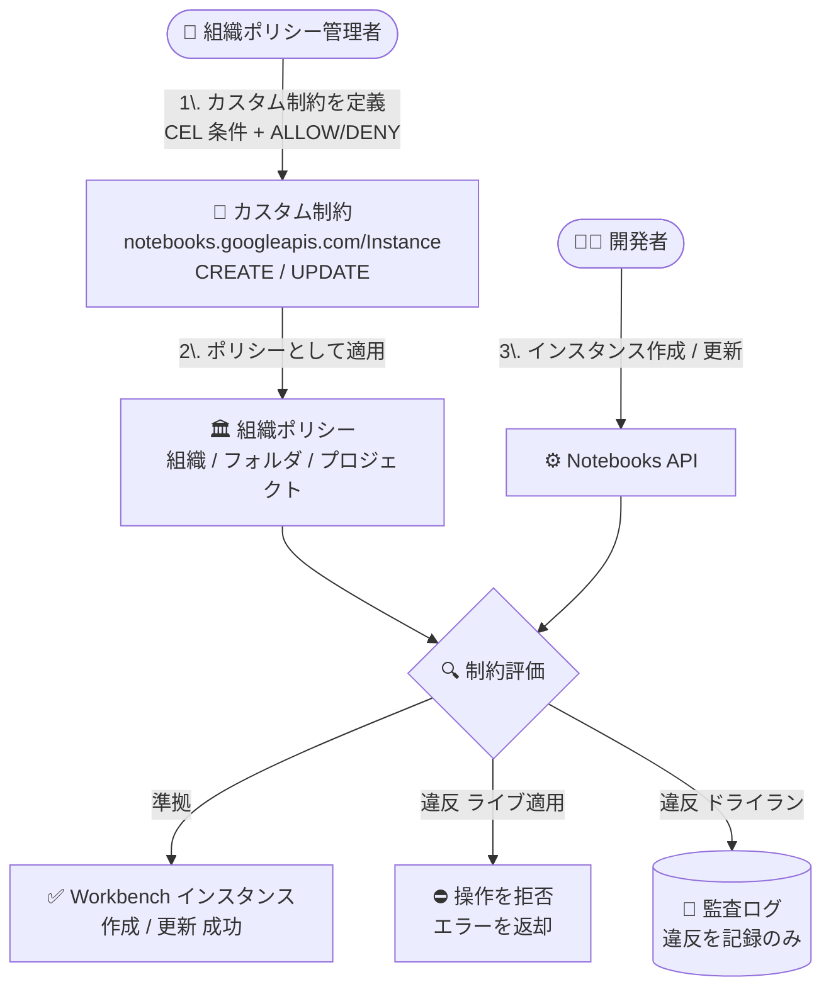

# Agent Platform Workbench: インスタンス向けカスタム組織ポリシーが GA

**リリース日**: 2026-10-26

**サービス**: Agent Platform Workbench (Gemini Enterprise Agent Platform)

**機能**: カスタム組織ポリシーによるインスタンス構成の制御

**ステータス**: GA (一般提供)

📊 [このアップデートのインフォグラフィックを見る](https://takech9203.github.io/google-cloud-news-summary/20261026-agent-platform-workbench-custom-org-policies-ga.html)

## 概要

Gemini Enterprise Agent Platform Workbench インスタンスに対するカスタム組織ポリシー (Custom Organization Policies) のサポートが一般提供 (GA) になりました。組織ポリシー管理者は、`notebooks.googleapis.com/Instance` リソースに対してカスタム制約 (custom constraints) を定義し、インスタンスの構成に基づいて作成・更新操作を許可 (ALLOW) または拒否 (DENY) できます。

カスタム制約はインスタンスの作成時 (CREATE) と更新時 (UPDATE) に適用され、条件は CEL (Common Expression Language) で記述します。例えば「すべての新規インスタンスで Shielded VM 機能を有効化する」「使用可能なマシンタイプを制限する」「外部 IP アドレスを持たないインスタンスのみ許可する」といった組織独自のガバナンス要件を、組織・フォルダ・プロジェクトの各階層で一元的に適用できます。また、ドライラン (dry-run) モードに対応しており、ポリシーを実際に適用する前に、違反を監査ログで観測して影響範囲を検証できます。

本機能は、データサイエンスや Agent 開発のためのマネージド JupyterLab 環境である Agent Platform Workbench を、セキュリティ・コンプライアンス要件に沿って統制したい組織の管理者・セキュリティチームに有用なアップデートです。

**アップデート前の課題**

- 組織ポリシーの組み込み (マネージド) 制約では、Agent Platform Workbench インスタンスの個別の構成フィールド (マシンタイプ、Shielded VM 設定、外部 IP の有無など) に対するきめ細かな制御ができなかった
- インスタンス構成の統制を行うには、作成後の監査や運用ルールの周知といった事後的・手動の手段に頼る必要があった
- 非準拠の構成でインスタンスが作成されること自体を、組織・フォルダ・プロジェクト階層で予防的にブロックする仕組みが不足していた

**アップデート後の改善**

- `notebooks.googleapis.com/Instance` リソースのフィールドを参照する CEL 条件で、組織独自の制約を定義し、作成・更新時に強制できるようになった
- 非準拠のリクエストは API レベルで拒否され、エラーが呼び出し元に返されるため、ガードレールを予防的に適用できるようになった
- ドライランモードにより、実際にブロックする前に違反を監査ログで確認でき、安全にポリシーを導入できるようになった

## アーキテクチャ図



管理者が定義したカスタム制約を組織ポリシーとして適用すると、インスタンスの作成・更新リクエストが制約条件で評価され、非準拠のリクエストは拒否されます。ドライランモードでは拒否せずに違反を監査ログへ記録します。

## サービスアップデートの詳細

### 主要機能

1. **インスタンス構成に基づく作成・更新の制御 (GA)**
   - `notebooks.googleapis.com/Instance` リソースに対するカスタム制約が一般提供
   - CREATE と UPDATE の両メソッドで制約を強制可能
   - 条件が true の場合に許可する `ALLOW`、拒否する `DENY` の 2 種類のアクションタイプ

2. **CEL 条件による柔軟な制約定義**
   - `resource.gceSetup.machineType.startsWith('n1-standard-')` のような CEL 式で条件を記述 (最大 1,000 文字)
   - マシンタイプ、Shielded VM 設定、外部 IP、ディスク暗号化 (CMEK)、ネットワーク、サービスアカウントなど多数のフィールドを参照可能
   - `resource.gceSetup.systemMetadata` では、許可リストに含まれる Workbench システムメタデータキー (例: `idle-timeout-seconds`、`notebook-disable-downloads`) を個別に参照可能

3. **ドライランモードのサポート**
   - `dryRunSpec` を使ってポリシーを適用すると、違反操作をブロックせずに監査ログへ記録
   - ライブポリシー (`spec`) とドライランポリシー (`dryRunSpec`) を同一の YAML で併用可能
   - 本番適用前に影響範囲を検証する段階的なロールアウトが可能

4. **リソース階層でのポリシー継承**
   - 組織・フォルダ・プロジェクトの各レベルでポリシーを適用可能
   - デフォルトでポリシーは下位リソースに継承される (例: フォルダに適用すると配下の全プロジェクトに適用)

### 参照可能な主なフィールド

| カテゴリ | フィールド例 |
|------|------|
| マシン構成 | `resource.gceSetup.machineType`、`resource.gceSetup.minCpuPlatform`、`resource.gceSetup.acceleratorConfigs.type` / `coreCount` |
| セキュリティ | `resource.gceSetup.shieldedInstanceConfig.enableSecureBoot` / `enableVtpm` / `enableIntegrityMonitoring`、`resource.gceSetup.confidentialInstanceConfig.confidentialInstanceType` |
| ネットワーク | `resource.gceSetup.disablePublicIp`、`resource.gceSetup.networkInterfaces.network` / `subnet` / `nicType`、`resource.gceSetup.enableIpForwarding` |
| ディスク・暗号化 | `resource.gceSetup.bootDisk.kmsKey` / `diskEncryption` / `diskSizeGb`、`resource.gceSetup.dataDisks.*` |
| アクセス制御 | `resource.disableProxyAccess`、`resource.enableManagedEuc`、`resource.enableThirdPartyIdentity`、`resource.gceSetup.serviceAccounts.email` |
| メタデータ | `resource.gceSetup.systemMetadata` (許可リスト内のキーのみ。`resource.gceSetup.metadata` は参照不可) |

## 技術仕様

### 制約の仕様

| 項目 | 詳細 |
|------|------|
| 対象リソース | `notebooks.googleapis.com/Instance` |
| 適用メソッド | `CREATE`、`UPDATE` |
| 条件記述言語 | CEL (Common Expression Language)、最大 1,000 文字 |
| アクションタイプ | `ALLOW` / `DENY` |
| 制約数の上限 | ほとんどのリソースタイプで最大 20 個のカスタム制約 |
| 制約 ID | `custom.` プレフィックス + 最大 70 文字 (英数字のみ) |
| ドライラン | 対応 (`dryRunSpec`。違反は監査ログに記録され、操作はブロックされない) |
| 必要なロール | `roles/orgpolicy.policyAdmin` (組織ポリシー管理者) を組織リソースに付与 |

### カスタム制約の YAML 例 (マシンタイプの制限)

```yaml
name: organizations/ORGANIZATION_ID/customConstraints/custom.restrictWorkbenchMachineType
resourceTypes:
- notebooks.googleapis.com/Instance
methodTypes:
- CREATE
- UPDATE
condition: "resource.gceSetup.machineType.startsWith('n1-standard-')"
actionType: ALLOW
displayName: Restrict Workbench instance machine types
description: Workbench instances must use an n1-standard machine type.
```

## 設定方法

### 前提条件

1. 組織 ID を確認しておく
2. `roles/orgpolicy.policyAdmin` (組織ポリシー管理者) ロールが組織リソースに付与されていること
3. ドライランモードを利用する場合は、プロジェクトで課金が有効になっていること

### 手順

#### ステップ 1: カスタム制約を作成して適用

```bash
# 制約 YAML (constraint-restrict-machine-type.yaml) を作成後に適用
gcloud org-policies set-custom-constraint ~/constraint-restrict-machine-type.yaml

# 制約が登録されたことを確認
gcloud org-policies list-custom-constraints --organization=ORGANIZATION_ID
```

カスタム制約を組織に登録し、組織ポリシーで利用可能な状態にします。

#### ステップ 2: 組織ポリシーを作成して適用

```yaml
# policy-restrict-machine-type.yaml
name: projects/PROJECT_ID/policies/custom.restrictWorkbenchMachineType
spec:
  rules:
  - enforce: true
```

```bash
gcloud org-policies set-policy ~/policy-restrict-machine-type.yaml

# ポリシーの確認
gcloud org-policies list --project=PROJECT_ID
```

ポリシー適用後、強制が開始されるまで約 2 分かかります。

#### ステップ 3 (推奨): ドライランモードで事前検証

```yaml
# ライブポリシーは無効のまま、ドライランのみ有効化する例
name: projects/PROJECT_ID/policies/custom.restrictWorkbenchMachineType
spec:
  rules:
  - enforce: false
dryRunSpec:
  rules:
  - enforce: true
```

```bash
gcloud org-policies set-policy POLICY_PATH --update-mask=dryRunSpec
```

ドライランモードでは違反操作はブロックされず、監査ログに違反として記録されます。影響を確認した後にライブポリシーへ昇格します。

#### ステップ 4: 動作確認

```bash
# 非準拠のマシンタイプで作成を試行
gcloud workbench instances create INSTANCE_NAME \
  --project=PROJECT_ID \
  --location=LOCATION \
  --machine-type=e2-standard-4
```

ライブポリシー適用下では、以下のようなエラーで操作が拒否されます。

```
ERROR: (gcloud.workbench.instances.create) Could not fetch resource:
 – Operation denied by custom org policies:
 [customConstraints/custom.restrictWorkbenchMachineType]:
 Workbench instances must use an n1-standard machine type.
```

## メリット

### ビジネス面

- **コンプライアンスの予防的担保**: セキュリティ基準 (Shielded VM 必須、外部 IP 禁止、CMEK 必須など) を満たさないインスタンスの作成を API レベルでブロックでき、事後監査の負担を軽減できる
- **一元的なガバナンス**: 組織・フォルダ・プロジェクト階層でポリシーを継承させ、組織全体の Workbench 利用を一貫したルールで統制できる
- **コスト統制**: マシンタイプやアクセラレータの制限、アイドルシャットダウンの必須化により、意図しない高コスト構成を防止できる

### 技術面

- **きめ細かなフィールドレベル制御**: マネージド制約では対応できない個別フィールド (マシンタイプ、ネットワーク、ディスク暗号化など) を CEL 条件で柔軟に制御できる
- **ドライランによる安全な導入**: 違反をブロックせず監査ログで観測できるため、既存ワークフローへの影響を検証してから段階的に強制を開始できる
- **GA 品質**: 一般提供となり、本番環境のガバナンス基盤として利用できる

## デメリット・制約事項

### 制限事項

- ポリシーは遡及適用されない。既存インスタンスの構成には影響せず、非準拠の構成でも更新されない限り有効なまま
- 条件 (CEL 式) は最大 1,000 文字、カスタム制約はほとんどのリソースタイプで最大 20 個まで
- `resource.gceSetup.systemMetadata` は許可リストに含まれるシステムメタデータキーのみ参照可能で、生の `resource.gceSetup.metadata` フィールドは参照できない
- ドライランモードの利用には、プロジェクトで課金が有効になっている必要がある

### 考慮すべき点

- ポリシー適用後、強制が開始されるまで約 2 分程度かかる
- `ALLOW` アクションは条件に合致するケース以外をすべてブロックするため、条件の書き方によっては意図以上に広くブロックされる可能性がある。ドライランでの事前検証を推奨
- `UPDATE` メソッドに制約を適用した場合、違反状態のリソースへの変更は、違反を解消する変更でない限りブロックされる
- 制約 ID やエラーメッセージ (displayName / description) は呼び出し元に露出するため、PII や機密情報を含めない

## ユースケース

### ユースケース 1: セキュリティ基準の強制 (Shielded VM と外部 IP 禁止)

**シナリオ**: 金融機関などの規制業種で、Workbench インスタンスに Secure Boot の有効化と外部 IP アドレスの無効化を必須としたい。

**実装例**:
```yaml
name: organizations/ORGANIZATION_ID/customConstraints/custom.workbenchRequireSecureBoot
resourceTypes:
- notebooks.googleapis.com/Instance
methodTypes:
- CREATE
- UPDATE
condition: "resource.gceSetup.shieldedInstanceConfig.enableSecureBoot == true"
actionType: ALLOW
displayName: Require Secure Boot on Workbench instances
description: All Workbench instances must have Secure Boot enabled.
```

外部 IP 禁止は `resource.gceSetup.disablePublicIp == true` を条件とする別の制約で実現できます。

**効果**: 非準拠インスタンスの作成・更新が API レベルで拒否され、セキュリティ基準からの逸脱を予防できる。

### ユースケース 2: コスト統制 (マシンタイプ制限とアイドルシャットダウン必須化)

**シナリオ**: データサイエンスチームが多数の Workbench インスタンスを利用しており、高価なマシンタイプの乱用やアイドル状態の放置によるコスト超過を防ぎたい。

**実装例**:
```yaml
condition: "'idle-timeout-seconds' in resource.gceSetup.systemMetadata && int(resource.gceSetup.systemMetadata['idle-timeout-seconds']) > 0"
```

**効果**: 承認されたマシンタイプのみ利用可能にし、アイドルシャットダウンを必須化することで、インスタンスの放置によるコストを抑制できる。

### ユースケース 3: ドライランによる段階的なポリシー導入

**シナリオ**: 既に多数のチームが Workbench を利用している組織で、新しい制約の導入による業務影響を最小化したい。

**効果**: `dryRunSpec` で違反を監査ログに記録しながら影響を把握し、問題がないことを確認してからライブポリシーへ昇格する、安全なロールアウトが可能になる。

## 料金

Organization Policy Service のカスタム制約機能自体についての追加料金の記載は、今回参照したドキュメントには見当たりませんでした。なお、ドライランモードの利用にはプロジェクトで課金が有効になっている必要があります。Agent Platform Workbench インスタンス自体には、基盤となるコンピュートリソース等の料金が発生します。

- [Organization Policy Service の概要](https://docs.cloud.google.com/organization-policy/overview)

## 関連サービス・機能

- **Organization Policy Service**: 本機能の基盤。マネージド制約とカスタム制約により Google Cloud リソースを一元的に統制する
- **Policy Simulator**: 組織ポリシーの変更による影響を適用前にシミュレーションできる (ドライランと併用可能)
- **Cloud Audit Logs**: ドライランモードでの違反はブロックされずに監査ログへ記録されるため、違反の観測に使用する
- **IAM**: カスタム制約の管理には `roles/orgpolicy.policyAdmin` ロールが必要
- **Shielded VM / Confidential Computing / CMEK**: カスタム制約で有効化を必須にできる Workbench インスタンスのセキュリティ機能

## 参考リンク

- 📊 [インフォグラフィック](https://takech9203.github.io/google-cloud-news-summary/20261026-agent-platform-workbench-custom-org-policies-ga.html)
- [公式リリースノート](https://docs.cloud.google.com/release-notes#October_26_2026)
- [Create custom organization policy constraints (Agent Platform Workbench)](https://docs.cloud.google.com/gemini-enterprise-agent-platform/notebooks/workbench/instances/custom-constraints)
- [Introduction to Agent Platform Workbench](https://docs.cloud.google.com/gemini-enterprise-agent-platform/notebooks/workbench/introduction)
- [Test organization policy changes with dry-run mode](https://docs.cloud.google.com/organization-policy/test-policies)
- [Organization Policy Service の概要](https://docs.cloud.google.com/organization-policy/overview)

## まとめ

Agent Platform Workbench インスタンスに対するカスタム組織ポリシーが GA となり、マシンタイプ、Shielded VM、外部 IP、暗号化設定などの構成をフィールドレベルで予防的に統制できるようになりました。既存インスタンスには遡及適用されないため、まずはドライランモードで現状の違反状況を把握し、影響を確認した上でライブポリシーへ段階的に昇格させる導入が推奨されます。

---

**タグ**: #AgentPlatformWorkbench #GeminiEnterprise #OrganizationPolicy #ガバナンス #セキュリティ #GA
