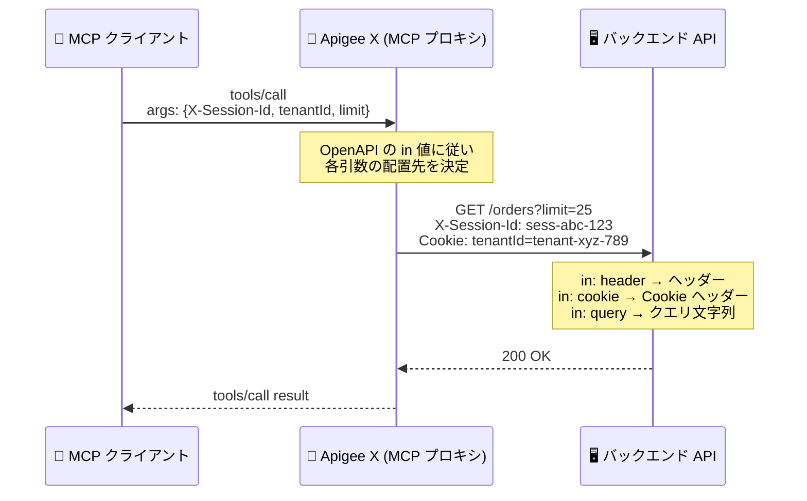

# Apigee X: MCP ツール引数の OpenAPI 宣言ロケーションへのルーティング

**リリース日**: 2026-10-26

**サービス**: Apigee X

**機能**: MCP ツール引数のバックエンドリクエスト配置 (header / cookie 対応)

**ステータス**: Feature

📊 [このアップデートのインフォグラフィックを見る](https://takech9203.github.io/google-cloud-news-summary/20261026-apigee-x-mcp-tool-argument-placement.html)

## 概要

Apigee X の Model Context Protocol (MCP) 機能において、ツール引数が OpenAPI 仕様のパラメータが宣言するロケーション (`in` の値) に従ってバックエンドリクエストに配置されるようになりました。`in: header` と宣言されたパラメータはリクエストヘッダーとして、`in: cookie` と宣言されたパラメータは `Cookie` ヘッダーとして送信されます。従来はどちらもクエリ文字列に付加されていました。本変更は、サポートされるすべてのリージョンの Apigee X に適用されます。

MCP クライアント側の操作は変わりません。すべてのパラメータは `in` の値にかかわらずツールの `inputSchema` に含まれるため、クライアントは従来どおり引数を供給します。変わるのは、Apigee がバックエンドへのリクエストを組み立てる際に値を配置する場所のみです。これにより、セッション ID をヘッダーで受け取る API やクッキーベースの認証を行う API を、OpenAPI 仕様の宣言どおりに MCP ツールとして公開できるようになります。

なお、デプロイ済みの既存 MCP プロキシは、構成が次に再生成されるまで従来のクエリ文字列への配置を継続します。新しいルーティングを適用するには、既存 MCP プロキシの新しいリビジョンをデプロイする必要があります。

**アップデート前の課題**

- `in: header` や `in: cookie` と宣言されたパラメータも、すべてクエリ文字列に付加されてバックエンドに送信されていた
- ヘッダーやクッキーで値を受け取る設計のバックエンドは、MCP ツール経由の呼び出しでは宣言どおりの場所で値を受け取れなかった
- OpenAPI 仕様の宣言と実際のリクエスト形状が一致せず、仕様と挙動の不整合が生じていた

**アップデート後の改善**

- `in: header` パラメータはリクエストヘッダーとして、仕様に書かれたパラメータ名をそのままヘッダー名としてバックエンドに送信されるようになった
- `in: cookie` パラメータは `Cookie` ヘッダー内の `name=value` ペアとして送信されるようになった (複数の cookie パラメータは `; ` 区切りで 1 つの `Cookie` ヘッダーにまとめられる)
- OpenAPI 仕様の宣言とバックエンドが実際に受け取るリクエストの形状が一致し、ヘッダー/クッキーベースの既存 API をそのまま MCP ツール化できるようになった

## アーキテクチャ図



MCP クライアントは従来どおり `inputSchema` に従って引数を供給し、Apigee X が各引数を OpenAPI 仕様の `in` 値が宣言するロケーションに配置してバックエンドにリクエストを送信します。

## サービスアップデートの詳細

### 主要機能

1. **`in` 値に基づく引数ルーティング**
   - `header`: リクエストヘッダーとして送信。仕様に書かれたパラメータ名がそのままヘッダー名になる
   - `cookie`: `Cookie` リクエストヘッダー内の `name=value` ペアとして送信。1 つのオペレーションに複数の cookie パラメータがある場合は `; ` (セミコロン + スペース) 区切りで 1 つの `Cookie` ヘッダーにまとめられる
   - `query`: クエリ文字列に配置 (従来どおり)
   - `path`: リクエスト URL のパスに置換 (従来どおり)

2. **MCP クライアントへの透過性**
   - すべてのパラメータは `in` 値にかかわらずツールの `inputSchema` に含まれる
   - MCP クライアントの引数の供給方法は一切変わらず、変更されるのはバックエンドリクエスト上の配置場所のみ

3. **Cookie ヘッダーの置換動作**
   - ツール呼び出しが cookie 引数を 1 つでも供給すると、`Cookie` ヘッダー全体が宣言済み cookie パラメータのみで置き換えられる (マージではない)
   - オペレーションが cookie パラメータを宣言していない場合、または宣言していても呼び出しが 1 つも供給しなかった場合は、クライアントのリクエストに含まれていた `Cookie` ヘッダーがそのままバックエンドに転送される
   - バックエンドが依存するクッキーは、必要なすべてのオペレーションで `in: cookie` パラメータとして宣言する必要がある。未宣言のクッキーを保持する設定は存在しない

4. **既存 MCP プロキシの段階的移行**
   - デプロイ済みの MCP プロキシは、構成が次に再生成されるまで従来のクエリ文字列への配置を継続する
   - 新しいルーティングを適用するには、既存 MCP プロキシの新しいリビジョンをデプロイする

## 技術仕様

### 引数の配置先マッピング

| OpenAPI の `in` 値 | バックエンドリクエスト上の配置先 |
|------|------|
| `header` | リクエストヘッダー (パラメータ名がヘッダー名) |
| `cookie` | `Cookie` ヘッダー内の `name=value` ペア |
| `query` | クエリ文字列 (変更なし) |
| `path` | リクエスト URL パスへの置換 (変更なし) |

### 細部の挙動

| 項目 | 詳細 |
|------|------|
| 重複配置の排除 | header / cookie にバインドされた引数は、クエリ文字列やリクエストボディには重複して付加されない |
| 未供給の引数 | クライアントが供給しなかった引数はスキップされ、空のヘッダー・クッキー・クエリパラメータは送信されない |
| 同名ヘッダーの扱い | バインドされたヘッダーは、バックエンドリクエスト上の同名ヘッダーを置き換える。その他のヘッダーは変更されずに通過する |
| エンコーディング | 値は RFC 3986 に従いパーセントエンコードされて配置される。スペースや予約文字を含む値はエンコード済みの形でバックエンドに到達するため、元の値が必要な場合はバックエンド側でデコードする |
| オペレーション/パスの優先順位 | オペレーションとそのパスが同じ名前・同じ `in` 値のパラメータを宣言している場合、OpenAPI 仕様の規定どおりオペレーションレベルの宣言が適用される |
| 同名・異ロケーションのパラメータ | MCP ツールは引数名ごとに単一の値を取るため、同名で `in` 値が異なる 2 つのパラメータを宣言すると、クライアントが供給した 1 つの値が両方のロケーションに送信される。同一オペレーションのパラメータ名は `in` 値が異なっても一意にすることが推奨される |
| 大文字小文字 | 引数名は大文字小文字を区別する (`UserID` と `userid` は別の引数)。ただし HTTP ヘッダー名は大文字小文字を区別しないため、大文字小文字のみが異なる 2 つの header パラメータは同一ヘッダーに解決され、片方の値しか残らない |

### OpenAPI 仕様の例

```yaml
paths:
  /orders:
    get:
      operationId: listOrders
      parameters:
        - name: X-Session-Id
          in: header
          schema:
            type: string
        - name: tenantId
          in: cookie
          schema:
            type: string
        - name: limit
          in: query
          schema:
            type: integer
```

3 つの引数をすべて供給した `tools/call` リクエストは、次の形のバックエンドリクエストを生成します。

```http
GET /orders?limit=25
X-Session-Id: sess-abc-123
Cookie: tenantId=tenant-xyz-789
```

## 設定方法

### 前提条件

1. Apigee X で MCP 機能を使用し、OpenAPI 3.0.x 仕様から MCP ツールを公開していること
2. 対象の OpenAPI 仕様でパラメータの `in` 値が、バックエンドが実際に値を読み取るロケーションと一致していること

### 手順

#### ステップ 1: OpenAPI 仕様の `in` 宣言とバックエンドの整合性を確認する

バックエンドがクエリ文字列から値を読み取っているのに、仕様が `in: header` や `in: cookie` を宣言しているパラメータがないかを確認します。不整合がある場合は、次のいずれかで仕様とバックエンドを一致させます。

- 値をクエリ文字列に残したい場合: パラメータを `in: query` に変更する
- ヘッダーまたはクッキーとして送りたい場合: 宣言をそのままにして、バックエンド側でそのロケーションから値を読み取る

#### ステップ 2: バックエンドが依存するクッキーを宣言する

ツール呼び出しが cookie 引数を 1 つでも供給すると `Cookie` ヘッダーは宣言済みパラメータのみに置き換えられるため、バックエンドが依存するすべてのクッキー (セッションクッキーなど) を、必要な各オペレーションに `in: cookie` パラメータとして宣言します。

#### ステップ 3: 既存 MCP プロキシの新しいリビジョンをデプロイする

デプロイ済みの MCP プロキシは構成が再生成されるまで従来の動作を継続するため、新しいルーティングを適用するには新しいリビジョンをデプロイします。

## メリット

### ビジネス面

- **既存 API の MCP 化が容易に**: ヘッダーベースのセッション管理やクッキーベースの認証を使う既存 API を、バックエンドを改修せずそのまま MCP ツールとして AI エージェントに公開できる
- **仕様駆動の一貫性**: OpenAPI 仕様が単一の情報源となり、仕様に書かれたとおりのリクエストがバックエンドに届くため、設計と実装の乖離によるトラブルを防げる

### 技術面

- **宣言どおりの引数配置**: `in: header` / `in: cookie` の宣言が尊重され、クエリ文字列への一律の付加という従来の挙動による不整合が解消される
- **クライアント互換性の維持**: `inputSchema` は変わらないため、MCP クライアント側の変更は不要
- **明確なヘッダー置換セマンティクス**: バインドされたヘッダーは同名ヘッダーを置き換え、その他のヘッダーは変更なしに通過するという予測可能な動作

## デメリット・制約事項

### 制限事項

- Apigee hybrid では本機能は未提供。`in: header` / `in: cookie` のツール引数は従来どおりクエリ文字列で送信される (`in: query` と `in: path` は Apigee hybrid でも表のとおり動作する)
- ツール呼び出しが cookie 引数を供給すると `Cookie` ヘッダー全体が置き換えられ、MCP クライアントのリクエストに含まれていた未宣言のクッキーはドロップされる。未宣言クッキーを保持する設定は存在しない

### 考慮すべき点

- **既存プロキシの挙動変化**: 新しいリビジョンをデプロイした時点で引数の配置先が変わるため、クエリ文字列から値を読んでいたバックエンドは影響を受ける。デプロイ前に仕様とバックエンドの整合性を確認する
- **クッキー依存の洗い出し**: バックエンドがクライアント由来のクッキー (ブラウザベースのクライアントのセッションクッキーなど) に依存している場合、cookie 引数を供給する呼び出しでのみクッキーが消えるという一貫性のない障害が起こり得る。依存するクッキーは必ず `in: cookie` として宣言する
- **値のエンコード**: 値は RFC 3986 でパーセントエンコードされて届くため、バックエンドでのデコード処理を確認する
- **同名パラメータ**: 同一オペレーション内で `in` 値のみが異なる同名パラメータは、1 つの値が両方のロケーションに送信される。値の由来 (ヘッダーかクエリか) に依存するロジックがバックエンドにある場合は注意する

## ユースケース

### ユースケース 1: ヘッダーベースのセッション管理 API を MCP ツール化

**シナリオ**: 既存の注文管理 API が `X-Session-Id` ヘッダーでセッションを識別している。この API を AI エージェントから MCP ツールとして呼び出したい。

**実装例**:
```yaml
parameters:
  - name: X-Session-Id
    in: header
    schema:
      type: string
```

**効果**: MCP クライアントが供給した `X-Session-Id` 引数がリクエストヘッダーとしてバックエンドに届くため、バックエンドの改修なしに既存のセッション管理ロジックをそのまま利用できる。

### ユースケース 2: クッキーベースのマルチテナント識別

**シナリオ**: バックエンドが `tenantId` クッキーでテナントを識別している。AI エージェントのツール呼び出しごとに適切なテナントを指定したい。

**効果**: `in: cookie` で宣言した `tenantId` が `Cookie` ヘッダーの `tenantId=...` としてバックエンドに届く。バックエンドが依存する他のクッキーも併せて `in: cookie` パラメータとして宣言すれば、ツール呼び出し単位でクッキーを明示的に制御できる。

## 利用可能リージョン

サポートされるすべてのリージョンの Apigee X に適用されます。Apigee hybrid では本機能は未提供で、`in: header` / `in: cookie` のパラメータは従来どおりクエリ文字列で送信されます。

## 関連サービス・機能

- **Model Context Protocol (MCP)**: AI エージェントとツールを接続するオープンプロトコル。Apigee は OpenAPI 仕様から MCP ツールを生成・公開する
- **OpenAPI 3.0.x 仕様**: MCP ツールの定義元。パラメータの `in` 値 (`query` / `path` / `header` / `cookie`) が本機能のルーティングを決定する
- **Apigee hybrid**: ハイブリッド/マルチクラウド向けの Apigee デプロイ形態。本機能は未提供で、従来のクエリ文字列への配置が継続される

## 参考リンク

- 📊 [インフォグラフィック](https://takech9203.github.io/google-cloud-news-summary/20261026-apigee-x-mcp-tool-argument-placement.html)
- [公式リリースノート](https://docs.cloud.google.com/release-notes#October_26_2026)
- [ドキュメント: Tool argument placement on the backend request](https://docs.cloud.google.com/apigee/docs/api-platform/apigee-mcp/apigee-mcp-overview#tool-argument-placement)
- [ドキュメント: MCP デプロイメントのトラブルシューティング](https://docs.cloud.google.com/apigee/docs/api-platform/apigee-mcp/troubleshoot-mcp-deployments)
- [ドキュメント: Apigee MCP クイックスタート](https://docs.cloud.google.com/apigee/docs/api-platform/apigee-mcp/apigee-mcp-quickstart)

## まとめ

Apigee X の MCP ツール引数が OpenAPI 仕様の `in` 宣言どおりにヘッダー・クッキー・クエリ・パスへルーティングされるようになり、ヘッダーやクッキーで値を受け取る既存 API をバックエンド改修なしに MCP ツール化できるようになりました。既存の MCP プロキシは新しいリビジョンをデプロイするまで従来動作を継続するため、デプロイ前に OpenAPI 仕様の `in` 宣言とバックエンドの読み取りロケーションの整合性、およびバックエンドが依存するクッキーの `in: cookie` 宣言を確認することを推奨します。

---

**タグ**: #ApigeeX #MCP #ModelContextProtocol #OpenAPI #APIManagement #AIエージェント
