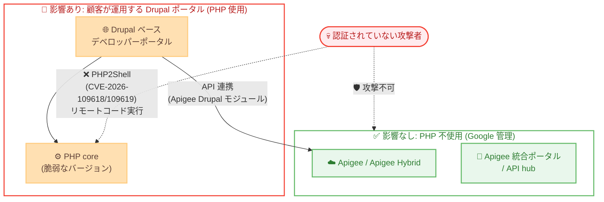

# Apigee X: セキュリティ速報 GCP-2026-072 (PHP2Shell: CVE-2026-109618 / CVE-2026-109619)

**リリース日**: 2026-10-26 (速報公開: 2026-10-24)

**サービス**: Apigee X

**機能**: セキュリティ速報 GCP-2026-072 (Drupal ベースのデベロッパーポータルに影響する PHP core 脆弱性)

**ステータス**: Security Bulletin (GCP-2026-072 / 重大度: Critical)

📊 [このアップデートのインフォグラフィックを見る](https://takech9203.github.io/google-cloud-news-summary/20261026-apigee-x-security-bulletin-gcp-2026-072.html)

## 概要

2026 年 10 月 24 日、Google Cloud は Apigee に関するセキュリティ速報 GCP-2026-072 を公開した。PHP core の 2 件の脆弱性 CVE-2026-109618 および CVE-2026-109619 (通称 "PHP2Shell") により、認証されていない攻撃者が脆弱な PHP バージョンを実行するサーバー上でリモートコード実行 (RCE) を行える。これらの脆弱性は PHP 8.2.35、8.3.36、8.4.27、8.5.12 で修正されているが、PHP 8.1 以前には修正リリースが存在しない。

**重要なポイントは影響範囲の切り分けである。** Apigee、Apigee Hybrid、Apigee Edge for Public Cloud、API hub、Apigee 統合ポータル (integrated portal) は PHP を使用しておらず影響を受けない。影響は顧客自身がデプロイ・運用する Drupal ベースの Apigee デベロッパーポータルに限定される。Apigee Edge for Private Cloud 本体も影響を受けないが、オプションの Drupal デベロッパーポータルは影響を受ける。

また、Apigee Drupal モジュールの更新ではこの脆弱性は修正されず、PHP 自体の更新のみが修正手段である点に注意が必要である。最新のモジュールリリース (apigee_edge 3.1.2 / 4.1.2、apigee_m10n 2.2.1、apigee_api_catalog 3.1.1) は修正済み PHP バージョンを必須とするため、PHP を先に更新する必要がある。

**アップデート前の課題**

- 脆弱な PHP バージョン上で稼働する Drupal ベースのデベロッパーポータルは、認証不要のリモートコード実行攻撃 (PHP2Shell) にさらされていた
- Google Cloud Marketplace の Apigee Developer Portal Kickstart の既存デプロイメントは、脆弱な PHP を含むイメージから起動した VM で稼働していた
- Kickstart Docker イメージ (`ghcr.io/apigee/docker-apigee-drupal-kickstart`) の既存タグも脆弱な PHP を含んでいた

**アップデート後の改善**

- セキュリティ速報の公開により、影響を受ける製品 (Drupal ベースのポータルのみ) と影響を受けない製品 (Apigee 本体など) が明確に切り分けられた
- Google Cloud Marketplace の新規デプロイメントは PHP 8.3.36 を含むパッチ済みイメージ (`apigee-devportal-drupal-202610231240` 以降) を使用するようになった
- Docker イメージの `:latest`、`:main`、`:nightly` タグが PHP 8.3.36 で再公開された
- PHP を更新できない環境向けの暫定緩和策 (PHP-FPM 設定、リクエストボディサイズ制限など) と侵害有無の確認手順が提供された

## アーキテクチャ図



この図はセキュリティ境界を示している。PHP2Shell の攻撃対象は顧客がデプロイ・運用する Drupal ベースのデベロッパーポータル (PHP 使用) のみであり、PHP を使用しない Apigee 本体、Apigee Hybrid、統合ポータル、API hub は影響を受けない。

## サービスアップデートの詳細

### 主要機能

1. **セキュリティ速報 GCP-2026-072 の公開 (2026-10-24)**
   - PHP core の脆弱性 CVE-2026-109618 および CVE-2026-109619 ("PHP2Shell") に関する速報
   - 認証されていない攻撃者による、脆弱な PHP バージョンを実行するサーバー上でのリモートコード実行が可能
   - 重大度は Critical
   - PHP 8.2.35、8.3.36、8.4.27、8.5.12 で修正済み。PHP 8.1 以前には修正リリースなし

2. **影響範囲の切り分け**
   - 影響なし: Apigee、Apigee Hybrid、Apigee Edge for Public Cloud、API hub、Apigee 統合ポータル (いずれも PHP を使用しない)
   - 影響あり: 顧客がデプロイ・運用する Drupal ベースのデベロッパーポータルのみ
   - Apigee Edge for Private Cloud は本体は影響なし、オプションの Drupal デベロッパーポータルのみ影響あり

3. **パッチ済みアーティファクトの提供**
   - Google Cloud Marketplace の新規デプロイメントは PHP 8.3.36 を含むパッチ済みイメージを使用
   - イメージ `apigee-devportal-drupal-202610231240` 以降はパッチ済み
   - Docker イメージの `:latest`、`:main`、`:nightly` タグを PHP 8.3.36 で再公開

4. **Apigee Drupal モジュールの対応**
   - モジュール更新自体は脆弱性を修正しない (PHP の更新のみが修正手段)
   - 最新モジュール (apigee_edge 3.1.2 / 4.1.2、apigee_m10n 2.2.1、apigee_api_catalog 3.1.1) は修正済み PHP バージョンを必須とするため、PHP を先に更新する必要がある

## 技術仕様

### CVE 一覧

| CVE 番号 | 通称 | 重大度 | 内容 |
|----------|------|--------|------|
| CVE-2026-109618 | PHP2Shell | Critical | PHP core の脆弱性。認証不要のリモートコード実行 |
| CVE-2026-109619 | PHP2Shell | Critical | PHP core の脆弱性。認証不要のリモートコード実行 |

関連する PHP アドバイザリ: GHSA-w8hw-w9fx-j79w、GHSA-6wmf-4rv5-p3rp

### 修正済み PHP バージョン

| PHP ブランチ | 修正バージョン |
|--------------|----------------|
| PHP 8.2 | 8.2.35 |
| PHP 8.3 | 8.3.36 |
| PHP 8.4 | 8.4.27 |
| PHP 8.5 | 8.5.12 |
| PHP 8.1 以前 | 修正リリースなし (PHP 8.2 以降へのアップグレードが必要) |

### 影響を受ける製品

| 製品 | 影響 | 備考 |
|------|------|------|
| Apigee / Apigee Hybrid | なし | PHP を使用しない |
| Apigee 統合ポータル / API hub | なし | PHP を使用しない |
| Apigee Edge for Public Cloud (本体) | なし | PHP を使用しない |
| Apigee Edge for Private Cloud (本体) | なし | オプションの Drupal ポータルを除く |
| Apigee Developer Portal Kickstart (Cloud Marketplace) | **あり** | 既存デプロイメントは自動更新されない |
| Kickstart Docker イメージ (`ghcr.io/apigee/docker-apigee-drupal-kickstart`) | **あり** | パッチ済みタグの pull が必要 |
| セルフホストの Drupal 10 / 11 ポータル (Kickstart または Apigee Edge Drupal モジュール利用) | **あり** | PHP の更新が必要 |
| Apigee Edge for Private Cloud の Drupal 7 / 9 ポータル (全バージョン) | **あり** | PHP 7.3 / 7.4 にパッケージ修正なし。Drupal 7 / 9 は EOL |
| Apigee Edge for Public Cloud のセルフホスト Drupal 7 ポータル | **あり** | 2020-05-31 の Apigee ポータルホスティング終了後に顧客が自前ホストしたもの |

## 設定方法 (推奨対応)

### 前提条件

1. 自組織で Drupal ベースの Apigee デベロッパーポータルを運用しているかを確認する (運用していなければ対応不要)
2. ポータルのデプロイ形態 (Cloud Marketplace / Docker / セルフホスト / Edge for Private Cloud) を特定する

### 手順

#### ステップ 1: Cloud Marketplace 版 Kickstart — 稼働中 VM を直ちにパッチ

既存デプロイメントは自動更新されない。各ポータル VM 上で以下を実行する (サイト、データベース、ファイルはそのまま保持される)。

```bash
sudo apt-get update && sudo DEBIAN_FRONTEND=noninteractive apt-get upgrade -y -o Dpkg::Options::=--force-confold
sudo supervisorctl restart php-fpm
sudo supervisorctl status php-fpm
sudo php-fpm8.3 -v
```

php-fpm が RUNNING (短い uptime) で、PHP 8.3.36 が報告されることを確認する。PHP-FPM の再起動は `systemctl` ではなく `supervisorctl` で行う。

#### ステップ 2: Cloud Marketplace 版 Kickstart — インスタンスグループをパッチ済みイメージへ移行

マネージドインスタンスグループ (MIG) が後から作成する VM はインスタンステンプレートのイメージから起動するため、テンプレートの更新も必要。データベースは Cloud SQL、ファイルは Filestore にあるため、VM を置き換えてもサイトは維持される。

```bash
# 現在使用中のイメージを確認
gcloud compute instance-groups managed describe DEPLOYMENT-igm --region REGION \
  --format='value(versions[0].instanceTemplate)'
gcloud compute instance-templates describe TEMPLATE \
  --format='value(properties.disks[0].initializeParams.sourceImage)'
```

- イメージ名が日付なしの `images/apigee-devportal-drupal` で終わる場合: パッチ済みイメージを指しており、テンプレート変更は不要。必要に応じて VM を置き換える: `gcloud compute instance-groups managed rolling-action replace DEPLOYMENT-igm --region REGION --max-unavailable=0`
- イメージ名に日付が含まれる場合: `apigee-devportal-drupal-202610231240` 以降はパッチ済み。それより古い場合 (例: `apigee-devportal-drupal-202610060628`) は脆弱なため、ブートディスクイメージを `projects/bap-marketplace/global/images/apigee-devportal-drupal` に設定した新テンプレートを作成し、`gcloud compute instance-groups managed rolling-action start-update DEPLOYMENT-igm --version=template=NEW_TEMPLATE --region REGION --max-unavailable=0` を実行する
- Terraform 管理の場合は `source_image_path` をパッチ済みイメージに設定して apply する (手動のテンプレート変更は次回 apply で巻き戻される)

最後に、グループ内のすべての VM で `sudo php-fpm8.3 -v` が PHP 8.3.36 を報告することを確認する。

#### ステップ 3: Docker イメージ利用の場合

データベースとアップロードファイルが Docker ボリュームまたはバインドマウントにあることを `docker-compose.yml` で確認し、バックアップを取得してから実施する。

```bash
# プレビルトイメージの場合
docker-compose pull apigee-kickstart
docker-compose up -d apigee-kickstart

# 自前ビルドの場合
docker-compose build --pull apigee-kickstart
docker-compose up -d apigee-kickstart

# 確認
docker-compose exec apigee-kickstart php -v   # PHP 8.3.36 を確認
```

Kubernetes の場合は `kubectl rollout restart deployment/DEPLOYMENT_NAME -n NAMESPACE` で再公開済みイメージを pull させる。

#### ステップ 4: セルフホスト Drupal 10 / 11 ポータルの場合

- すべてのポータルサーバーで PHP を 8.2.35、8.3.36、8.4.27、8.5.12 以降 (同一ブランチ内) に更新し、PHP-FPM または Web サーバーを再起動する
- PHP 8.1 の場合: 修正がないため PHP 8.2 以降へアップグレードする
- CentOS 7 / RHEL 7 + Remi パッケージの場合: パッケージ修正がないため、メンテナンスされた PHP パッケージを持つサポート対象 OS へ移行するか、PHP をソースからビルドする

#### ステップ 5: Apigee Edge for Private Cloud の Drupal 7 / 9 ポータルの場合

PHP 7.3 / 7.4 (RHEL/CentOS 7、RHEL 8、Amazon Linux 2) にはパッケージ修正がなく、Drupal 7 / 9 は EOL である。

- デベロッパーポータルプロファイル (`setup.sh -p dp`) を新規インストールしない (今後の apigee-setup リリース 4.53.01 / 4.54.00 ではインストールがブロックされる)
- ポータルをオフラインにするか、内部ネットワークのみにアクセスを制限する
- 後述の暫定緩和策を適用する
- サポート対象の PHP バージョン上の Drupal 10 / 11 ポータルへ移行する

#### ステップ 6: Apigee Edge for Public Cloud のセルフホスト Drupal 7 ポータルの場合

- Pantheon または Acquia でホストしている場合: パッチ済み PHP バージョンで稼働しているかプロバイダーに確認する
- 自前サーバーの場合: Debian / Ubuntu の PHP 7.4 は Sury パッケージでインプレース更新可能。PHP 7.3 以前は修正がないため PHP 8.2 以降へ移行する。その後 PHP-FPM を再起動する

### 暫定緩和策 (PHP を更新できるまでの措置)

以下の設定は露出を減らすものであり、脆弱性を修正するものではない。アプリケーションが上書きできないよう、PHP-FPM プール設定の `php_admin_value` / `php_admin_flag` (または Apache 設定の `php_admin_value`) で管理者設定として適用し、すべての PHP-FPM ワーカーを再起動する。

- `session.upload_progress.enabled=0`
- `memory_limit=-1` (Marketplace イメージでは `/etc/php/8.3/fpm/pool.d/www.conf` の既存の `php_admin_value[memory_limit]` 行を `-1` に変更する。同じ値を 2 回設定すると片方しか有効にならない)
- 小さい `post_max_size` (例: 8M) とそれ未満の `upload_max_filesize`
- `post_max_size` はバイパス可能で `memory_limit=-1` は PHP のリクエストごとのメモリ上限を外すため、Web サーバーまたはロードバランサーでもリクエストボディサイズを制限する (例: nginx の `client_max_body_size`)
- PHP 8.5 の場合: `fatal_error_backtraces=0`
- ポータルがファイルアップロードを受け付けない場合は、ロードバランサーまたは Web サーバーで `multipart/form-data` リクエストをブロックする

なお、VM レベルの変更は MIG の VM 置き換えで消えるため、恒久対応としてはイメージの更新 (ステップ 2) が必要である。

### 侵害有無の確認

PHP の更新は、パッチ適用前に侵入した攻撃者を排除しない。以下を確認する。

- シェル、インタープリタ、`curl`、`wget` を起動した PHP-FPM ワーカープロセス
- Web ルート、`sites/default/files`、プライベートファイルディレクトリ内の新規・変更ファイル
- multipart リクエストの直後のメモリ上限エラーや HTTP 500 のバースト (Web サーバー / PHP-FPM ログ)
- 不正な形式または過大な PHPSESSID Cookie を含むリクエスト

これらが見つかった場合、またはインターネット公開ポータルで侵害を否定できない場合は、ポータルに保存されている Apigee 認証情報 (Apigee Edge モジュールの接続認証情報、または Apigee 用サービスアカウントキー)、Drupal 管理者パスワード、データベースパスワードをローテーションし、パッチ済みイメージからポータル VM を再構築する。

## メリット

### ビジネス面

- **影響範囲の明確化**: Apigee 本体 (Apigee / Hybrid / 統合ポータル / API hub) は影響なしと公式に明言されており、Drupal ポータルを運用していない組織は対応不要と判断できる
- **リスクの早期遮断**: Critical 級の認証不要 RCE に対し、パッチ済みイメージ・具体的なコマンド手順・暫定緩和策が提供されており、迅速な対応が可能

### 技術面

- **パッチ済みアーティファクトの即時提供**: Marketplace イメージ、Docker タグが PHP 8.3.36 で再公開済み
- **実践的な侵害調査手順**: パッチ適用後に行うべき侵害痕跡の確認ポイントと認証情報ローテーション手順が具体的に示されている

## デメリット・制約事項

### 制限事項

- PHP 8.1 以前には修正リリースが存在せず、PHP 8.2 以降へのアップグレードが必須
- Apigee Edge for Private Cloud の Drupal 7 / 9 ポータル (PHP 7.3 / 7.4) にはパッケージ修正がなく、オフライン化・アクセス制限・Drupal 10 / 11 への移行が必要
- CentOS 7 / RHEL 7 (Remi) 環境にはパッケージ修正がなく、OS 移行またはソースビルドが必要
- Apigee Drupal モジュールの更新では脆弱性は修正されない (PHP の更新が唯一の修正手段)

### 考慮すべき点

- Cloud Marketplace の既存デプロイメントは自動更新されないため、顧客自身による VM パッチとテンプレート更新が必要
- 暫定緩和策は露出を減らすのみで脆弱性を修正しない。また VM レベルの変更は MIG の VM 置き換えで失われる
- PHP の更新だけでは侵害済みの環境は復旧しないため、侵害有無の確認と必要に応じた認証情報ローテーション・VM 再構築が必要
- 最新の Apigee Drupal モジュールは修正済み PHP を必須とするため、更新順序は「PHP → モジュール」とする

## ユースケース

### ユースケース 1: Cloud Marketplace 版 Kickstart ポータルの緊急パッチ適用

**シナリオ**: Google Cloud Marketplace から Apigee Developer Portal Kickstart をデプロイし、インターネット公開のデベロッパーポータルとして運用している企業が、PHP2Shell への緊急対応を行う。

**実装例**:
```bash
# ステップ 1: 稼働中 VM のパッチ
sudo apt-get update && sudo DEBIAN_FRONTEND=noninteractive apt-get upgrade -y -o Dpkg::Options::=--force-confold
sudo supervisorctl restart php-fpm
sudo php-fpm8.3 -v   # PHP 8.3.36 を確認

# ステップ 2: MIG をパッチ済みイメージへ
gcloud compute instance-groups managed rolling-action replace DEPLOYMENT-igm \
  --region REGION --max-unavailable=0
```

**効果**: サイト・データベース (Cloud SQL)・ファイル (Filestore) を維持したまま、ダウンタイムなしで RCE 脆弱性を解消できる。オートヒーリングで将来作成される VM もパッチ済みイメージから起動する。

### ユースケース 2: レガシー Drupal 7 / 9 ポータルのリスク封じ込めと移行

**シナリオ**: Apigee Edge for Private Cloud のオプション Drupal 9 ポータルを運用しているが、PHP 7.4 に修正パッケージがなく即時のパッチ適用ができない。

**効果**: ポータルを内部ネットワークに制限 (またはオフライン化) し、PHP-FPM の管理者設定による暫定緩和策とロードバランサーでのリクエストボディ制限で露出を削減しつつ、サポート対象 PHP 上の Drupal 10 / 11 ポータルへの移行を計画的に進められる。EOL スタックからの脱却により、将来の同種脆弱性への対応力も向上する。

## 関連サービス・機能

- **Apigee Developer Portal Kickstart (Cloud Marketplace)**: Drupal ベースのポータルを Google Cloud プロジェクトにクリックデプロイするソリューション。MIG + Cloud SQL + Filestore 構成で、本速報の主要な対象
- **Apigee 統合ポータル (integrated portal)**: Apigee が提供するマネージドなポータル。PHP を使用せず本脆弱性の影響を受けないため、運用負荷を下げたい場合の代替選択肢となる
- **Compute Engine (マネージドインスタンスグループ)**: Marketplace 版ポータルの実行基盤。インスタンステンプレートの更新とローリング置換でパッチ済みイメージへ移行する
- **Cloud SQL / Filestore**: Marketplace 版ポータルのデータベースとファイルの保存先。VM を置き換えてもサイトデータが維持される理由
- **Cloud Load Balancing**: 暫定緩和策としてのリクエストボディサイズ制限や multipart リクエストのブロックを適用するポイント

## 参考リンク

- 📊 [インフォグラフィック](https://takech9203.github.io/google-cloud-news-summary/20261026-apigee-x-security-bulletin-gcp-2026-072.html)
- [公式リリースノート](https://docs.cloud.google.com/release-notes#October_26_2026)
- [Apigee セキュリティ速報 GCP-2026-072](https://docs.cloud.google.com/apigee/docs/security-bulletins/security-bulletins#gcp-2026-072)
- [Drupal 10 でのポータル構築 (公式ドキュメント)](https://docs.cloud.google.com/apigee/docs/api-platform/publish/drupal/open-source-drupal-8)
- [Apigee Developer Portal Kickstart (Cloud Marketplace) 概要](https://docs.cloud.google.com/apigee/docs/api-platform/publish/drupal/apigee-cloud-marketplace-overview)
- [デベロッパーポータルの選択肢 (公式ドキュメント)](https://docs.cloud.google.com/apigee/docs/api-platform/publish/intro-portals)
- [PHP アドバイザリ GHSA-w8hw-w9fx-j79w](https://github.com/php/php-src/security/advisories/GHSA-w8hw-w9fx-j79w)
- [PHP アドバイザリ GHSA-6wmf-4rv5-p3rp](https://github.com/php/php-src/security/advisories/GHSA-6wmf-4rv5-p3rp)

## まとめ

GCP-2026-072 は、PHP core の認証不要 RCE 脆弱性 "PHP2Shell" (CVE-2026-109618 / CVE-2026-109619) に関する Critical 級のセキュリティ速報であり、影響は顧客が運用する Drupal ベースの Apigee デベロッパーポータルに限定される (Apigee / Apigee Hybrid / 統合ポータルは影響なし)。Drupal ポータルを運用している組織は、モジュール更新ではなく PHP 自体の更新 (8.2.35 / 8.3.36 / 8.4.27 / 8.5.12 以降) を直ちに実施し、Marketplace 版はインスタンステンプレートのイメージ更新まで完了させることが必須である。あわせて、パッチ適用前の侵害有無を確認し、疑いがある場合は認証情報のローテーションと VM の再構築を行うことを推奨する。

---

**タグ**: Apigee, Security, Drupal, Developer Portal, PHP, CVE-2026-109618, CVE-2026-109619, PHP2Shell, GCP-2026-072, RCE
