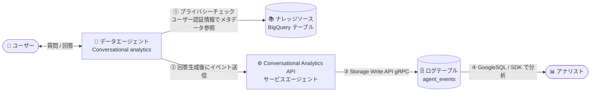

# BigQuery: Conversational analytics の会話ログ記録 (Conversation logging) が GA

**リリース日**: 2026-10-26

**サービス**: BigQuery (Conversational analytics)

**機能**: Conversation logging (データエージェントの会話ログ記録)

**ステータス**: GA (一般提供)

📊 [このアップデートのインフォグラフィックを見る](https://takech9203.github.io/google-cloud-news-summary/20261026-bigquery-conversational-analytics-conversation-logging-ga.html)

## 概要

BigQuery の Conversational analytics における会話ログ記録 (Conversation logging) が一般提供 (GA) になりました。データエージェントとの会話を、エージェントと同じプロジェクト内の BigQuery テーブルに記録できるようになり、回答品質のレビュー、利用状況 (アダプション) の追跡、コストのモニタリングを、使い慣れた GoogleSQL でそのまま実行できます。

各会話ターンごとに、ユーザーの質問、エージェントの回答 (テキスト、インサイト、前提、フォローアップ質問の提案、引用元、参照したデータ結果やチャートの名前)、ターンごとのレイテンシ、モデルのトークン使用量・モデルバージョン・終了理由 (finish reason)、エージェント ID・会話 ID・ユーザー ID、ステータスとエラー詳細が記録されます。ログ行は [BigQuery agent analytics](https://docs.cloud.google.com/bigquery/docs/bigquery-agent-analytics) スキーマに従い、BigQuery Storage Write API (gRPC) 経由で書き込まれます。

対象ユーザーは、Conversational analytics のデータエージェントを運用するデータプラットフォーム管理者やアナリティクスエンジニアです。複数エージェントのログを 1 つのテーブルに集約し、エージェント横断での品質・コスト分析が可能になります。

**アップデート前の課題**

- データエージェントの会話内容 (質問と回答) をテーブルとして蓄積し、SQL で分析する組み込みの仕組みがなかった
- 回答品質のレビューや利用状況の追跡を行うには、プロジェクトレベルの Observability 指標 (Cloud Monitoring / Cloud Trace) に頼る必要があり、個々の会話ターンの内容までは確認できなかった
- モデルのトークン使用量をエージェント別・ユーザー別・会話別に集計してコストを把握する手段が限られていた

**アップデート後の改善**

- エージェント単位で会話ログ記録を有効化し、エージェントのプロジェクト内の BigQuery テーブルに各ターンのイベント行を自動で書き込めるようになった
- 質問・回答・レイテンシ・トークン使用量・各種 ID が構造化されて記録されるため、GoogleSQL、Colab ノートブック、BigQuery agent analytics Python SDK で品質・利用状況・コストを分析できるようになった
- 初回ログ書き込み時にサービスエージェントが宛先テーブルを自動作成する (タイムスタンプで日次パーティショニング、`event_type`・`agent`・`user_id` でクラスタリング) ため、スキーマ設計が不要になった

## アーキテクチャ図



ユーザーとデータエージェントの会話は、ターンごとにプライバシーチェック (行レベル/列レベルセキュリティ・データマスキングの有無を確認) を通過した後、サービスエージェントが Storage Write API (gRPC) でエージェントのプロジェクト内のログテーブルに書き込みます。

## サービスアップデートの詳細

### 主要機能

1. **会話ターンの構造化ログ記録**
   - ユーザーの質問、エージェントの回答 (テキスト、インサイト、前提、フォローアップ提案、引用元、データ結果・チャートの名前) を記録
   - ターンごとのレイテンシ、モデル呼び出しごとのトークン使用量・モデルバージョン・終了理由、ステータスとエラー詳細を記録
   - データエージェント ID・会話 ID・ユーザー ID が付与されるため、1 つのテーブルで複数エージェントを横断分析可能

2. **ログテーブルの自動作成と最適化されたレイアウト**
   - 初回のログ記録時に、サービスエージェントが宛先データセット内にテーブルを自動作成 (既存の互換テーブルには不足カラムを追加)
   - テーブルは `timestamp` で日次パーティショニングされ、`event_type`・`agent`・`user_id` でクラスタリングされる
   - スキーマ変更は追加のみ (additive)。型やモードが競合するカラムがあると書き込みが停止する

3. **ターンごとのプライバシーチェック**
   - エージェントが回答を開始する前に、会話しているユーザーの認証情報でナレッジソーステーブルのメタデータを確認
   - 行レベルセキュリティ (行アクセスポリシー)、列レベルセキュリティ (ポリシータグ)、動的データマスキングが使われている場合、そのターンはログに記録されない (回答自体は通常どおり返される)
   - ログ記録のエラーが会話を失敗させることはない (ベストエフォートの書き込み)

4. **記録されない情報 (設計上の制限)**
   - エージェントが実行した SQL クエリは記録されない (ユーザーが明示的に SQL の表示・説明を求めた場合のみ回答テキストに含まれ得る)
   - ツール呼び出しの名前や引数は書き込み前に除去され、トークン使用量・モデルバージョン・終了理由のみ保持される
   - サムズアップ/ダウンのユーザーフィードバックは記録されない

## 技術仕様

### ログ記録の仕組み

| 項目 | 詳細 |
|------|------|
| 書き込み主体 | Conversational Analytics API サービスエージェント (`service-PROJECT_NUMBER@gcp-sa-geminidataanalytics.iam.gserviceaccount.com`) |
| 書き込み方式 | BigQuery Storage Write API (gRPC) |
| スキーマ | BigQuery agent analytics スキーマ |
| 宛先 | エージェントと同一プロジェクト内の既存データセット (テーブルは自動作成可) |
| パーティショニング | `timestamp` による日次パーティション (データセットのデフォルトパーティション有効期限を継承) |
| クラスタリング | `event_type`、`agent`、`user_id` |
| 反映タイミング | 通常は回答完了から数秒以内 (配信時間は保証されない) |
| テキスト長の上限 | 512,000 文字 (500 × 1,024) を超えると `...[TRUNCATED]` で切り詰め |
| 重複排除 | リトライで重複行が発生し得るため `event_id` で重複排除 |

### 必要な IAM ロール

| 操作 | 必要なロール / 権限 |
|------|---------------------|
| ログデータセットの作成・アクセス付与 | `bigquery.datasets.create`、ログデータセットに対する `roles/bigquery.dataOwner` または `roles/bigquery.admin` |
| エージェントのログ設定変更 | `geminidataanalytics.dataAgents.update` (`roles/geminidataanalytics.dataAgentEditor` に含まれる) |
| サービスエージェントの書き込み | ログデータセットに対する `roles/bigquery.dataEditor` |
| アナリストによるログ分析 | ログデータセットに対する `roles/bigquery.dataViewer` と、クエリ実行プロジェクトに対する `roles/bigquery.jobUser` |

CMEK を使用するデータセットの場合は、BigQuery 暗号化サービスアカウント (`bq-PROJECT_NUMBER@bigquery-encryption.iam.gserviceaccount.com`) に `roles/cloudkms.cryptoKeyEncrypterDecrypter` が必要です。

## 設定方法

### 前提条件

1. 宛先データセットがエージェントと同じプロジェクトに存在すること (データセットは事前に作成が必要)
2. ナレッジソースとして特定の BigQuery テーブルが選択されていること (検索スコープのみのエージェントは対象外)
3. サービスエージェントがログデータセットに対して `roles/bigquery.dataEditor` を持つこと

### 手順

#### ステップ 1: BigQuery Studio でエージェントの設定を開く

既存エージェントを編集する場合はビューセレクタを **Draft** に切り替え、ナレッジソースに特定の BigQuery テーブルが選択されていることを確認します。

#### ステップ 2: 会話ログ記録を有効化する

**Settings** セクションの **Conversation logging** で **Enable conversation logging** をオンにします。

- **Dataset ID** でエージェントのプロジェクト内の既存データセットを選択
- **Table ID** で既存テーブルを選択するか、**+ New table** で新しいテーブル名 (例: `agent_events`) を入力して保存
- **Data logging & user disclosure notice** を確認
- 設定のバリデーションを待つ。サービスエージェントにデータセットへのアクセスがない場合は **Grant Access** をクリックして `roles/bigquery.dataEditor` を付与

#### ステップ 3: 動作確認

エージェントを公開 (Publish) した後、公開済みエージェントのメインチャット画面からテスト質問を送信し (Preview セクションは記録されない)、BigQuery Studio で宛先データセットを更新してログテーブルが作成されたことを確認します。

```sql
-- ログの確認例 (timestamp フィルタを必ず付与する)
SELECT event_type, agent, user_id, timestamp
FROM `PROJECT_ID.DATASET_ID.agent_events`
WHERE timestamp >= TIMESTAMP_SUB(CURRENT_TIMESTAMP(), INTERVAL 1 DAY)
ORDER BY timestamp DESC;
```

## メリット

### ビジネス面

- **回答品質の継続的レビュー**: 質問と回答のペアを蓄積し、エージェントの回答品質を定期的に評価・改善できる
- **アダプションとコストの可視化**: ユーザー ID・エージェント ID 単位で利用状況とトークン使用量を集計し、投資対効果を把握できる
- **追加課金なし**: 会話ログ記録自体に個別の料金はなく、標準の BigQuery 料金のみで利用できる

### 技術面

- **スキーマ設計不要**: 最適化されたパーティショニング・クラスタリング付きのテーブルが自動作成される
- **会話への非侵襲性**: ログ記録のエラー (権限不足、データセット不存在、クォータ枯渇) が会話リクエストを失敗させることはない
- **既存の BigQuery ガバナンスを適用可能**: ログテーブル自体にポリシータグ、データマスキング、行アクセスポリシー、パーティション有効期限 (保持期間) を設定できる

## デメリット・制約事項

### 制限事項

- BigQuery Studio エージェントエディタの Preview ペインでの会話、データエージェントを介さない直接会話は記録されない
- BigQuery テーブルをナレッジソースとするエージェントのみ対応。Looker、Data Studio、AlloyDB、Spanner、Cloud SQL のデータソースは非対応。検索スコープのみのエージェントや BigQuery プロパティグラフをナレッジソースとするエージェントも対象外
- ナレッジソースに行アクセスポリシー、列レベルセキュリティ (ポリシータグ)、データマスキングが使われている場合、そのターンは記録されない (プライバシーチェックはビューの背後のテーブルまでは確認しない)
- 生成された SQL、ツール呼び出し、ADK のツール/リクエストイベント (`TOOL_STARTING` など) は記録されない。検証済みクエリで直接回答したターンは `LLM_RESPONSE` 行を書き込まず、失敗した検証済みクエリのターンは記録されない
- サンプリング設定はなく、対象となる全ターンが記録される (サンプリングはクエリ時に実施する)

### 考慮すべき点

- 書き込みはベストエフォートで限定的なリトライのみ。書き込みに失敗したターンは記録されず、リトライにより重複行が発生し得る (`event_id` で重複排除する)
- ログ記録の失敗はチャット UI にも Cloud Logging にも報告されない。テーブルが空のままであることが唯一の失敗シグナルとなる
- プライバシーチェックとログ書き込みはレイテンシを増加させる可能性がある
- API 経由で 1 つのサービスアカウントを多数のエンドユーザーで共有する場合、全行にそのサービスアカウントのメールアドレスが記録される
- Google はログ行を削除しないため、保持ポリシーに合わせてパーティション有効期限 (例: 90 日) を自分で設定する必要がある
- VPC Service Controls を使用する場合、`geminidataanalytics.googleapis.com` と `bigquery.googleapis.com` を同じ境界に含め、サービスエージェントからの Ingress ルールの追加が必要

## ユースケース

### ユースケース 1: エージェントの回答品質レビュー

**シナリオ**: 社内に展開した複数のデータエージェントについて、ユーザーの質問に対する回答の品質を定期的にレビューし、システムインストラクションや知識ソースの改善につなげたい。

**実装例**:
```sql
-- エージェント別に直近 7 日間のターンをサンプリングしてレビュー
SELECT *
FROM `PROJECT_ID.DATASET_ID.agent_events`
WHERE timestamp >= TIMESTAMP_SUB(CURRENT_TIMESTAMP(), INTERVAL 7 DAY)
QUALIFY ROW_NUMBER() OVER (PARTITION BY agent ORDER BY RAND()) <= 20;
```

**効果**: 全エージェントのログが 1 テーブルに集約されるため、横断的な品質評価と改善サイクルを SQL だけで回せる。

### ユースケース 2: トークン使用量によるコストモニタリング

**シナリオ**: データエージェントの利用拡大に伴い、エージェント別・ユーザー別のモデルトークン使用量を把握し、コストの予測と配賦を行いたい。

**効果**: 各モデル呼び出しのトークン使用量・モデルバージョンが記録されるため、利用部門ごとのコスト集計やヘビーユーザーの特定が可能になる。Cloud Monitoring の Observability 指標と組み合わせれば、プロジェクト全体の傾向と個別会話の詳細の両方を追跡できる。

## 料金

Conversational analytics は会話ログ記録に対して個別の課金を行いません。エージェントのプロジェクトに対して、標準の BigQuery 料金が適用されます。

- **データ取り込み**: BigQuery Storage Write API (gRPC) の取り込み料金 (請求先アカウントごとに月 2 TiB の無料枠があり、Storage Write API (gRPC) の使用量全体で共有)
- **ストレージ**: 標準の BigQuery ストレージ料金
- **分析クエリ**: 標準の BigQuery 分析料金 (`timestamp` でフィルタしてスキャン量を削減)
- **プライバシーチェック**: テーブルメタデータの読み取りとドライランクエリのみで、料金は発生しない

詳細は [BigQuery の料金ページ](https://cloud.google.com/bigquery/pricing) を参照してください。

## 関連サービス・機能

- **BigQuery agent analytics**: 会話ログのスキーマ定義と、ログ分析用の Python SDK を提供
- **BigQuery Storage Write API**: ログ行の書き込みに使用される gRPC ベースの取り込み API
- **Cloud Monitoring / Cloud Trace (エージェント Observability、Preview)**: プロジェクトレベルの指標 (会話数、ユーザー数、レイテンシ、トークン使用量の予測など) とトレースを提供。会話ログ記録はこれを補完するターン単位の詳細ログ。なお、エージェントはプロジェクトレベルの Observability 設定を継承しない
- **Conversational Analytics API (Gemini Data Analytics)**: データエージェントの基盤となる API。エージェントの変更は Admin Activity 監査ログに記録される
- **Cloud KMS (CMEK) / VPC Service Controls**: ログデータセットの暗号化と境界セキュリティの構成に使用

## 参考リンク

- 📊 [インフォグラフィック](https://takech9203.github.io/google-cloud-news-summary/20261026-bigquery-conversational-analytics-conversation-logging-ga.html)
- [公式リリースノート](https://docs.cloud.google.com/release-notes#October_26_2026)
- [Conversation logging overview](https://docs.cloud.google.com/bigquery/docs/conversation-logging-overview)
- [Configure settings (データエージェントの作成)](https://docs.cloud.google.com/bigquery/docs/create-data-agents#configure_settings)
- [Conversation log schema](https://docs.cloud.google.com/bigquery/docs/conversation-log-schema)
- [Analyze conversation logs](https://docs.cloud.google.com/bigquery/docs/analyze-conversation-logs)
- [BigQuery の料金](https://cloud.google.com/bigquery/pricing)

## まとめ

Conversational analytics の会話ログ記録が GA となり、データエージェントの会話を BigQuery テーブルに蓄積して品質・利用状況・コストを SQL で分析する運用が正式にサポートされました。データエージェントを本番運用しているチームは、ログデータセットを分離して作成し、パーティション有効期限による保持ポリシーを設定した上で、エージェントごとにログ記録を有効化することを推奨します。プライバシーチェックの仕様 (行/列レベルセキュリティ使用時はログ記録されない) と、記録されない情報 (SQL、ツール呼び出し、フィードバック) を理解した上で導入してください。

---

**タグ**: BigQuery, Conversational Analytics, データエージェント, 会話ログ, GA, 生成 AI, Gemini, Observability, ガバナンス
