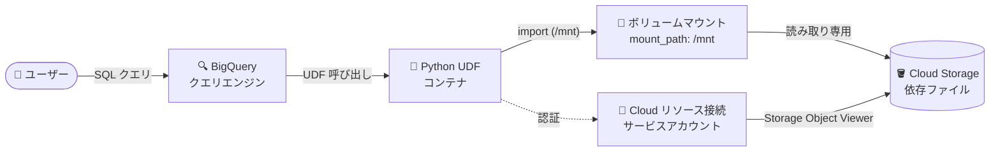

# BigQuery: Python UDF のボリュームマウント対応 (Preview)

**リリース日**: 2026-10-26

**サービス**: BigQuery

**機能**: Python UDF のボリュームマウント (Cloud Storage 上の依存ファイルへの直接アクセス)

**ステータス**: Preview

📊 [このアップデートのインフォグラフィックを見る](https://takech9203.github.io/google-cloud-news-summary/20261026-bigquery-python-udf-volume-mounts.html)

## 概要

BigQuery の Python ユーザー定義関数 (UDF) がボリュームマウントに対応しました (Preview)。`CREATE FUNCTION` の `volume_mounts` オプションで Cloud Storage バケット (またはバケット内の特定フォルダ) をコンテナのファイルシステムにマウントし、UDF の Python コードから依存ファイルに直接アクセスできます。

Python UDF は BigQuery のマネージドリソース上のコンテナで実行され、これまでも PyPI パッケージのインストールや `library` オプションによる Cloud Storage 上の Python ファイルのインポートが可能でした。今回のアップデートにより、Cloud Storage 上の依存ファイル群をローカルディレクトリのように扱えるようになり、共通ユーティリティやライブラリ群を複数の UDF から参照する構成が容易になります。

**アップデート前の課題**

- Cloud Storage 上のファイルを利用するには `library` オプションで Python ファイルを個別に指定してモジュールとしてインポートする方式が中心で、ファイル名・フォルダ名が有効な Python 識別子である必要があった
- バケットやフォルダ単位で依存ファイル群をまとめて UDF から参照する仕組みがなかった

**アップデート後の改善**

- `volume_mounts` オプションでバケット全体 (例: `gs://my-udf-deps-bucket`) またはサブフォルダ (例: `gs://my-udf-deps-bucket/common-utils`) をコンテナ内の任意のマウントパス (例: `/mnt`) にマウントできるようになった
- マウントしたパスを `sys.path` に追加することで、Cloud Storage 上の共通ユーティリティをパッケージとしてインポートできるようになった
- 1 つの UDF あたり最大 10 個のボリュームマウントを定義可能

## アーキテクチャ図



クエリから呼び出された Python UDF コンテナが、Cloud リソース接続のサービスアカウント権限で Cloud Storage バケットを読み取り専用ボリュームとしてマウントし、依存ファイルへファイルシステム経由でアクセスします。

## サービスアップデートの詳細

### 主要機能

1. **`volume_mounts` オプションによる Cloud Storage のマウント**
   - `CREATE FUNCTION` の OPTIONS に `source_path` (Cloud Storage パス) と `mount_path` (コンテナ内パス) を JSON 文字列の配列で指定
   - バケット全体または特定のサブフォルダをマウント可能
   - `source_path` と `mount_path` は 1 対 1 で対応

2. **UDF コードからのファイルシステムアクセス**
   - マウントしたファイルは読み取り専用でアクセス可能
   - マウントパスを `sys.path` に追加することで Python モジュールとしてインポート可能

3. **Cloud リソース接続による認証**
   - UDF と同じリージョンの Cloud リソース接続を使用
   - 接続のサービスアカウントに Storage オブジェクト閲覧者ロールを付与してアクセスを制御

## 技術仕様

### volume_mounts オプションの仕様

| 項目 | 詳細 |
|------|------|
| ソース | Cloud Storage バケットまたはサブフォルダ (`gs://...`) |
| マウント数の上限 | 1 UDF あたり最大 10 個 |
| アクセスモード | 読み取り専用 |
| マウントパス | `/` で開始、`/` で終了不可、最大 256 文字 |
| 使用不可パス | `/dev`、`/opt`、`/proc`、`/root`、`/srv`、`/sys`、`/udf_modules`、`/user_site_packages`、`/usr` 配下 |
| コンテナリソース要件 | ボリュームマウント定義時はメモリ 512 MiB 以上、CPU 1.0 vCPU 以上 |
| ランタイム | python-3.11 (Python UDF 共通) |

### 必要な IAM 権限

接続のサービスアカウントに対して、マウント対象の Cloud Storage フォルダへの以下の権限が必要です。

| 権限 | 用途 |
|------|------|
| `storage.objects.get` | オブジェクトの読み取り |
| `storage.objects.list` | オブジェクトの一覧取得 |

事前定義ロールでは **Storage オブジェクト閲覧者** (`roles/storage.objectViewer`) が対応します。セキュリティのベストプラクティスとして、IAM 条件のプレフィックスマッチ (例: `resource.name.startsWith("projects/_/buckets/BUCKET_NAME/objects/SUBFOLDER_NAME/")`) で付与範囲を限定することが推奨されています。

## 設定方法

### 前提条件

1. UDF と同じリージョンに Cloud リソース接続を作成していること
2. 接続のサービスアカウントに、マウント対象バケット (フォルダ) への Storage オブジェクト閲覧者ロールを付与していること
3. 依存ファイルを Cloud Storage バケットに配置していること

### 手順

#### ステップ 1: 依存ファイルを Cloud Storage に配置

```bash
gsutil cp -r ./common-utils gs://my-udf-deps-bucket/
```

共通ユーティリティなどの依存ファイルをバケットに配置します。

#### ステップ 2: volume_mounts を指定して UDF を作成

```sql
CREATE OR REPLACE FUNCTION `my-project.my-dataset`.my_udf_name(x STRING)
RETURNS STRING
LANGUAGE python
WITH CONNECTION `my-project`.us-central1.`my-connection`
OPTIONS (
  entry_point="python_func",
  runtime_version="python-3.11",
  volume_mounts=['{"source_path": "gs://my-udf-deps-bucket", "mount_path": "/mnt"}'])
AS r"""
# マウントパスを sys.path に追加する
import sys
sys.path.append('/mnt')

# common-utils は gs://my-udf-deps-bucket 直下のサブフォルダ
from common-utils import string_helpers

def python_func(x):
  suffix = string_helpers.functionA()
  return x + suffix
""";
```

`volume_mounts` に `source_path` と `mount_path` を JSON 文字列で指定します。UDF コード内でマウントパスを `sys.path` に追加する必要があります。

## メリット

### ビジネス面

- **依存管理の簡素化**: 共通ライブラリやユーティリティを Cloud Storage で一元管理し、複数の UDF から参照できるため、コードの重複や配布の手間を削減できる
- **既存資産の活用**: Cloud Storage に蓄積した既存の Python 資産を UDF からそのまま利用しやすくなる

### 技術面

- **ファイルシステムベースのアクセス**: マウントしたファイルにローカルディレクトリと同様にアクセスでき、`library` オプションの個別ファイル指定よりも柔軟にフォルダ構成を扱える
- **最小権限での制御**: Cloud リソース接続のサービスアカウントと IAM 条件 (プレフィックスマッチ) により、マウント対象を細かく制御できる

## デメリット・制約事項

### 制限事項

- Preview 機能であり、Pre-GA 利用規約が適用される
- マネージドなバージョン管理はなく、Cloud Storage 上のファイル変更が (クエリ実行中であっても) UDF に自動的に反映され得る
- マウントされたファイルは読み取り専用
- ボリュームマウントは 1 UDF あたり最大 10 個
- ボリュームマウントを定義する場合、コンテナメモリは 512 MiB 以上、CPU は 1.0 vCPU 以上が必要
- Python UDF 共通の制限 (python-3.11 のみ、一時 UDF 不可、マテリアライズドビュー不可、結果キャッシュなし、`JSON`/`RANGE`/`INTERVAL`/`GEOGRAPHY` 型非対応、最大 4 vCPU / 16 GiB など) も適用される

### 考慮すべき点

- 依存ファイルの意図しない更新が UDF の挙動を変える可能性があるため、本番用バケット (フォルダ) の書き込み権限を厳格に管理し、バージョン付きのフォルダ構成などで変更を統制することが望ましい
- VPC Service Controls 環境では、クエリ実行プロジェクトとバケット所有プロジェクトの境界構成に応じて `storage.googleapis.com` への egress / ingress ルールの追加が必要 (両者が同一境界内なら不要)

## ユースケース

### ユースケース 1: 共通ユーティリティライブラリの共有

**シナリオ**: データエンジニアリングチームが文字列正規化やバリデーションなどの共通 Python ユーティリティを複数の Python UDF で使い回したい。

**実装例**:
```sql
CREATE OR REPLACE FUNCTION `my-project.my-dataset`.normalize_text(x STRING)
RETURNS STRING
LANGUAGE python
WITH CONNECTION `my-project`.us-central1.`my-connection`
OPTIONS (
  entry_point="handler",
  runtime_version="python-3.11",
  volume_mounts=['{"source_path": "gs://my-udf-deps-bucket/common-utils", "mount_path": "/mnt/utils"}'])
AS r"""
import sys
sys.path.append('/mnt/utils')
import text_normalizer

def handler(x):
  return text_normalizer.normalize(x)
""";
```

**効果**: 共通ロジックを UDF 本体に埋め込まずに Cloud Storage で一元管理でき、更新時の展開コストを削減できる。

### ユースケース 2: サブフォルダ単位での最小権限アクセス

**シナリオ**: 1 つのバケットに複数チームの依存ファイルが同居しており、UDF からは自チームのフォルダのみ参照させたい。

**効果**: `source_path` にサブフォルダを指定し、IAM 条件のプレフィックスマッチで接続サービスアカウントの権限をそのフォルダに限定することで、コンテナが許可されていないオブジェクトを読み取れない構成を実現できる。

## 料金

ボリュームマウント固有の追加料金は公式ドキュメント上で確認できませんでした。Python UDF 自体は BigQuery Services SKU で課金され、コンテナイメージのビルド (`MANAGED_ROUTINE_BUILD`) と UDF 実行時のコンピュート/メモリ (`MANAGED_ROUTINE_EXECUTION`) が対象となります。外部へのインターネット下り (egress) にはプレミアムティアの egress 料金が適用されます。

詳細は [BigQuery の料金ページ](https://cloud.google.com/bigquery/pricing) を参照してください。

## 関連サービス・機能

- **Cloud Storage**: 依存ファイルの格納先。バケットまたはサブフォルダ単位で UDF コンテナにマウントされる
- **BigQuery Cloud リソース接続**: ボリュームマウントの認証基盤。接続のサービスアカウントに Cloud Storage への読み取り権限を付与する
- **IAM (Storage オブジェクト閲覧者)**: `storage.objects.get` / `storage.objects.list` を含むロール。IAM 条件による範囲限定が推奨される
- **VPC Service Controls**: Python UDF はサポート対象。境界をまたぐ構成では egress / ingress ルールの追加が必要

## 参考リンク

- 📊 [インフォグラフィック](https://takech9203.github.io/google-cloud-news-summary/20261026-bigquery-python-udf-volume-mounts.html)
- [公式リリースノート](https://docs.cloud.google.com/release-notes#October_26_2026)
- [ドキュメント: Python UDF のボリュームマウント](https://docs.cloud.google.com/bigquery/docs/user-defined-functions-python#volume-mounts)
- [ドキュメント: Python でユーザー定義関数を操作する](https://docs.cloud.google.com/bigquery/docs/user-defined-functions-python)
- [料金ページ](https://cloud.google.com/bigquery/pricing)

## まとめ

Python UDF のボリュームマウント対応により、Cloud Storage 上の依存ファイル群をファイルシステムとして直接参照でき、共通ライブラリの管理と再利用が大幅に簡素化されます。Preview 段階のため Pre-GA 規約と制約 (読み取り専用、最大 10 マウント、バージョン管理なし等) を確認したうえで、まずは開発環境の UDF で共通ユーティリティの共有構成を検証することをおすすめします。

---

**タグ**: BigQuery, Python UDF, Cloud Storage, Volume Mounts, Preview, データ分析
