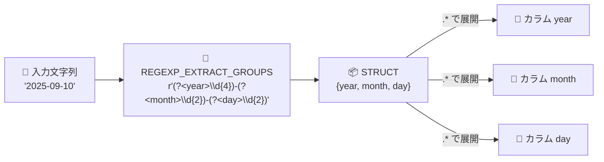

# BigQuery: REGEXP_EXTRACT_GROUPS 関数 (Preview)

**リリース日**: 2026-10-26

**サービス**: BigQuery

**機能**: REGEXP_EXTRACT_GROUPS 関数 (複数キャプチャグループの一括抽出)

**ステータス**: Preview

📊 [このアップデートのインフォグラフィックを見る](https://takech9203.github.io/google-cloud-news-summary/20261026-bigquery-regexp-extract-groups-preview.html)

## 概要

BigQuery の GoogleSQL に新しい文字列関数 `REGEXP_EXTRACT_GROUPS` が追加されました (Preview)。この関数は、正規表現内の複数のキャプチャグループにマッチする部分文字列を一度にまとめて抽出し、各グループに対応するフィールドを持つ `STRUCT` として返します。

従来の `REGEXP_EXTRACT` は 1 つのキャプチャグループしか扱えず、`REGEXP_EXTRACT_ALL` は正規表現に複数のキャプチャグループが含まれるとエラーになるため、1 つの文字列から複数の部分を取り出すには関数を複数回呼び出す必要がありました。`REGEXP_EXTRACT_GROUPS` を使えば、ログ行や ID 文字列、日付文字列などの構造化されたテキストを 1 回の関数呼び出しで複数カラムに分解でき、名前付きグループや型の自動キャストにも対応します。

ログ分析やデータクレンジングなどで正規表現による文字列パースを多用するデータエンジニア・アナリストに有用なアップデートです。

**アップデート前の課題**

- `REGEXP_EXTRACT` はキャプチャグループに対応する部分文字列を 1 つしか返せず、複数の部分を抽出するには同じ正規表現マッチングを複数回実行する必要があった
- `REGEXP_EXTRACT_ALL` は正規表現に複数のキャプチャグループが含まれるとエラーを返す仕様で、複数グループの一括抽出には使えなかった
- 抽出した文字列を数値などの型に変換するには、別途 `CAST` / `SAFE_CAST` を記述する必要があった

**アップデート後の改善**

- 1 回の関数呼び出しで、正規表現内のすべてのキャプチャグループにマッチする部分文字列を `STRUCT` として取得できるようになった
- 名前付きグループ (`(?<name>...)` / `(?P<name>...)`) を使うと `STRUCT` のフィールド名に反映され、`.*` 演算子で `STRUCT` を展開して各グループを個別のカラムとして取り出せるようになった
- グループ名に `__INT64` のような `__TYPE` サフィックスを付けることで、抽出した部分文字列を指定した型へ自動キャストできるようになった

## アーキテクチャ図



入力文字列が正規表現の複数キャプチャグループで一括パースされて `STRUCT` になり、`.*` 演算子で各グループを個別のカラムに展開できる流れを示しています。

## サービスアップデートの詳細

### 主要機能

1. **複数キャプチャグループの一括抽出**
   - `REGEXP_EXTRACT_GROUPS(value, regexp)` は、`value` の中で正規表現 `regexp` 全体が最初にマッチした箇所から、各キャプチャグループに対応する部分文字列を `STRUCT` として返す
   - `STRUCT` のフィールド順は、正規表現内のキャプチャグループの左から右の順序に対応する
   - 正規表現は re2 構文で、少なくとも 1 つのキャプチャグループを含む必要がある

2. **名前付きグループと STRUCT のカラム展開**
   - 名前付きグループ (`(?<name>...)` または `(?P<name>...)`、両者は等価) は、その名前が `STRUCT` のフィールド名になる
   - 名前のないグループは匿名フィールドとなり、`STRUCT` 内の 0 始まりの位置でアクセスできる
   - 戻り値が `STRUCT` のため、SELECT リストで `.*` 演算子を使ってフィールドを個別のカラムに展開できる

3. **`__TYPE` サフィックスによる自動キャスト**
   - グループ名の末尾にダブルアンダースコア + 型名 (例: `(?<val__INT64>...)`) を付けると、抽出した部分文字列がその型に自動キャストされる
   - `STRING` (BYTES 版では `BYTES`) からキャスト可能な任意の型をサポートし、型名の大文字小文字は区別されない。結果の `STRUCT` のフィールド名からは `__TYPE` サフィックスが除去される
   - キャストに失敗した場合 (空文字列の数値・ブール型へのキャストを含む) はエラーになる。オプショナルグループが未マッチで `NULL` の場合、キャスト結果も `NULL` になる

4. **NULL とオプショナルグループの扱い**
   - `value` が `NULL` の場合、または正規表現全体がまったくマッチしない場合は `NULL` を返す
   - 選択 (alternation) やオプショナルグループなどで特定のグループがマッチしなかった場合、対応する `STRUCT` フィールドが `NULL` になる (空文字列へのマッチとは区別される)

## 技術仕様

### 関数仕様

| 項目 | 詳細 |
|------|------|
| シグネチャ | `REGEXP_EXTRACT_GROUPS(value, regexp)` |
| 戻り値の型 | `STRUCT<...>` (フィールドは基本 `STRING`、入力が `BYTES` の場合は `BYTES`。自動キャストで他の型も可) |
| 正規表現エンジン | re2 |
| regexp の要件 | 文字列リテラルであること、キャプチャグループを 1 つ以上含むこと |
| ステータス | Preview (Pre-GA Offerings Terms が適用) |
| フィードバック窓口 | bigquery-sql-preview-support@googlegroups.com |

### エラーになる条件

| 条件 | 内容 |
|------|------|
| 無効な正規表現 | `regexp` が不正な場合 |
| リテラル以外の指定 | `regexp` が文字列リテラルでない場合 |
| グループなし | `regexp` にキャプチャグループが 1 つもない場合 |
| 無効なグループ名 | グループ名が有効な `STRUCT` フィールド名でない場合 (数字始まり、空白を含むなど。有効な名前は英数字とアンダースコアで構成され、先頭は英字またはアンダースコア) |
| グループ名の重複 | 同じグループ名を複数回使用した場合 (大文字小文字を区別しない) |
| キャスト失敗 | `__TYPE` 指定のグループで、抽出文字列が指定型にキャストできない場合 |

## 設定方法

SQL 関数のため事前設定は不要で、クエリ内でそのまま使用できます。

### 基本的な使用例

#### 名前なしグループの抽出

```sql
SELECT REGEXP_EXTRACT_GROUPS('abc123xyz', r'([a-z]+)([0-9]+)([a-z]+)') AS result
-- result: {abc, 123, xyz}
```

#### 名前付きグループの抽出とカラム展開

```sql
SELECT REGEXP_EXTRACT_GROUPS('PROD-WIDGET-1234', r'(?<env>\w+)-(?<product>\w+)-(?<id>\d+)').*
/*-------+-----------+------+
 | env   | product   | id   |
 +-------+-----------+------+
 | PROD  | WIDGET    | 1234 |
 +-------+-----------+------*/
```

#### 自動キャスト (`__TYPE` サフィックス)

```sql
SELECT REGEXP_EXTRACT_GROUPS('2025-09-10',
  r'(?<year__INT64>\d{4})-(?<month__INT64>\d{2})-(?<day__INT64>\d{2})').*
/*--------+---------+-------+
 | year   | month   | day   |
 +--------+---------+-------+
 | 2025   | 9       | 10    |
 +--------+---------+-------*/
```

## メリット

### ビジネス面

- **クエリ開発の効率化**: ログや ID 文字列のパース処理を 1 つの関数呼び出しに集約でき、クエリの記述量と保守コストを削減できる
- **可読性の向上**: 名前付きグループがそのままカラム名になるため、抽出ロジックの意図がクエリから読み取りやすくなる

### 技術面

- **冗長な繰り返しの排除**: 同一文字列への `REGEXP_EXTRACT` の複数回適用が不要になり、正規表現の定義を 1 箇所にまとめられる
- **型変換の統合**: `__TYPE` サフィックスにより抽出と型キャストを 1 ステップで行え、別途 `CAST` を書く必要がない
- **パイプ構文との親和性**: `|> EXTEND ... .*` のようにパイプ構文と組み合わせて、抽出したフィールドを後続の計算にそのまま利用できる

## デメリット・制約事項

### 制限事項

- Preview 機能であり、Pre-GA Offerings Terms が適用される ("as is" 提供、サポートが限定される場合がある)
- `regexp` は文字列リテラルである必要があり、カラム値や式を正規表現として渡すことはできない
- 同じグループ名の重複使用は不可 (大文字小文字を区別しない)
- `__TYPE` キャストは失敗するとエラーになる (空文字列の数値型へのキャストを含む)。`SAFE_CAST` のような NULL フォールバックは、グループをオプショナル (`(...)?`) にするなどの工夫が必要

### 考慮すべき点

- 正規表現全体がマッチしない場合は `STRUCT` 全体が `NULL`、一部グループのみ未マッチの場合はそのフィールドだけが `NULL` になるため、NULL ハンドリングの挙動の違いを理解して使う必要がある
- オプショナルグループが空文字列にマッチした場合と、まったくマッチしなかった場合では結果が異なる (前者は空文字列、後者は `NULL`)
- Preview 段階のため、本番ワークロードへの組み込みは GA を待つか、影響範囲を限定して利用することが望ましい

## ユースケース

### ユースケース 1: 構造化された ID 文字列の分解

**シナリオ**: `PROD-WIDGET-1234` のような「環境-製品-ID」形式の識別子カラムを、環境・製品・ID の 3 カラムに分解して分析したい。

**実装例**:
```sql
SELECT
  item_code,
  REGEXP_EXTRACT_GROUPS(item_code, r'(?<env>\w+)-(?<product>\w+)-(?<id__INT64>\d+)').*
FROM my_dataset.items
```

**効果**: 従来は `REGEXP_EXTRACT` を 3 回 + `CAST` を記述する必要があった処理が 1 つの関数呼び出しで完結し、クエリが簡潔になる。

### ユースケース 2: 時刻文字列のパースと計算 (パイプ構文)

**シナリオ**: `02:30:10` のような時刻文字列から時・分・秒を数値として取り出し、合計秒数を計算したい。

**実装例**:
```sql
FROM UNNEST(['02:30:10', '01:02:03']) AS time_str
|> EXTEND REGEXP_EXTRACT_GROUPS(time_str,
     r'(?<h__INT64>\d{2}):(?<m__INT64>\d{2}):(?<s__INT64>\d{2})').*
|> SELECT time_str, h * 3600 + m * 60 + s AS total_seconds
```

**効果**: 自動キャストにより抽出直後から数値演算が可能で、パース・変換・計算を宣言的に記述できる。

### ユースケース 3: 複数フォーマットが混在するログのパース

**シナリオ**: `config_id=123` と `option_name=ABC` のように異なる形式の行が混在するログから、形式ごとの値を抽出したい。

**実装例**:
```sql
SELECT t, REGEXP_EXTRACT_GROUPS(t, r'config_id=(?<id>\d+)|option_name=(?<name>\w+)') AS result
FROM logs
```

**効果**: 選択 (alternation) 内のすべての名前付きグループが `STRUCT` のフィールドになり、マッチした形式に対応するフィールドのみ値が入る (他は `NULL`) ため、1 つの正規表現で複数フォーマットを処理できる。

## 料金

`REGEXP_EXTRACT_GROUPS` は GoogleSQL の組み込み関数であり、関数固有の追加料金に関する記載は公式ドキュメント上で確認できませんでした。通常の BigQuery クエリ料金 (オンデマンドのスキャン量課金、または Editions のスロット課金) が適用されます。

詳細は [BigQuery の料金ページ](https://cloud.google.com/bigquery/pricing) を参照してください。

## 関連サービス・機能

- **REGEXP_EXTRACT**: 単一のキャプチャグループ (または正規表現全体) にマッチする部分文字列を返す既存関数。複数グループの抽出は本関数が補完する
- **REGEXP_EXTRACT_ALL**: マッチするすべての部分文字列を配列で返す既存関数。複数のキャプチャグループを含む正規表現はエラーになる
- **GoogleSQL の STRUCT 型 / `.*` 演算子**: 本関数の戻り値である `STRUCT` をカラムに展開する際に使用
- **BigQuery パイプ構文**: `|> EXTEND` と組み合わせて抽出フィールドを後続処理に利用できる

## 参考リンク

- 📊 [インフォグラフィック](https://takech9203.github.io/google-cloud-news-summary/20261026-bigquery-regexp-extract-groups-preview.html)
- [公式リリースノート](https://docs.cloud.google.com/release-notes#October_26_2026)
- [ドキュメント: 文字列関数 (REGEXP_EXTRACT_GROUPS)](https://docs.cloud.google.com/bigquery/docs/reference/standard-sql/string_functions#regexp_extract_groups)
- [料金ページ](https://cloud.google.com/bigquery/pricing)

## まとめ

`REGEXP_EXTRACT_GROUPS` の追加により、複数のキャプチャグループを含む正規表現での文字列パースが 1 回の関数呼び出しで完結し、名前付きグループと `__TYPE` 自動キャストによってログ分析やデータクレンジングのクエリを大幅に簡潔化できます。Preview 段階のため Pre-GA 規約を確認のうえ、まずは既存の `REGEXP_EXTRACT` を複数回呼び出しているクエリの置き換え候補として検証することをおすすめします。

---

**タグ**: BigQuery, GoogleSQL, 正規表現, REGEXP_EXTRACT_GROUPS, STRUCT, Preview, データ分析
