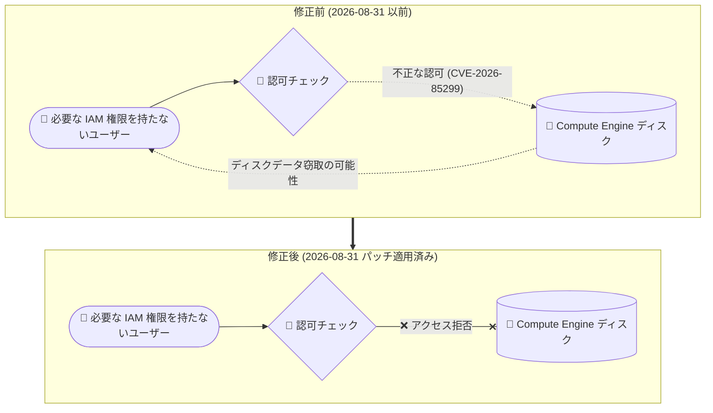

# Compute Engine: セキュリティ速報 GCP-2026-073 (CVE-2026-85299)

**リリース日**: 2026-10-26

**サービス**: Compute Engine

**機能**: セキュリティ速報 GCP-2026-073 (不正な認可の脆弱性への対応)

**ステータス**: セキュリティ速報 (重大度: High、対応済み)

📊 [このアップデートのインフォグラフィックを見る](https://takech9203.github.io/google-cloud-news-summary/20261026-compute-engine-security-gcp-2026-073.html)

## 概要

Google Cloud は 2026 年 10 月 26 日、Compute Engine に関するセキュリティ速報 GCP-2026-073 を公開しました。2026 年 8 月 31 日以前の Compute Engine に、不正な認可 (incorrect authorization) に関する脆弱性 (CVE-2026-85299) が存在していたことが判明したものです。この脆弱性は、ユーザーが本来必要な IAM 権限を持たない状態でディスクデータを窃取 (exfiltrate) できる可能性があるというもので、重大度は High と評価されています。

本脆弱性は 2026 年 8 月 31 日に Google 側でパッチが適用済みであり、**顧客側で必要なアクションはありません**。Compute Engine のサービス側 (Google 管理のインフラストラクチャ側) で修正が完了しているため、ゲスト OS のアップデートや設定変更などは不要です。

**脆弱性の内容**

- 2026 年 8 月 31 日より前の Compute Engine に、不正な認可の脆弱性 (CVE-2026-85299) が存在していた
- この脆弱性により、必要な IAM 権限を持たないユーザーがディスクデータを窃取できる可能性があった
- 重大度: High

**対応状況**

- 2026 年 8 月 31 日に Google によりパッチ適用済み
- 顧客側でのアクションは不要 (セキュリティ速報に "No action is required from you" と明記)

## アーキテクチャ図

修正前は認可処理の不備により、必要な IAM 権限を持たないユーザーがディスクデータにアクセスできる可能性がありました。2026 年 8 月 31 日のパッチ適用により、IAM 権限に基づく認可が正しく機能するようになっています。

## サービスアップデートの詳細

### 脆弱性の詳細 (GCP-2026-073)

| 項目 | 内容 |
|------|------|
| セキュリティ速報 ID | GCP-2026-073 |
| CVE | CVE-2026-85299 |
| 公開日 | 2026-10-26 |
| 対象 | 2026 年 8 月 31 日以前の Compute Engine |
| 脆弱性の種類 | 不正な認可 (incorrect authorization) |
| 影響 | 必要な IAM 権限を持たないユーザーによるディスクデータの窃取 |
| 重大度 | High |
| 対応状況 | 2026 年 8 月 31 日にパッチ適用済み |
| 顧客側のアクション | 不要 |

### 顧客側で必要なアクション

**アクションは不要です。** セキュリティ速報には「No action is required from you. This vulnerability was patched on August 31, 2026.」と明記されており、Google 側のインフラストラクチャで修正が完了しています。ゲスト OS のパッチ適用、VM の再起動、IAM ポリシーの変更などの対応は必要ありません。

## 考慮すべき点

- 本速報では、脆弱性が実際に悪用された事例の有無については言及されていません
- 脆弱性の発見から公表 (2026-10-26) まで期間がありますが、パッチ自体は 2026 年 8 月 31 日に適用済みです
- ディスクデータへのアクセス制御に関わる脆弱性であったため、ディスク関連の IAM 権限設計 (最小権限の原則) を改めて確認する良い機会といえます
- Compute Engine のセキュリティ速報は [XML フィード](https://docs.cloud.google.com/compute/docs/security-bulletins) で購読でき、今後の速報を早期に把握できます

## 関連サービス・機能

- **IAM (Identity and Access Management)**: 本脆弱性は IAM 権限による認可が正しく機能しないというもの。ディスクやスナップショットに対する権限付与状況の定期的な棚卸しが推奨される
- **Cloud Audit Logs**: ディスクやスナップショットへのアクセス操作を監査ログで追跡可能。データアクセスの可視化に有効
- **Security Command Center**: Google Cloud 環境全体の脆弱性・脅威の検出と管理に活用できる

## 参考リンク

- 📊 [インフォグラフィック](https://takech9203.github.io/google-cloud-news-summary/20261026-compute-engine-security-gcp-2026-073.html)
- [公式リリースノート](https://docs.cloud.google.com/release-notes#October_26_2026)
- [セキュリティ速報 GCP-2026-073](https://docs.cloud.google.com/compute/docs/security-bulletins#gcp-2026-073)

## まとめ

Compute Engine における不正な認可の脆弱性 (CVE-2026-85299、重大度 High) が公表されましたが、2026 年 8 月 31 日に Google 側でパッチ適用が完了しており、顧客側のアクションは不要です。ディスクデータへのアクセス制御に関わる脆弱性であったため、これを機にディスク関連の IAM 権限設計や監査ログの活用状況を見直すことを推奨します。

---

**タグ**: #ComputeEngine #Security #CVE-2026-85299 #GCP-2026-073 #IAM
