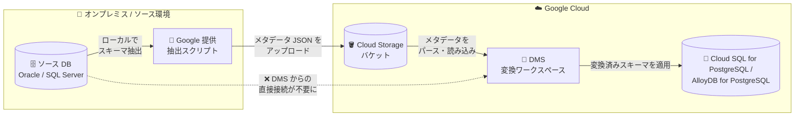

# Database Migration Service: Cloud Storage からのスキーマインポートによる異種間変換ワークスペース作成

**リリース日**: 2026-10-26

**サービス**: Database Migration Service (DMS)

**機能**: Cloud Storage のスキーマメタデータファイルを使用した異種間変換ワークスペースの作成

**ステータス**: Feature

📊 [このアップデートのインフォグラフィックを見る](https://takech9203.github.io/google-cloud-news-summary/20261026-database-migration-service-conversion-workspace-cloud-storage.html)

## 概要

Database Migration Service (DMS) で、Cloud Storage バケットにアップロードしたデータベーススキーマのメタデータファイルをインポートして、異種間 (heterogeneous) 移行用の変換ワークスペース (conversion workspace) を作成できるようになりました。これにより、スキーマ変換フェーズにおいて DMS とソースデータベース間の直接的なネットワーク接続が不要になります。

変換ワークスペースは、Oracle や SQL Server のスキーマ・オブジェクトを PostgreSQL 互換の SQL 構文に変換するための機能です。従来、ワークスペースの初期化にはソースデータベースへの直接接続によるスキーマ取得が必要でしたが、今回のアップデートで、Google 提供の抽出スクリプトをローカルで実行してスキーマメタデータを抽出し、その結果ファイルを Cloud Storage バケットにアップロードする方式が選択可能になりました。

ネットワーク制約の厳しいオンプレミス環境やセキュリティポリシー上クラウドからの直接接続が許可されない環境からの移行を計画している企業にとって、スキーマ変換の評価・実施を早期に開始できる重要な改善です。本機能は以下の 4 つの異種間移行パスで利用できます。

- Oracle → Cloud SQL for PostgreSQL
- Oracle → AlloyDB for PostgreSQL
- SQL Server → Cloud SQL for PostgreSQL
- SQL Server → AlloyDB for PostgreSQL

**アップデート前の課題**

- 変換ワークスペースの作成時、DMS が接続プロファイル経由でソースデータベースに直接接続し、ネットワーク経由でスキーマを取得する必要があった
- スキーマ変換フェーズの開始前に、DMS とソースデータベース間のネットワーク接続性 (接続経路の確保、ファイアウォール設定など) を確立する必要があった
- ネットワーク接続の準備が完了するまで、スキーマ変換の評価・作業に着手できなかった

**アップデート後の改善**

- Google 提供の抽出スクリプトをローカルで実行してスキーマメタデータを抽出し、Cloud Storage バケットにアップロードすることで、ソースデータベースへ接続せずにワークスペースを準備できるようになった
- スキーマ変換フェーズにおいて、DMS とソースデータベース間の直接的なネットワーク接続が不要になった
- Google Cloud コンソールに加え、gcloud CLI (`conversion-workspaces create` / `seed`) でも Cloud Storage からのワークスペース初期化が可能になった

## アーキテクチャ図



スキーマメタデータをローカルで抽出して Cloud Storage にアップロードすることで、DMS はバケットからスキーマを読み込んで変換ワークスペースを初期化します。スキーマ変換フェーズでは DMS からソースデータベースへの直接のネットワーク接続は不要です。

## サービスアップデートの詳細

### 主要機能

1. **Cloud Storage を使用したソーススキーマの初期化**
   - 変換ワークスペースのソース接続方法として、従来の「直接データベース接続」に加えて「Cloud Storage」を選択可能
   - Google 提供の Python 抽出スクリプトをローカルで実行し、生成されたスキーマメタデータ JSON ファイルを Cloud Storage バケットにアップロードする方式
   - コンソールの「Define source and pull schema snapshot」ページでバケット内のフォルダを選択し、スキーマスナップショットを取得

2. **gcloud CLI によるワークスペース作成と初期化 (seed)**
   - `gcloud database-migration conversion-workspaces create` で空のワークスペースを作成
   - `gcloud database-migration conversion-workspaces seed --gcs-path=gs://BUCKET/PREFIX/` で Cloud Storage 上のスキーマメタデータファイルをパースしてワークスペースに読み込み

3. **スキーマスナップショットの更新 (リフレッシュ)**
   - ソーススキーマに変更があった場合や対象オブジェクトを追加したい場合は、抽出スクリプトを再実行し、生成された JSON ファイルを同じフォルダに上書きアップロードすることでスナップショットを更新可能
   - 既存の変換ワークスペースの機能 (決定論的スキーマ変換、インタラクティブ SQL エディタ、Gemini 支援変換など) はそのまま利用可能

## 技術仕様

### 対応する移行パス

| ソース | 移行先 |
|------|------|
| Oracle | Cloud SQL for PostgreSQL |
| Oracle | AlloyDB for PostgreSQL |
| SQL Server | Cloud SQL for PostgreSQL |
| SQL Server | AlloyDB for PostgreSQL |

### 必要な IAM ロール

| アカウント | 必要なロール | 付与対象 |
|------|------|------|
| ワークスペースを作成するユーザーアカウント | Database Migration Admin (`roles/datamigration.admin`) | プロジェクト |
| DMS サービスアカウント (`service-PROJECT_NUMBER@gcp-sa-datamigration.iam.gserviceaccount.com`) | Storage Object Viewer (`roles/storage.objectViewer`) | スキーマファイルを格納する Cloud Storage バケット |

## 設定方法

### 前提条件

1. スキーマメタデータファイルを格納する Cloud Storage バケットを用意する
2. DMS サービスアカウントに対象バケットへの `roles/storage.objectViewer` を付与する
3. 抽出スクリプトを実行するマシンからソースデータベースへ接続できること (抽出スクリプト自体はソース DB へのネットワーク接続が必要)

### 手順

#### ステップ 1: スキーマメタデータの抽出とアップロード

コンソールの変換ワークスペース作成フローで「Source connection method」に **Cloud Storage** を選択し、サイドパネルの手順に従って Google 提供のメタデータ抽出ユーティリティをダウンロードします。ソースデータベースに対してローカルで実行し、生成されたスキーマメタデータ JSON ファイルを Cloud Storage バケットの専用フォルダにアップロードします。

#### ステップ 2: 空の変換ワークスペースを作成 (gcloud の場合)

```bash
gcloud database-migration conversion-workspaces create WORKSPACE_ID \
  --region=REGION \
  --source-database-engine=ORACLE \
  --destination-database-engine=POSTGRESQL
```

`WORKSPACE_ID` にワークスペースの識別子、`REGION` に作成先リージョンを指定します。

#### ステップ 3: Cloud Storage のスキーマファイルでワークスペースを初期化

```bash
gcloud database-migration conversion-workspaces seed WORKSPACE_ID \
  --region=REGION \
  --gcs-path=gs://BUCKET_NAME/PREFIX/
```

バケット内のスキーマメタデータファイルがパースされ、変換ワークスペースに読み込まれます。コンソールの場合は「Pull schema snapshot and continue」をクリック後、「Select and convert objects」ページで変換対象オブジェクトを選択して変換を実行します。

## メリット

### ビジネス面

- **移行プロジェクトの早期着手**: ネットワーク接続の準備 (接続経路の構築、ファイアウォール調整など) の完了を待たずに、スキーマ変換の評価・作業を開始できる
- **セキュリティ要件への適合**: クラウドサービスからソースデータベースへの直接接続を許可できないセキュリティポリシーの環境でも、スキーマ変換フェーズを進められる

### 技術面

- **スキーマ変換フェーズのネットワーク接続が不要**: DMS とソースデータベース間の直接接続なしでワークスペースを準備できる
- **CLI による自動化**: `gcloud database-migration conversion-workspaces create` / `seed` により、ワークスペースの作成・初期化をスクリプト化できる
- **スナップショットの再取得に対応**: スキーマ変更時は抽出スクリプトの再実行とファイルの上書きアップロードでワークスペースをリフレッシュできる

## デメリット・制約事項

### 考慮すべき点

- 抽出ユーティリティ自体は、実行元マシンからソースデータベースへのネットワーク接続を確立できる必要がある (DMS からの接続が不要になるのであり、抽出作業はソース DB に到達可能な環境で行う)
- ソーススキーマが変更された場合や対象オブジェクトを追加する場合は、抽出を再実行して同じフォルダにファイルを上書きアップロードし、スナップショットを再取得する必要がある
- 本機能が不要になるのはスキーマ変換フェーズの接続であり、実際のデータ移行 (移行ジョブ) ではソースデータベースへの接続が引き続き必要

## ユースケース

### ユースケース 1: ネットワーク接続準備と並行したスキーマ変換の先行実施

**シナリオ**: オンプレミスの Oracle データベースを AlloyDB for PostgreSQL に移行するプロジェクトで、VPN などの接続経路の構築に時間がかかっている。

**実装例**:
```bash
# 1. ローカルで抽出した JSON を Cloud Storage にアップロード
gsutil cp ./schema-metadata/*.json gs://my-dms-schema-bucket/oracle-erp/

# 2. 空のワークスペースを作成し、バケットから初期化
gcloud database-migration conversion-workspaces create oracle-erp-cw \
  --region=asia-northeast1 \
  --source-database-engine=ORACLE \
  --destination-database-engine=POSTGRESQL
gcloud database-migration conversion-workspaces seed oracle-erp-cw \
  --region=asia-northeast1 \
  --gcs-path=gs://my-dms-schema-bucket/oracle-erp/
```

**効果**: ネットワーク構築と並行してスキーマ変換・互換性課題の洗い出しを進められ、移行プロジェクト全体のリードタイムを短縮できる。

### ユースケース 2: 直接接続が許可されない環境からの移行アセスメント

**シナリオ**: セキュリティポリシーにより、クラウドサービスから社内の SQL Server への直接接続が許可されていない企業が、Cloud SQL for PostgreSQL への移行の実現性を評価したい。

**効果**: 社内で抽出したスキーマメタデータファイルのアップロードのみで変換ワークスペースを作成でき、変換結果 (変換可能なオブジェクト、要修正箇所) を事前に把握して移行可否を判断できる。

## 料金

Database Migration Service の料金の詳細は、公式の料金ページを参照してください。スキーマファイルの保存には Cloud Storage の料金が別途適用されます。

- [Database Migration Service の料金](https://cloud.google.com/database-migration/pricing)
- [Cloud Storage の料金](https://cloud.google.com/storage/pricing)

## 関連サービス・機能

- **Cloud Storage**: 抽出したスキーマメタデータ JSON ファイルの格納先。DMS サービスアカウントに `roles/storage.objectViewer` の付与が必要
- **Cloud SQL for PostgreSQL**: Oracle / SQL Server からの異種間移行の移行先データベース
- **AlloyDB for PostgreSQL**: Oracle / SQL Server からの異種間移行の移行先データベース
- **Gemini (DMS の Gemini 支援変換)**: 変換ワークスペースで利用できる生成 AI によるスキーマ・コード変換支援機能。Cloud Storage 方式で作成したワークスペースでも利用可能

## 参考リンク

- 📊 [インフォグラフィック](https://takech9203.github.io/google-cloud-news-summary/20261026-database-migration-service-conversion-workspace-cloud-storage.html)
- [公式リリースノート](https://docs.cloud.google.com/release-notes#October_26_2026)
- [変換ワークスペースの作成 (Oracle → Cloud SQL for PostgreSQL)](https://docs.cloud.google.com/database-migration/docs/oracle-to-postgresql/create-conversion-workspace#use-cloud-storage)
- [変換ワークスペースの作成 (Oracle → AlloyDB for PostgreSQL)](https://docs.cloud.google.com/database-migration/docs/oracle-to-alloydb/create-conversion-workspace#use-cloud-storage)
- [変換ワークスペースの作成 (SQL Server → Cloud SQL for PostgreSQL)](https://docs.cloud.google.com/database-migration/docs/sqlserver-to-csql-pgsql/create-conversion-workspace#use-cloud-storage)
- [変換ワークスペースの作成 (SQL Server → AlloyDB for PostgreSQL)](https://docs.cloud.google.com/database-migration/docs/sqlserver-to-alloydb/create-conversion-workspace#use-cloud-storage)
- [変換ワークスペースの概要](https://docs.cloud.google.com/database-migration/docs/oracle-to-postgresql/about-conversion-workspaces)
- [料金ページ](https://cloud.google.com/database-migration/pricing)

## まとめ

DMS の異種間変換ワークスペースが Cloud Storage からのスキーマメタデータインポートに対応し、スキーマ変換フェーズにおけるソースデータベースへの直接ネットワーク接続が不要になりました。ネットワーク制約のある環境からの Oracle / SQL Server → PostgreSQL 系移行を検討している場合は、接続経路の準備を待たずにスキーマ変換アセスメントを先行して開始することを推奨します。

---

**タグ**: #DatabaseMigrationService #DMS #CloudStorage #CloudSQL #AlloyDB #Oracle #SQLServer #PostgreSQL #DatabaseMigration
