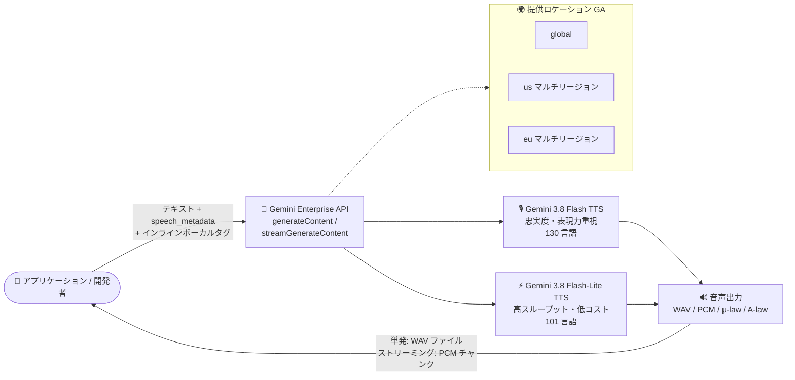

# Gemini Enterprise Agent Platform: Gemini 3.8 Flash TTS / Gemini 3.8 Flash-Lite TTS が一般提供 (GA) に

**リリース日**: 2026-10-26

**サービス**: Gemini Enterprise Agent Platform

**機能**: Gemini 3.8 Flash TTS / Gemini 3.8 Flash-Lite TTS の一般提供 (GA)

**ステータス**: GA (一般提供)

📊 [このアップデートのインフォグラフィックを見る](https://takech9203.github.io/google-cloud-news-summary/20261026-gemini-3-8-flash-tts-ga.html)

## 概要

Google Cloud は、Gemini Enterprise Agent Platform のテキスト読み上げ (TTS) モデルである **Gemini 3.8 Flash TTS** (`gemini-3.8-flash-tts`) と **Gemini 3.8 Flash-Lite TTS** (`gemini-3.8-flash-lite-tts`) の一般提供 (GA) を発表しました。両モデルは `global` ロケーションに加え、`us` および `eu` マルチリージョンで利用できます。

両モデルは、構造化されたスピーカー/スタイルメタデータ (`speech_metadata`)、インラインボーカルタグ (`<laugh>`、`<sigh>`、`<short pause>` など)、マルチスピーカーダイアログ、ストリーミングをサポートします。テキストを一言一句正確に読み上げる (verbatim recitation) 用途に最適化されており、ナレーション、オーディオブック、音声エージェントの応答などに適しています。なお、ボイスデザイン (Voice design) とボイスレプリケーション (Voice replication) の機能は引き続き Preview 提供です。

GA 化により、音声合成を本番ワークロードに組み込みたいエンタープライズユーザーは、SLA が適用される安定したモデルとして Gemini 3.8 TTS ファミリーを採用できるようになりました。忠実度重視の Flash TTS と、スループット/コスト効率重視の Flash-Lite TTS を、同一のリクエストスキーマのままモデル ID の変更だけで使い分けられます。

**アップデート前の課題**

- Gemini 3.8 Flash TTS / Flash-Lite TTS は 2026 年 9 月 28 日のリリース以降 Preview (Pre-GA Offerings Terms 適用) であり、本番利用には Pre-GA 規約上の制約を考慮する必要があった
- 提供ロケーションは `global` のみで、`us` / `eu` マルチリージョンでのデータ処理を求めるワークロードに対応できなかった
- 旧世代の `gemini-3.1-flash-tts-preview` では、スタイル指示をテキストに埋め込む形式 (例: "Say cheerfully: Hello!") だったため、指示文がそのまま読み上げられるリスクがあった

**アップデート後の改善**

- 両モデルが GA となり、本番・商用ワークロードで安心して利用できるようになった
- `global` ロケーションに加え、`us` / `eu` マルチリージョンで利用可能になった
- 構造化メタデータ (`speech_metadata`) によるスピーカー/スタイル指定、インラインボーカルタグ、マルチスピーカーダイアログ、ストリーミングが GA 機能として利用できるようになった

## アーキテクチャ図



アプリケーションは Gemini Enterprise API の `generateContent` / `streamGenerateContent` を通じて、テキストと構造化メタデータを 2 つの GA モデルのいずれかに送信し、WAV またはストリーミング PCM として音声を受け取ります。

## サービスアップデートの詳細

### 主要機能

1. **構造化されたスピーカー/スタイルメタデータ (`speech_metadata`)**
   - 入力テキストは一言一句読み上げる「台本」として扱われ、話し方の指示は各 `part` に付与する `speech_metadata` (`speaker`、`style`) で構造的に指定する
   - 例: `"speech_metadata": {"style": "cheerful and friendly"}`
   - スタイル指示文が誤って読み上げられる問題を構造的に回避できる

2. **インラインボーカルタグ**
   - `<laugh>`、`<sigh>`、`<cough>`、`<breath>`、`<short pause>` などの山括弧タグをトランスクリプト内に記述し、瞬間的な非言語音声イベントを挿入できる

3. **マルチスピーカーダイアログ**
   - 複数の話者による対話音声を 1 回のリクエストで生成できる
   - マルチスピーカーリクエストでは、各ターンの `speech_metadata` に設定済みスピーカーのいずれかを明示する

4. **ストリーミング**
   - `streamGenerateContent` によるストリーミング生成をサポートし、リアルタイム性が求められる音声エージェントなどに対応

5. **豊富なボイスオプション**
   - 30 のプレビルトボイス、2,000 以上の Extended Voice Library のボイスを利用可能
   - Voice design (ボイス作成) と Voice replication (ボイス複製) で作成したボイス (`voice_...` ID) も利用可能 (両機能は引き続き Preview)

### 2 モデルの使い分け

| 項目 | Gemini 3.8 Flash TTS | Gemini 3.8 Flash-Lite TTS |
|------|---------------------|---------------------------|
| モデル ID | `gemini-3.8-flash-tts` | `gemini-3.8-flash-lite-tts` |
| 強み | 音響忠実度、演技のニュアンス、方言カバレッジ | 高スループット、低レイテンシ、コスト効率 |
| 主なユースケース | オーディオブック、スタジオ品質のナレーション、複雑なマルチスピーカーダイアログ、難読語、地域方言 | 大量バッチ生成、音声エージェントカスケード、読み上げ機能、日常的なシングルスピーカー音声 |
| 対応言語 | 130 言語 | 101 言語 |
| 位置づけ | フラッグシップのクリエイティブモデル | `gemini-3.1-flash-tts-preview` の推奨後継 |

両モデルは同一のリクエストスキーマとプロンプト形式を共有しており、モデル ID の変更のみで切り替えられます。

## 技術仕様

### モデル仕様

| 項目 | 詳細 |
|------|------|
| 入力トークン上限 | 8,192 |
| 出力トークン上限 | 16,384 |
| 対応 API | GenerateContent API (`generateContent` / `streamGenerateContent`) |
| エンドポイント | `aiplatform.googleapis.com` |
| 消費オプション | Pay-as-you-go |
| SDK 要件 | Google Gen AI SDK (Python) 2.25.0 以降 |

### 音声出力フォーマット

| mimeType | フォーマット | 説明 |
|----------|-------------|------|
| `AUDIO_WAV` (単発リクエストのデフォルト) | WAV (`audio/wav`) | RIFF ヘッダー付き完全な WAV ファイル (16-bit PCM、24 kHz、モノラル) |
| `AUDIO_L16` (ストリーミングのデフォルト) | Linear PCM (`audio/l16`) | ヘッダーなし raw 16-bit signed little-endian PCM (24 kHz、モノラル) |
| `AUDIO_MULAW` | μ-law (`audio/mulaw`) | G.711 μ-law (8 kHz、モノラル)。北米・日本の電話系で利用 |
| `AUDIO_ALAW` | A-law (`audio/alaw`) | G.711 A-law (8 kHz、モノラル)。欧州・国際電話系で利用 |

## 設定方法

### 前提条件

1. プロジェクトを設定し、Gemini Enterprise API を有効化する
2. 開発環境に Application Default Credentials を構成する
3. Python を使用する場合: `pip install --upgrade "google-genai>=2.25.0"`

### 手順

#### ステップ 1: Python SDK でシングルスピーカー音声を生成

```python
from google import genai

client = genai.Client(enterprise=True, project="PROJECT_ID", location="global")

response = client.models.generate_content(
    model="gemini-3.8-flash-tts",
    contents=[{
        "role": "user",
        "parts": [{
            "text": "Have a wonderful day!",
            "speech_metadata": {"style": "cheerful and friendly"},
        }],
    }],
    config={
        "response_modalities": ["AUDIO"],
        "speech_config": {"voice_config": {"voice": "Kore"}},
    },
)

# 単発リクエストのレスポンスはデフォルトで完全な WAV ファイル
with open("out.wav", "wb") as f:
    f.write(response.candidates[0].content.parts[0].inline_data.data)
```

テキスト本文は台本として扱われ、スタイルは `speech_metadata` で指定します。

#### ステップ 2: REST API での呼び出し

```bash
curl -X POST \
  -H "Authorization: Bearer $(gcloud auth print-access-token)" \
  -H "Content-Type: application/json" \
  https://aiplatform.googleapis.com/v1/projects/PROJECT_ID/locations/global/publishers/google/models/gemini-3.8-flash-tts:generateContent \
  -d '{
    "contents": [{
      "role": "user",
      "parts": [{
        "text": "Have a wonderful day!",
        "speechMetadata": {"style": "cheerful and friendly"}
      }]
    }],
    "generationConfig": {
      "responseModalities": ["AUDIO"],
      "speechConfig": {"voiceConfig": {"voice": "Kore"}}
    }
  }' | jq -r '.candidates[0].content.parts[0].inlineData.data' | base64 --decode > out.wav
```

Flash-Lite TTS を使う場合はモデル ID を `gemini-3.8-flash-lite-tts` に変更するだけです。

## メリット

### ビジネス面

- **本番利用の安心感**: Pre-GA 規約の制約を受けない GA モデルとして、エンタープライズの本番・商用ワークロードに採用しやすくなった
- **データ所在地要件への対応**: `us` / `eu` マルチリージョンの提供により、リージョン要件のあるワークロードでも利用しやすくなった
- **コスト最適化の選択肢**: 高品質な Flash TTS と低コスト・高スループットの Flash-Lite TTS を、同一スキーマのままワークロードに応じて使い分けられる

### 技術面

- **構造化された制御**: `speech_metadata` とインラインボーカルタグにより、読み上げテキストと演出指示を分離して正確に制御できる
- **ストリーミング対応**: `streamGenerateContent` により音声エージェントなどリアルタイム用途に対応
- **豊富なボイス**: 30 のプレビルトボイスと 2,000 以上の Extended Voice Library ボイスを利用可能

## デメリット・制約事項

### 制限事項

- Voice design と Voice replication は引き続き Preview 提供 (Pre-GA Offerings Terms が適用される)
- 入力トークン上限は 8,192、出力トークン上限は 16,384
- Gemini Live API、Count Tokens API、Chat Completions API には対応していない (GenerateContent API を使用)
- `sampleRate` フィールドは無視される (Linear PCM / WAV は 24 kHz、μ-law / A-law は 8 kHz 固定。別のサンプルレートが必要な場合はクライアント側でリサンプリング)

### 考慮すべき点

- 旧モデル (`gemini-3.1-flash-tts-preview` 以前) からの移行では、スキーマ変更への対応が必要
  - インラインのスタイル指示文 (例: "Say cheerfully: ...") は読み上げられる可能性があるため、`speech_metadata` に移動する
  - 単発リクエストのデフォルト出力が raw PCM から WAV (RIFF ヘッダー付き) に変わったため、手動で WAV ヘッダーを付与していたコードは修正が必要
- マルチスピーカーリクエストでは全ターンで `speaker` の明示が必須
- 対応言語数がモデルにより異なる (Flash: 130 言語、Flash-Lite: 101 言語)

## ユースケース

### ユースケース 1: オーディオブック・スタジオ品質ナレーションの制作

**シナリオ**: 出版社がオーディオブックを大量制作したい。長時間のナレーションでも声質やトーンが一貫し、笑い声やため息などの演技表現も必要。

**実装例**:
```python
response = client.models.generate_content(
    model="gemini-3.8-flash-tts",
    contents=[{
        "role": "user",
        "parts": [{
            "text": "それは、忘れられない夏の日のことでした。<short pause> 彼は静かに扉を開けたのです。",
            "speech_metadata": {"style": "calm, storytelling narration"},
        }],
    }],
    config={
        "response_modalities": ["AUDIO"],
        "speech_config": {"voice_config": {"voice": "Kore"}},
    },
)
```

**効果**: Flash TTS の長時間マルチターン安定性により、声の同一性・音色・ルームトーンを維持したまま長編ナレーションを生成できる。

### ユースケース 2: コールセンター音声エージェントの応答生成

**シナリオ**: コールセンターの音声ボットで、LLM が生成した応答テキストを低レイテンシで音声化し、電話回線 (μ-law) に流したい。

**効果**: Flash-Lite TTS のストリーミングと `AUDIO_MULAW` 出力により、テレフォニーパイプラインに直接組み込める低コスト・低レイテンシの音声応答を実現できる。

## 料金

両モデルは Pay-as-you-go (従量課金) で利用できます。具体的な単価は公式料金ページを参照してください。

- [Gemini Enterprise Agent Platform の生成 AI 料金](https://cloud.google.com/gemini-enterprise-agent-platform/generative-ai/pricing)

## 利用可能リージョン

- **global** ロケーション
- **us** マルチリージョン
- **eu** マルチリージョン

最新のモデル提供状況は [Model availability](https://docs.cloud.google.com/gemini-enterprise-agent-platform/resources/locations) を参照してください。

## 関連サービス・機能

- **Gemini Live API**: 音声入出力を伴うリアルタイムの対話的な会話にはこちらを使用する (TTS モデルは正確なテキスト読み上げ向け)
- **Voice design (Preview)**: プロンプトからカスタムボイスのペルソナを作成し、`voice_...` ID として TTS リクエストで利用できる
- **Voice replication (Preview)**: 既存の音声を複製したボイスを TTS リクエストで利用できる
- **Cloud Text-to-Speech API**: 従来からの TTS サービス。旧世代 Gemini TTS モデル (Gemini 2.5 系など) のドキュメントはこちらに掲載されている

## 参考リンク

- 📊 [インフォグラフィック](https://takech9203.github.io/google-cloud-news-summary/20261026-gemini-3-8-flash-tts-ga.html)
- [公式リリースノート](https://cloud.google.com/release-notes#October_26_2026)
- [Generate speech with Gemini TTS (ドキュメント)](https://docs.cloud.google.com/gemini-enterprise-agent-platform/models/text-to-speech/overview)
- [Gemini 3.8 Flash TTS モデルページ](https://docs.cloud.google.com/gemini-enterprise-agent-platform/models/gemini/3-8-flash-tts)
- [Gemini 3.8 Flash-Lite TTS モデルページ](https://docs.cloud.google.com/gemini-enterprise-agent-platform/models/gemini/3-8-flash-lite-tts)
- [旧モデルからの移行ガイド](https://docs.cloud.google.com/gemini-enterprise-agent-platform/models/text-to-speech/migration-guide)
- [料金ページ](https://cloud.google.com/gemini-enterprise-agent-platform/generative-ai/pricing)

## まとめ

Gemini 3.8 Flash TTS / Flash-Lite TTS の GA により、構造化メタデータとボーカルタグによる高度な音声制御、マルチスピーカーダイアログ、ストリーミングを本番ワークロードで利用できるようになりました。`us` / `eu` マルチリージョン対応により、データ所在地要件のあるエンタープライズでも採用しやすくなっています。旧世代 TTS モデルを利用中の場合は、`speech_metadata` への移行とデフォルト出力フォーマットの変更 (WAV) に注意しつつ、移行ガイドに沿ったアップデートを推奨します。

---

**タグ**: #GeminiEnterpriseAgentPlatform #TTS #TextToSpeech #Gemini38FlashTTS #Gemini38FlashLiteTTS #GA #GenerativeAI #音声合成
