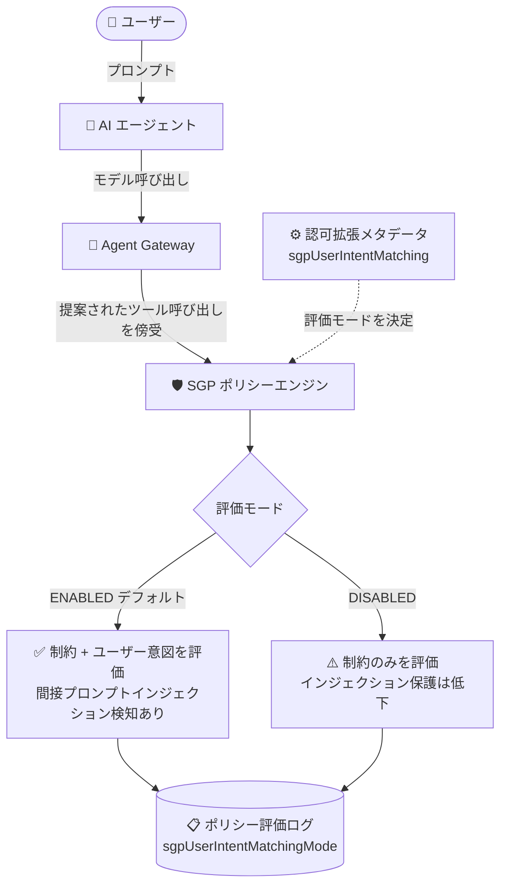

# Gemini Enterprise Agent Platform: Semantic Governance Policy のユーザー意図マッチング制御

**リリース日**: 2026-10-26

**サービス**: Gemini Enterprise Agent Platform

**機能**: Semantic Governance Policy におけるユーザー意図マッチング (`sgpUserIntentMatching`) の有効/無効制御

**ステータス**: Feature (Semantic Governance Policy は Pre-GA / Preview)

📊 [このアップデートのインフォグラフィックを見る](https://takech9203.github.io/google-cloud-news-summary/20261026-gemini-enterprise-agent-platform-sgp-user-intent-matching.html)

## 概要

Gemini Enterprise Agent Platform の Semantic Governance Policy (SGP) で、ユーザー意図マッチング (user intent matching) のオン/オフを制御できるようになりました。認可拡張 (authorization extension) のメタデータに `sgpUserIntentMatching` キーを設定することで、ポリシーエンジンの評価動作を切り替えられます。

Semantic Governance Policy は、エージェントが提案するツール呼び出しを実行前に評価するセキュリティチェックレイヤーです。ポリシーエンジンはデフォルトで 2 つの検証を行います。1 つは「制約 (Natural Language Constraints) への準拠」、もう 1 つは「ユーザーの本来のリクエスト (意図) との整合性」です。今回のアップデートにより、後者のユーザー意図マッチングを `DISABLED` に設定して無効化し、制約のみでの評価に切り替えることが可能になりました。デフォルトではユーザー意図マッチングは有効です。

対象ユーザーは、Agent Gateway と Semantic Governance Policy エンジンを運用するプラットフォーム管理者・セキュリティ管理者です。意図マッチングによる想定外の拒否 (誤検知) を避けたいケースと、間接プロンプトインジェクション対策を優先するケースのトレードオフを、環境ごとに明示的に選択できるようになります。

**アップデート前の課題**

- ユーザー意図マッチングは常に有効で、無効化する手段がなかった
- 制約に違反していないツール呼び出しでも、ポリシーエンジンがユーザーの意図と一致しないと判断すると拒否されることがあり、この挙動を管理者が制御できなかった
- ポリシー評価ログからは、評価にどのモード (意図マッチングの有無) が使われたかを確認できなかった

**アップデート後の改善**

- 認可拡張メタデータの `sgpUserIntentMatching` キー (`ENABLED` / `DISABLED`) でユーザー意図マッチングのオン/オフを制御できるようになった
- `DISABLED` 設定時は制約のみで評価されるため、意図マッチング起因の拒否を回避できる
- キーを設定すると、ポリシー評価ログの `sgpUserIntentMatchingMode` フィールドに各評価で使用されたモードが記録され、監査・デバッグが容易になった

## アーキテクチャ図



Agent Gateway が傍受したツール呼び出しを SGP ポリシーエンジンが評価する際、認可拡張メタデータの `sgpUserIntentMatching` の値によって「制約 + 意図」評価か「制約のみ」評価かが決まり、使用されたモードがポリシー評価ログに記録されます。

## サービスアップデートの詳細

### 主要機能

1. **`sgpUserIntentMatching` メタデータキーによる評価モード制御**
   - 認可拡張 (AuthzExtension) のメタデータに `sgpUserIntentMatching` キーを設定して制御する
   - `DISABLED`: ユーザー意図マッチングを無効化し、制約のみで判定する
   - `ENABLED` またはキーの削除: ユーザー意図マッチングを有効化する (デフォルトは有効)
   - 値は大文字で指定する必要があり、それ以外の値は無視されて意図マッチングは有効のまま維持される
   - 設定はその認可拡張がポリシーエンジンに送信するすべてのリクエストに適用される

2. **ポリシー評価ログへのモード記録 (`sgpUserIntentMatchingMode`)**
   - `sgpUserIntentMatching` キーが設定されている場合のみ、各評価ログにモードが記録される
   - `CONSTRAINTS_AND_INTENT`: 意図マッチング有効 (制約 + 意図で評価)
   - `CONSTRAINTS_ONLY`: 意図マッチング無効 (制約のみで評価)
   - `INTENT_ONLY`: 意図マッチング有効で、そのツール呼び出しに適用される制約がない場合

3. **ドライランモードとの独立した動作**
   - `sgpUserIntentMatching` は `sgpEnforcementMode` (ドライラン) と独立して機能する
   - ドライラン中は意図マッチングを有効のままにして、意図ベースの拒否をログで確認してから強制 (enforce) に移行する運用が推奨されている

## 技術仕様

### ユーザー意図マッチングの評価モード

| 設定値 | 評価内容 | ログの `sgpUserIntentMatchingMode` |
|------|------|------|
| 未設定 (デフォルト) | 制約 + ユーザー意図 | 記録されない |
| `ENABLED` | 制約 + ユーザー意図 | `CONSTRAINTS_AND_INTENT` または `INTENT_ONLY` (制約なしの場合) |
| `DISABLED` | 制約のみ | `CONSTRAINTS_ONLY` |
| その他の値 | 無視され意図マッチング有効のまま | - |

### 設定上の注意点

| 項目 | 詳細 |
|------|------|
| 設定場所 | 認可拡張 (AuthzExtension) の `metadata` |
| API | Network Services API (`v1beta1`) の PATCH |
| メタデータの置換 | `updateMask=metadata` は metadata マップ全体を置換するため、`sgpEnforcementMode` など維持したいキーもすべて含める必要がある |
| 反映時間 | 更新は長時間実行オペレーションで、ポリシーエンジンへの反映に数分かかる場合がある |

## 設定方法

### 前提条件

1. Semantic Governance Policy エンジンがプロビジョニング済みで状態が `ACTIVE` であること
2. Agent Gateway と、ポリシーエンジンをバインドする認可拡張・認可ポリシーが構成済みであること (`sgpUserIntentMatching` はこの認可拡張に設定するため)

### 手順

#### ステップ 1: ユーザー意図マッチングを無効化する

```bash
curl -X PATCH \
  "https://networkservices.googleapis.com/v1beta1/projects/PROJECT_ID/locations/LOCATION/authzExtensions/AUTHZ_EXTENSION_NAME?updateMask=metadata" \
  -H "Authorization: Bearer $(gcloud auth application-default print-access-token)" \
  -H "Content-Type: application/json" \
  -d '{
    "metadata": {
      "sgpUserIntentMatching": "DISABLED"
    }
  }'
```

認可拡張のメタデータに `sgpUserIntentMatching: DISABLED` を設定します。ドライランモード (`sgpEnforcementMode: DRY_RUN`) を併用している場合は、同じ `metadata` にそのキーも含めてください (metadata 全体が置換されるため)。

#### ステップ 2: ポリシー評価ログでモードを確認する

```bash
# Logs Explorer で以下のフィルタを使用
logName="projects/PROJECT_ID/logs/semantic-governance-policy"
```

各評価ログエントリの `sgpUserIntentMatchingMode` フィールドで、評価に使用されたモード (`CONSTRAINTS_ONLY` など) を確認できます。

#### ステップ 3: 意図マッチングを再度有効化する

```bash
curl -X PATCH \
  "https://networkservices.googleapis.com/v1beta1/projects/PROJECT_ID/locations/LOCATION/authzExtensions/AUTHZ_EXTENSION_NAME?updateMask=metadata" \
  -H "Authorization: Bearer $(gcloud auth application-default print-access-token)" \
  -H "Content-Type: application/json" \
  -d '{
    "metadata": {
      "sgpUserIntentMatching": "ENABLED"
    }
  }'
```

`ENABLED` を設定するか、メタデータからキーを削除すると意図マッチングが再び有効になります。

## メリット

### ビジネス面

- **誤検知による業務停止の回避**: 制約には違反していないのに意図との不一致と判定されてツール呼び出しが拒否されるケースを、管理者の判断で回避できる
- **段階的な導入が可能**: ドライランモードと組み合わせ、意図ベースの拒否をログで観察してから本番で強制するなど、環境に応じた導入戦略を選択できる

### 技術面

- **評価モードの可観測性**: `sgpUserIntentMatchingMode` フィールドにより、各評価がどのモードで行われたかをログで追跡でき、監査やトラブルシューティングが容易になる
- **再デプロイ不要の切り替え**: 認可拡張メタデータの PATCH だけで評価動作を変更でき、エージェントやゲートウェイの再構成は不要

## デメリット・制約事項

### 制限事項

- Semantic Governance Policy 自体が Pre-GA (Preview) の機能であり、LLM ベースの評価のため判定が不正確な場合がある
- `updateMask=metadata` はメタデータ全体を置換するため、他のキー (`sgpEnforcementMode` など) を誤って消さないよう注意が必要。ドライラン解除で metadata を空にすると、意図マッチング設定も同時にクリアされる
- 設定値は大文字 (`ENABLED` / `DISABLED`) のみ有効で、それ以外の値は無視される
- 設定の反映には数分かかる場合がある
- 設定は認可拡張単位で適用され、ツール単位・ポリシー単位での切り替えはできない

### 考慮すべき点

- **間接プロンプトインジェクション保護の低下 (重要)**: ユーザー意図マッチングは、メールや Web ページなどの信頼できないコンテンツがエージェントに注入したツール呼び出しを検知する仕組みそのもの。`DISABLED` にすると、注入されたツール呼び出しをブロックできるのは明示的に記述した制約のみとなり、間接プロンプトインジェクションに対する保護が低下する
- 無効化する場合は、Model Armor によるプロンプトスキャンや IAM、認可ポリシーなど他のレイヤーの防御を併用し、多層防御を維持することが重要
- ドライラン中は意図マッチングを有効のままにし、意図ベースの拒否内容をログで確認してから運用方針を決めることが推奨される

## ユースケース

### ユースケース 1: 誤検知の多いエージェントで制約のみの評価に切り替え

**シナリオ**: 社内の定型業務エージェントで、ユーザーのあいまいなプロンプトに対してポリシーエンジンが意図不一致と判定し、正当なツール呼び出しが頻繁に拒否されている。ツール呼び出しの安全性は詳細な Natural Language Constraints で担保できている。

**実装例**:
```bash
curl -X PATCH \
  "https://networkservices.googleapis.com/v1beta1/projects/my-project/locations/us-central1/authzExtensions/my-sgp-extension?updateMask=metadata" \
  -H "Authorization: Bearer $(gcloud auth application-default print-access-token)" \
  -H "Content-Type: application/json" \
  -d '{"metadata": {"sgpUserIntentMatching": "DISABLED"}}'
```

**効果**: 制約ベースの評価のみとなり誤検知が減少する。ログの `sgpUserIntentMatchingMode: CONSTRAINTS_ONLY` で動作を確認できる。ただしインジェクション対策は制約の網羅性に依存するため、制約の精査が前提となる。

### ユースケース 2: ドライラン中に意図ベースの拒否を事前評価

**シナリオ**: 本番導入前に、意図マッチングがどの程度ツール呼び出しを拒否するかを把握したい。

**効果**: `sgpEnforcementMode: DRY_RUN` と意図マッチング有効 (デフォルト) を併用することで、実際のブロックを発生させずに意図ベースの拒否 (verdict と rationale) をログで確認し、強制モード移行の判断材料にできる。

## 関連サービス・機能

- **Agent Gateway**: エージェントとモデル/ツール間の通信を傍受する実行時エンフォースメントポイント。認可拡張はこのゲートウェイにバインドされる
- **Cloud Logging**: ポリシー評価ログ (`semantic-governance-policy`) の出力先。`sgpUserIntentMatchingMode` や verdict、rationale、トークン使用量を記録
- **Model Armor**: プロンプト/レスポンスのスキャン (PII、プロンプトインジェクション検知など) を担う補完レイヤー。意図マッチング無効化時の多層防御として重要
- **IAM / 認可ポリシー (AuthzPolicy)**: ベースラインのアクセス制御。Semantic Governance Policy はこれらを置き換えるのではなく補完する

## 参考リンク

- 📊 [インフォグラフィック](https://takech9203.github.io/google-cloud-news-summary/20261026-gemini-enterprise-agent-platform-sgp-user-intent-matching.html)
- [公式リリースノート](https://docs.cloud.google.com/release-notes#October_26_2026)
- [ドキュメント: ユーザー意図マッチングの制御](https://docs.cloud.google.com/gemini-enterprise-agent-platform/govern/policies/configure-semantic-governance#control-intent-matching)
- [ドキュメント: Semantic Governance Policy の概要](https://docs.cloud.google.com/gemini-enterprise-agent-platform/govern/policies/semantic-governance-overview)

## まとめ

Semantic Governance Policy のユーザー意図マッチングを認可拡張メタデータ 1 つで制御できるようになり、誤検知の抑制と間接プロンプトインジェクション対策のトレードオフを環境ごとに選択できるようになりました。意図マッチングはインジェクション検知の中核機能であるため、無効化は制約の網羅性と他レイヤーの防御 (Model Armor、IAM など) を確認したうえで慎重に判断し、ログの `sgpUserIntentMatchingMode` で運用状態を継続的に監視することを推奨します。

---

**タグ**: Gemini Enterprise Agent Platform, Semantic Governance Policy, Agent Gateway, セキュリティ, プロンプトインジェクション, AI エージェント, ガバナンス
