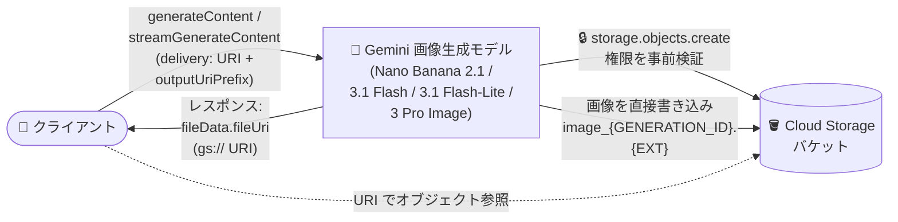

# Gemini Enterprise Agent Platform: Gemini 画像生成モデルの Cloud Storage 出力サポートが GA

**リリース日**: 2026-10-26

**サービス**: Gemini Enterprise Agent Platform

**機能**: Gemini 画像生成モデルの Cloud Storage 直接出力 (Direct Cloud Storage output persistence)

**ステータス**: GA (一般提供)

📊 [このアップデートのインフォグラフィックを見る](https://takech9203.github.io/google-cloud-news-summary/20261026-gemini-image-generation-cloud-storage-output-ga.html)

## 概要

Gemini Enterprise Agent Platform において、Gemini 画像生成モデルの生成画像を Cloud Storage バケットに直接書き込む「Direct Cloud Storage output persistence」が一般提供 (GA) になりました。対象モデルは Gemini Nano Banana 2.1 (`gemini-nano-banana-2.1`)、Gemini 3.1 Flash Image (`gemini-3.1-flash-image`)、Gemini 3.1 Flash-Lite Image (`gemini-3.1-flash-lite-image`)、Gemini 3 Pro Image (`gemini-3-pro-image`) の 4 モデルです。

`generateContent` および `streamGenerateContent` リクエストで `outputConfig.outputUriPrefix` と `generationConfig.responseFormat[].image.delivery: "URI"` を設定すると、生成・編集された画像がインラインの base64 バイト列としてではなく、指定した Cloud Storage バケットに直接書き込まれ、レスポンスにはオブジェクト URI (`fileData.fileUri`) が返されます。

画像の新規生成だけでなく画像編集にも対応しており、生成画像を保存・配信・後続処理するパイプラインを構築する開発者にとって、レスポンス処理とストレージ保存の手間を大きく削減するアップデートです。

**アップデート前の課題**

- 生成画像はレスポンス内にインラインの base64 エンコードされたバイト列 (`inlineData`) として返されるため、レスポンスサイズが大きくなっていた
- 生成画像を保存するには、クライアント側で base64 をデコードし、Cloud Storage などへ別途アップロードする処理を実装する必要があった

**アップデート後の改善**

- リクエストに `outputConfig.outputUriPrefix` と `responseFormat[].image.delivery: "URI"` を設定するだけで、生成画像がサービス側から Cloud Storage バケットに直接書き込まれるようになった
- レスポンスには `fileData.fileUri` としてオブジェクト URI が返されるため、クライアント側のデコード・アップロード処理が不要になった
- 書き込まれたオブジェクトは出力先バケットの暗号化設定 (CMEK を含む) を継承し、バケットのライフサイクル管理ルールに従うため、既存のガバナンス設定をそのまま適用できる

## アーキテクチャ図



クライアントが Cloud Storage 出力を指定してリクエストを送ると、サービスが生成画像をバケットへ直接書き込み、レスポンスにはインラインバイトの代わりにオブジェクト URI が返されます。

## サービスアップデートの詳細

### 主要機能

1. **Cloud Storage への直接出力**
   - `outputConfig.outputUriPrefix` に出力先バケット/フォルダプレフィックス (例: `gs://BUCKET_NAME/PREFIX/`) を指定
   - `generationConfig.responseFormat[].image.delivery` を `"URI"` に設定
   - 生成画像は `gs://BUCKET_NAME/PREFIX/image_{GENERATION_ID}.{EXTENSION}` の命名パターンで書き込まれる (複数候補の場合は `CANDIDATE_INDEX`、1 候補に複数画像の場合は `IMAGE_INDEX` が付加される)

2. **テキスト・画像混在レスポンスへの対応**
   - TEXT と IMAGE の混在レスポンスでは、テキストパートは従来どおり `parts[].text` にインラインで返される
   - 生成画像パートのみが Cloud Storage に書き込まれ、`parts[].fileData` オブジェクトとして返される

3. **Thinking 画像・ストリーミングへの対応**
   - `generationConfig.thinkingConfig.includeThoughts: true` の場合、中間の思考画像 (`parts[].thought: true`) も `thought_image_{GENERATION_ID}` プレフィックスで Cloud Storage に書き込まれる
   - `streamGenerateContent` では、各画像が Cloud Storage に書き込まれた後に、その `fileData.fileUri` を参照するレスポンスチャンクが送信される

4. **画像編集にも対応**
   - 新規生成だけでなく、`generateContent` / `streamGenerateContent` による画像編集の出力も同じ設定で Cloud Storage に直接保存できる

## 技術仕様

### リクエスト設定と動作

| 項目 | 詳細 |
|------|------|
| 対象モデル | `gemini-nano-banana-2.1`, `gemini-3.1-flash-image`, `gemini-3.1-flash-lite-image`, `gemini-3-pro-image` |
| 対象 API | `generateContent`, `streamGenerateContent` |
| 出力先指定 | `outputConfig.outputUriPrefix` (例: `gs://BUCKET_NAME/PREFIX/`) |
| 配信モード指定 | `generationConfig.responseFormat[].image.delivery: "URI"` |
| レスポンス形式 | `fileData.mimeType` と `fileData.fileUri` (gs:// URI) |
| オブジェクト命名 | `image_{GENERATION_ID}.{EXTENSION}` (必要に応じて候補番号・画像番号を付加) |
| 必要な IAM 権限 | 出力先バケットに対する `storage.objects.create` (`roles/storage.objectCreator` などに含まれる) |
| 暗号化・保持 | バケットの暗号化設定 (CMEK 含む) を継承し、ライフサイクル管理ルールに従う |

### リクエスト例 (REST)

```bash
curl -X POST \
  -H "Authorization: Bearer $(gcloud auth print-access-token)" \
  -H "Content-Type: application/json" \
  "https://aiplatform.googleapis.com/v1/projects/PROJECT_ID/locations/global/publishers/google/models/gemini-nano-banana-2.1:generateContent" \
  -d '{
    "contents": [
      {
        "role": "USER",
        "parts": [
          { "text": "Create an architectural rendering of a sustainable glass greenhouse in alpine snow." }
        ]
      }
    ],
    "generationConfig": {
      "responseModalities": ["TEXT", "IMAGE"],
      "responseFormat": [
        { "image": { "delivery": "URI" } }
      ]
    },
    "outputConfig": {
      "outputUriPrefix": "gs://BUCKET_NAME/PREFIX/"
    }
  }'
```

### レスポンス例

```json
{
  "candidates": [
    {
      "content": {
        "role": "model",
        "parts": [
          {
            "fileData": {
              "mimeType": "image/png",
              "fileUri": "gs://my-bucket/outputs/image_1234567890.png"
            }
          }
        ]
      }
    }
  ]
}
```

## 設定方法

### 前提条件

1. リクエストを認証するプリンシパルが、出力先 Cloud Storage バケットに対する `storage.objects.create` 権限 (`roles/storage.objectCreator` などに含まれる) を持っていること
2. 出力先の Cloud Storage バケットが存在すること

サービスは画像生成前に、呼び出し元の認証情報で対象バケットへの `storage.objects.create` 権限を検証します。バケットが存在しない場合、書き込み権限がない場合、または VPC Service Controls の境界により書き込みがブロックされる場合は、生成前に `403 PERMISSION_DENIED` エラーでリクエストが失敗します。

### 手順

#### ステップ 1: 出力先バケットへの権限付与

```bash
# 呼び出し元プリンシパルに Storage Object Creator ロールを付与
gcloud storage buckets add-iam-policy-binding gs://BUCKET_NAME \
  --member="user:USER_EMAIL" \
  --role="roles/storage.objectCreator"
```

#### ステップ 2: Cloud Storage 出力を指定してリクエストを送信

`generateContent` または `streamGenerateContent` リクエストで、`outputConfig.outputUriPrefix` と `generationConfig.responseFormat[].image.delivery: "URI"` の両方を設定します (上記リクエスト例を参照)。

## メリット

### ビジネス面

- **パイプライン構築の簡素化**: 生成画像の保存処理をサービス側に任せられるため、画像生成ワークロードの開発・運用コストを削減できる
- **ガバナンスの一元化**: 出力オブジェクトがバケットの CMEK 暗号化設定とライフサイクル管理ルールを継承するため、既存のデータガバナンスポリシーをそのまま適用できる

### 技術面

- **レスポンスの軽量化**: インラインの base64 バイト列の代わりに URI が返されるため、レスポンスサイズを削減できる
- **クライアント実装の削減**: base64 デコードと Cloud Storage へのアップロード処理が不要になる
- **ストリーミング対応**: `streamGenerateContent` でも各画像の書き込み完了後に URI を含むチャンクが届くため、ストリーミング処理と組み合わせられる
- **フェイルファスト設計**: 権限不足やバケット不存在は生成前に 403 エラーで検出されるため、無駄な生成処理が発生しない

## デメリット・制約事項

### 制限事項

- 対象は上記 4 つの Gemini 画像生成モデルに限られる
- テキストのみのレスポンスや、セーフティフィルタによりブロックされたリクエストでは、Cloud Storage にオブジェクトは書き込まれない
- 混在レスポンスのテキストパートは引き続きインラインで返される (Cloud Storage に書き込まれるのは画像パートのみ)

### 考慮すべき点

- 出力先バケットへの `storage.objects.create` 権限の付与が事前に必要
- VPC Service Controls の境界を構成している場合、境界が書き込みをブロックするとリクエスト自体が `403 PERMISSION_DENIED` で失敗する
- `thinkingConfig.includeThoughts: true` を設定すると中間の思考画像もバケットに書き込まれるため、オブジェクト数とストレージ使用量が増える点に留意する

## ユースケース

### ユースケース 1: 画像生成 Web サービスの配信パイプライン

**シナリオ**: ユーザーのプロンプトから画像を生成し、CDN 経由で配信する Web サービス。従来はアプリケーションサーバーが base64 をデコードして Cloud Storage にアップロードしていた。

**実装例**:
```json
{
  "generationConfig": {
    "responseModalities": ["TEXT", "IMAGE"],
    "responseFormat": [{ "image": { "delivery": "URI" } }]
  },
  "outputConfig": { "outputUriPrefix": "gs://my-app-images/generated/" }
}
```

**効果**: アプリケーションサーバーは返された `fileData.fileUri` をメタデータとして保存するだけでよく、画像バイトの中継処理が不要になり、サーバーのメモリ・帯域の負荷を削減できる。

### ユースケース 2: CMEK とライフサイクル管理による生成画像のガバナンス

**シナリオ**: コンプライアンス要件により、生成コンテンツを顧客管理暗号鍵 (CMEK) で暗号化し、一定期間後に自動削除したい企業。

**効果**: 出力オブジェクトは出力先バケットの CMEK 設定を継承し、バケットのライフサイクル管理ルールに従うため、Cloud Storage 側の設定だけで暗号化と保持期間のポリシーを一元管理できる。

## 料金

本アップデート自体の追加料金に関する公式情報は Release Notes には記載されていません。モデルの利用料金と Cloud Storage の料金は、以下の公式料金ページを参照してください。

- [Vertex AI の料金](https://cloud.google.com/vertex-ai/pricing)
- [Cloud Storage の料金](https://cloud.google.com/storage/pricing)

## 関連サービス・機能

- **Cloud Storage**: 生成画像の出力先。オブジェクトはバケットの暗号化設定 (CMEK 含む) とライフサイクル管理ルールを継承する
- **IAM**: 出力先バケットへの書き込みには `storage.objects.create` 権限 (`roles/storage.objectCreator` など) が必要
- **VPC Service Controls**: 境界によりバケットへの書き込みがブロックされる場合、リクエストは生成前に失敗する
- **Cloud KMS (CMEK)**: 出力先バケットに CMEK を設定している場合、生成画像も顧客管理鍵で暗号化される

## 参考リンク

- 📊 [インフォグラフィック](https://takech9203.github.io/google-cloud-news-summary/20261026-gemini-image-generation-cloud-storage-output-ga.html)
- [公式リリースノート](https://docs.cloud.google.com/release-notes#October_26_2026)
- [ドキュメント: Save generated images to Cloud Storage](https://docs.cloud.google.com/gemini-enterprise-agent-platform/models/capabilities/image-generation#save-generated-images-cloud-storage)
- [ドキュメント: 画像編集 (Gemini image models)](https://docs.cloud.google.com/gemini-enterprise-agent-platform/models/capabilities/gemini-edit-images)
- [料金ページ (Cloud Storage)](https://cloud.google.com/storage/pricing)

## まとめ

Gemini 画像生成モデルの出力を Cloud Storage へ直接永続化できる機能が GA となり、base64 デコードと再アップロードという定型処理が不要になりました。画像生成パイプラインを運用しているチームは、`outputConfig.outputUriPrefix` と `delivery: "URI"` の設定への移行を検討し、出力先バケットの IAM 権限・CMEK・ライフサイクルルールを事前に整備することを推奨します。

---

**タグ**: Gemini Enterprise Agent Platform, Gemini, 画像生成, Cloud Storage, generateContent, GA, CMEK
