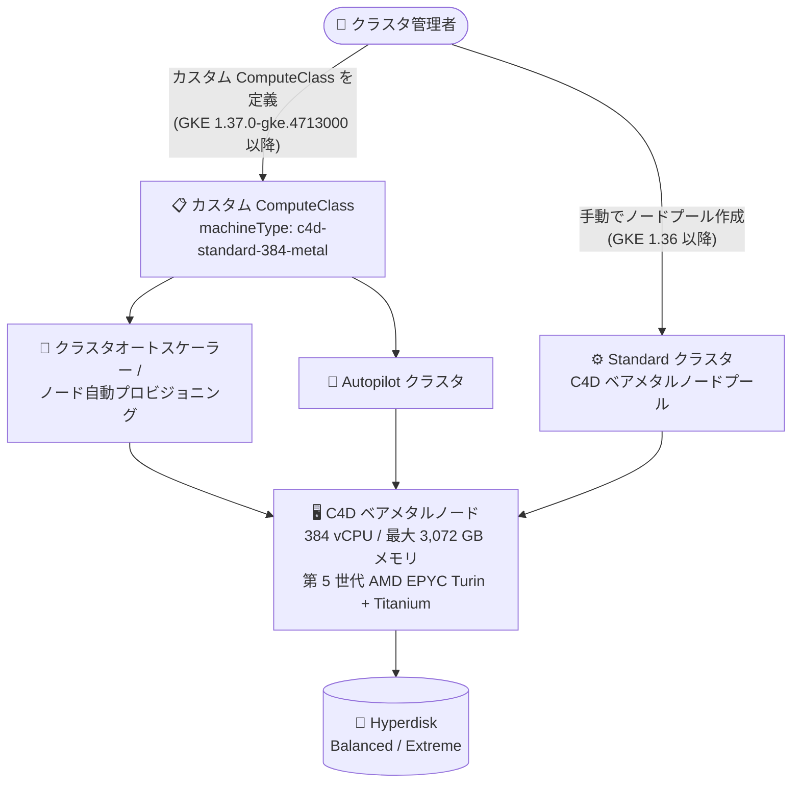

# Google Kubernetes Engine: C4D ベアメタルマシンタイプの一般提供 (GA)

**リリース日**: 2026-10-26

**サービス**: Google Kubernetes Engine (GKE)

**機能**: C4D ベアメタルマシンタイプ (c4d-standard-384-metal / c4d-highcpu-384-metal / c4d-highmem-384-metal) の GKE サポート

**ステータス**: GA (一般提供)

📊 [このアップデートのインフォグラフィックを見る](https://takech9203.github.io/google-cloud-news-summary/20261026-gke-c4d-bare-metal-machine-types-ga.html)

## 概要

GKE において、C4D ベアメタルマシンタイプ (`c4d-standard-384-metal`、`c4d-highcpu-384-metal`、`c4d-highmem-384-metal`) が一般提供 (GA) になりました。バージョン 1.36 以降を実行する Standard クラスタで、C4D ベアメタルノードプールを作成できます。さらにバージョン 1.37.0-gke.4713000 以降では、クラスタオートスケーラー、ノード自動プロビジョニング、カスタム ComputeClass と組み合わせて C4D ベアメタルノードを使用でき、カスタム ComputeClass を使用する Autopilot クラスタでも利用可能です。

C4D は第 5 世代 AMD EPYC Turin プロセッサと Google 独自の Titanium オフロード基盤を搭載した汎用マシンシリーズです。ベアメタルマシンタイプは 384 vCPU と最大 3,072 GB のメモリを提供し、専用のホストサーバー上でハイパーバイザーなしに直接実行されます。ハイパーバイザーを介さない実行が必要なワークロード (ライセンス要件、ネステッド仮想化、低レベルのハードウェアアクセスなど) や、大規模なインメモリ処理を Kubernetes 上で運用したいユーザーが対象です。

なお、1.37.0-gke.4713000 より前のバージョンでは、C4D ベアメタルノードプールは手動でスケールする必要があります。

**アップデート前の課題**

- GKE では C4D の仮想マシン (VM) タイプは利用できたものの、C4D ベアメタルマシンタイプは GA として利用できなかった
- ベアメタルマシンタイプの先行シリーズである C3 / C4A ベアメタル (GKE 1.35.3-gke.1389000 以降でサポート) は、それぞれ 192 vCPU / 96 vCPU までの構成であり、より大規模な単一ノード構成の選択肢が限られていた
- ベアメタルノードを自動スケーリングやノード自動プロビジョニングと組み合わせる手段がシリーズごとに限定されていた

**アップデート後の改善**

- GKE Standard クラスタ (バージョン 1.36 以降) で 384 vCPU / 最大 3,072 GB メモリの C4D ベアメタルノードプールを作成できるようになった
- バージョン 1.37.0-gke.4713000 以降では、クラスタオートスケーラー、ノード自動プロビジョニング、カスタム ComputeClass による自動的なノード管理に対応した
- カスタム ComputeClass を使用することで、Autopilot クラスタでも C4D ベアメタルノードを利用できるようになった

## アーキテクチャ図



GKE バージョンに応じた C4D ベアメタルノードのプロビジョニング経路を示しています。1.36 以降では Standard クラスタでの手動作成、1.37.0-gke.4713000 以降ではカスタム ComputeClass を介した自動プロビジョニング (Autopilot 含む) が可能です。

## サービスアップデートの詳細

### 主要機能

1. **C4D ベアメタルノードプールの GA**
   - `c4d-standard-384-metal`、`c4d-highcpu-384-metal`、`c4d-highmem-384-metal` の 3 つのマシンタイプが GKE で一般提供
   - バージョン 1.36 以降の Standard クラスタでノードプールを作成可能
   - ベアメタルインスタンスは専用ホストサーバーを必要とし、そのホスト上で実行される唯一のコンピュートインスタンスとなる

2. **自動スケーリング・自動プロビジョニングへの対応 (1.37.0-gke.4713000 以降)**
   - クラスタオートスケーラーおよびノード自動プロビジョニングで C4D ベアメタルノードを管理可能
   - カスタム ComputeClass の `machineType` ルールで正確なマシンタイプを指定してプロビジョニング
   - カスタム ComputeClass を使用する Autopilot クラスタでも利用可能
   - これより前のバージョンでは、C4D ベアメタルノードプールは手動スケールが必要

3. **第 5 世代 AMD EPYC Turin + Titanium 基盤**
   - C4D は推定 SPECrate®2017_int_base ベンチマークで C3D 比 30% の性能向上
   - 最大 4.1 GHz のブースト周波数と改善された IPC により、MySQL で 55% 高い QPS、Memorystore for Redis で 35% 高いオペレーション性能 (C3D 比)
   - Titanium によるネットワークオフロードで、標準ネットワーキングで最大 100 Gbps、Tier_1 ネットワーキングで最大 200 Gbps の帯域

## 技術仕様

### C4D ベアメタルマシンタイプ

| マシンタイプ | vCPU | メモリ |
|------|------|------|
| `c4d-highcpu-384-metal` | 384 | 768 GB |
| `c4d-standard-384-metal` | 384 | 1,488 GB |
| `c4d-highmem-384-metal` | 384 | 3,072 GB |

### GKE バージョン要件

| 利用形態 | 必要な GKE バージョン |
|------|------|
| Standard クラスタでのノードプール手動作成 | 1.36 以降 |
| クラスタオートスケーラー / ノード自動プロビジョニング / カスタム ComputeClass / Autopilot (カスタム ComputeClass 経由) | 1.37.0-gke.4713000 以降 |

### ストレージ・ネットワーク

| 項目 | 詳細 |
|------|------|
| プロセッサ | 第 5 世代 AMD EPYC Turin (最大ブースト 4.1 GHz) |
| 対応ディスク | Hyperdisk Balanced、Hyperdisk Extreme |
| Local SSD | ベアメタルインスタンスでは利用不可 (`-lssd` の C4D VM でのみ利用可) |
| ネットワーク帯域 | 標準: 最大 100 Gbps / per VM Tier_1: 最大 200 Gbps |
| 基盤 | Titanium (ネットワークオフロード) |

## 設定方法

### 前提条件

1. GKE Standard クラスタの場合: バージョン 1.36 以降
2. 自動スケーリング・ComputeClass・Autopilot で使用する場合: バージョン 1.37.0-gke.4713000 以降
3. C4D ベアメタルインスタンスが利用可能なリージョン・ゾーンであること

### 手順

#### ステップ 1: Standard クラスタで C4D ベアメタルノードプールを作成する

```bash
gcloud container node-pools create c4d-metal-pool \
    --cluster=CLUSTER_NAME \
    --location=LOCATION \
    --machine-type=c4d-standard-384-metal
```

`--machine-type` に C4D ベアメタルマシンタイプを指定してノードプールを作成します。1.37.0-gke.4713000 より前のバージョンでは、このノードプールのスケールは手動で行う必要があります。

#### ステップ 2: カスタム ComputeClass で自動プロビジョニングする (1.37.0-gke.4713000 以降)

```yaml
apiVersion: cloud.google.com/v1
kind: ComputeClass
metadata:
  name: c4d-metal-class
spec:
  priorities:
  - machineType: c4d-standard-384-metal
  nodePoolAutoCreation:
    enabled: true
```

ベアメタルマシンタイプは正確なマシンタイプの指定が必要なため、`machineFamily` フィールドではなく `machineType` フィールドで指定します。`machineFamily: c4d` と指定しても、ベアメタルマシンタイプはプロビジョニングされません。ワークロード側では `nodeSelector` で `cloud.google.com/compute-class: c4d-metal-class` を指定します。

## メリット

### ビジネス面

- **大規模ワークロードの集約**: 384 vCPU / 最大 3,072 GB メモリの単一ノードにより、大規模なデータベースやインメモリ処理を少ないノード数で運用できる
- **コスト最適化の選択肢**: C4D シリーズはリソースベースおよびフレキシブルな確約利用割引 (CUD) に対応しており、長期利用でのコスト削減が可能

### 技術面

- **ハイパーバイザーなしの直接実行**: ベアメタルインスタンスは専用ホストサーバー上で動作し、ハードウェアへの低レベルアクセスが必要なワークロードに対応できる
- **Kubernetes ネイティブな運用**: 1.37.0-gke.4713000 以降ではクラスタオートスケーラー・ノード自動プロビジョニング・ComputeClass と統合され、ベアメタルノードも宣言的に管理できる
- **高いネットワーク性能**: Titanium によるオフロードで最大 200 Gbps (Tier_1) のネットワーク帯域を利用できる

## デメリット・制約事項

### 制限事項

- 1.37.0-gke.4713000 より前のバージョンでは、C4D ベアメタルノードプールの自動スケールは不可で、手動スケールが必要
- 事前定義された Autopilot の Performance ComputeClass はベアメタルマシンタイプをサポートしない。Autopilot やノードプール自動作成で使用するには、カスタム ComputeClass で正確なマシンタイプを指定する必要がある
- カスタム ComputeClass の `machineFamily` フィールド (例: `c4d`) ではベアメタルマシンタイプはプロビジョニングされない
- C4D ベアメタルインスタンスでは Local SSD は利用不可 (Hyperdisk Balanced / Hyperdisk Extreme のみ)
- Confidential VM (AMD SEV) はベアメタルインスタンスでは利用不可

### 考慮すべき点

- ベアメタルインスタンスは専用ホストサーバーを占有するため、小規模ワークロードには 384 vCPU の粒度が過剰になる場合がある。ノードあたりの集約率とコストのバランスを検討する
- C4D ベアメタルの利用可能リージョン・ゾーンは限定されるため、デプロイ先リージョンでの提供状況を事前に確認する

## ユースケース

### ユースケース 1: 大規模インメモリデータベースの GKE 移行

**シナリオ**: 3 TB 近いメモリを必要とするインメモリデータベースやキャッシュ層を、Kubernetes 上で統一的に運用したい。

**実装例**:
```yaml
apiVersion: cloud.google.com/v1
kind: ComputeClass
metadata:
  name: inmemory-db-class
spec:
  priorities:
  - machineType: c4d-highmem-384-metal
  nodePoolAutoCreation:
    enabled: true
```

**効果**: `c4d-highmem-384-metal` (384 vCPU / 3,072 GB メモリ) により、メモリ集約型ワークロードを単一ノードに収容しつつ、ComputeClass でノードのライフサイクルを自動管理できる。

### ユースケース 2: ハイパーバイザーなしの実行が必要なワークロード

**シナリオ**: ライセンス要件やネステッド仮想化、低レベルのハードウェアアクセスなど、ハイパーバイザーを介さない実行環境が必要なワークロードを GKE で運用したい。

**効果**: 専用ホストサーバー上で直接実行されるベアメタルノードを GKE のノードプールとして管理でき、既存の Kubernetes 運用 (デプロイ、監視、アップグレード) に統合できる。

## 料金

C4D ベアメタルノードの料金は、Compute Engine の C4D マシンタイプ料金に基づきます (GKE Standard ではノードの Compute Engine 料金 + クラスタ管理手数料、Autopilot では ComputeClass 経由の場合ノードベースの課金)。C4D シリーズはオンデマンド、Spot VM (VM のみ)、リソースベース / フレキシブル確約利用割引 (CUD) に対応しています。ベアメタルマシンタイプの具体的な単価は、以下の公式料金ページを参照してください。

- [Compute Engine VM インスタンス料金](https://cloud.google.com/compute/vm-instance-pricing)
- [GKE の料金](https://cloud.google.com/kubernetes-engine/pricing)

## 利用可能リージョン

C4D ベアメタルインスタンスは一部のリージョン・ゾーンで利用可能です。最新の提供状況は [ベアメタルインスタンスのリージョンとゾーン](https://docs.cloud.google.com/compute/docs/instances/bare-metal-instances#regions_zones) および [リージョンとゾーン](https://docs.cloud.google.com/compute/docs/regions-zones#available) を参照してください。

## 関連サービス・機能

- **Compute Engine (C4D マシンシリーズ)**: GKE ノードの基盤となるマシンシリーズ。ベアメタルのほか、VM タイプや Local SSD 付き (`-lssd`) タイプも提供
- **カスタム ComputeClass**: ベアメタルマシンタイプを Autopilot やノードプール自動作成で使用するために必須の仕組み。`machineType` ルールで正確なマシンタイプを指定する
- **クラスタオートスケーラー / ノード自動プロビジョニング**: 1.37.0-gke.4713000 以降で C4D ベアメタルノードの自動管理に対応
- **Hyperdisk (Balanced / Extreme)**: C4D ベアメタルインスタンスで利用可能なブロックストレージ
- **確約利用割引 (CUD)**: C4D はリソースベースおよびフレキシブル CUD に対応

## 参考リンク

- 📊 [インフォグラフィック](https://takech9203.github.io/google-cloud-news-summary/20261026-gke-c4d-bare-metal-machine-types-ga.html)
- [公式リリースノート](https://docs.cloud.google.com/release-notes#October_26_2026)
- [Machine support with GKE](https://docs.cloud.google.com/kubernetes-engine/docs/concepts/machine-support#machine-support)
- [ベアメタルインスタンス (C4D)](https://docs.cloud.google.com/compute/docs/instances/bare-metal-instances)
- [C4D マシンシリーズ](https://docs.cloud.google.com/compute/docs/general-purpose-machines#c4d_series)
- [カスタム ComputeClass について](https://docs.cloud.google.com/kubernetes-engine/docs/concepts/about-custom-compute-classes)
- [料金ページ (Compute Engine VM インスタンス)](https://cloud.google.com/compute/vm-instance-pricing)

## まとめ

GKE で 384 vCPU / 最大 3,072 GB メモリの C4D ベアメタルマシンタイプが GA となり、ハイパーバイザーなしの実行環境や大規模インメモリワークロードを Kubernetes 上で運用する選択肢が広がりました。1.37.0-gke.4713000 以降ではカスタム ComputeClass・オートスケーラー・ノード自動プロビジョニングとの統合により、ベアメタルノードも宣言的に管理できます。該当ワークロードを持つ場合は、クラスタのバージョン要件と対象リージョンでの提供状況を確認のうえ、カスタム ComputeClass での導入を検討してください。

---

**タグ**: #GKE #ComputeEngine #C4D #BareMetal #AMD #EPYC #Kubernetes #Autopilot #ComputeClass #GA
