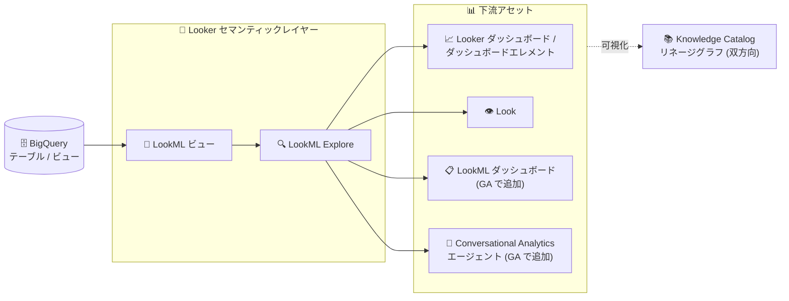

# Looker (Google Cloud core) / Knowledge Catalog: データリネージが GA

**リリース日**: 2026-10-26

**サービス**: Looker (Google Cloud core), Knowledge Catalog

**機能**: Looker (Google Cloud core) のデータリネージ (Knowledge Catalog 統合)

**ステータス**: 一般提供 (GA)

📊 [このアップデートのインフォグラフィックを見る](https://takech9203.github.io/google-cloud-news-summary/20261026-looker-data-lineage-ga.html)

## 概要

Knowledge Catalog における Looker (Google Cloud core) のデータリネージ (系統) サポートが一般提供 (GA) になりました。BigQuery のデータソースから Looker のセマンティックレイヤー (LookML ビュー / Explore) を経て、ダッシュボード、ダッシュボードエレメント、Look、LookML ダッシュボード、Conversational Analytics エージェントといった下流アセットに至る end-to-end のデータフローを可視化できます。

今回の GA では、LookML ダッシュボードと Conversational Analytics エージェントまでの end-to-end の可視性が追加されました。また、リネージの有効化は Data Lineage API とサービスレベルの取り込み制御 (ingestion control) を通じて独立して管理されるようになり、Looker 内部の Knowledge Catalog メタデータ設定から分離 (デカップリング) されました。取り込み制御は組織・フォルダ・プロジェクトの各レベルで設定できます。

なお、2026-10-21 に GA となった Knowledge Catalog によるメタデータの自動カタログ化の時点では、データリネージ統合は Preview のままでした ([関連レポート](./2026-10-21-looker-knowledge-catalog-ga.md))。今回のアップデートで、リネージ統合自体が GA に昇格しています。

**アップデート前の課題**

- データリネージ統合は Preview として提供されており、Pre-GA 提供条件下での利用だったため、本番のデータガバナンス・監査ワークフローへの組み込み判断が難しかった
- Preview 時点では LookML ダッシュボードや Conversational Analytics エージェントまでの end-to-end の可視性が提供されていなかった
- リネージの有効化設定が Looker の Knowledge Catalog メタデータ統合設定と結び付いており、Looker Admin パネル内の Preview 用設定に依存していた

**アップデート後の改善**

- データリネージが GA となり、データガバナンス、影響分析、監査ワークフローの本番基盤として利用できるようになった
- LookML ダッシュボードと Conversational Analytics エージェントを含む end-to-end のリネージ可視性が追加された
- リネージの有効化が Data Lineage API とサービスレベルの取り込み制御で独立管理されるようになり、組織・フォルダ・プロジェクトの各レベルで取り込みを制御できるようになった (Looker Admin パネルでの設定は不要)

## アーキテクチャ図



BigQuery のデータソースから LookML ビュー / Explore を経由して、ダッシュボード・Look・LookML ダッシュボード・Conversational Analytics エージェントに至るデータフローを Knowledge Catalog のリネージグラフで双方向に追跡できます。右方向に下流影響を評価し、左方向に上流の出所を監査できます。

## サービスアップデートの詳細

### 主要機能

1. **End-to-end データリネージの GA**
   - BigQuery ソース → LookML ビュー / Explore → ダッシュボード / Look / LookML ダッシュボード / Conversational Analytics エージェントのデータフローを可視化
   - リネージグラフは対象アセットを中央ノードとし、左に上流ソース、右に下流コンシューマを表示する双方向レイアウト
   - 下流影響分析 (例: BigQuery テーブルのカラム削除前に、破損し得るダッシュボードを特定) と上流データ監査 (経営ダッシュボードの指標の出所・変換・管理の連鎖を追跡) に対応

2. **LookML ダッシュボードと Conversational Analytics エージェントのサポート (今回追加)**
   - GA ローンチで、LookML ダッシュボードと Conversational Analytics エージェントまでの end-to-end の可視性が追加された
   - サポート対象の Looker アセット: Looker ダッシュボード、ダッシュボードエレメント (タイル)、Look、LookML ダッシュボード、Looker エージェント (Conversational Analytics エージェント)、LookML Explore、LookML ビュー

3. **リネージ有効化の独立管理 (今回変更)**
   - リネージの有効化は Data Lineage API とサービスレベルの取り込み制御で管理され、Looker 内部の Knowledge Catalog メタデータ統合のオプトアウト設定から分離された
   - Looker Admin パネルでの設定は不要。Preview 期間中に Looker Admin パネルで構成した設定はリネージ統合に適用されなくなった
   - Data Lineage API が有効なプロジェクトの Looker (Google Cloud core) インスタンスでは、リネージ取り込みがデフォルトで有効

4. **組織・フォルダ・プロジェクトレベルの取り込み制御**
   - データリネージの取り込みを組織、フォルダ、プロジェクトの各レベルで制御可能
   - Knowledge Catalog はプロジェクト → フォルダ → 組織の順にリソース階層を評価し、最初に明示的に設定された構成を適用する (どのレベルにも設定がない場合はシステムデフォルト)
   - サービス統合 (`LOOKER_CORE` など) ごとに独立して構成を解決

5. **リネージの閲覧とフィルタリング**
   - Knowledge Catalog の検索ページで BigQuery テーブルや Looker アセットを検索し、詳細ページの Lineage タブでグラフを表示
   - List ビューではエンティティタイプでフィルタ可能 (例: `Looker Dashboard`、`LookML Dashboard`、`Looker Look` に絞り込み、中間の LookML ビュー / Explore を除外)
   - ノードの Aspects セクションから下流アセットの所有者 (メールアドレス) を確認可能

## 技術仕様

### リネージ統合の仕様

| 項目 | 詳細 |
|------|------|
| 対象インスタンス | Looker (Google Cloud core) の全エディション (Looker (original) は非対応) |
| 対象データソース | BigQuery のみ |
| 粒度 | オブジェクトレベル (テーブル、ビュー、Explore、Looker ダッシュボード、LookML ダッシュボード、Conversational Analytics エージェント)。カラムレベルは未サポート |
| 必要な API | Data Lineage API (`datalineage.googleapis.com`) を Looker インスタンスと BigQuery データをホストする各プロジェクトで有効化 |
| デフォルト状態 | Data Lineage API が有効なプロジェクトではリネージ取り込みがデフォルトで有効 |
| 同期間隔 | 通常約 4 時間、最大 8 時間程度。統合有効化後の初回同期は最大 24 時間 |
| 取り込み制御 | 組織 / フォルダ / プロジェクトレベルで設定可能 (プロジェクト → フォルダ → 組織の順に評価) |

### 必要な IAM ロール

| ロール | 用途 |
|--------|------|
| `roles/looker.schemaViewer` | リネージグラフのサイドパネルに表示される Looker 固有メタデータの閲覧 (インスタンスをホストするプロジェクトに付与、gcloud CLI でのみ付与可能) |
| `roles/dataplex.catalogViewer` | Knowledge Catalog アセットの閲覧 |
| `roles/datalineage.viewer` | リネージデータの読み取り |
| `roles/datalineage.admin` | リネージ取り込み構成の取得・更新 (`datalineage.configs.get` / `datalineage.configs.update`) |

### 取り込み構成の確認例

プロジェクトのリネージ構成は Data Lineage API で確認できます。Looker (Google Cloud core) 統合が無効化されている場合、次のような出力が返されます。

```json
{
  "name": "projects/123456789012/locations/global/config",
  "ingestion": {
    "rules": [
      {
        "integrationSelector": {
          "integration": "LOOKER_CORE"
        },
        "lineageEnablement": {
          "enabled": false
        }
      }
    ]
  },
  "etag": "Wb35wDxTTLd6Z+QAL+Yd4g=="
}
```

## 設定方法

### 前提条件

1. Looker (Google Cloud core) インスタンスと BigQuery データをホストする各 Google Cloud プロジェクトで Data Lineage API (`datalineage.googleapis.com`) が有効であること
2. 閲覧ユーザーに `roles/looker.schemaViewer`、`roles/dataplex.catalogViewer` (または同等権限)、`roles/datalineage.viewer` が付与されていること

### 手順

#### ステップ 1: Data Lineage API の有効化と取り込み設定の確認

Data Lineage API を有効化します。Looker (Google Cloud core) のサービスレベルのリネージ統合が有効であることを確認します (API が有効なプロジェクトではデフォルトで有効)。フォルダや組織内の全プロジェクトに対して一括で API を有効化するには、hierarchical service activation のルールに従います。

#### ステップ 2: 閲覧用 IAM ロールの付与

```bash
gcloud projects add-iam-policy-binding YOUR_PROJECT_ID \
  --member=PRINCIPAL_TYPE:PRINCIPAL_ID \
  --role=roles/looker.schemaViewer
```

`roles/looker.schemaViewer` は gcloud CLI でのみ付与でき、プロジェクトレベルでの付与が必須です。

#### ステップ 3: リネージグラフの閲覧

1. Google Cloud コンソールで Knowledge Catalog ページを開く
2. 左ナビゲーションの Search をクリック
3. BigQuery テーブルまたは Looker アセット (ダッシュボード、Explore など) を検索 (Filters パネルの Systems > Looker で絞り込み可能)
4. アセット名をクリックして詳細ページを開き、Lineage タブをクリック

統合の有効化と初回同期の完了 (最大 24 時間) 後にリネージを閲覧できます。

## メリット

### ビジネス面

- **本番ガバナンス基盤としての採用**: GA 昇格により、データガバナンス・影響分析・監査ワークフローの本番基盤として安心して利用できる
- **AI 活用まで含めた可視性**: Conversational Analytics エージェントがリネージ対象になったことで、AI エージェントが参照するデータの出所まで追跡でき、AI 活用時の説明責任を果たしやすくなる
- **変更管理の安全性向上**: スキーマ変更前に影響を受けるダッシュボードと所有者を特定でき、ダッシュボード破損のリスクを低減できる

### 技術面

- **有効化管理の簡素化**: Looker Admin パネルでの設定が不要になり、Data Lineage API とサービスレベルの取り込み制御のみでリネージを管理できる
- **階層的な取り込み制御**: 組織・フォルダ・プロジェクトの各レベルで取り込みを制御でき、開発用プロジェクトの除外やガバナンスポリシーの一括適用が可能
- **双方向リネージ**: 下流影響分析と上流監査の両方向にグラフを辿れ、List ビューのエンティティフィルタでユーザー向けアセットに絞り込める

## デメリット・制約事項

### 制限事項

- リネージは Looker (Google Cloud core) インスタンスのみサポート (Looker (original) は非対応)
- データソースは BigQuery のみサポート
- リネージはオブジェクトレベルのみで、カラムレベルのリネージは未サポート
- リネージデータはリアルタイムではない (同期は通常 4 時間、Looker メタデータエクスポートのタイミングによっては最大 8 時間。初回同期は最大 24 時間)
- 複雑なカスタム SQL (Liquid テンプレート、複雑な JOIN を含む派生テーブルなど) で定義された LookML は完全にパースされず、ノードが分断される場合がある

### 考慮すべき点

- LookML 内の SQL テーブル参照は、対応する BigQuery テーブルと大文字・小文字が厳密に一致している必要がある (不一致だと下流リネージがグラフに表示されない)
- Preview 期間中に Looker Admin パネルで構成した設定はリネージ統合に適用されなくなったため、取り込み制御の現在の構成を Data Lineage API で確認し、意図した有効 / 無効状態になっているか検証する必要がある
- リネージ取り込みはプロジェクトレベルの設定がフォルダ・組織レベルの設定より優先されるため、階層全体での設定の整合性に注意が必要
- `roles/looker.schemaViewer` はプロジェクトレベルで付与され、付与されたユーザーは統合が有効なプロジェクト内の全インスタンスのメタデータを閲覧できる

## ユースケース

### ユースケース 1: BigQuery スキーマ変更前の下流影響分析

**シナリオ**: データエンジニアが BigQuery テーブルのカラム削除を計画しており、影響を受ける Looker ダッシュボードや Conversational Analytics エージェントを事前に特定したい。

**実装例**:
```text
1. Knowledge Catalog の Search で対象の BigQuery テーブルを検索
2. Lineage タブでリネージグラフを表示し、右方向 (下流) を確認
3. List ビューでエンティティフィルタに「Looker Dashboard」「LookML Dashboard」
   「Looker Look」を指定し、ユーザー向けアセットに絞り込み
4. 各ノードの Aspects セクションで所有者 (メールアドレス) を確認し、事前に連絡
```

**効果**: スキーマ変更によるダッシュボード破損を未然に防ぎ、所有者への事前連絡を含む安全な変更管理プロセスを実現できる。

### ユースケース 2: 組織全体でのリネージ取り込みポリシーの一元管理

**シナリオ**: ガバナンス管理者が、本番環境のプロジェクト群ではリネージを有効化し、開発用フォルダ配下ではリネージ取り込みを無効化したい。

**効果**: 組織・フォルダ・プロジェクトレベルの取り込み制御により、開発ワークロードを除外しつつ本番環境で一貫したリネージポリシーを適用できる。プロジェクトレベルの明示的な設定が最優先されるため、個別の例外設定も可能。

### ユースケース 3: 経営ダッシュボード指標の上流監査

**シナリオ**: 監査担当者が、経営ダッシュボードや Look に表示される指標の出所、変換、管理の連鎖 (chain of custody) を確認したい。

**効果**: リネージグラフを左方向 (上流) に辿ることで、指標が LookML Explore / ビューを経由してどの BigQuery テーブルに由来するかを追跡でき、監査ワークフローを効率化できる。

## 料金

- Looker (Google Cloud core) のデータリネージは一般提供されていますが、課金は将来の日付から開始され、事前に Mandatory Service Announcement (MSA) で通知されます
- Data Lineage API は Knowledge Catalog Premium Processing SKU で課金されます
- Data Lineage API はクライアントベースの API であり、取り込み制御の操作には課金・クォータ用のクライアントプロジェクトの構成が必要です

詳細は [Knowledge Catalog の料金ページ](https://cloud.google.com/dataplex/pricing)を参照してください。

## 利用可能リージョン

リージョン固有の提供情報はリリースノートに記載されていません。Looker (Google Cloud core) の全エディションタイプのインスタンスでサポートされます。

## 関連サービス・機能

- **Knowledge Catalog (Dataplex Universal Catalog)**: リネージグラフの表示・検索基盤。2026-10-21 に GA となったメタデータの自動カタログ化と組み合わせて、検索・ガバナンス・リネージを一元化できる
- **BigQuery**: リネージの上流データソース。BigQuery 自体のリネージ取り込み制御 (組織 / フォルダ / プロジェクトレベル) は 2026-07-17 に GA 済み
- **Data Lineage API** (`datalineage.googleapis.com`): リネージの記録・閲覧・取り込み制御に必要。Looker Admin パネルに代わる有効化管理の起点
- **Conversational Analytics**: Looker データに自然言語で質問できるエージェント。今回の GA でリネージの下流アセットとして可視化されるようになった

## 参考リンク

- 📊 [インフォグラフィック](https://takech9203.github.io/google-cloud-news-summary/20261026-looker-data-lineage-ga.html)
- [公式リリースノート](https://docs.cloud.google.com/release-notes#October_26_2026)
- [ドキュメント: Knowledge Catalog によるデータリネージの追跡 (Looker)](https://docs.cloud.google.com/looker/docs/looker-core-lineage)
- [ドキュメント: データリネージについて](https://docs.cloud.google.com/knowledge-catalog/docs/about-data-lineage)
- [ドキュメント: データリネージ取り込み制御について](https://docs.cloud.google.com/knowledge-catalog/docs/control-lineage-ingestion)
- [ドキュメント: サービスのデータリネージ取り込みを構成する](https://docs.cloud.google.com/knowledge-catalog/docs/configure-lineage-ingestion)
- [料金ページ](https://cloud.google.com/dataplex/pricing)
- [関連レポート: Knowledge Catalog によるメタデータの自動カタログ化が GA (2026-10-21)](./2026-10-21-looker-knowledge-catalog-ga.md)

## まとめ

Looker (Google Cloud core) のデータリネージが GA となり、BigQuery から LookML ダッシュボードや Conversational Analytics エージェントまでの end-to-end のデータフローを本番ガバナンス基盤として追跡できるようになりました。有効化管理が Looker 内部設定から Data Lineage API とサービスレベルの取り込み制御に移行したため、既存ユーザーはまず現在の取り込み構成を確認し、組織・フォルダ・プロジェクトレベルでのポリシー設計と、課金開始 (MSA で事前通知) に備えたコスト計画を進めることを推奨します。

---

**タグ**: Looker, Knowledge Catalog, データリネージ, Data Lineage API, データガバナンス, BigQuery, Conversational Analytics, GA
