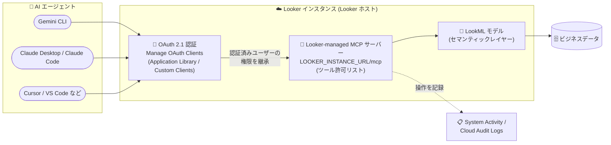

# Looker: Looker-managed MCP サーバーが一般提供 (GA) 開始

**リリース日**: 2026-10-26

**サービス**: Looker

**機能**: Looker-managed Model Context Protocol (MCP) サーバーの一般提供 (GA) と「Manage OAuth Clients」管理ページ

**ステータス**: GA (一般提供)

📊 [このアップデートのインフォグラフィックを見る](https://takech9203.github.io/google-cloud-news-summary/20261026-looker-mcp-server-ga.html)

## 概要

Looker-managed Model Context Protocol (MCP) サーバーが一般提供 (GA) になりました。これは MCP サーバーを Looker プラットフォームに直接組み込んだマネージドな統合機能で、Gemini CLI、Claude Desktop、Cursor、Copilot などの AI エージェントが、追加のミドルウェアを構築・運用することなく、Looker インスタンスのビジネスデータや LookML モデルと安全に対話できるようになります。Looker がサーバーをホストするため、ユーザー側でのインフラのデプロイ・保守は不要です。

今回の GA は、新しい「Manage OAuth Clients」管理ページによって支えられています。このページは、AI エージェントやその他の外部アプリケーションに対するアイデンティティベースのアクセスを統制する一元的なインターフェースを提供します。管理者は Application Library から事前構成済みの統合をすばやく有効化したり、特定のリダイレクト URI とグループベースのアクセス制御を持つカスタム OAuth クライアントを登録したりできます。

対象ユーザーは、Looker を信頼できるセマンティックレイヤーとして AI エージェントに接続したいデータチーム・プラットフォーム管理者です。AI エージェントからの BI データ活用をガバナンスの効いた形で実現したい組織にとって重要なアップデートです。

**アップデート前の課題**

- AI エージェントを Looker に接続するには、オープンソースの MCP Toolbox for Databases などのスタンドアロン MCP サーバーを自前でデプロイ・運用するミドルウェアが必要だった
- 外部アプリケーションからのアクセス管理には API キーの作成や API Explorer の利用が必要で、OAuth クライアントを一元的に統制する管理画面がなかった
- AI エージェントごとの OAuth クライアント登録やアクセス制御を管理者が集中管理する手段が限られていた

**アップデート後の改善**

- Looker がホストする組み込みの MCP サーバーにより、ミドルウェア不要で AI エージェントを Looker インスタンスに接続できるようになった (エンドポイントは `LOOKER_INSTANCE_URL/mcp`)
- 新しい「Manage OAuth Clients」管理ページで、API キーを作成することなく、アイデンティティベースの OAuth 2.0 アクセスを一元管理できるようになった
- Application Library から Cursor、VS Code、Claude Code、Claude Desktop、ChatGPT、Gemini CLI、Cline、Windsurf、Antigravity などの事前構成済みクライアントをワンクリックで有効化できるようになった
- カスタム OAuth クライアントを、複数のリダイレクト URI やグループ ID によるアクセス制限付きで登録できるようになった

## アーキテクチャ図



AI エージェントは OAuth 2.1 で認証し、Looker 組み込みの MCP サーバー経由で LookML モデルとビジネスデータに安全にアクセスします。エージェントは認証したユーザーの Looker ロールと権限を継承し、すべての操作は監査ログに記録されます。

## サービスアップデートの詳細

### 主要機能

1. **Looker-managed MCP サーバー (GA)**
   - MCP サーバーが Looker プラットフォームに直接組み込まれ、AI エージェントが Looker インスタンスのビジネスデータと LookML モデルに安全に接続可能
   - Looker がサーバーをホストするため、自前のミドルウェアのデプロイ・保守が不要なプラグアンドプレイ構成
   - サーバー URL は `LOOKER_INSTANCE_URL/mcp`、認証は OAuth 2.1
   - 接続した AI エージェントは、認証したユーザーの Looker ロールとアクセス権を継承

2. **Manage OAuth Clients 管理ページ**
   - Looker Admin パネルの Authentication セクションに配置され、API キーの作成や API Explorer を使わずにアイデンティティベースの OAuth 2.0 アクセスを一元管理
   - **Application Library タブ**: Looker が管理する事前構成済み OAuth クライアントのカタログ。AI エージェント MCP クライアント (Cursor、VS Code、Claude Code、Claude Desktop、ChatGPT、Gemini CLI、Cline、Windsurf、Antigravity、Looker Extension for VS Code)、BI コネクタ (Connected Sheets、Data Studio、Tableau Desktop、Microsoft Power BI、Microsoft Excel)、開発者ツール (Looker CLI) を有効/無効スイッチで管理
   - **Custom Clients タブ**: 独自のカスタム OAuth 2.0 クライアントを、クライアント ID、複数のリダイレクト URI、グループ ID によるアクセス制限 (Restrict to Group ID) 付きで登録・編集・削除
   - アプリケーションの無効化・削除時には、発行済みのアクティブな OAuth リフレッシュトークンが即時失効 (発行済みアクセストークンも 60 分以内に失効)

3. **MCP ツールのきめ細かな管理 (Admin > Platform > MCP ページ)**
   - デフォルトではすべてのツールが無効化されており、管理者が許可するツール (例: `looker_query`、`looker_update_project_file`) を明示的に有効化
   - 「Enable all tools」トグルによる一括有効化、またはツール単位での個別制御が可能
   - 各ツールには読み取り/書き込みのアクセスレベルが表示され、必要なツールのみの有効化がセキュリティベストプラクティスとして推奨

4. **Looker の既存セキュリティ・ガバナンスの継承**
   - ユーザーレベルの権限境界を厳格に適用し、AI エージェントは認証ユーザーが閲覧権限を持たないデータ・モデルにアクセス不可
   - Looker (Google Cloud core) では VPC Service Controls 境界、CMEK、IP 許可リストを追加設定なしでそのまま尊重
   - AI エージェントのすべての操作は Looker System Activity (History / Event Attribute Explore) と Cloud Audit Logs に記録

## 技術仕様

### 利用要件

| 項目 | 詳細 |
|------|------|
| 対象インスタンス | Looker (Google Cloud core) または Looker (original)。Looker ホストのインスタンスのみ (顧客ホストは非対応) |
| サーバー URL | `LOOKER_INSTANCE_URL/mcp` |
| 認証方式 | OAuth 2.1 |
| ツール管理に必要なロール | Looker の Admin ロール |
| OAuth クライアント登録に必要なロール | Looker の Admin ロール |
| エージェントの権限 | 認証したユーザーの Looker ロール・アクセス権を継承 |
| 顧客ホストインスタンスの代替 | オープンソースの MCP Toolbox for Databases を自前で運用して接続可能 |

### クライアント設定例 (Gemini CLI)

```bash
# Gemini CLI にリモート MCP サーバーを追加
gemini mcp add --transport http looker LOOKER_INSTANCE_URL/mcp
```

または `~/.gemini/settings.json` に手動で設定:

```json
{
  "mcpServers": {
    "looker": {
      "httpUrl": "LOOKER_INSTANCE_URL/mcp",
      "oauth": {
        "clientId": "CLIENT_GUID"
      }
    }
  }
}
```

## 設定方法

### 前提条件

1. Looker ホストの Looker (Google Cloud core) または Looker (original) インスタンスであること
2. ツール有効化と OAuth クライアント登録には Looker の Admin ロールが必要
3. AI エージェントを接続するユーザーは、OAuth 接続時に標準の Looker ログイン認証情報で認証

### 手順

#### ステップ 1: MCP ツールの有効化

1. Looker の **Admin** メニュー > **Platform** セクション > **MCP** を開く
2. AI エージェントに許可するツール (例: `looker_query`) のトグルを **Enabled** に切り替える (デフォルトはすべて無効)
3. 必要に応じて「Enable all tools」トグルで一括有効化も可能 (最小権限の観点からは個別有効化を推奨)

#### ステップ 2: OAuth クライアントの有効化・登録

1. **Admin** メニュー > **Authentication** セクション > **Manage OAuth Clients** を開く
2. **Application Library** タブで、接続したい AI クライアント (Cursor、Claude Code、Gemini CLI など) の **Enable** スイッチをオンにする
3. ライブラリにないツールや別のリダイレクト URI が必要な場合は、**Custom Clients** タブ > **Add New** から、クライアント ID (`com.looker.` で始まる ID は予約済みのため不可)、クライアント名、リダイレクト URI、必要に応じてグループ ID 制限を指定して登録する

#### ステップ 3: AI エージェント側の接続設定

1. エージェントの設定で MCP サーバー URL に `LOOKER_INSTANCE_URL/mcp` を指定する
2. エージェントを起動すると OAuth 認可フローが開始され、Looker のログイン認証情報で認証する
3. ブラウザ内で動作する MCP クライアントが CORS 経由で通信する場合は、そのドメインを Embedded Domain Allowlist に追加する

## メリット

### ビジネス面

- **ミドルウェア運用コストの削減**: 自前の MCP サーバーインフラのデプロイ・保守が不要になり、AI エージェント連携の導入障壁が下がる
- **ガバナンスの効いた AI 活用**: LookML セマンティックレイヤーを経由した「信頼できるビジネスインサイトへのゲートウェイ」として、一貫した指標定義のもとで AI エージェントがデータを扱える
- **監査可能性**: AI エージェントの全操作が System Activity と Cloud Audit Logs に記録され、コンプライアンス要件に対応しやすい

### 技術面

- **既存セキュリティ基盤の継承**: ユーザーレベル権限、VPC Service Controls、CMEK、IP 許可リストが追加設定なしでそのまま適用される
- **一元的な OAuth 管理**: API キー不要のアイデンティティベース認証で、クライアントの有効化・無効化・削除時のトークン即時失効も自動化
- **主要 AI ツールへの事前対応**: Gemini CLI、Claude Code/Desktop、Cursor、VS Code、ChatGPT など主要クライアントが Application Library に事前構成済み

## デメリット・制約事項

### 制限事項

- Looker ホストのインスタンスのみ対応。顧客ホストの Looker (original) インスタンスでは利用できない (代替としてオープンソースの MCP Toolbox for Databases を利用可能)
- きめ細かな OAuth スコープは未サポートで、アクセス制御はグローバルなツール許可リストとユーザーの基本権限に依存する
- ツール許可リストの変更は接続中のクライアントに自動反映されず、クライアントを MCP サーバーに再接続する必要がある
- リダイレクト URI は登録値との完全一致が必要で、ワイルドカードは非対応。動的ポートを使う AI ツール (Claude Code、Cline など) には事前登録された固定ポート (例: Claude Code/Cline は 8080、Gemini CLI は 7777) を使用するか、カスタムクライアントとして登録する

### 考慮すべき点

- AI エージェントのツール呼び出しはインスタンスの標準的な管理系・クエリ系 API クォータを消費するため、エージェントの活発な利用は API クォータに影響しうる
- セキュリティベストプラクティスとして、ユースケースに必要なツールのみを有効化することが推奨される
- エージェントは認証ユーザーの権限をそのまま継承するため、接続するユーザーの Looker ロール設計が実質的なアクセス制御になる

## ユースケース

### ユースケース 1: IDE / CLI からの自然言語データ分析

**シナリオ**: データアナリストや開発者が、Gemini CLI や Cursor などの AI ツールから自然言語で Looker のガバナンスされた指標に対してクエリを実行したい。

**実装例**:
```bash
# 管理者: Admin > Platform > MCP で looker_query を有効化
# 管理者: Manage OAuth Clients の Application Library で Gemini CLI を有効化
# ユーザー:
gemini mcp add --transport http looker https://mycompany.looker.com/mcp
gemini   # 対話モードで起動し、OAuth 認証後に自然言語で Looker に質問
```

**効果**: SQL や Looker UI の操作を介さずに、LookML で定義された信頼できる指標に基づく分析結果を AI エージェント経由で取得できる。

### ユースケース 2: 社内カスタム AI アプリケーションのガバナンス付き接続

**シナリオ**: 社内開発の AI アシスタントを Looker に接続したいが、利用者を特定の部門 (Looker グループ) に限定したい。

**実装例**: Custom Clients タブでカスタム OAuth クライアントを登録し、リダイレクト URI (例: `https://mycompany.com/oauth/callback`) と「Restrict to Group ID」に対象グループの数値 ID を設定する。

**効果**: 指定グループのメンバーのみがそのアプリケーション経由で Looker に認証でき、退役時はクライアント無効化によりトークンが即時失効するため、安全なライフサイクル管理が可能。

## 料金

Looker-managed MCP サーバーは追加費用なしで利用できます。ただし、AI エージェントによるツール呼び出しはインスタンスの標準的な管理系およびクエリ系 API クォータを消費します。

- [Looker の料金ページ](https://cloud.google.com/looker/pricing)

## 利用可能リージョン

Looker ホストの Looker (Google Cloud core) および Looker (original) インスタンスで利用できます。リージョン別の提供状況は公式ドキュメントを参照してください。

## 関連サービス・機能

- **MCP Toolbox for Databases**: 顧客ホストインスタンスや自前インフラでの運用を好む場合に利用できる、オープンソースのスタンドアロン MCP サーバー
- **Gemini CLI / Gemini Code Assist**: Looker-managed MCP サーバーに直接接続できる Google の AI エージェント。Gemini Code Assist は Gemini CLI 経由での利用が推奨
- **Cloud Audit Logs**: Looker (Google Cloud core) で MCP サーバー経由のアクティビティを追跡
- **VPC Service Controls / CMEK**: Looker (Google Cloud core) の既存のセキュリティ境界・暗号化設定が MCP エンドポイントにもそのまま適用
- **BI コネクタ (Connected Sheets、Power BI など)**: Manage OAuth Clients ページで有効化状態が BI Connectors ページと自動同期

## 参考リンク

- 📊 [インフォグラフィック](https://takech9203.github.io/google-cloud-news-summary/20261026-looker-mcp-server-ga.html)
- [公式リリースノート](https://docs.cloud.google.com/release-notes#October_26_2026)
- [Looker-managed MCP server ドキュメント](https://docs.cloud.google.com/looker/docs/mcp)
- [Admin settings - Model Context Protocol (MCP)](https://docs.cloud.google.com/looker/docs/admin-panel-platform-mcp)
- [Admin settings - Manage OAuth Clients](https://docs.cloud.google.com/looker/docs/admin-panel-authentication-oauth-clients)
- [料金ページ](https://cloud.google.com/looker/pricing)

## まとめ

Looker-managed MCP サーバーの GA により、Gemini CLI や Claude などの AI エージェントを、ミドルウェアなしでガバナンスの効いた LookML セマンティックレイヤーに接続できるようになりました。新しい Manage OAuth Clients ページとツール単位の許可リストにより、管理者はエージェントのアクセスを一元的かつ安全に統制できます。AI エージェントからの BI 活用を検討している組織は、まず Admin パネルで必要最小限のツールと OAuth クライアントを有効化し、System Activity での監査を組み合わせた運用を始めることを推奨します。

---

**タグ**: Looker, MCP, Model Context Protocol, AI エージェント, OAuth, GA, BI, LookML, ガバナンス
