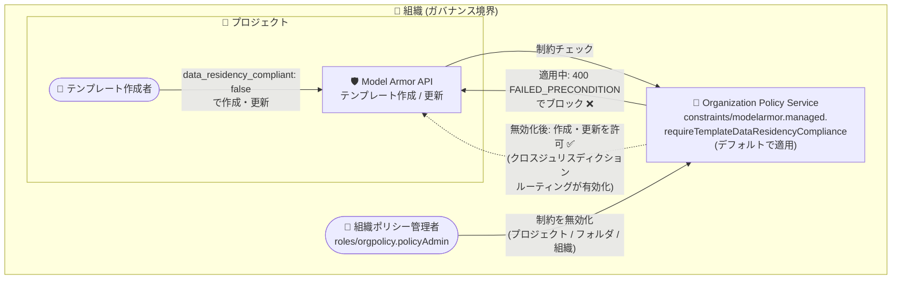

# Model Armor: テンプレートのデータレジデンシー遵守を必須化する管理対象組織ポリシー制約がデフォルトで適用 (GA)

**リリース日**: 2026-10-26

**サービス**: Model Armor

**機能**: 管理対象組織ポリシー制約 `constraints/modelarmor.managed.requireTemplateDataResidencyCompliance` のデフォルト適用

**ステータス**: GA (一般提供)

📊 [このアップデートのインフォグラフィックを見る](https://takech9203.github.io/google-cloud-news-summary/20261026-model-armor-data-residency-constraint-ga.html)

## 概要

Model Armor が、管理対象の Organization Policy Service 制約 `constraints/modelarmor.managed.requireTemplateDataResidencyCompliance` (Require Model Armor Template Data Residency Compliance) をデフォルトで適用するようになりました。この機能は一般提供 (GA) です。

この制約が適用されている状態では、Model Armor テンプレートの作成または更新時に `data_residency_compliant` を `false` に設定する操作、および Google Cloud コンソールで「Enforce data residency (データレジデンシーを適用)」オプションをオフにする操作がブロックされます。データレジデンシーの適用を無効化するには、組織ポリシー管理者 (`roles/orgpolicy.policyAdmin`) がこの制約を無効化する必要があります。

Model Armor のテンプレートは、デフォルトでデータレジデンシー遵守を厳格に適用し、テンプレートのリージョンが属する管轄区域内でホストされていない機能を無効化することで、データが管轄区域外に出ることを防ぎます。一方、包括的なセキュリティフィルタリングを優先するためにデータレジデンシー適用を無効化すると、機能がローカルで利用できない場合にリクエストが他の管轄区域にルーティングされる可能性があります。今回のアップデートにより、この無効化操作が組織レベルのガバナンス統制下に置かれ、データレジデンシー要件を持つ組織 (金融、公共、医療など) が意図しないクロスジュリスディクションのデータルーティングを組織全体で防止できるようになりました。

**アップデート前の課題**

- テンプレートの作成・更新権限を持つユーザーであれば誰でも、`data_residency_compliant` を `false` に設定してデータレジデンシー適用を無効化でき、組織として統制する仕組みがデフォルトでは存在しなかった
- データレジデンシー適用を無効化すると、データ (使用中・転送中) が管轄区域外にルーティングされる可能性があり、コンプライアンス違反のリスクがプロジェクトごとの運用に委ねられていた

**アップデート後の改善**

- 管理対象組織ポリシー制約がデフォルトで適用され、データレジデンシー適用を無効化するテンプレートの作成・更新が自動的にブロックされるようになった
- データレジデンシー適用の無効化には組織ポリシー管理者 (`roles/orgpolicy.policyAdmin`) による明示的な制約の無効化が必要となり、ガバナンスの責任分界点が明確になった
- 管理対象制約はカスタム組織ポリシー基盤上に構築されており、Policy Simulator やドライラン組織ポリシーを使用して影響を事前に確認してから適用変更ができる

## アーキテクチャ図



デフォルトで適用される管理対象組織ポリシー制約が、データレジデンシー適用を無効化するテンプレート操作をブロックします。無効化には組織ポリシー管理者による明示的な制約の無効化が必要です。

## サービスアップデートの詳細

### 主要機能

1. **データレジデンシー遵守のデフォルト強制**
   - `constraints/modelarmor.managed.requireTemplateDataResidencyCompliance` 制約がデフォルトで適用される
   - 制約の適用中は、`data_residency_compliant` を `false` に設定したテンプレートの作成・更新が `400 (FAILED_PRECONDITION)` エラーで失敗する
   - Google Cloud コンソールの「Enforce data residency」オプションをオフにする操作も同様にブロックされる

2. **既存テンプレートへの影響の限定**
   - 既存のテンプレート、およびプロンプト・レスポンスのサニタイズリクエストは影響を受けない
   - ただし、`data_residency_compliant` が `false` のままの既存テンプレートに対してフィルタなどの設定を変更 (更新) すると、この制約によりエラーが発生する

3. **組織ポリシー管理者による制御**
   - 組織ポリシー管理者 (`roles/orgpolicy.policyAdmin`) が、プロジェクト・フォルダ・組織の単位で制約を無効化できる
   - 制約を無効化した後に、コンソールで「Enforce data residency」をオフにするか、API で `data_residency_compliant` を `false` に設定できる

## 技術仕様

### 制約の仕様

| 項目 | 詳細 |
|------|------|
| 制約名 | `constraints/modelarmor.managed.requireTemplateDataResidencyCompliance` |
| 制約タイプ | 管理対象 (Managed) 組織ポリシー制約 |
| デフォルト動作 | 適用 (enforced) |
| 違反時のエラー | `400 FAILED_PRECONDITION` ("Template data residency compliance is required. The 'Enforce data residency' field must not be set to false.") |
| 影響範囲 | テンプレートの作成・更新のみ (既存テンプレートとサニタイズリクエストは影響なし) |
| 無効化に必要なロール | `roles/orgpolicy.policyAdmin` (組織ポリシー管理者) |
| 設定可能なスコープ | プロジェクト / フォルダ / 組織 |

### データレジデンシー適用の動作

| 状態 | 動作 |
|------|------|
| データレジデンシー適用: 有効 (デフォルト) | テンプレートのリージョンの管轄区域内でホストされていない Model Armor 機能は無効化され、データが管轄区域外に出ない |
| データレジデンシー適用: 無効 | 機能がローカルで利用できない場合、リクエストが他の管轄区域にルーティングされる可能性がある (使用中・転送中データ)。保存データ (at rest) は本オプションの状態に関係なくデータレジデンシーに準拠 |
| 画像モダリティ | データレジデンシー適用を無効化しても `us` / `eu` マルチリージョンに制限されたまま |

## 設定方法

### 前提条件

1. データレジデンシー適用を無効化する場合は、組織ポリシー管理者 (`roles/orgpolicy.policyAdmin`) の協力が必要
2. Model Armor テンプレートの作成・更新権限

### 手順

#### ステップ 1: 制約の状態を確認する

管理対象制約の詳細は、Google Cloud コンソールの「組織のポリシー」ページ、または gcloud で確認できます。

```bash
gcloud org-policies describe-custom-constraint \
    modelarmor.managed.requireTemplateDataResidencyCompliance \
    --organization=ORGANIZATION_ID
```

管理対象制約はカスタム組織ポリシー基盤上に構築されており、Policy Simulator やドライラン組織ポリシーで影響を事前確認できます。

#### ステップ 2: (必要な場合のみ) 組織ポリシー管理者が制約を無効化する

テンプレートでデータレジデンシー適用を無効化する必要がある場合は、組織ポリシー管理者に依頼して、対象のプロジェクト・フォルダ・組織で `constraints/modelarmor.managed.requireTemplateDataResidencyCompliance` 制約を無効化します。手順は[管理対象制約を組織ポリシーで使用する](https://docs.cloud.google.com/organization-policy/create-organization-policies#managed-constraints)を参照してください。

#### ステップ 3: テンプレートのデータレジデンシー適用を無効化する

制約の無効化後、テンプレートの作成・更新時に Google Cloud コンソールで「Enforce data residency」オプションをオフにするか、Model Armor API で `data_residency_compliant` を `false` に設定します。

**注意**: データのクロスジュリスディクションルーティングは、データレジデンシーのコンプライアンスに影響する可能性があります。

## メリット

### ビジネス面

- **コンプライアンスリスクの低減**: データレジデンシー要件を持つ組織 (金融、公共、医療など) で、担当者の操作ミスや認識不足による管轄区域外へのデータルーティングを組織全体でデフォルトで防止できる
- **ガバナンスの明確化**: データレジデンシー適用の無効化という重要な判断が、組織ポリシー管理者の承認プロセスを経る形に統一され、責任分界点が明確になる

### 技術面

- **デフォルトで安全 (Secure by Default)**: 追加の設定なしで制約が適用されるため、新規プロジェクトでも即座に保護が効く
- **柔軟なスコープ制御**: プロジェクト・フォルダ・組織の単位で制約を無効化できるため、特定のワークロードのみ包括的なフィルタリングを優先する運用が可能
- **安全なポリシー変更**: 管理対象制約は Policy Simulator とドライラン組織ポリシーに対応しており、変更の影響を事前に検証できる

## デメリット・制約事項

### 制限事項

- `data_residency_compliant` が `false` のままの既存テンプレートは、フィルタ設定などを変更 (更新) しようとすると `400 FAILED_PRECONDITION` エラーが発生する。更新するには、`data_residency_compliant` を `true` に戻すか、組織ポリシー管理者に制約の無効化を依頼する必要がある
- データレジデンシー適用を有効にしたままの場合、テンプレートのリージョンの管轄区域内でホストされていない Model Armor 機能は利用できない (リージョンごとの機能提供状況は[公式ドキュメント](https://docs.cloud.google.com/model-armor/feature-availability-by-region#supported-by-region)を参照)

### 考慮すべき点

- データレジデンシー適用を無効化すると、使用中・転送中のデータが他の管轄区域にルーティングされる可能性があり、データレジデンシーのコンプライアンスに影響し得る (保存データは影響を受けない)
- 包括的なセキュリティフィルタリング (管轄区域内で提供されていないフィルタの利用) とデータレジデンシー遵守のどちらを優先するか、組織としての方針を事前に決めておく必要がある

## ユースケース

### ユースケース 1: 規制業種におけるデータレジデンシーの組織全体での強制

**シナリオ**: 金融機関が複数のプロジェクトで生成 AI アプリケーションに Model Armor を導入している。規制要件によりデータを特定の管轄区域内に保持する必要があるが、各プロジェクトのチームがテンプレートを個別に管理している。

**効果**: 制約がデフォルトで適用されるため、各チームが誤ってデータレジデンシー適用を無効化することを組織全体で防止できる。追加の設定作業は不要で、ガードレールとして機能する。

### ユースケース 2: 特定プロジェクトのみ包括的フィルタリングを許可

**シナリオ**: データレジデンシー要件のない開発・検証用プロジェクトでは、管轄区域内で提供されていないフィルタも含めた包括的なセキュリティフィルタリングを利用したい。

**実装例**:
```
1. 組織ポリシー管理者 (roles/orgpolicy.policyAdmin) が、対象プロジェクトでのみ
   constraints/modelarmor.managed.requireTemplateDataResidencyCompliance を無効化
2. テンプレートの作成・更新時に data_residency_compliant を false に設定
   (コンソールでは「Enforce data residency」をオフ)
```

**効果**: 本番環境ではデータレジデンシーを強制しつつ、要件のないプロジェクトに限って柔軟なフィルタリング構成を許可する、メリハリのあるガバナンスを実現できる。

## 料金

本アップデートはガバナンス機能の変更であり、Organization Policy Service の利用自体に追加料金は発生しません。Model Armor の料金詳細は[料金ページ](https://cloud.google.com/security-command-center/pricing)を参照してください。

## 関連サービス・機能

- **Organization Policy Service**: 本制約を提供する基盤サービス。管理対象制約はカスタム組織ポリシー基盤上に構築されており、プロジェクト・フォルダ・組織の単位で適用を制御できる
- **Policy Simulator / ドライラン組織ポリシー**: 管理対象制約の変更による影響を事前に検証できる
- **Model Armor カスタム組織ポリシー (2026-10-21 GA)**: 責任ある AI フィルタやプロンプトインジェクション / ジェイルブレイク検出などの必須フィルタをテンプレートに強制するカスタム制約。本アップデートと組み合わせることで、テンプレートのガバナンスをより強化できる
- **Assured Workloads**: サポート対象ロケーションにおいて、選択した管轄区域内で使用中データのデータレジデンシーを維持する

## 参考リンク

- 📊 [インフォグラフィック](https://takech9203.github.io/google-cloud-news-summary/20261026-model-armor-data-residency-constraint-ga.html)
- [公式リリースノート](https://docs.cloud.google.com/release-notes#October_26_2026)
- [ドキュメント: データレジデンシーの組織ポリシー制約を無効化する](https://docs.cloud.google.com/model-armor/manage-templates#disable-data-residency-constraint)
- [ドキュメント: Model Armor のデータレジデンシー](https://docs.cloud.google.com/model-armor/data-residency)
- [トラブルシューティング: Template data residency compliance is required](https://docs.cloud.google.com/model-armor/troubleshooting#data-residency-required)
- [管理対象制約を組織ポリシーで使用する](https://docs.cloud.google.com/organization-policy/create-organization-policies#managed-constraints)

## まとめ

Model Armor テンプレートのデータレジデンシー遵守を必須化する管理対象組織ポリシー制約がデフォルトで適用され、意図しないクロスジュリスディクションのデータルーティングを組織全体で防止できるようになりました。`data_residency_compliant` を `false` に設定している既存テンプレートは更新時にエラーが発生するため、該当テンプレートの有無を確認し、データレジデンシー適用を有効に戻すか、組織ポリシー管理者と制約無効化の要否を協議することを推奨します。

---

**タグ**: #ModelArmor #OrganizationPolicy #DataResidency #Security #Governance #Compliance #GA
