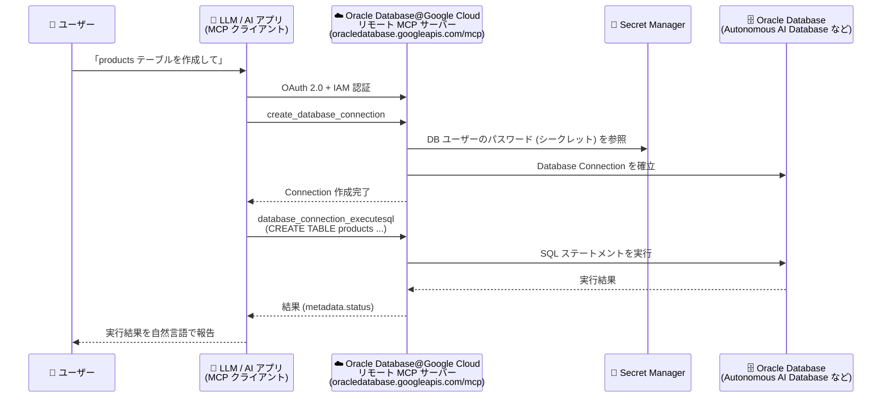

# Oracle Database@Google Cloud: リモート MCP サーバーが GA、Database Connection 管理と SQL 実行ツールを追加

**リリース日**: 2026-10-26

**サービス**: Oracle Database@Google Cloud

**機能**: リモート MCP サーバー (Database Connection 管理 / SQL 実行ツール)

**ステータス**: GA (一般提供)

📊 [このアップデートのインフォグラフィックを見る](https://takech9203.github.io/google-cloud-news-summary/20261026-oracle-database-google-cloud-mcp-server-ga.html)

## 概要

Oracle Database@Google Cloud のリモート MCP (Model Context Protocol) サーバーが一般提供 (GA) となりました。あわせて、Database Connection を作成・管理するツール群と、`database_connection_executesql` ツールによる SQL ステートメント実行機能が追加されました。これにより、LLM、AI アプリケーション、AI 対応の開発プラットフォーム (Antigravity、ChatGPT、Claude、独自開発アプリケーションなど) から Oracle Database@Google Cloud のリソースを自然言語で簡単に操作できるようになります。

MCP は、LLM や AI アプリケーションが外部データソースに接続する方法を標準化するプロトコルです。リモート MCP サーバーは Google Cloud のインフラストラクチャ上で動作し、AI アプリケーションに HTTP エンドポイント (`https://oracledatabase.googleapis.com/mcp`) を提供します。Oracle Database@Google Cloud API を有効化すると、MCP サーバーも有効になります。

今回の GA により、Autonomous AI Database や Exadata などのリソース管理 (プロビジョニング、一覧取得、詳細確認) に加えて、データベースへの接続作成と SQL 実行 (DML / DDL / DQL) までを AI エージェントのワークフローとして一気通貫で実行できるようになりました。

**アップデート前の課題**

- AI エージェントや LLM から Oracle Database@Google Cloud のリソースを操作するには、gcloud CLI や API 呼び出しを個別に実装・仲介する必要があった
- MCP 経由でデータベース内のデータに対して SQL を実行する標準的な手段がなかった
- Database Connection の作成・管理を AI ワークフローに組み込むツールが提供されていなかった

**アップデート後の改善**

- リモート MCP サーバーが GA となり、本番利用を想定した標準エンドポイント経由で Oracle Database@Google Cloud リソースを操作できるようになった
- Database Connection を作成・管理するツールが追加され、ODB Network 上のデータベースへの接続を自然言語プロンプトから作成できるようになった
- `database_connection_executesql` ツールにより、DML / DDL / DQL を含むあらゆる SQL ステートメントを AI エージェントから実行できるようになった (テーブル作成、初期データ投入、データ照会など)

## アーキテクチャ図



LLM / AI アプリケーションは MCP クライアントとしてリモート MCP サーバーに接続し、Database Connection の作成を経て、`database_connection_executesql` ツールで Oracle Database に対する SQL を実行します。認証情報 (DB ユーザーのパスワード) は Secret Manager のシークレットとして参照されます。

## サービスアップデートの詳細

### 主要機能

1. **リモート MCP サーバーの GA**
   - グローバルエンドポイント `https://oracledatabase.googleapis.com/mcp` を提供 (Streamable HTTP トランスポート)
   - MCP バージョン 2026-07-28 のステートレスプロトコルに対応。`initialize` ハンドシェイクや `Mcp-Session-Id` が不要で、各リクエストが自己記述的
   - Oracle Database@Google Cloud API を有効化すると自動的に利用可能になる

2. **Database Connection の作成・管理ツール**
   - ODB Network 上のデータベースに対する Database Connection の作成・一覧取得・詳細取得に対応
   - DB ユーザーのパスワードは Secret Manager のシークレットとして指定 (生パスワードは非サポート)
   - 例: 「Autonomous AI Database DATABASE_ID に対して、シークレット projects/PROJECT_ID/secrets/SECRET_ID/versions/SECRET_VERSION を使って Database Connection CONNECTION_ID を作成して」というプロンプトで作成可能

3. **`database_connection_executesql` による SQL 実行**
   - DML / DDL / DQL を含むすべての種類の SQL ステートメントを実行可能
   - 読み取り専用権限の DB ユーザーで Database Connection を作成すれば、エージェントや LLM による書き込み操作はデータベース側で拒否される (読み取り専用運用のパターン)

4. **リソース管理ツール群**
   - ODB Network / ODB Subnet、Exadata Infrastructure、Exadata VM Cluster、Exascale VM Cluster / Storage Vault、Autonomous AI Database、DB System、Oracle GoldenGate (Deployment / Connection) などの作成・一覧・取得ツールを提供
   - `get_operation` ツールで長時間実行オペレーションのステータスをポーリング可能
   - 利用可能なツールの一覧は `tools/list` リクエスト (認証不要) または MCP リファレンスで確認できる

## 技術仕様

### MCP サーバーの仕様

| 項目 | 詳細 |
|------|------|
| エンドポイント | `https://oracledatabase.googleapis.com/mcp` (グローバル) |
| トランスポート | Streamable HTTP |
| プロトコルバージョン | MCP 2026-07-28 (ステートレス) |
| 認証 | OAuth 2.0 + IAM (すべての Google Cloud ID をサポート。API キーは非対応) |
| OAuth スコープ | `https://www.googleapis.com/auth/oracle-database` |
| セキュリティ (任意) | Model Armor によるプロンプト / レスポンスの保護、Cloud Audit Logs による集中監査ログ |

### 必要な IAM ロール

| 操作 | ロール |
|------|--------|
| MCP ツール呼び出し | MCP Tool User (`roles/mcp.toolUser`) |
| リソースの作成 | Oracle Database@Google Cloud Admin (`roles/oracledatabase.admin`) |
| リソースの取得・一覧 | Oracle Database@Google Cloud Viewer (`roles/oracledatabase.viewer`) |
| SQL 実行 | Oracle Database@Google Cloud Admin (`roles/oracledatabase.admin`) |

最小権限の原則に従い、カスタムロールの作成が推奨されています。たとえば、SQL 実行専用のエージェント向けには以下の権限のみを持つ「SQL runner」ロールを作成できます。

```
oracledatabase.databaseConnections.get
oracledatabase.databaseConnections.list
oracledatabase.databaseConnections.executeSql
```

## 設定方法

### 前提条件

1. Oracle Database@Google Cloud API を有効化する (MCP サーバーも有効になる)
2. 必要な IAM ロール (`roles/mcp.toolUser` など) を付与する
3. SQL を実行する場合は、対象データベースの ODB Network と、DB ユーザーのパスワードを格納した Secret Manager のシークレットを用意する

### 手順

#### ステップ 1: MCP クライアントの設定

AI アプリケーション (Claude、Antigravity など) のリモート MCP サーバー設定に以下を入力します。

- **サーバー名**: Oracle Database@Google Cloud MCP server
- **サーバー URL**: `https://oracledatabase.googleapis.com/mcp`
- **トランスポート**: Streamable HTTP
- **認証**: Google Cloud 認証情報、OAuth クライアント ID / シークレット、またはエージェント ID

#### ステップ 2: 利用可能なツールの確認

```bash
curl -X POST https://oracledatabase.googleapis.com/mcp \
  -H 'Content-Type: application/json' \
  -H 'Accept: application/json' \
  -H 'MCP-Protocol-Version: 2026-07-28' \
  -H 'Mcp-Method: tools/list' \
  -d '{"jsonrpc": "2.0", "id": 1, "method": "tools/list", "params": {"_meta": {"io.modelcontextprotocol/protocolVersion": "2026-07-28"}}}'
```

`tools/list` メソッドは認証不要で、提供されているツールの一覧を確認できます。

#### ステップ 3: Database Connection の作成と SQL 実行

AI アプリケーションから自然言語プロンプトでツールを呼び出します。

```
Create a Database Connection CONNECTION_ID for my Autonomous AI Database DATABASE_ID
using secret "projects/PROJECT_ID/secrets/SECRET_ID/versions/SECRET_VERSION".
```

接続作成後、`database_connection_executesql` ツールで SQL ステートメントを実行できます。

## メリット

### ビジネス面

- **開発の迅速化**: 自然言語プロンプトでデータベースのプロビジョニングからスキーマ作成、データ投入までを実行でき、Web アプリケーション開発などの初期セットアップを短縮できる
- **運用標準化の支援**: プロジェクト内の Autonomous AI Database の構成を一覧・点検し、構成標準からの逸脱を AI エージェントにレポートさせる運用が可能

### 技術面

- **標準プロトコルによる統合**: MCP 標準に準拠しているため、Antigravity、ChatGPT、Claude、カスタムアプリケーションなど多様な AI プラットフォームから同一のエンドポイントで利用できる
- **IAM によるきめ細かなアクセス制御**: OAuth 2.0 + IAM による認証・認可で、エージェント専用 ID の分離やカスタムロールによる最小権限運用が可能
- **安全な認証情報管理**: DB パスワードは Secret Manager のシークレット参照のみをサポートし、生パスワードの受け渡しを排除
- **読み取り専用運用パターン**: 読み取り専用権限の DB ユーザーで接続を作成することで、LLM による意図しない書き込みをデータベース側で防止できる

## デメリット・制約事項

### 制限事項

- `create_autonomous_database` / `create_db_system` ツールは Secret Manager に保存されたシークレットのみをサポートし、生パスワードは使用できない
- `database_connection_executesql` のレスポンスが 10 MB を超える場合は切り捨てられる (`metadata.status = PARTIAL`、`partialResult: true` で通知)
- 30 秒を超えて実行されるクエリはタイムアウトする可能性がある
- 1 回の呼び出しで実行できる SQL ステートメントは 1 つのみ (autocommit)。複数ステートメントや複数呼び出しにまたがるトランザクションは非サポート
- 接続文字列でのホスト名指定は未サポート。データベースのプライベート IP を使用する必要がある

### 考慮すべき点

- SQL エラーが発生しても呼び出し自体は成功として返る。Oracle がステートメントを拒否した場合 (例: ORA-00942) は `metadata.status = ERROR` と `metadata.message` を確認する必要がある
- Secret Manager は安全な保管手段だが、`secretmanager.versions.access` 権限を持つユーザーや IAM ポリシーを変更できるユーザーはシークレットにアクセスし得るため、権限設計に注意が必要
- エージェント用には専用の ID を作成し、リソースアクセスを制御・監視することが推奨されている

## ユースケース

### ユースケース 1: Web アプリケーション開発でのデータベース初期構築

**シナリオ**: 新規プロジェクトの Web アプリケーション向けに、Autonomous AI Database を作成し初期データを投入したい。

**実装例**:
```
プロンプト: "Create a new Autonomous AI Database and set up a table called products."

ワークフロー:
1. create_odb_network で Private Service Connect インターフェイス接続の ODB Network を作成
2. create_autonomous_database で開発環境サイズの Autonomous AI Database を作成
3. get_operation で作成オペレーションの完了をポーリング
4. get_autonomous_database で接続メタデータを取得し、create_database_connection で接続を作成
5. database_connection_executesql で CREATE TABLE products を実行
6. database_connection_executesql で初期データ (DML) を投入
```

**効果**: プロビジョニングからスキーマ作成・データ投入までを自然言語ベースのエージェントワークフローとして自動化できる。

### ユースケース 2: データベース構成の運用監査

**シナリオ**: プロジェクト内の Autonomous AI Database インスタンスが運用構成標準を満たしているか定期的に確認したい。

**実装例**:
```
プロンプト: "List all the Autonomous AI Databases in my project and show me
their details to verify that they're using the same configuration."

ワークフロー:
1. list_autonomous_databases でプロジェクト内の全データベースを一覧取得
2. 各データベースに対して get_autonomous_database でバージョンやリージョンなどの構成を取得
3. 期待される構成から逸脱しているデータベースをハイライトしてレポート
```

**効果**: 構成ドリフトの検出を AI エージェントに委譲し、運用監査の工数を削減できる。

## 利用可能リージョン

Oracle Database@Google Cloud MCP サーバーはグローバルエンドポイント (`https://oracledatabase.googleapis.com/mcp`) として提供されます。

## 関連サービス・機能

- **Secret Manager**: Database Connection や データベース作成時の DB ユーザーパスワードをシークレットとして安全に管理
- **IAM (Identity and Access Management)**: OAuth 2.0 と組み合わせた MCP ツール呼び出しの認証・認可。カスタムロールによる最小権限運用
- **Model Armor**: プロジェクトのフロア設定により、MCP ツール呼び出しとレスポンスに対するセキュリティフィルタ (悪意ある URI 検出など) を適用可能
- **Cloud Audit Logs**: Google Cloud リモート MCP サーバー共通の集中監査ログ
- **Private Service Connect**: ODB Network のサービス接続 (ネットワークアタッチメント) に使用
- **Oracle GoldenGate**: MCP ツール経由で Deployment / Connection の作成・管理が可能

## 参考リンク

- 📊 [インフォグラフィック](https://takech9203.github.io/google-cloud-news-summary/20261026-oracle-database-google-cloud-mcp-server-ga.html)
- [公式リリースノート](https://docs.cloud.google.com/release-notes#October_26_2026)
- [ドキュメント: Use the Oracle Database@Google Cloud MCP server](https://docs.cloud.google.com/oracle/database/docs/use-oracledatabase-mcp)
- [ドキュメント: Oracle Database@Google Cloud MCP reference](https://docs.cloud.google.com/oracle/database/docs/reference/mcp)
- [ドキュメント: Google Cloud MCP servers overview](https://docs.cloud.google.com/mcp/overview)
- [ドキュメント: Authenticate to MCP servers](https://docs.cloud.google.com/mcp/authenticate-mcp)

## まとめ

Oracle Database@Google Cloud のリモート MCP サーバーが GA となり、Database Connection 管理と `database_connection_executesql` による SQL 実行が加わったことで、AI エージェントから Oracle データベースのプロビジョニング・接続・データ操作までを一気通貫で自動化できるようになりました。AI 対応の開発ワークフローに Oracle Database@Google Cloud を組み込む場合は、まず `tools/list` でツールを確認し、最小権限のカスタムロールと読み取り専用接続の設計から始めることを推奨します。

---

**タグ**: Oracle Database@Google Cloud, MCP, Model Context Protocol, AI エージェント, LLM, Autonomous AI Database, GA, Secret Manager, IAM
