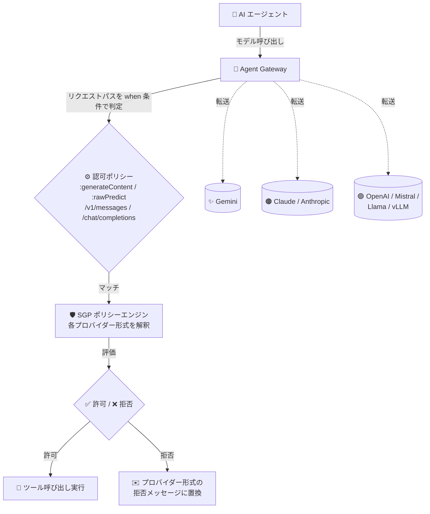

# Gemini Enterprise Agent Platform: Semantic Governance Policy が複数のモデルプロバイダーに対応

**リリース日**: 2026-10-26

**サービス**: Gemini Enterprise Agent Platform

**機能**: Semantic Governance Policy のモデルプロバイダー対応拡大 (非 Google モデルを使うエージェントのツール呼び出し評価)

**ステータス**: Feature (Semantic Governance Policy は Pre-GA / Preview)

📊 [このアップデートのインフォグラフィックを見る](https://takech9203.github.io/google-cloud-news-summary/20261026-semantic-governance-model-providers.html)

## 概要

Gemini Enterprise Agent Platform の Semantic Governance Policy (SGP) が、Gemini 以外のモデルプロバイダーを使用するエージェントのツール呼び出しも評価できるようになりました。ポリシーエンジンが各プロバイダーのリクエスト/レスポンス形式を読み取るため、エージェントがどのモデルを使っていても同じポリシーをそのまま適用できます。

今回サポートされる API は、Gemini Developer API および Gemini Enterprise Agent Platform 上の Gemini モデルに加えて、Anthropic Messages API、Gemini Enterprise Agent Platform 上の Claude モデル、OpenAI Chat Completions API、Mistral AI API、Gemini Enterprise Agent Platform の OpenAI 互換エンドポイント (Model Garden の Llama モデルを含む)、さらに vLLM などのセルフホスト型 OpenAI 互換サーバーです。ツール呼び出しが拒否された場合、ポリシーエンジンはそのプロバイダーのレスポンス形式に合わせた拒否メッセージに置き換えます。

対象ユーザーは、複数のモデルプロバイダーを混在させてエージェントを運用するプラットフォーム管理者・セキュリティ管理者です。モデル選定の自由度を保ちながら、自然言語制約 (NLC) による一元的なガバナンスを維持できます。なお、これらのプロバイダーをガバナンス対象にするには、認可ポリシー (authorization policy) の `when` 条件を各プロバイダーのリクエストパスに一致するよう更新する必要があります。更新後の条件はクエリ文字列を含むリクエストにもマッチします。

**アップデート前の課題**

- Semantic Governance Policy のツール呼び出し評価は Gemini モデルの呼び出しを前提としており、Claude、OpenAI、Mistral AI、Llama などの非 Google モデルを使うエージェントには同じポリシーを適用できなかった
- 複数のモデルプロバイダーを使い分ける環境では、モデルごとにガバナンスの仕組みが分断されるリスクがあった

**アップデート後の改善**

- ポリシーエンジンが各プロバイダーのリクエスト/レスポンス形式を解釈し、Anthropic Messages API、OpenAI Chat Completions API、Mistral AI API、OpenAI 互換エンドポイント (Llama モデル、vLLM などのセルフホストサーバーを含む) のツール呼び出しも評価できるようになった
- モデルを切り替えたり混在させたりしても、同一の Semantic Governance Policy (自然言語制約) をそのまま適用できるようになった
- 拒否時の応答も各プロバイダーのレスポンス形式で返されるため、エージェント側の実装を変えずにガバナンスを適用できる
- 認可ポリシーの `when` 条件がクエリ文字列付きのリクエストにもマッチするようになった

## アーキテクチャ図



Agent Gateway が認可ポリシーの `when` 条件で各モデルプロバイダーのリクエストパスを判定し、マッチしたモデル推論トラフィックを SGP ポリシーエンジンに転送します。エンジンはプロバイダーごとの形式を解釈して同一ポリシーで評価し、拒否時はそのプロバイダーのレスポンス形式で拒否メッセージを返します。

## サービスアップデートの詳細

### 主要機能

1. **マルチプロバイダー対応のツール呼び出し評価**
   - ポリシーエンジンがサポート対象の各モデルプロバイダーのリクエスト/レスポンス形式を読み取る
   - エージェントが使用するモデルに関わらず、同じ Semantic Governance Policy が適用される
   - ツール呼び出しが拒否された場合、そのプロバイダーのレスポンス形式に合わせた拒否メッセージに置き換えられる

2. **サポート対象 API とリクエストパス**
   - Gemini Developer API / Gemini Enterprise Agent Platform 上の Gemini モデル: `:generateContent`
   - Anthropic Messages API: `/v1/messages`
   - Gemini Enterprise Agent Platform 上の Claude モデル: `:rawPredict`
   - OpenAI Chat Completions API、Mistral AI API、Gemini Enterprise Agent Platform の OpenAI 互換エンドポイント (Model Garden の Llama モデルを含む)、vLLM などのセルフホスト型 OpenAI 互換サーバー: `/chat/completions`

3. **認可ポリシーの `when` 条件の更新**
   - 新しいプロバイダーをガバナンス対象にするには、認可ポリシーの `when` 条件を各プロバイダーのリクエストパスにマッチするよう更新する
   - `request.path` はクエリ文字列を含むため、条件は `contains()` を使用する (`endsWith()` ではクエリパラメータ付きリクエストを取りこぼす)
   - 更新後の条件はクエリ文字列を含むリクエストにもマッチする

## 技術仕様

### サポート対象のモデルプロバイダーとリクエストパス

| API | リクエストパス |
|------|------|
| Gemini Developer API / Gemini Enterprise Agent Platform 上の Gemini モデル | `:generateContent` |
| Anthropic Messages API | `/v1/messages` |
| Gemini Enterprise Agent Platform 上の Claude モデル | `:rawPredict` |
| OpenAI Chat Completions API、Mistral AI API、OpenAI 互換エンドポイント (Llama モデルを含む)、セルフホスト型 OpenAI 互換サーバー (vLLM など) | `/chat/completions` |

### 認可ポリシーの `when` 条件 (全プロバイダー対応の例)

```yaml
name: AUTHZ_POLICY_NAME
target:
  loadBalancingScheme: LOAD_BALANCING_SCHEME_UNSPECIFIED
  resources:
  - projects/PROJECT_ID/locations/LOCATION/agentGateways/AGENT_GATEWAY_NAME
httpRules:
- to:
    operations:
    - paths:
      - prefix: /
  when: "!request.headers['content-type'].startsWith('application/grpc') && (request.path.contains(':generateContent') || request.path.contains(':rawPredict') || request.path.contains('/v1/messages') || request.path.contains('/chat/completions'))"
action: CUSTOM
policyProfile: CONTENT_AUTHZ
customProvider:
  authzExtension:
    resources:
    - projects/PROJECT_ID/locations/LOCATION/authzExtensions/AUTHZ_EXTENSION_NAME
```

この例はサポート対象の全モデルプロバイダーにマッチします。エージェントが使用しないプロバイダーのパスは削除できます。条件を必要以上に広げると、MCP ツール呼び出しなど評価されないトラフィックにもレイテンシが加わるため避けてください。また、gRPC トラフィックを除外する CEL 式を含めないと、ポリシーエンジンが gRPC 呼び出し (Cloud Resource Manager など) を傍受してエージェントの起動が失敗します。

## 設定方法

### 前提条件

1. Agent Gateway が作成済みで、エージェントが Agent Gateway 経由でトラフィックをルーティングしている (`identity_type=AGENT_IDENTITY` と `agent_gateway_config` を指定してデプロイ済み)
2. Semantic Governance Policy エンジンがプロビジョニング済みで、ネットワーク構成 (PSC エンドポイント、DNS レコード、VPC 接続) が完了している
3. エージェントがサポート対象のモデルプロバイダーをストリーミングなしで呼び出している

### 手順

#### ステップ 1: 認可ポリシーの `when` 条件を更新する

```bash
# authz-policy.yaml の when 条件に、使用するプロバイダーのリクエストパスを追加して再インポート
gcloud network-security authz-policies import AUTHZ_POLICY_NAME \
  --source=authz-policy.yaml \
  --location=LOCATION \
  --project=PROJECT_ID
```

`when` 条件に `request.path.contains('/v1/messages')` (Anthropic)、`request.path.contains(':rawPredict')` (Claude on Agent Platform)、`request.path.contains('/chat/completions')` (OpenAI / Mistral / OpenAI 互換) など、エージェントが呼び出すプロバイダーのパスを含めます。

#### ステップ 2: 評価が行われていることを確認する

```bash
# Agent Gateway のリクエストログで serviceExtensionInfo に認可拡張が含まれているか確認
# (Cloud Logging の Log Explorer で Agent Gateway request log を参照)
```

verdict が返らない場合は、リクエストパスが `when` 条件にマッチしているか、エンジンの状態が `ACTIVE` か、認可拡張とポリシーが存在するかを確認します。本番適用前にドライランモードでポリシーエンジンの判定を観察することが推奨されています。

## メリット

### ビジネス面

- **モデル選択の自由度とガバナンスの両立**: ビジネス要件に応じて Gemini、Claude、OpenAI、Mistral、Llama などを選択・併用しても、単一のポリシーセットで統制を維持できる
- **ガバナンスの一元化**: モデルプロバイダーごとに別々の統制の仕組みを構築・運用する必要がなくなり、コンプライアンス対応を簡素化できる

### 技術面

- **ポリシーの再利用**: モデルを切り替えてもポリシー (自然言語制約) を書き直す必要がない
- **プロバイダー形式での拒否応答**: 拒否メッセージが各プロバイダーのレスポンス形式で返されるため、エージェント側のコード変更なしに適用できる
- **セルフホストモデルへの対応**: vLLM などの OpenAI 互換セルフホストサーバーもガバナンス対象にできる

## デメリット・制約事項

### 制限事項

- ストリーミングされたモデルレスポンスはサポートされない (`:streamGenerateContent`、`:streamRawPredict`、`"stream": true` を設定したリクエスト)。ストリーミングレスポンス内のツール呼び出しはブロックされない可能性があるため、エージェントはストリーミングなしでモデルを呼び出すよう構成する必要がある
- 新しいプロバイダーをガバナンス対象にするには、認可ポリシーの `when` 条件を手動で更新する必要がある
- Semantic Governance Policy は Pre-GA (Preview) であり、「Pre-GA Offerings Terms」が適用される。また LLM を用いた確率的な評価のため、判定 (verdict) が常に正確とは限らない

### 考慮すべき点

- `when` 条件は `contains()` を使用する (`request.path` にクエリ文字列が含まれるため、`endsWith()` ではクエリパラメータ付きリクエストを取りこぼす)
- 使用しないプロバイダーのパスは条件から削除し、条件を必要以上に広げない (評価されないトラフィックにレイテンシが加わるため)
- gRPC トラフィックを除外する CEL 式 (`!request.headers['content-type'].startsWith('application/grpc')`) を必ず含める

## ユースケース

### ユースケース 1: Claude モデルを使うエージェントに既存ポリシーを適用

**シナリオ**: Agent Runtime 上で Claude モデル (Anthropic Messages API または Agent Platform の `:rawPredict`) を使用するエージェントに、Gemini エージェント向けに作成済みの Semantic Governance Policy をそのまま適用したい。

**実装例**:
```yaml
# 認可ポリシーの when 条件に Claude 関連のパスを追加
when: "!request.headers['content-type'].startsWith('application/grpc') && (request.path.contains(':generateContent') || request.path.contains(':rawPredict') || request.path.contains('/v1/messages'))"
```

**効果**: モデルプロバイダーごとにポリシーを作り直すことなく、既存の自然言語制約が Claude 利用エージェントのツール呼び出しにも適用される。

### ユースケース 2: vLLM セルフホストモデルを含むマルチモデル環境の統制

**シナリオ**: コスト最適化のため一部エージェントは vLLM でセルフホストした Llama モデルを使用し、他のエージェントは Gemini や OpenAI を使用している。全エージェントに同一のビジネスルール (例: 「承認なしで外部送金ツールを呼び出さない」) を適用したい。

**効果**: `when` 条件に `/chat/completions` を含めることで、セルフホストモデルを含む全プロバイダーのツール呼び出しが単一のポリシーエンジンで評価され、統制の抜け漏れを防げる。

## 料金

Semantic Governance Policy のモデルプロバイダー対応拡大に固有の料金情報は、今回のリリースノートには記載されていません。なお、Semantic Governance Policy の管理操作 (ポリシー作成、エンジン有効化など) は管理クォータを消費します。最新の料金・クォータは以下を参照してください。

- [Gemini Enterprise Agent Platform のクォータ](https://docs.cloud.google.com/gemini-enterprise-agent-platform/models/quotas)
- [Google Cloud の料金](https://cloud.google.com/pricing)

## 利用可能リージョン

Semantic Governance Policy エンジンおよび Semantic Governance Policy は以下のリージョンでサポートされています。

| 地域 | 利用可能リージョン |
|------|------|
| 南北アメリカ | us-central1、us-east1、us-east4、us-west1 |
| ヨーロッパ | europe-southwest1、europe-west1、europe-west4、europe-west8 |

## 関連サービス・機能

- **Agent Gateway**: エージェントとモデル/ツール間の通信を傍受するランタイム適用ポイント。認可ポリシーと認可拡張を通じてポリシーエンジンにトラフィックを転送する
- **Agent Registry / Agent Identity**: エージェントの認証情報 (Identity トークン) に基づいて適用すべきポリシーを特定する
- **Model Armor**: プロンプトスキャンと DLP を提供する補完的な保護レイヤー。Agent Gateway の認可拡張として併用できる
- **Cloud Logging**: ポリシー評価ログと Agent Gateway リクエストログで verdict や拒否理由を確認できる

## 参考リンク

- 📊 [インフォグラフィック](https://takech9203.github.io/google-cloud-news-summary/20261026-semantic-governance-model-providers.html)
- [公式リリースノート](https://cloud.google.com/release-notes#October_26_2026)
- [Semantic governance policies 概要 (Supported model providers)](https://docs.cloud.google.com/gemini-enterprise-agent-platform/govern/policies/semantic-governance-overview#supported-providers)
- [Semantic governance policies の構成 (Connect the policy engine to Agent Gateway)](https://docs.cloud.google.com/gemini-enterprise-agent-platform/govern/policies/configure-semantic-governance#connect-policy-engine)
- [Agent Gateway 概要](https://docs.cloud.google.com/gemini-enterprise-agent-platform/govern/gateways/agent-gateway-overview)

## まとめ

Semantic Governance Policy が Anthropic、OpenAI、Mistral AI、Llama、vLLM などの非 Google モデルプロバイダーのツール呼び出し評価に対応し、マルチモデル環境でも単一のポリシーセットでエージェントを統制できるようになりました。非 Google モデルを使うエージェントを運用している場合は、認可ポリシーの `when` 条件に該当プロバイダーのリクエストパスを追加し、ドライランモードで判定を確認してから本番適用することを推奨します。ストリーミングレスポンスは評価対象外となるため、ガバナンス対象のエージェントはストリーミングなしの呼び出しに構成してください。

---

**タグ**: Gemini Enterprise Agent Platform, Semantic Governance Policy, Agent Gateway, AI エージェント, ガバナンス, Anthropic, OpenAI, Mistral AI, Llama, vLLM, マルチモデル, Preview
