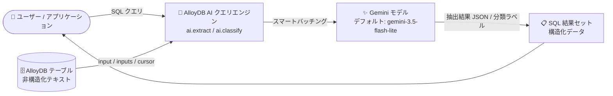

# AlloyDB for PostgreSQL: AI 関数 ai.extract / ai.classify の追加と AI クエリエンジン関数のシグネチャ更新 (Preview)

**リリース日**: 2026-10-27

**サービス**: AlloyDB for PostgreSQL

**機能**: AlloyDB AI の新関数 (ai.extract / ai.classify) と既存 AI 関数のパラメータ更新

**ステータス**: Preview

📊 [このアップデートのインフォグラフィックを見る](https://takech9203.github.io/google-cloud-news-summary/20261027-alloydb-ai-extract-classify-functions.html)

## 概要

AlloyDB for PostgreSQL の AI クエリエンジンに、新しい AI 関数 `ai.extract` と `ai.classify` が Preview として追加されました。`ai.extract` は非構造化テキストから指定したスキーマに基づいて構造化データを抽出する関数、`ai.classify` はテキストを事前定義したラベル (カテゴリ) に分類する関数です。いずれも SQL クエリ内で直接実行できるため、外部の抽出パイプラインや ETL 処理、外部サービス連携を構築することなく、データベース内で非構造化データを処理できます。

あわせて、既存の AI クエリエンジン関数 (`ai.analyze_sentiment`、`ai.summarize`、`ai.agg_summarize`) のパラメータ名とシグネチャが更新されました。スカラー版・バッチ版の `prompt`/`prompts` パラメータが `input`/`inputs` にリネームされ、`ai.summarize` と `ai.agg_summarize` には要約のフォーマット・長さ・トーンを指示できるオプションの `additional_instructions` パラメータが追加されています。

対象ユーザーは、データベース内に蓄積された問い合わせ記録、レビュー、議事録、契約書などの非構造化テキストを、アプリケーション側のコードや外部パイプラインなしで構造化・分類したいデータベースエンジニアやアプリケーション開発者です。

**アップデート前の課題**

- 非構造化テキストから構造化データを抽出するには、データベース外部に ETL パイプラインや外部サービス (Vertex AI API の直接呼び出しなど) との連携を構築する必要があった
- テキストを定義済みカテゴリに分類する処理も、同様にデータベース外部での実装が必要だった
- `ai.summarize` などの既存 AI 関数では、要約のフォーマットや長さ、トーンを指示するための専用パラメータが用意されていなかった

**アップデート後の改善**

- `ai.extract` により、JSON スキーマまたは自然言語の指示に基づいて、SQL クエリ内で直接構造化データの抽出が可能になった
- `ai.classify` により、事前定義したラベルへのテキスト分類 (トピック分類、スパム検出、インテント認識など) が SQL クエリ内で可能になった
- `additional_instructions` パラメータにより、`ai.summarize` / `ai.agg_summarize` で要約のフォーマット・長さ・トーンをガイドできるようになった
- `prompt`/`prompts` から `input`/`inputs` へのリネームにより、AI 関数群のパラメータ名が統一され、一貫性が向上した

## アーキテクチャ図



テーブル内の非構造化テキストを AlloyDB AI クエリエンジンが Gemini モデルに渡し、構造化 JSON や分類ラベルとして SQL 結果に返すフローです。スマートバッチングにより行単位の呼び出しが自動的にバッチ化されます。

## サービスアップデートの詳細

### 主要機能

1. **ai.extract: 構造化データ抽出関数 (Preview)**
   - 非構造化テキストから、指定したスキーマに基づいて構造化データを抽出する組み込み関数
   - `output_schema` には JSON スキーマ形式 (例: `'{"contact_name": {"type": "string"}}'`) と自然言語によるテキスト指定の両方が利用可能で、配列型フィールドの抽出にも対応
   - スカラー版 (`input`)、配列ベースのバッチ版 (`inputs`)、カーソルベース版 (`input_cursor`) の 3 形態を提供し、数千行規模のデータも効率的に処理可能

2. **ai.classify: テキスト分類関数 (Preview)**
   - テキストを事前定義したクラス / ラベルに分類する組み込み関数
   - `categories` にはラベルの配列、またはラベルと説明のペアの 2 次元配列を指定可能。オプションで `examples` (few-shot 例) と `output_mode` (デフォルト: `single`) を指定できる
   - トピック分類、スパム検出、インテント認識などのユースケースに対応し、スカラー版・配列版・カーソル版を提供

3. **AI クエリエンジン関数のパラメータ名・シグネチャ更新**
   - `ai.analyze_sentiment`、`ai.summarize`、`ai.agg_summarize` のスカラー版・バッチ版で `prompt`/`prompts` パラメータが `input`/`inputs` にリネーム
   - `ai.summarize` と `ai.agg_summarize` にオプションの `additional_instructions` パラメータが追加され、要約のフォーマット・長さ・トーンを指示可能に
   - `ai.analyze_sentiment` と `ai.summarize` のカーソルベース版では `prompt` パラメータが削除
   - `ai.agg_summarize` は集約関数のため名前付き引数をサポートせず、複数の位置引数シグネチャ (列のみ / 列 + 指示 / 列 + 指示 + モデル ID / 列 + モデル ID の `VARCHAR` キャスト) をサポート

4. **スマートバッチング (AI 関数アクセラレーション) 対応**
   - `google_ml_integration.enable_ai_function_acceleration` フラグを `on` にすると、行単位のスカラー AI 関数呼び出しがバックグラウンドで自動的にバッチ化されたモデルリクエストにグループ化され、クエリ全体の実行時間を短縮

## 技術仕様

### ai.extract の関数シグネチャ

| 形態 | 主なパラメータ |
|------|---------------|
| スカラー版 | `input` (TEXT)、`output_schema` (TEXT)、`model_id` (オプション) |
| バッチ版 | `inputs` (TEXT[])、`output_schema`、`batch_size` (オプション、デフォルト 10)、`model_id` (オプション) |
| カーソル版 | `input_cursor` (REFCURSOR)、`output_schema`、`batch_size` (オプション)、`model_id` (オプション) |

### ai.classify の関数シグネチャ

| 形態 | 主なパラメータ |
|------|---------------|
| スカラー版 | `input` (TEXT)、`categories` (TEXT[])、`examples` (オプション)、`output_mode` (オプション、デフォルト `single`)、`model_id` (オプション) |
| バッチ版 | `inputs` (TEXT[])、`categories` (TEXT[][])、`examples`、`output_mode`、`batch_size` (デフォルト 10)、`model_id` (いずれもオプション) |
| カーソル版 | `input_cursor` (REFCURSOR)、`categories` (TEXT[][])、`examples`、`output_mode`、`batch_size`、`model_id` (いずれもオプション) |

### 前提条件・要件

| 項目 | 詳細 |
|------|------|
| PostgreSQL バージョン | `ai.extract` / `ai.classify` は PostgreSQL 18 以降でサポート |
| 拡張機能 | `google_ml_integration` 拡張のバージョン 1.6.1 以上 |
| 必要なフラグ | `google_ml_integration.enable_ai_query_engine = on` および `google_ml_integration.enable_preview_ai_functions = on` (デフォルトは `off`) |
| デフォルトモデル | `model_id` 未指定時は既定の Gemini モデル (ドキュメント上のデフォルトは `gemini-3.5-flash-lite`) を使用 |

## 設定方法

### 前提条件

1. AlloyDB クラスタが PostgreSQL 18 以降で稼働していること
2. `google_ml_integration` 拡張のバージョンが 1.6.1 以上であること

### 手順

#### ステップ 1: 拡張バージョンの確認とフラグの有効化

```sql
-- 拡張バージョンの確認
SELECT extversion FROM pg_extension WHERE extname = 'google_ml_integration';

-- 現在のセッションでフラグを有効化 (再起動不要)
SET google_ml_integration.enable_ai_query_engine = 'on';
SET google_ml_integration.enable_preview_ai_functions = 'on';
```

データベース単位で永続化する場合は `ALTER DATABASE ... SET`、インスタンス全体では `gcloud alloydb instances update --database-flags` を使用します。

#### ステップ 2: (推奨) スマートバッチングの有効化

```sql
SET google_ml_integration.enable_ai_function_acceleration = 'on';
```

複数行に対するスカラー AI 関数呼び出しが自動でバッチ化され、実行時間が短縮されます。

#### ステップ 3: ai.extract / ai.classify の実行

```sql
-- 構造化データの抽出
SELECT lead_id,
       ai.extract(
         input => raw_transcript,
         output_schema => '{"contact_name": {"type": "string"}, "company_name": {"type": "string"}, "job_title": {"type": "string"}}'
       ) AS extracted_info
FROM sales_leads
WHERE lead_status = 'new';

-- テキストの分類
SELECT id,
       ai.classify(
         input => review,
         categories => ARRAY['positive', 'neutral', 'negative']
       ) AS sentiment
FROM product_reviews
ORDER BY id;
```

## メリット

### ビジネス面

- **パイプライン構築コストの削減**: 外部 ETL パイプラインや外部サービス連携を構築・運用することなく、データベース内で非構造化データを構造化・分類できる
- **幅広い業種での活用**: 医療 (診療メモの構造化)、不動産 (物件説明の構造化)、リーガルテック (契約書からの条項抽出)、財務 (請求書テキストからのメタデータ抽出) など、公式ドキュメントに記載された多様なユースケースに対応

### 技術面

- **スケーラビリティ**: スマートバッチングに加え、配列ベース・カーソルベースの処理により数千行規模のデータを効率的に処理可能
- **高レベルの抽象化**: モデル呼び出しとデータ準備を関数が自動管理するため、SQL のみで完結する
- **API の一貫性向上**: `input`/`inputs` へのパラメータ統一と `additional_instructions` の追加により、AI 関数群のインターフェースが整理された

## デメリット・制約事項

### 制限事項

- Preview 機能であり、Pre-GA Offerings Terms が適用される (サポートが限定される場合がある)
- `ai.extract` / `ai.classify` は PostgreSQL 18 以降のみサポート
- `google_ml_integration` 拡張 1.6.1 以上と Preview 用フラグの有効化が必要 (デフォルトは無効)

### 考慮すべき点

- パラメータ名の変更 (`prompt`/`prompts` → `input`/`inputs`) およびカーソル版からの `prompt` 削除は、既存クエリで名前付き引数を使用している場合に修正が必要になる可能性がある
- `ai.agg_summarize` は集約関数のため名前付き引数が使えず、モデル ID のみを指定する場合は `'MODEL_ID'::VARCHAR` の明示的キャストが必要
- AI 関数の実行は Gemini モデルの呼び出しを伴うため、大量データ処理時はバッチサイズやコストへの影響を考慮する

## ユースケース

### ユースケース 1: 営業コールの記録から CRM データを自動生成

**シナリオ**: 営業チームがフリーテキストで記録したコールメモから、担当者名・会社名・役職・ニーズを抽出して構造化したい。

**実装例**:
```sql
SELECT ai.extract(
  input => 'Spoke with Alex R., Director of IT at Example Organization. They are looking to upgrade their cloud storage.',
  output_schema => '{"contact_name": {"type": "string"}, "job_title": {"type": "string"}, "company_name": {"type": "string"}, "need": {"type": "string"}}'
);
-- 出力: {"contact_name": "Alex R.", "job_title": "Director of IT", "company_name": "Example Organization", "need": "upgrade cloud storage"}
```

**効果**: 外部パイプラインなしで、SQL だけでフリーテキストを構造化 JSON に変換でき、CRM への取り込みを自動化できる。

### ユースケース 2: 商品レビューのセンチメント分類

**シナリオ**: 蓄積された商品レビューを positive / neutral / negative に分類して、顧客満足度を集計したい。

**実装例**:
```sql
SELECT unnest(
  ai.classify(
    inputs => ARRAY(SELECT review FROM product_reviews ORDER BY id),
    categories => ARRAY[
      ARRAY['positive', 'Good sentiment'],
      ARRAY['neutral', 'Neither good nor bad sentiment'],
      ARRAY['negative', 'Bad sentiment']
    ],
    batch_size => 5
  )
) AS sentiment;
```

**効果**: ラベルに説明を添えた 2 次元配列で分類精度をガイドしつつ、バッチ処理で大量レビューを効率的に分類できる。

### ユースケース 3: 指示付き要約によるレポート整形

**シナリオ**: 映画レビューを映画ごとに集約し、長さを指定した要約を生成したい。

**実装例**:
```sql
SELECT ai.agg_summarize(review, 'Please summarize this within 10 words')
FROM movie_reviews
GROUP BY movie_id;
```

**効果**: 新しい `additional_instructions` により、要約の長さやトーンを SQL 内で直接コントロールできる。

## 料金

AlloyDB AI 関数の利用には AlloyDB for PostgreSQL の利用料金が適用されます。AI 関数は Gemini モデルの呼び出しを伴います。詳細な料金は公式料金ページを参照してください。

- [AlloyDB for PostgreSQL 料金ページ](https://cloud.google.com/alloydb/pricing)
- [Vertex AI 料金ページ](https://cloud.google.com/vertex-ai/pricing)

## 関連サービス・機能

- **Vertex AI (Gemini モデル)**: AI 関数のバックエンドとして Gemini モデル (デフォルト: gemini-3.5-flash-lite) を使用。`model_id` でモデルエンドポイントを指定可能
- **AlloyDB AI クエリエンジン**: `ai.if`、`ai.rank`、`ai.generate`、`ai.analyze_sentiment`、`ai.summarize`、`ai.agg_summarize`、`ai.forecast` など、今回の新関数と同じファミリーの AI 関数群
- **BigQuery の AI.CLASSIFY / AI.GENERATE 関数**: BigQuery にも同様の SQL 組み込み AI 関数があり、分析系ワークロードでは補完関係にある
- **モデルエンドポイント管理 (google_ml_integration)**: カスタムモデルエンドポイントの登録・管理により、AI 関数で使用するモデルを柔軟に選択可能

## 参考リンク

- 📊 [インフォグラフィック](https://takech9203.github.io/google-cloud-news-summary/20261027-alloydb-ai-extract-classify-functions.html)
- [公式リリースノート](https://docs.cloud.google.com/release-notes#October_27_2026)
- [ドキュメント: Extract structured data](https://docs.cloud.google.com/alloydb/docs/ai/extract-structured-data)
- [ドキュメント: Classify text](https://docs.cloud.google.com/alloydb/docs/ai/classify-text)
- [ドキュメント: Summarize content](https://docs.cloud.google.com/alloydb/docs/ai/summarize-content)
- [ドキュメント: AI functions overview (AI query engine)](https://docs.cloud.google.com/alloydb/docs/ai/ai-query-engine-landing)
- [ドキュメント: モデルエンドポイントリファレンス](https://docs.cloud.google.com/alloydb/docs/reference/model-endpoint)
- [ドキュメント: Smart batching for AI functions](https://docs.cloud.google.com/alloydb/docs/ai/accelerate-ai-queries)
- [料金ページ](https://cloud.google.com/alloydb/pricing)

## まとめ

AlloyDB for PostgreSQL に `ai.extract` と `ai.classify` が追加され、非構造化テキストの構造化・分類が外部パイプラインなしで SQL のみで完結できるようになりました。既存 AI 関数のパラメータ名統一と `additional_instructions` の追加により、AI クエリエンジン全体の使い勝手も向上しています。PostgreSQL 18 以降のクラスタで Preview フラグを有効化して試すとともに、既存クエリで `prompt`/`prompts` の名前付き引数を使用している場合はシグネチャ変更の影響を確認することを推奨します。

---

**タグ**: AlloyDB, PostgreSQL, AlloyDB AI, AI クエリエンジン, ai.extract, ai.classify, Gemini, Preview, 生成 AI, データベース
