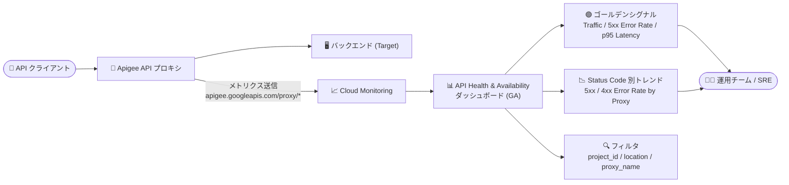

# Apigee X: API Health & Availability ダッシュボードが Cloud Monitoring で一般提供 (GA)

**リリース日**: 2026-10-27

**サービス**: Apigee X

**機能**: Apigee API Health & Availability dashboard (Cloud Monitoring)

**ステータス**: GA (一般提供)

📊 [このアップデートのインフォグラフィックを見る](https://takech9203.github.io/google-cloud-news-summary/20261027-apigee-api-health-availability-dashboard-ga.html)

## 概要

Apigee の API プロキシの健全性・パフォーマンス・可用性をリアルタイムに監視できる「Apigee API Health & Availability ダッシュボード」が Cloud Monitoring で一般提供 (GA) になりました。SRE の実践で重視される「ゴールデンシグナル」(トラフィック、エラー率、レイテンシ) をスコアカードとして一目で確認でき、API 運用チームが障害の検知と切り分けを迅速に行えるようになります。

このダッシュボードでは、集計されたトラフィック (requests per second)、エラー率 (5xx)、レイテンシ (p95) のスコアカードに加え、ステータスコード別のリクエストレート推移や、プロキシ単位の 5xx / 4xx エラー率チャートを提供します。さらに `project_id`、`location`、`proxy_name` によるフィルタリングに対応しており、特定リージョンや特定プロキシに絞り込んだトラブルシューティングが可能です。

Apigee で API プログラムを運用するプラットフォームチーム・SRE・運用担当者が主な対象ユーザーです。Cloud Monitoring 上で他の Google Cloud リソースのメトリクスと同じ基盤・同じ UI で Apigee の API 監視ができる点が価値です。

**アップデート前の課題**

- Cloud Monitoring 上で Apigee API プロキシのゴールデンシグナル (トラフィック・エラー率・レイテンシ) をまとめて確認するには、`apigee.googleapis.com/proxy/request_count` や `proxy/response_count`、`proxy/latencies` などのメトリクスを使ってカスタムダッシュボードを自作する必要があった
- 問題のあるプロキシを特定するための 5xx / 4xx エラー率のプロキシ別チャートなどを、PromQL / MQL クエリで個別に構築・保守する必要があった

**アップデート後の改善**

- 事前構築された「API Health & Availability ダッシュボード」が GA となり、カスタムダッシュボードを構築せずにゴールデンシグナルのスコアカードをすぐに利用できるようになった
- 「Request Rate by Status Code」チャートでステータスコード別の傾向を可視化し、「5xx Error Rate by Proxy」「4xx Error Rate by Proxy」チャートで問題のある API プロキシを特定できるようになった
- `project_id`、`location`、`proxy_name` によるきめ細かなフィルタリングで、特定のリージョンやプロキシに絞ったトラブルシューティングが可能になった

## アーキテクチャ図

Apigee API プロキシのテレメトリが Cloud Monitoring に送信され、GA となった API Health & Availability ダッシュボードでゴールデンシグナルのスコアカードやプロキシ別エラーチャートとして可視化される流れを示しています。

## サービスアップデートの詳細

### 主要機能

1. **ゴールデンシグナルのスコアカード**
   - 集計された Traffic (requests per second)、Error Rate (5xx)、Latency (p95) をスコアカードとして表示
   - API 全体の健全性を一目で把握でき、異常の早期検知に役立つ

2. **ステータスコードとエラーのトレンド可視化**
   - 「Request Rate by Status Code」チャートで、ステータスコード別のリクエストレートの推移を時系列で可視化
   - 専用の「5xx Error Rate by Proxy」「4xx Error Rate by Proxy」チャートで、問題のある API プロキシを特定可能

3. **きめ細かなフィルタリング**
   - `project_id`、`location`、`proxy_name` でテレメトリをフィルタリング
   - 特定のリージョンや特定のプロキシに絞り込んだトラブルシューティングが可能

## 技術仕様

### ダッシュボードの構成要素

| 項目 | 詳細 |
|------|------|
| 提供場所 | Cloud Monitoring (ダッシュボード) |
| スコアカード | Traffic (req/s)、Error Rate (5xx)、Latency (p95) |
| チャート | Request Rate by Status Code、5xx Error Rate by Proxy、4xx Error Rate by Proxy |
| フィルタ | `project_id`、`location`、`proxy_name` |
| 対象 | Apigee API プロキシ (リアルタイムの健全性・パフォーマンス・可用性) |

### 必要なロール (API Monitoring へのアクセス)

Apigee の API Monitoring を利用するには、公式ドキュメントで以下のロールが必要とされています。

| ロール | 用途 |
|--------|------|
| `roles/apigee.readOnlyAdmin` | Apigee リソースの読み取り |
| `roles/monitoring.viewer` | Cloud Monitoring データの閲覧 |

## メリット

### ビジネス面

- **MTTD (平均検知時間) の短縮**: ゴールデンシグナルを一目で確認できるため、顧客影響が出る前に API の異常に気づき対処しやすくなる
- **運用コストの削減**: カスタムダッシュボードの構築・保守が不要になり、監視基盤の立ち上げ工数を削減できる

### 技術面

- **SRE プラクティスとの整合**: Traffic / Error Rate / Latency というゴールデンシグナルベースの監視を標準で利用できる
- **Cloud Monitoring への統合**: 他の Google Cloud リソースのメトリクスと同じ基盤・UI で Apigee の API を監視でき、アラートポリシーなど Cloud Monitoring の機能と組み合わせやすい
- **プロキシ単位の切り分け**: 5xx / 4xx Error Rate by Proxy チャートと `proxy_name` フィルタにより、問題のプロキシを素早く特定できる

## デメリット・制約事項

### 考慮すべき点

- スコアカードで提供されるレイテンシは p95 であり、p99 など他のパーセンタイルが必要な場合は別途メトリクス (`apigee.googleapis.com/proxy/latencies`) を使ったカスタムチャートの作成を検討する
- フィルタ対象は `project_id`、`location`、`proxy_name` であり、それ以外の軸 (環境やメソッドなど) での深掘りが必要な場合は、Apigee の API Monitoring 画面 (Timeline / Investigate / Recent) や Metrics Explorer を併用する

## ユースケース

### ユースケース 1: 障害発生時の迅速な切り分け

**シナリオ**: API 利用者からエラー増加の報告を受けた運用チームが、原因となっているプロキシとリージョンを特定したい。

**実装例**:
1. Cloud Monitoring の Apigee API Health & Availability ダッシュボードを開く
2. Error Rate (5xx) スコアカードと「5xx Error Rate by Proxy」チャートで異常なプロキシを特定
3. `location` フィルタで特定リージョンに絞り込み、リージョン起因かプロキシ起因かを切り分け

**効果**: カスタムクエリを書かずに、問題のプロキシ・リージョンを短時間で特定でき、MTTD を短縮できる。

### ユースケース 2: ゴールデンシグナルベースの日常監視

**シナリオ**: SRE チームが複数の Apigee プロジェクトの API 健全性を日常的にレビューしたい。

**効果**: Traffic / Error Rate / Latency のスコアカードを定常確認することで、トラフィックの異常なスパイクや 5xx 増加、p95 レイテンシの悪化傾向を早期に把握できる。`project_id` フィルタでプロジェクトごとの状況も確認できる。

## 料金

このダッシュボード自体の追加料金に関する記載はリリースノートにはありません。Cloud Monitoring および Apigee の料金詳細は公式の料金ページを参照してください。

- [Cloud Monitoring 料金](https://cloud.google.com/stackdriver/pricing)
- [Apigee 料金](https://cloud.google.com/apigee/pricing)

## 関連サービス・機能

- **Cloud Monitoring**: 本ダッシュボードの提供基盤。Apigee メトリクス (`apigee.googleapis.com/proxy/*`) を使ったアラートポリシーやカスタムダッシュボードの作成も可能
- **Apigee API Monitoring**: Apigee UI 上の API 監視機能 (Timeline / Investigate / Recent ビュー)。本ダッシュボードと組み合わせて、フォールトコードベースの詳細診断などに活用できる
- **Cloud Logging**: API プロキシのログと組み合わせることで、メトリクスで検知した異常の根本原因分析が可能

## 参考リンク

- 📊 [インフォグラフィック](https://takech9203.github.io/google-cloud-news-summary/20261027-apigee-api-health-availability-dashboard-ga.html)
- [公式リリースノート](https://cloud.google.com/release-notes#October_27_2026)
- [API Monitoring ドキュメント](https://cloud.google.com/apigee/docs/api-monitoring)
- [Cloud Monitoring ドキュメント](https://cloud.google.com/monitoring/docs)
- [Cloud Monitoring 料金ページ](https://cloud.google.com/stackdriver/pricing)

## まとめ

Apigee API Health & Availability ダッシュボードの GA により、Cloud Monitoring 上でゴールデンシグナルベースの API 監視をカスタム構築なしで利用できるようになりました。Apigee を運用しているチームは、まずこのダッシュボードを日常監視に組み込み、5xx / 4xx Error Rate by Proxy チャートと `project_id` / `location` / `proxy_name` フィルタを活用した障害切り分けフローの整備を検討することを推奨します。

---

**タグ**: Apigee, Cloud Monitoring, API Monitoring, Observability, GA, ゴールデンシグナル
