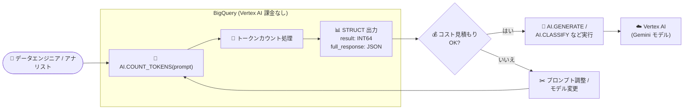

# BigQuery: AI.COUNT_TOKENS 関数が一般提供 (GA) に

**リリース日**: 2026-10-27

**サービス**: BigQuery

**機能**: AI.COUNT_TOKENS 関数 (テキストのトークン数見積もり)

**ステータス**: GA (一般提供)

📊 [このアップデートのインフォグラフィックを見る](https://takech9203.github.io/google-cloud-news-summary/20261027-bigquery-ai-count-tokens-ga.html)

## 概要

BigQuery の AI.COUNT_TOKENS 関数が一般提供 (GA) となった。この関数は、テキスト文字列のトークン数を SQL クエリ内で直接見積もるユーティリティ関数である。トークンは生成 AI モデルが入力を処理する際の基本単位であり、AI 関数の利用コストはトークン数に基づいて課金されるため、プロンプトのトークン数を事前に把握することで AI.GENERATE などの AI 関数呼び出しコストを見積もることができる。

トークンカウント処理は BigQuery 内で実行されるため、この関数自体は Vertex AI 側の課金を発生させない点が大きな特長である。見積もり対象は入力トークン数のみであり、思考 (thinking) トークンや出力トークンは結果に含まれない。クエリで実際に処理された各種トークン数は、クエリ結果ペインの「ジョブ情報」タブで確認できる。

本機能は 2026 年 5 月 12 日に Preview として発表されており、今回 GA に昇格したことで、本番環境でのコスト見積もりワークフローに正式に組み込めるようになった。BigQuery で生成 AI 関数を活用するデータエンジニア、データサイエンティスト、アナリストが対象ユーザーである。

**アップデート前の課題**

- AI.COUNT_TOKENS は Preview ステータスであり、GA レベルの提供条件が適用されず、本番ワークロードへの組み込みには慎重な判断が必要だった
- Preview 以前は、BigQuery SQL 内でプロンプトのトークン数を事前に見積もる手段がなく、AI.GENERATE 等の実行コストを事前に把握できなかった
- コスト確認は Cloud Billing レポートなどによる事後確認が中心で、クエリ実行前のコスト予測が困難だった

**アップデート後の改善**

- AI.COUNT_TOKENS 関数が GA となり、本番環境のコスト見積もり・コスト管理ワークフローに正式に利用できるようになった
- 任意のテキスト入力のトークン数を SQL クエリで即座に見積もれる (トークンカウントは BigQuery 内で処理され、Vertex AI の課金は発生しない)
- `endpoint` 引数でモデルを指定することで、使用予定の生成 AI モデルのトークン化ルールに基づいた見積もりが可能

## アーキテクチャ図



AI 関数の実行前に AI.COUNT_TOKENS で入力トークン数を見積もり、コストを確認してから Vertex AI の Gemini モデルを呼び出す AI 関数を実行するワークフローを示す。トークンカウントは BigQuery 内で完結するため、見積もり自体に Vertex AI の課金は発生しない。

## サービスアップデートの詳細

### 主要機能

1. **SQL 内でのトークン数見積もり**
   - テキスト文字列 (STRING) の入力トークン数を SQL クエリ内で直接見積もる
   - 例: `SELECT AI.COUNT_TOKENS("Token count isn't always equal to word count.").result AS num_tokens;` (結果は約 11)
   - テーブルの列に対して適用し、行ごとのトークン数を一括で算出することも可能

2. **モデル指定によるトークン化ルールの選択**
   - `endpoint` 引数で生成 AI モデル名を指定すると、そのモデルのトークン化ルールでカウントされる
   - `endpoint` を省略した場合は、AI.GENERATE 関数のデフォルトモデルが使用される

3. **Vertex AI 課金なしのコスト見積もり**
   - トークンカウントは BigQuery 内で処理され、この関数は Vertex AI の課金を発生させない
   - 見積もり対象は入力トークンのみ (思考トークン・出力トークンは含まれない)
   - 実際のトークン消費量はクエリ結果ペインの「ジョブ情報」タブで確認できる

## 技術仕様

### 関数シグネチャ

```sql
AI.COUNT_TOKENS(
  INPUT
  [, endpoint => ENDPOINT]
)
```

### 引数と出力

| 項目 | 詳細 |
|------|------|
| `INPUT` | トークン数をカウントする入力テキスト (STRING) |
| `ENDPOINT` | トークン化ルールに使用する生成 AI モデル名 (STRING リテラル、省略可)。省略時は AI.GENERATE のデフォルトモデルを使用 |
| 戻り値 | STRUCT 値 |
| `result` | 入力の合計トークン数 (INT64)。入力が NULL または API エラー時は NULL |
| `full_response` | 入力のモダリティとトークン数を含む JSON。入力が NULL または API エラー時は NULL |

### 出力例

```sql
SELECT review, AI.COUNT_TOKENS(review).*
FROM `bigquery-public-data.imdb.reviews`
LIMIT 2;
```

```
+----------------------------------------+--------+---------------------------------------------+
| review                                 | result | full_response                               |
+----------------------------------------+--------+---------------------------------------------+
| I think the manuscript of the movie... | 180    | {"promptTokensDetails":[{"modality":"TEXT", |
|                                        |        | "tokenCount":180}],"totalTokens":180}       |
| Or that's what the filmmakers would... | 246    | {"promptTokensDetails":[{"modality":"TEXT", |
|                                        |        | "tokenCount":246}],"totalTokens":246}       |
+----------------------------------------+--------+---------------------------------------------+
```

## メリット

### ビジネス面

- **コストの事前予測**: AI 関数実行前にプロンプトのトークン数を把握できるため、大規模データセットに対する生成 AI 処理のコストを事前に見積もり、予算超過を防止できる
- **見積もり自体が低コスト**: トークンカウントは BigQuery 内で処理され Vertex AI の課金が発生しないため、コスト見積もりのための追加コストを最小限に抑えられる
- **GA による本番利用の安心感**: GA 昇格により、本番環境のコスト管理ワークフローへ正式に組み込める

### 技術面

- **SQL 完結のワークフロー**: 外部ツールや SDK (Vertex AI の countTokens API など) を使わず、BigQuery の SQL だけでトークン見積もりからAI 関数実行までを完結できる
- **モデル別のトークン化ルール対応**: `endpoint` 引数により、実際に使用するモデルに即した正確な見積もりが可能
- **詳細情報の取得**: `full_response` の JSON からモダリティ別のトークン数を取得でき、プログラマティックな処理に活用できる

## デメリット・制約事項

### 制限事項

- 見積もり対象は入力トークン数のみで、思考 (thinking) トークンや出力トークンの数は結果に含まれない
- 入力が NULL の場合や API エラーが発生した場合、`result` と `full_response` は NULL になる
- 入力は STRING 型のテキストが対象

### 考慮すべき点

- あくまで「見積もり (estimate)」であり、実際にクエリで処理された正確なトークン数は、クエリ結果ペインの「ジョブ情報」タブで確認する必要がある
- 出力トークン数は実行してみないと分からないため、総コストの厳密な事前算出はできない
- トークン単位の課金管理には、BigQuery のトークンクォータ (AI input/output tokens per day) の設定も併せて検討するとよい

## ユースケース

### ユースケース 1: 大規模バッチ推論前のコスト見積もり

**シナリオ**: 数百万行のレビューデータに AI.GENERATE で感情分析を実行する前に、入力トークンの総量を見積もり、コストを予測したい。

**実装例**:
```sql
SELECT
  SUM(AI.COUNT_TOKENS(review).result) AS total_input_tokens
FROM `bigquery-public-data.imdb.reviews`;
```

**効果**: Vertex AI の課金を発生させずに入力トークン総量を把握し、モデルの単価と掛け合わせて推論コストの概算を事前に算出できる。

### ユースケース 2: プロンプト設計の最適化

**シナリオ**: AI.GENERATE に渡すプロンプトテンプレートを複数案比較し、トークン効率のよいものを選定したい。

**効果**: 各テンプレート案のトークン数を SQL で即座に比較でき、同等の品質でトークン消費 (コスト) の少ないプロンプトを選択できる。

## 料金

AI.COUNT_TOKENS のトークンカウント処理は BigQuery 内で実行され、この関数自体は Vertex AI の課金を発生させない。クエリの実行に使用するコンピュートリソースについては、通常の BigQuery の料金体系が適用される。

詳細は [BigQuery の料金ページ](https://cloud.google.com/bigquery/pricing) を参照。

## 利用可能リージョン

リージョンごとの提供状況は公式ドキュメントで明示されていないため、[BigQuery のロケーション情報](https://cloud.google.com/bigquery/docs/locations) および [生成 AI 関数のドキュメント](https://cloud.google.com/bigquery/docs/generative-ai-overview) を参照。

## 関連サービス・機能

- **AI.GENERATE / AI.GENERATE_TEXT**: 推論を実行する汎用生成 AI 関数。AI.COUNT_TOKENS はこれらの関数の呼び出しコスト見積もりに使用し、`endpoint` 省略時は AI.GENERATE のデフォルトモデルのトークン化ルールが適用される
- **AI.CLASSIFY / AI.IF / AI.SCORE / AI.AGG**: マネージド AI 関数。トークン使用量が Vertex AI 課金に直結するため、事前見積もりと組み合わせたコスト管理が有効
- **トークンクォータ (Control costs with token quotas)**: プロジェクト単位・ユーザー単位で 1 日あたりの入力/出力トークン数に上限を設定できる BigQuery のコスト管理機能。AI.COUNT_TOKENS による事前見積もりと併用することで多層的なコスト管理が可能
- **Vertex AI**: BigQuery の生成 AI 関数のバックエンド。AI.COUNT_TOKENS 自体は Vertex AI の課金を発生させない

## 参考リンク

- 📊 [インフォグラフィック](https://takech9203.github.io/google-cloud-news-summary/20261027-bigquery-ai-count-tokens-ga.html)
- [公式リリースノート](https://cloud.google.com/bigquery/docs/release-notes#October_27_2026)
- [AI.COUNT_TOKENS 関数ドキュメント](https://docs.cloud.google.com/bigquery/docs/reference/standard-sql/bigqueryml-syntax-ai-count-tokens)
- [生成 AI の概要 (トークン使用量の確認)](https://docs.cloud.google.com/bigquery/docs/generative-ai-overview)
- [トークンクォータによるコスト管理](https://docs.cloud.google.com/bigquery/docs/control-genai-costs)
- [料金ページ](https://cloud.google.com/bigquery/pricing)

## まとめ

AI.COUNT_TOKENS 関数の GA 昇格により、BigQuery の生成 AI 関数を使う際のコスト見積もりを本番環境のワークフローに正式に組み込めるようになった。トークンカウントは BigQuery 内で完結し Vertex AI の課金が発生しないため、大規模バッチ推論の実行前見積もりやプロンプト最適化に気軽に活用できる。生成 AI 関数を本番運用しているチームは、トークンクォータと組み合わせたコスト管理体制の整備を推奨する。

---

**タグ**: BigQuery, AI.COUNT_TOKENS, 生成AI, トークン, コスト管理, GA, Gemini, Vertex AI
