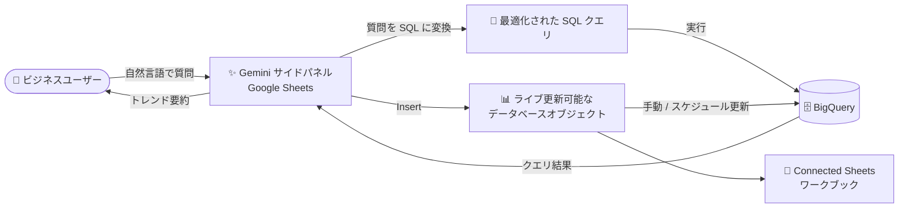

# BigQuery: Connected Sheets の会話型分析 (Conversational Analytics) が GA

**リリース日**: 2026-10-27

**サービス**: BigQuery (Connected Sheets)

**機能**: Connected Sheets における会話型分析 — 自然言語による BigQuery データ分析

**ステータス**: GA (一般提供)

📊 [このアップデートのインフォグラフィックを見る](https://takech9203.github.io/google-cloud-news-summary/20261027-bigquery-conversational-analytics-connected-sheets.html)

## 概要

Google Sheets の Connected Sheets で、会話型分析 (Conversational Analytics) を使って BigQuery のデータを自然言語で分析できる機能が一般提供 (GA) になりました。Google Sheets の Gemini サイドパネルに質問を入力するだけで、Gemini が質問を最適化された SQL クエリに変換して実行し、主要なトレンドを要約します。さらに、ライブで更新可能なデータベースオブジェクトをワークブックに直接挿入できます。

この機能は Gemini for Google Cloud を基盤とする会話型分析 (Conversational Analytics) を Connected Sheets に統合したもので、BI の専門知識や SQL スキルを持たないビジネスユーザーでも、使い慣れたスプレッドシートのインターフェースから BigQuery 上の大規模データに対して対話的に質問・分析できるようになります。会話はコンテキストを維持したまま複数の質問を続けられるため、深掘り分析にも対応します。

**アップデート前の課題**

- Connected Sheets で BigQuery データを分析するには、ピボットテーブル・グラフ・関数・カスタムクエリ (SQL) などを利用者自身が作成する必要があった
- 自然言語での質問から SQL を生成・実行して結果を得るには、BigQuery Studio 側の機能 (データキャンバスや会話型分析) を使う必要があり、スプレッドシート上で完結しなかった
- データの傾向の要約や分析結果のスプレッドシートへの反映は手作業だった

**アップデート後の改善**

- Google Sheets の Gemini サイドパネルから自然言語で質問するだけで、Gemini が最適化された SQL クエリへの変換と実行を代行するようになった
- クエリ結果の主要なトレンドを Gemini が要約してくれるようになった
- ライブで更新可能 (refreshable) なデータベースオブジェクトをワークブックに直接挿入でき、手動更新に加えて更新スケジュールの設定も可能になった
- 複数の質問にわたってコンテキストを維持できるため、対話的に分析を深められるようになった

## アーキテクチャ図



ユーザーが Gemini サイドパネルに自然言語で質問すると、Gemini が SQL に変換して BigQuery で実行し、結果の要約と、更新可能なオブジェクトのワークブックへの挿入を行います。

## サービスアップデートの詳細

### 主要機能

1. **自然言語から SQL への変換と実行**
   - Gemini サイドパネルに入力した質問を、Gemini が最適化された SQL クエリに変換して BigQuery 上で実行する
   - SQL の知識がなくても BigQuery データへの問い合わせが可能

2. **主要トレンドの要約**
   - クエリ結果から主要なトレンドを Gemini が要約して提示する
   - コンテキストを維持したまま複数の質問を続けられる (マルチターン対話)

3. **ライブで更新可能なデータベースオブジェクトの挿入**
   - Gemini に依頼してライブで更新可能なオブジェクトを作成し、「Insert」で結果をスプレッドシートに直接追加できる
   - オブジェクトは任意のタイミングで手動更新できるほか、更新スケジュールの設定も可能

### 利用手順 (公式ドキュメントより)

1. Google Sheets で Gemini サイドパネルを開く (初回利用時は BigQuery へのアクセス認可を求められる場合があり、「Get connected」をクリックして続行)
2. テキストフィールドに質問を入力する (複数の質問にわたりコンテキストを維持可能)
3. Gemini にライブで更新可能なオブジェクトの作成を依頼する
4. 「Insert」をクリックして結果をスプレッドシートに直接追加する

## 技術仕様

### Connected Sheets の前提条件・アクセス制御

| 項目 | 詳細 |
|------|------|
| 必要な IAM ロール (BigQuery 側) | `bigquery.user`、または `bigquery.jobUser` と `bigquery.dataViewer` |
| プロジェクト要件 | 課金が有効な Google Cloud プロジェクトを選択 (BigQuery API 有効化) |
| アクセス制御 | BigQuery データセット・テーブルへのアクセスは BigQuery 側の IAM で制御 |
| VPC Service Controls | Sheets は VPC-SC 非対応のため、境界内のデータへアクセスするにはクエリ結果のコピーを許可する egress ルール等の構成が必要 |
| 実行クエリの確認 | Connected Sheets が発行したクエリは BigQuery のクエリ詳細や Cloud Logging で確認可能 |

### 注意事項 (Gemini for Google Cloud 共通)

- Gemini for Google Cloud は、もっともらしく見えても事実と異なる出力を生成する可能性があるため、利用前に出力内容を検証することが推奨されています

## メリット

### ビジネス面

- **データ分析の民主化**: SQL や BI の専門知識がないビジネスユーザーでも、自然言語で BigQuery の大規模データを分析できる
- **意思決定の迅速化**: 質問から結果の要約までがスプレッドシート上で完結し、分析担当者への依頼・待ち時間を削減できる

### 技術面

- **最適化された SQL の自動生成**: Gemini が質問を最適化された SQL に変換するため、クエリ作成の工数を削減できる
- **ライブデータとの同期**: 挿入したオブジェクトは手動またはスケジュールで更新でき、スプレッドシート上のデータを BigQuery の最新データと同期できる
- **ガバナンスの維持**: データアクセスは引き続き BigQuery 側の IAM で制御され、既存のアクセス管理の枠組みを維持できる

## デメリット・制約事項

### 考慮すべき点

- Gemini の出力はもっともらしく見えても誤りを含む可能性があり、生成された分析結果の検証が推奨される
- 初回利用時に BigQuery アクセスの認可 (Get connected) が必要
- Connected Sheets の利用には BigQuery 側の IAM ロール (`bigquery.user` など) と課金が有効なプロジェクトが必要
- Google Sheets のセル上限 (全タブ合計 1,000 万セル) など、スプレッドシート側の制限は従来どおり適用される
- VPC Service Controls で保護された BigQuery データにアクセスする場合は、境界の追加構成が必要

## ユースケース

### ユースケース 1: 営業チームによるセルフサービス分析

**シナリオ**: 営業企画担当者が、SQL を書かずに BigQuery 上の売上データから地域別・月別のトレンドを把握したい。

**実装例**:
```
Gemini サイドパネルでの質問例:
「過去 6 か月の地域別売上の推移を教えて」
→ Gemini が SQL を生成・実行し、トレンドを要約
「その結果を表としてシートに挿入して」
→ Insert でライブ更新可能なオブジェクトをワークブックに追加
```

**効果**: 分析チームへの依頼なしに、スプレッドシート上でセルフサービスの売上分析が完結する。

### ユースケース 2: 定例レポートの自動鮮度維持

**シナリオ**: 週次の経営会議資料として使うスプレッドシートに、BigQuery の KPI データを常に最新の状態で反映したい。

**効果**: 会話型分析で作成したライブオブジェクトに更新スケジュールを設定することで、手動でのデータ転記・更新作業が不要になる。

## 料金

本機能固有の料金情報はリリースノートに記載されていません。Connected Sheets からのクエリは選択した Google Cloud プロジェクト (課金有効) に対して実行されます。詳細は以下の公式料金ページを参照してください。

- [BigQuery の料金](https://cloud.google.com/bigquery/pricing)
- [Gemini for Google Cloud の料金](https://cloud.google.com/products/gemini/pricing)

## 関連サービス・機能

- **Gemini for Google Cloud**: 会話型分析の基盤となる AI 機能。自然言語からの SQL 生成・要約を担う
- **会話型分析 (Conversational Analytics)**: BigQuery データと自然言語で対話する機能群。BigQuery で作成したデータエージェントとの連携や Conversational Analytics API も提供されている
- **BigQuery データキャンバス**: BigQuery Studio 上で自然言語によるデータ探索・可視化を行う機能
- **Google Sheets (Connected Sheets)**: 数十億行の BigQuery データをスプレッドシートから直接分析できる機能。ピボットテーブル (最大 10 万件)、データ抽出 (最大 50 万行または 10 MB) などに対応
- **Cloud Logging**: Connected Sheets が発行した BigQuery クエリの監査・確認に利用可能

## 参考リンク

- 📊 [インフォグラフィック](https://takech9203.github.io/google-cloud-news-summary/20261027-bigquery-conversational-analytics-connected-sheets.html)
- [公式リリースノート (BigQuery)](https://cloud.google.com/bigquery/docs/release-notes#October_27_2026)
- [ドキュメント: Connected Sheets を使用した BigQuery データの分析](https://cloud.google.com/bigquery/docs/connected-sheets)
- [ドキュメント: 会話型分析の概要](https://cloud.google.com/bigquery/docs/conversational-analytics)
- [料金ページ (BigQuery)](https://cloud.google.com/bigquery/pricing)

## まとめ

Connected Sheets の会話型分析が GA となり、Google Sheets の Gemini サイドパネルから自然言語で BigQuery データの分析・要約・ライブオブジェクトの挿入までが完結するようになりました。SQL スキルを持たないビジネスユーザーへのデータ分析の展開手段として有力であり、まずは BigQuery 側の IAM ロールを確認のうえ、既存の Connected Sheets ワークブックで試用することを推奨します。

---

**タグ**: BigQuery, Connected Sheets, Google Sheets, Gemini, Conversational Analytics, 自然言語分析, GA
