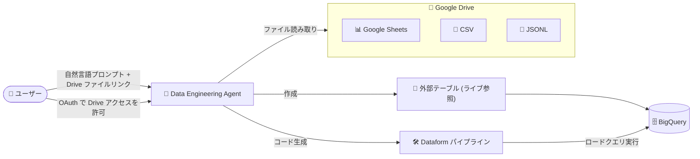

# BigQuery: Data Engineering Agent の Google Drive 統合が GA

**リリース日**: 2026-10-27

**サービス**: BigQuery

**機能**: Data Engineering Agent の Google Drive 統合

**ステータス**: GA (一般提供)

📊 [このアップデートのインフォグラフィックを見る](https://takech9203.github.io/google-cloud-news-summary/20261027-bigquery-data-engineering-agent-google-drive.html)

## 概要

BigQuery の Data Engineering Agent が Google Drive と統合され、Google スプレッドシート (Google Sheets)、CSV、JSONL (改行区切り JSON) ファイルをデータエンジニアリングパイプラインの入力として直接利用できるようになりました。この機能は一般提供 (GA) となり、本番環境での利用が可能です。

Data Engineering Agent は、自然言語プロンプトで BigQuery と Dataform 上のデータパイプラインを構築・変更・トラブルシューティングできるエージェントです。今回の統合により、プロンプト内で Drive 上のファイルへのリンクを指定し、要求に応じて OAuth で Drive へのアクセスを許可するだけで、エージェントがファイルを読み取り、ライブの Drive ファイルを参照する外部テーブルの作成や、Dataform パイプラインクエリによるデータのロードを行えるようになります。

スプレッドシートで管理されているマスタデータや、Drive に共有される CSV/JSONL ファイルを BigQuery に取り込むワークフローを、自然言語だけで構築したいデータエンジニアやアナリティクスエンジニアに有用なアップデートです。

**アップデート前の課題**

- Drive 上の Google Sheets / CSV / JSONL ファイルを BigQuery パイプラインに取り込むには、外部テーブルの定義 (スキーマ指定、Drive URI の取得、OAuth スコープの設定) やロードクエリの作成を手動で行う必要があった
- Data Engineering Agent は BigQuery 内のテーブルを主な対象としており、Drive 上のファイルを自然言語プロンプトの入力として直接扱うことができなかった

**アップデート後の改善**

- プロンプトに Drive 上のファイルリンクを渡すだけで、エージェントがファイルを読み取り、パイプラインに組み込めるようになった
- ライブの Drive ファイルを参照する外部テーブルの作成と、Dataform パイプラインクエリを通じたファイルのロードをエージェントが自動で行えるようになった
- CSV ベースの外部テーブルのような生データのテーブルを追加すると、エージェントが自動的にデータラングリング (クレンジング・型変換など) の分析を開始する既存機能と組み合わせて活用できる

## アーキテクチャ図



ユーザーが Drive ファイルのリンクを含むプロンプトを渡すと、エージェントが OAuth 経由でファイルを読み取り、ライブ参照用の外部テーブル作成や Dataform パイプラインによるロードを行い、BigQuery にデータを取り込みます。

## サービスアップデートの詳細

### 主要機能

1. **Drive ファイルのパイプライン入力対応**
   - プロンプト内で Drive 上のファイルへのリンクを指定すると、エージェントがそのファイルを読み取ってパイプラインに組み込む
   - 要求に応じてユーザーが OAuth で Drive へのアクセスを許可する方式

2. **外部テーブルの自動作成**
   - ライブの Drive ファイルを参照する外部テーブルをエージェントが作成できる
   - Drive 上のファイルが更新されると、外部テーブル経由で常に最新のデータをクエリ可能 (外部テーブルの特性)

3. **Dataform パイプラインクエリによるロード**
   - 外部テーブル参照に加え、Dataform パイプラインのクエリを通じてファイルを BigQuery にロードすることも可能
   - 生成されたコードは Dataform リポジトリ / ワークスペース内に整理される

### サポートされるファイル形式

| ファイル形式 | 説明 |
|------|------|
| CSV | カンマ区切りテキスト |
| Google Sheets | Google スプレッドシート |
| JSONL | 改行区切り JSON (Newline-delimited JSON) |

## 技術仕様

### Drive アクセスの認証

Drive 上のデータへのアクセスには、BigQuery に加えて Drive 用の追加 OAuth スコープが必要です。

| 方法 | 内容 |
|------|------|
| コンソール | 外部テーブル作成時に Web ベースの認証フローで「許可」をクリック |
| gcloud CLI | `gcloud auth login --enable-gdrive-access` で認証 |
| API / クライアントライブラリ | `https://www.googleapis.com/auth/drive` スコープを BigQuery スコープに加えて要求 |

```bash
# gcloud CLI で Drive アクセスを有効にして認証
gcloud auth login --enable-gdrive-access
```

### Drive URI の形式

外部テーブルの作成には Drive URI を指定します。

```
https://docs.google.com/spreadsheets/d/FILE_ID
https://drive.google.com/open?id=FILE_ID
```

## 設定方法

### 前提条件

1. Data Engineering Agent を利用できる環境 (BigQuery pipelines インターフェース、Dataform、VS Code 拡張、または Data Engineering Agent API)
2. 対象の Drive ファイル (Google Sheets / CSV / JSONL) への閲覧権限
3. Drive アクセス用の OAuth スコープの許可

### 手順

#### ステップ 1: Drive ファイルのリンクを取得

対象の Google Sheets / CSV / JSONL ファイルの URL (Drive URI) をコピーします。

#### ステップ 2: エージェントにプロンプトでリンクを渡す

Data Engineering Agent へのプロンプトに Drive ファイルのリンクを含め、パイプラインへの組み込みを指示します。エージェントから要求された場合は、OAuth で Drive へのアクセスを許可します。

#### ステップ 3: 生成されたプランとパイプラインをレビュー

エージェントはプランを生成するため、外部テーブル定義やロードクエリの内容をレビューし、確認後にパイプラインを作成します。なお、エージェントはパイプラインを実行できないため、実行やスケジュールはユーザーが行います。

## メリット

### ビジネス面

- **ビジネスデータの取り込み迅速化**: スプレッドシートで管理されている現場のデータを、専門的な外部テーブル定義の知識なしに BigQuery パイプラインへ取り込める
- **GA による本番利用**: 一般提供となったため、本番ワークロードでの利用が可能

### 技術面

- **外部テーブルとロードの両対応**: ライブ参照 (外部テーブル) とスナップショット取り込み (Dataform パイプラインによるロード) を使い分けられる
- **既存のエージェント機能との連携**: CSV ベースの外部テーブルなど生データを追加すると、エージェントが自動的にデータラングリング分析 (クレンジング、型検出・変換など) を開始する

## デメリット・制約事項

### 制限事項

- サポートされる Drive 上のファイル形式は CSV、Google Sheets、JSONL の 3 種類
- Data Engineering Agent はパイプラインを実行できない (レビュー後にユーザーが実行・スケジュールする必要がある)
- エージェントはプロンプトや指示で与えられた Web リンク / URL を検索できない (Drive ファイルリンクの読み取りは今回の統合機能による)

### 考慮すべき点

- Drive アクセスには追加の OAuth スコープ (`https://www.googleapis.com/auth/drive`) が必要
- Drive の外部テーブルをクエリするユーザー / サービスアカウントには、対象 Drive ファイルへの閲覧権限が必要 (権限がないと `Permission denied while getting Drive credentials` エラーが発生)
- Google Sheets の外部テーブルは、数式を多用したスプレッドシートで `Google Sheets service overloaded` エラーが発生する場合がある
- エージェントによるデータサンプリング・プロファイリングは BigQuery リソースを使用し、BigQuery の料金が適用される

## ユースケース

### ユースケース 1: スプレッドシート管理のマスタデータの取り込み

**シナリオ**: 営業部門が Google Sheets で管理している商品マスタや担当者リストを、日次の売上分析パイプラインに組み込みたい。

**実装例**:
```
プロンプト例:
「この Google スプレッドシート (https://docs.google.com/spreadsheets/d/FILE_ID) を
外部テーブルとして取り込み、sales_raw テーブルと結合して日次売上サマリを作る
Dataform パイプラインを作成して。プランを見せて。」
```

**効果**: 外部テーブル定義やロードクエリを手書きすることなく、スプレッドシートの最新データを参照するパイプラインを自然言語だけで構築できる。

### ユースケース 2: Drive に共有される CSV / JSONL ファイルの定期ロード

**シナリオ**: 外部パートナーから Drive 経由で共有される CSV / JSONL ファイルを BigQuery にロードし、クレンジングして分析用テーブルに変換したい。

**効果**: エージェントがファイルを読み取ってロードパイプラインを生成し、生データに対しては自動データラングリング分析 (欠損値補完、重複修正、型変換など) の提案も受けられるため、取り込みから整形までの工数を削減できる。

## 料金

Data Engineering Agent の利用はトークンベースの料金です (BigQuery 料金ページより)。

| 項目 | 料金 (USD) |
|--------|-----------------|
| 入力データ (Data Engineering Agent) | $3 / 100 万トークン |
| 出力データ (Data Engineering Agent) | $20 / 100 万トークン |

- エージェントによるデータサンプリング・プロファイリングは BigQuery のクエリ料金の対象
- 詳細は [BigQuery 料金ページ](https://cloud.google.com/bigquery/pricing) を参照

## 利用可能リージョン

Data Engineering Agent のデータ処理ロケーションについては、公式ドキュメントの [Gemini in BigQuery のロケーション](https://docs.cloud.google.com/bigquery/docs/gemini-locations) を参照してください。

## 関連サービス・機能

- **Dataform**: エージェントが生成するパイプラインコードは Dataform リポジトリ / ワークスペース内に整理され、Drive ファイルのロードも Dataform パイプラインクエリで行われる
- **BigQuery 外部テーブル (Drive)**: ライブの Drive ファイルを参照する外部テーブル機能。今回の統合でエージェントが自動作成できるようになった
- **Knowledge Catalog**: エージェントは追加コンテキストとして Knowledge Catalog と統合されており、メタデータの自動生成・送信にも対応
- **Data Agent Kit**: VS Code などの IDE から Data Engineering Agent を利用するための拡張 / ツール群

## 参考リンク

- 📊 [インフォグラフィック](https://takech9203.github.io/google-cloud-news-summary/20261027-bigquery-data-engineering-agent-google-drive.html)
- [公式リリースノート](https://docs.cloud.google.com/release-notes#October_27_2026)
- [Data Engineering Agent 概要 (Google Drive integration)](https://docs.cloud.google.com/gemini/data-agents/data-engineering-agent/agent-overview#google-drive-integration)
- [Data Engineering Agent でパイプラインを構築する](https://docs.cloud.google.com/bigquery/docs/data-engineering-agent-pipelines)
- [Drive データ用の外部テーブルを作成する](https://docs.cloud.google.com/bigquery/docs/external-data-drive)
- [BigQuery 料金ページ](https://cloud.google.com/bigquery/pricing)

## まとめ

Data Engineering Agent の Google Drive 統合が GA となり、Google Sheets / CSV / JSONL ファイルを自然言語プロンプトだけでパイプラインに組み込めるようになりました。スプレッドシート管理のデータを BigQuery に取り込むワークフローが多い組織は、外部テーブル定義やロードクエリの手作業を削減できるため、まずは Drive ファイルリンクを使ったプロンプトでのパイプライン生成を試すことを推奨します。

---

**タグ**: BigQuery, Data Engineering Agent, Google Drive, Google Sheets, Dataform, Gemini, GA
