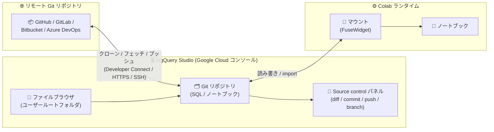

# BigQuery: BigQuery Studio Git リポジトリが一般提供 (GA)

**リリース日**: 2026-10-27

**サービス**: BigQuery

**機能**: BigQuery Studio Git repositories (SQL スクリプト・ノートブックの管理とバージョン管理)

**ステータス**: GA (一般提供)

📊 [このアップデートのインフォグラフィックを見る](https://takech9203.github.io/google-cloud-news-summary/20261027-bigquery-studio-git-repositories.html)

## 概要

BigQuery Studio Git リポジトリが一般提供 (GA) になりました。この機能により、SQL スクリプトやノートブックなどのコードアセットを、BigQuery Studio のファイルブラウザ上で直接バージョン管理できます。リモート Git リポジトリのクローン、ブランチ管理、コミット・プッシュなどの Git 操作を、Google Cloud コンソールを離れることなく実行できます。

従来の BigQuery リポジトリ (classic repositories) と比較して、この統合は左ペインのユーザールートフォルダ配下での「フォルダベース」の操作体験を提供するのが特徴です。コードアセットを通常のファイルやディレクトリと同じように操作しながら、リモート Git リポジトリとの接続を維持できます。

主な対象ユーザーは、BigQuery 上で SQL スクリプトやノートブックを開発するデータアナリスト、データエンジニア、データサイエンティストです。GitHub、GitLab、Bitbucket、Azure DevOps などのリモート Git リポジトリと連携し、チームの標準的な Git ワークフロー (ブランチ、コミット、プッシュ) に BigQuery 上の開発作業を組み込めます。

**アップデート前の課題**

- BigQuery Studio 上のコードアセット (SQL クエリ、ノートブックなど) をリモート Git リポジトリでバージョン管理するには、Preview 段階の classic repositories (リポジトリ + ワークスペースの構成) を利用する必要があった
- classic repositories はリポジトリとワークスペースという専用の概念を介した操作であり、ファイルブラウザ上でファイルやフォルダを直接操作するような体験ではなかった
- バージョン管理されたコードとノートブックのランタイムを直接連携させる仕組みが限られていた

**アップデート後の改善**

- ユーザールートフォルダ配下にリモート Git リポジトリをクローンし、ファイルブラウザ上で通常のファイル・ディレクトリとして直接操作できるフォルダベースの統合が GA として利用可能になった
- Source control パネルから差分表示 (Show diff)、コミット、リモートへのプッシュ、ブランチのチェックアウト・切り替え、コミット履歴の表示、フェッチといった Git 操作をコンソール内で完結できるようになった
- ノートブックから `FuseWidget` でリポジトリをランタイムにマウントし、同一リポジトリ内のファイルやクエリスクリプトを直接読み書き・import できるようになった
- 大規模リポジトリ向けに shallow clone (コミット履歴を制限したクローン) を作成し、必要に応じて後から追加のコミットをフェッチできるようになった

## アーキテクチャ図



リモート Git リポジトリを BigQuery Studio のファイルブラウザ配下にクローンし、Source control パネルで Git 操作を行います。ノートブックからは FuseWidget によるマウントを通じて、同一リポジトリ内のファイルへ直接アクセスできます。

## サービスアップデートの詳細

### 主要機能

1. **フォルダベースの Git リポジトリ統合**
   - ファイルブラウザのユーザールートノードから「Create > Git repository」でリモート Git リポジトリの URL を指定してクローンを作成
   - クローンされたリポジトリ内のコードアセットを、通常のファイル・ディレクトリと同じように作成・リネーム・コピー・移動・ダウンロード・削除・アップロードできる
   - リポジトリ内に SQL クエリ、ノートブック、データキャンバス、データ準備 (data preparation)、ファイル、サブディレクトリを新規作成できる

2. **コンソール内での Git 操作 (Source control パネル)**
   - 変更ファイルの行単位の差分表示 (Show diff)
   - コミットメッセージを入力してローカルブランチへコミットし、「Push to remote」でリモートへ同期
   - ローカル・リモートトラッキングブランチを基にした新規ブランチのチェックアウトと既存ブランチへの切り替え (未コミットの変更がある場合はブランチ切り替え不可)
   - アクティブブランチのコミット履歴の表示と、リモートからのフェッチ

3. **接続方法の柔軟性**
   - Developer Connect のアカウントコネクタを自動検出し、存在すれば表示名が自動入力される。存在しない場合は新規作成も可能
   - Developer Connect を使わない場合は HTTPS または SSH で接続可能
   - 対応 Git プロバイダ: GitHub (SSH/HTTPS)、GitLab (SSH/HTTPS)、Bitbucket (SSH)、Microsoft Azure DevOps Services (SSH)

4. **Shallow clone (浅いクローン)**
   - 作成時の Advanced options で Shallow clone を選択し、取得するコミット数 (Depth) を指定可能
   - コミット履歴が深いリポジトリのクローン時間を短縮し、クローン操作のタイムアウトを回避
   - 後から「Fetch」で追加のコミットを段階的に取得できる

5. **ノートブックからのリポジトリマウント (FuseWidget)**
   - ノートブック内で `FuseWidget()` を実行し、ホストの Git リポジトリを Colab ランタイムにマウント
   - マウント接続時、ノートブックのカレントディレクトリがリポジトリ内の相対パスに更新され、リポジトリのパスが Python の system path に追加されるため、標準の `import` 文でリポジトリ内のスクリプトを読み込める
   - Mount / Unmount / Connect / Disconnect / Repair の各操作とステータスバー (Connected / Mounted / Stopped / Unhealthy) で状態を管理

## 技術仕様

### 主な仕様と制限

| 項目 | 詳細 |
|------|------|
| 利用場所 | BigQuery Studio ファイルブラウザのユーザールートフォルダ配下 (実体はプロジェクトレベルで作成) |
| 用途の想定 | プライベート利用 (他のユーザーとの共有は非推奨) |
| クォータ | マウント内のファイルシステム操作は Dataform のクォータを消費 |
| ノートブックファイルサイズ | マウント内に保存するノートブックは 30 MB まで (超える場合は Colab ランタイムのローカルストレージへ保存) |
| マウントへの変更反映 | マウント外 (左ペインなど) での変更は、マウント側に反映されるまで最大 60 秒 (`FuseWidget(CACHE_TTL_SECONDS=N)` で調整可能) |
| 大規模リポジトリ | ファイル数・サイズ・ブランチ数・コミット履歴が大きいとクローンに時間がかかり、タイムアウトする可能性あり (shallow clone で回避) |
| ファイアウォール内のリモートリポジトリ | Dataform の egress IP アドレス範囲をファイアウォールルールに追加して接続 |
| 組織ポリシー | `dataform.restrictGitRemotes` ポリシーで許可リスト管理が可能。許可されていないリモートは事前に `allowedValues` へ追加が必要 |

### ノートブックでのマウント方法

```python
from google_dataform_fuse_widget import FuseWidget
FuseWidget()
```

このコードはノートブックと一緒に保存されない Colab のスクラッチセル (Insert > Scratch code cell) で実行することが推奨されています。キャッシュの有効期間を変更する場合は次のように指定します。

```python
FuseWidget(CACHE_TTL_SECONDS=30)
```

## 設定方法

### 前提条件

1. リモート Git リポジトリ (GitHub、GitLab、Bitbucket、Azure DevOps など) が利用可能であること
2. リモートリポジトリがファイアウォール内にある場合は、Dataform の egress IP アドレス範囲をファイアウォールルールに追加していること
3. 組織で `dataform.restrictGitRemotes` ポリシーを使用している場合は、対象のリモートリポジトリが許可リストに含まれていること

### 手順

#### ステップ 1: Git リポジトリの作成 (クローン)

1. Google Cloud コンソールで BigQuery ページに移動
2. 左ペインで「Files」をクリックしてファイルブラウザを開く
3. ユーザールートノードの横の「View actions > Create > Git repository」をクリック
4. リモート Git リポジトリの URL を入力
5. Developer Connect アカウントコネクタを選択・作成するか、「Use a different connection type」で HTTPS / SSH 接続を設定
6. (任意) Advanced options で Shallow clone を選択し、Depth に取得コミット数を入力
7. 「Connect」をクリック

#### ステップ 2: 編集・コミット・プッシュ

1. ファイルノード (SQL スクリプトやノートブック) をクリックしてエディタタブで開く。変更は自動保存される
2. 左ペインの「Source control」をクリックしてパネルを開く
3. (任意) 変更ファイルにカーソルを合わせて「Show diff」で差分を確認
4. コミットメッセージを入力して「Commit」をクリック
5. 「Push to remote」をクリックしてリモートリポジトリへ同期

## メリット

### ビジネス面

- **ガバナンスの向上**: SQL スクリプトやノートブックの変更履歴が Git で管理されるため、分析資産の変更追跡・レビュー・ロールバックが既存の Git ワークフローの延長で実現できる
- **GA による本番利用**: 一般提供となり、Pre-GA の制約なく利用できる

### 技術面

- **コンソール内で完結する Git 操作**: クローン、差分確認、コミット、プッシュ、ブランチ操作、履歴参照をコンソールから離れずに実行でき、ローカル環境への git クローンや CLI 操作が不要
- **ノートブックとリポジトリの直接連携**: FuseWidget のマウントにより、ノートブックからリポジトリ内のファイルを読み書きでき、標準の Python `import` でリポジトリ内のスクリプトを再利用できる
- **大規模リポジトリへの対応**: shallow clone と追加フェッチにより、履歴の深いリポジトリでも実用的なクローン時間で利用を開始できる

## デメリット・制約事項

### 制限事項

- ユーザールートフォルダのコンテキストに限定され、プライベート利用が前提 (他ユーザーとの共有は非推奨)
- マウント内のファイルシステム操作は Dataform クォータを消費する
- マウント内のノートブックファイルは 30 MB まで
- 未コミットの変更がある状態では、新規ブランチのチェックアウトやブランチ切り替えができない
- ファイルのコピー・移動は同一 Git リポジトリ内に限定される

### 考慮すべき点

- マウント外での変更がマウントへ反映されるまで最大 60 秒のラグがある (`CACHE_TTL_SECONDS` で調整できるが、短くするほど Dataform クォータの消費が増える)
- ファイアウォール内のリモートリポジトリに接続する場合は、Dataform の egress IP 範囲の許可設定が必要
- 組織ポリシー `dataform.restrictGitRemotes` を運用している場合、接続先リモートの事前許可が必要

## ユースケース

### ユースケース 1: SQL 資産のチーム開発を Git ワークフローに統合

**シナリオ**: データエンジニアリングチームが GitHub 上で SQL スクリプトを管理しており、BigQuery Studio で開発した変更をブランチ運用 (feature ブランチ → main へのマージ) に乗せたい。

**実装例**:
```
1. ファイルブラウザで GitHub リポジトリの URL を指定して Git リポジトリを作成
2. Source control パネルで origin/main を基に feature ブランチをチェックアウト
3. SQL スクリプトを編集し、Show diff で差分を確認してコミット
4. Push to remote でリモートへプッシュし、GitHub 上でプルリクエストを作成
```

**効果**: BigQuery Studio での開発作業がチーム標準の Git レビューフローに組み込まれ、変更履歴の追跡とレビューが可能になる。

### ユースケース 2: ノートブックからリポジトリ内の共通スクリプトを再利用

**シナリオ**: データサイエンティストが、リポジトリで管理する共通のユーティリティスクリプトやクエリファイルを、ノートブックから直接読み込んで分析に利用したい。

**実装例**:
```python
# スクラッチセルで実行
from google_dataform_fuse_widget import FuseWidget
FuseWidget()

# マウント後、リポジトリ内のモジュールを標準の import で利用
import my_utils
```

**効果**: マウントによりカレントディレクトリと Python system path がリポジトリに合わせて設定されるため、パスベースのファイルアクセスと import がそのまま動作し、共通コードの再利用が容易になる。

## 料金

BigQuery のリポジトリ機能では、リポジトリの作成・更新・削除に対する課金はありません。ただし、マウント内のファイルシステム操作は Dataform のクォータを消費します。BigQuery 自体の料金 (クエリ、ストレージなど) は通常どおり適用されます。

詳細は [BigQuery 料金ページ](https://cloud.google.com/bigquery/pricing) を参照してください。

## 利用可能リージョン

BigQuery のリポジトリは BigQuery Studio のロケーションで作成できます。詳細は [BigQuery のロケーション](https://docs.cloud.google.com/bigquery/docs/locations#bqstudio-loc) を参照してください。

## 関連サービス・機能

- **Dataform**: BigQuery の Git リポジトリ機能は Dataform の基盤を利用しており、クォータ、egress IP 範囲、`dataform.restrictGitRemotes` 組織ポリシーが適用される
- **Developer Connect**: リモート Git プロバイダへの接続にアカウントコネクタを利用可能 (HTTPS / SSH 接続の代替)
- **Colab Enterprise (BigQuery ノートブック)**: FuseWidget によるマウントで、ノートブックのランタイムから Git リポジトリ内のファイルへ直接アクセス
- **BigQuery repositories (classic)**: リポジトリ + ワークスペース構成の従来機能 (Preview)。BigQuery Studio Git リポジトリはこれに対するフォルダベースの統合を提供する

## 参考リンク

- 📊 [インフォグラフィック](https://takech9203.github.io/google-cloud-news-summary/20261027-bigquery-studio-git-repositories.html)
- [公式リリースノート](https://cloud.google.com/bigquery/docs/release-notes#October_27_2026)
- [ドキュメント: Manage code with BigQuery Studio Git repositories](https://docs.cloud.google.com/bigquery/docs/git-repositories)
- [ドキュメント: Introduction to repositories](https://docs.cloud.google.com/bigquery/docs/repository-intro)
- [料金ページ](https://cloud.google.com/bigquery/pricing)

## まとめ

BigQuery Studio Git リポジトリの GA により、SQL スクリプトやノートブックのバージョン管理を Google Cloud コンソール内で完結できるようになりました。リモート Git リポジトリとのフォルダベースの統合、Source control パネルでの Git 操作、ノートブックへのマウントにより、BigQuery 上の開発作業をチームの Git ワークフローへ自然に組み込めます。BigQuery 上でコードアセットを管理しているチームは、既存のリモートリポジトリを接続して評価を始めることを推奨します。

---

**タグ**: BigQuery, BigQuery Studio, Git, バージョン管理, ノートブック, SQL, Dataform, GA
