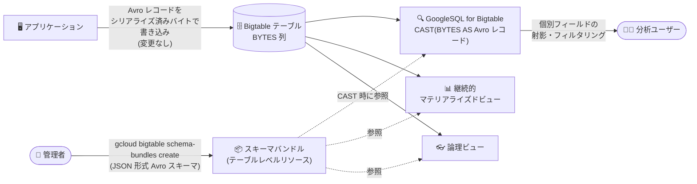

# Bigtable: Apache Avro スキーマバンドル (Preview)

**リリース日**: 2026-10-27

**サービス**: Bigtable

**機能**: Apache Avro スキーマバンドルによる Avro レコード内フィールドのクエリ

**ステータス**: Preview

📊 [このアップデートのインフォグラフィックを見る](https://takech9203.github.io/google-cloud-news-summary/20261027-bigtable-avro-schema-bundles.html)

## 概要

Bigtable で Apache Avro スキーマバンドルが Preview として利用可能になりました。Bigtable の列にシリアライズ済みバイト (serialized bytes) として格納されている Avro レコードについて、レコード内の個別フィールドをクエリできるようになります。JSON 形式の Avro スキーマを「スキーマバンドル」というテーブルレベルのリソースとしてアップロードすることで、GoogleSQL for Bigtable、継続的マテリアライズドビュー (continuous materialized views)、論理ビュー (logical views) から Avro データをクエリできます。

重要な点として、スキーマバンドルをアップロードしても Bigtable へのデータ書き込み方法は変わりません。アプリケーションは従来どおり Avro レコードをシリアライズ済みバイトとして書き込みます (セルのペイロードにはスキーマやスキーマフィンガープリントを埋め込まず、生のバイトのみを格納します)。読み取り側で、スキーマバンドルを参照して BYTES 列を構造化された Avro レコードとしてキャストし、ネストされたフィールドを抽出できます。

Avro でイベントデータやトランザクションデータを Bigtable に格納しているユーザーにとって、クライアント側でのデシリアライズなしにサーバー側でフィールド単位の射影・フィルタリングが可能になるアップデートです。

**アップデート前の課題**

- Bigtable は Avro レコードを不透明なバイト列として格納するため、SQL クエリでレコード内の個別フィールドを参照できなかった
- フィールド値の参照やフィルタリングには、セル全体を読み取ってクライアント側で Avro をデシリアライズする必要があった

**アップデート後の改善**

- Avro スキーマバンドルをテーブルにアップロードするだけで、GoogleSQL の `CAST` 演算子により BYTES 列を Avro レコードとして解釈し、個別フィールドの射影・フィルタリングがサーバー側で可能になった
- 継続的マテリアライズドビューおよび論理ビューからも Avro データをクエリできるようになった
- 書き込みパスの変更は不要で、既存のシリアライズ済みバイトの書き込み方法をそのまま維持できる

## アーキテクチャ図



書き込みパスは従来どおりシリアライズ済みバイトのまま変更せず、テーブルにアップロードしたスキーマバンドルを参照することで、GoogleSQL・継続的マテリアライズドビュー・論理ビューから Avro レコード内のフィールドをサーバー側でクエリできます。

## サービスアップデートの詳細

### 主要機能

1. **スキーマバンドルの作成・管理**
   - JSON 形式 (AVSC または JSON ファイル) の Avro スキーマを、テーブルレベルのリソース「スキーマバンドル」としてアップロード
   - 各ファイルはトップレベルに有効で自己完結した Avro レコードスキーマを含み、依存関係はすべてインライン化されている必要がある
   - `gcloud bigtable schema-bundles` コマンド群 (create / update / delete / describe / list) で管理

2. **GoogleSQL for Bigtable による Avro フィールドのクエリ**
   - `CAST` 演算子で BYTES 値を Avro レコードとして解釈し、ドット記法でネストされたフィールドにアクセス
   - レコード名は `SCHEMA_BUNDLE_ID.FULLY_QUALIFIED_RECORD_NAME` 形式 (名前空間を含む完全修飾名) で指定
   - `WHERE` 句で Avro フィールドの値に基づくフィルタリングが可能
   - map フィールドは `ARRAY_TRANSFORM` 関数で `ARRAY<STRUCT<key, value>>` に変換して射影可能

3. **継続的マテリアライズドビュー・論理ビューとの統合**
   - スキーマバンドルを参照する継続的マテリアライズドビューおよび論理ビューを定義して、Avro データをクエリ可能
   - ビューが参照しているスキーマバンドルは削除できない (先にビューの削除または参照解除が必要)

## 技術仕様

### Avro 型と GoogleSQL 型のマッピング

| Avro 型 | GoogleSQL 表現 | 説明 |
|------|------|------|
| `int`, `long` | `INT64` | 32 ビット / 64 ビット符号付き整数は 64 ビット整数にマップ |
| `float` | `FLOAT32` | 単精度浮動小数点 |
| `double` | `FLOAT64` | 倍精度浮動小数点 |
| `boolean` | `BOOL` | ブール値 |
| `string` | `STRING` | Unicode 文字列 |
| `bytes` | `BYTES` | 生バイト列 |
| `record` | Message オブジェクト | ドット記法 (`record.field`) でネストフィールドにアクセス |
| `enum` | `ENUM` | 列挙型 |
| `array` | `ARRAY` | 繰り返しフィールド (ネストした配列は非対応) |
| `map<T>` | 繰り返し key-value エントリ | キーは `STRING`。`ARRAY_TRANSFORM` で `ARRAY<STRUCT<key STRING, value T>>` に変換可能 |
| `union` | NULL 許容フィールド | `null` + 非 null 型 1 つの union のみ対応 |
| `fixed` | 非対応 | 固定長バイト列は非対応 |

### クエリ例

```sql
-- BYTES 列を Avro レコードにキャストしてフィールドを射影
SELECT CAST(cf['product'] AS my_avro.com.example.billing.Transaction).product_name
FROM table;

-- Avro フィールドの値でフィルタリング
SELECT CAST(cf['product'] AS my_avro.com.example.billing.Transaction).product_name
FROM table
WHERE CAST(cf['product'] AS my_avro.com.example.billing.Transaction).product_category = "yummy food";
```

### 必要な IAM ロール・権限

| 操作 | ロール / 権限 |
|------|------|
| スキーマバンドルの作成・管理 | Bigtable 管理者 (`roles/bigtable.admin`)。権限: `bigtable.schemaBundles.create` / `update` / `delete` / `get` / `list` / `getIamPolicy` / `setIamPolicy` |
| スキーマバンドルの読み取りと GoogleSQL での Avro クエリ | Bigtable 閲覧者 (`roles/bigtable.reader`) または Bigtable ユーザー (`roles/bigtable.user`)。権限: `bigtable.tables.readRows`、`bigtable.instances.executeQuery` |

## 設定方法

### 前提条件

1. Google Cloud CLI をインストールし、`gcloud init` で初期化済みであること
2. Bigtable インスタンスとテーブルが存在すること
3. Cloud Bigtable API と Cloud Bigtable Admin API が有効であること
   ```bash
   gcloud services enable bigtable.googleapis.com bigtableadmin.googleapis.com
   ```

### 手順

#### ステップ 1: Avro スキーマファイルの準備

JSON 形式 (AVSC または JSON) の Avro スキーマファイルを 1 つ以上用意します。各ファイルはトップレベルに有効で自己完結した Avro レコードスキーマを含み、すべての依存関係をインライン化する必要があります。同一バンドル内の複数ファイルが同じ名前空間の同じレコード / enum を定義する場合、`doc` や `aliases` を含めて定義が一致している必要があります。

#### ステップ 2: スキーマバンドルの作成

```bash
gcloud bigtable schema-bundles create SCHEMA_BUNDLE_ID \
  --instance=INSTANCE_ID \
  --table=TABLE_ID \
  --avro-schema-path=AVRO_SCHEMA_PATH
```

- `SCHEMA_BUNDLE_ID`: 1〜50 文字。英数字・アンダースコア・ハイフンのみ使用可能 (ハイフン開始とピリオドは不可)
- `AVRO_SCHEMA_PATH`: JSON 形式の Avro スキーマファイル、または複数のスキーマファイルを含むディレクトリのパス

#### ステップ 3: スキーマバンドルの確認とクエリ

```bash
# バンドルの一覧表示
gcloud bigtable schema-bundles list --instance=INSTANCE_ID --table=TABLE_ID

# バンドル定義の取得
gcloud bigtable schema-bundles describe SCHEMA_BUNDLE_ID \
  --instance=INSTANCE_ID --table=TABLE_ID
```

アップロード後、GoogleSQL for Bigtable の `CAST` 演算子で BYTES 列を Avro レコードとしてクエリできます。Java では Cloud Bigtable クライアントライブラリの `executeQuery` メソッドを使用します。

#### ステップ 4 (必要に応じて): スキーマバンドルの更新

```bash
gcloud bigtable schema-bundles update SCHEMA_BUNDLE_ID \
  --instance=INSTANCE_ID \
  --table=TABLE_ID \
  --avro-schema-path=AVRO_SCHEMA_PATH
```

更新は新しいレコード / enum 定義の追加のみ可能で、既存定義の変更・削除はできません。更新時は新規スキーマと既存スキーマの両方を含むファイルまたはディレクトリを渡す必要があります。

## メリット

### ビジネス面

- **既存資産の活用**: Avro でシリアライズして Bigtable に格納している既存データを、書き込みパイプラインを変更することなく SQL で分析可能
- **追加コストなし**: スキーマバンドルの作成・管理自体に追加料金は発生しない

### 技術面

- **サーバー側でのフィールド抽出**: クライアント側でのデシリアライズ処理が不要になり、必要なフィールドのみを射影・フィルタリングできる
- **ビューとの統合**: 継続的マテリアライズドビューや論理ビューと組み合わせて、Avro データに対する集計・抽象化レイヤーを構築できる
- **IAM によるアクセス制御**: スキーマバンドル単位で IAM ポリシーを設定可能 (`getIamPolicy` / `setIamPolicy`)

## デメリット・制約事項

### 制限事項

- Preview 段階の機能であり、Pre-GA Offerings Terms が適用される (サポートが限定される場合がある)
- Avro レコードとしてのクエリは GoogleSQL for Bigtable、継続的マテリアライズドビュー、論理ビューのみ対応。`ReadRows` API と BigQuery 外部テーブルはサーバー側 Avro パースに非対応
- スキーマバンドルはテーブルあたり最大 10 個 (Avro と protobuf の合計)
- 1 バンドル内の JSON 形式 Avro スキーマの合計サイズは 4 MB まで (内部変換される protobuf ディスクリプタセットも 4 MB まで)
- 非対応のスキーマ型・構造: `fixed` 型、論理型 (`date`、`duration`、`time-micros`、`uuid` など)、非 null 型を複数含む union、ネストしたコレクション (配列 / map の中の配列 / map)、NULL 許容要素を持つ配列、32 レベルを超えるネスト、名前空間値のアンダースコア、同一名前空間内での enum シンボル名重複など
- クエリ時に `default`、`aliases`、`doc`、`order` などの属性は無視される

### 考慮すべき点

- **スキーマの不変性**: 一度バンドルに登録したレコード / enum 定義は変更・削除不可。更新は定義の追加のみ
- **書き込み時と同一のスキーマでの読み取りが必須**: スキーマが一致しない読み取りはランタイムクエリ失敗、データ破損、フィールドの誤マッピングの原因になるため非対応
- **セルのペイロード形式**: セルにはスキーマやスキーマフィンガープリントを埋め込まず、生のバイトのみを格納する必要がある
- **削除時の依存関係**: 継続的マテリアライズドビューまたは論理ビューが参照しているバンドルは削除できない。削除後のバンドルは復元不可
- **バンドルタイプの固定**: Avro と protobuf の間でスキーマバンドルのタイプを変更することはできない

## ユースケース

### ユースケース 1: Avro イベントデータへのアドホック SQL 分析

**シナリオ**: アプリケーションがトランザクションイベントを Avro でシリアライズして Bigtable に書き込んでいる。特定カテゴリの商品のみを抽出したいが、従来はセル全体を読み取ってクライアント側でデコードする必要があった。

**実装例**:
```sql
SELECT CAST(cf['product'] AS my_avro.com.example.billing.Transaction).product_name
FROM table
WHERE CAST(cf['product'] AS my_avro.com.example.billing.Transaction).product_category = "yummy food";
```

**効果**: サーバー側で必要なフィールドのみを射影・フィルタリングでき、クライアント側のデシリアライズ処理が不要になる。

### ユースケース 2: 継続的マテリアライズドビューによる Avro データの集計

**シナリオ**: Avro 形式で書き込まれるデータに対して、常に最新の集計結果を参照したい。

**効果**: スキーマバンドルを参照する継続的マテリアライズドビューを定義することで、Avro レコード内のフィールドに基づく集計ビューを構築できる。論理ビューを使えば、利用者に対して構造化されたスキーマとして公開することも可能。

## 料金

スキーマバンドルの作成・管理に追加料金はかかりません。リクエストとレスポンスには標準のネットワーク帯域幅料金が適用されます。Data Boost サーバーレスコンピュートを使用して Bigtable からデータを読み取る場合は、クエリが消費するコンピュートリソースに対して課金されます。

詳細は [Bigtable の料金ページ](https://cloud.google.com/bigtable/pricing) を参照してください。

## 利用可能リージョン

リリースノートおよびドキュメントにリージョン制限の記載はありません。最新情報は [Bigtable のドキュメント](https://docs.cloud.google.com/bigtable/docs/create-manage-avro-schemas) を参照してください。

## 関連サービス・機能

- **GoogleSQL for Bigtable**: Avro フィールドのクエリに使用する SQL インターフェース。`CAST` 演算子でバイト列を Avro レコードとして解釈する
- **継続的マテリアライズドビュー / 論理ビュー**: スキーマバンドルを参照して Avro データの集計・抽象化レイヤーを構築できる
- **Protobuf スキーマバンドル**: Bigtable は protobuf スキーマのバンドルにも対応しており、テーブルあたり 10 個の上限は両タイプの合計に適用される
- **Data Boost**: Avro データのクエリをサーバーレスコンピュートで実行する場合に使用 (消費リソースに応じた課金)
- **Apache Avro**: 行指向のデータシリアライゼーションフレームワーク。スキーマは JSON 形式で定義される

## 参考リンク

- 📊 [インフォグラフィック](https://takech9203.github.io/google-cloud-news-summary/20261027-bigtable-avro-schema-bundles.html)
- [公式リリースノート](https://cloud.google.com/bigtable/docs/release-notes)
- [ドキュメント: Create and manage Avro schemas](https://docs.cloud.google.com/bigtable/docs/create-manage-avro-schemas)
- [ドキュメント: Query Avro data](https://docs.cloud.google.com/bigtable/docs/query-avro-data)
- [gcloud bigtable schema-bundles create リファレンス](https://docs.cloud.google.com/sdk/gcloud/reference/bigtable/schema-bundles/create)
- [料金ページ](https://cloud.google.com/bigtable/pricing)

## まとめ

Avro スキーマバンドルにより、Bigtable に格納された Avro レコードを書き込みパイプラインの変更なしに SQL でフィールド単位にクエリできるようになりました。Avro データを Bigtable に格納しているチームは、まず対象テーブルのスキーマをバンドルとしてアップロードし、GoogleSQL でのフィールド射影・フィルタリングを試すことをおすすめします。ただし Preview 段階であること、登録済みスキーマ定義は変更・削除できないこと、書き込み時と同一のスキーマで読み取る必要があることに注意してください。

---

**タグ**: Bigtable, Apache Avro, スキーマバンドル, GoogleSQL, Preview, NoSQL, データ分析
