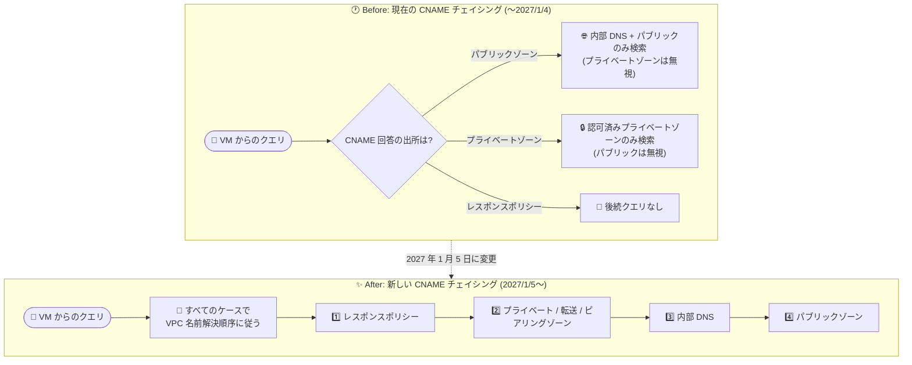

# Cloud DNS: CNAME チェイシングと ANY クエリの動作変更 (2027 年 1 月 5 日発効)

**リリース日**: 2026-10-27

**サービス**: Cloud DNS

**機能**: CNAME チェイシング動作変更 / ANY クエリ (QTYPE=ANY) 応答変更の事前アナウンス

**ステータス**: Announcement (2027 年 1 月 5 日より動作変更)

📊 [このアップデートのインフォグラフィックを見る](https://takech9203.github.io/google-cloud-news-summary/20261027-cloud-dns-cname-chasing-any-query-changes.html)

## 概要

Google Cloud は、Cloud DNS における 2 つの動作変更を事前アナウンスしました。いずれも **2027 年 1 月 5 日** に発効します。1 つ目は **CNAME チェイシング** (CNAME レコードの回答に対する後続ルックアップ) の動作変更で、CNAME チェーンの後続クエリがパブリックゾーンとプライベートゾーンの境界を越えて、VPC の完全な名前解決順序に従うようになります。2 つ目は、パブリック権威ゾーンにおける **DNS タイプ ANY クエリ (QTYPE=ANY)** へのフル応答の無効化で、今後は一致するレコードセットから選ばれた単一のリソースレコードのみが返されます。

CNAME チェイシングの変更は、プライベートゾーンやレスポンスポリシーがパブリック CNAME ターゲットと重複するドメイン名を持つ環境に影響します。クエリが意図しない内部 IP アドレスに解決されたり、解決エラーが返されたりする可能性があるため、該当構成を持つユーザーは発効日前の確認が必要です。ANY クエリの変更は、標準的なブラウザ・アプリケーション・API のトラフィックには影響しませんが、ANY クエリに依存するレガシースクリプト、ヘルスチェッカー、監視システムは単一レコードしか受け取れなくなります。

どちらも新機能の追加ではなく「破壊的変更の予告」であるため、Cloud DNS を利用するすべての組織 (特にスプリットホライズン DNS 構成や ANY クエリベースの自動化を持つ組織) は、2027 年 1 月 5 日までに影響評価と移行対応を完了することが推奨されます。

**アップデート前の課題 (現在の動作)**

- CNAME チェイシングの後続クエリは、CNAME 回答の出所によって検索範囲が分断されていた:
  - パブリックゾーンからの CNAME 回答 → 後続クエリはパブリック DNS と内部 DNS のみを検索し、プライベートゾーン・転送ゾーン・レスポンスポリシーは無視される
  - プライベートゾーン (ローカルレコード) からの CNAME 回答 → VPC ネットワークに認可されたプライベートゾーンのみを検索し、パブリックゾーンは無視される
  - レスポンスポリシーゾーンからの CNAME 回答 → 後続クエリは一切実行されない
- このため、プライベート → パブリック、パブリック → プライベートをまたぐ CNAME チェーンは解決できず NXDOMAIN となるケースがあった
- ANY クエリはパブリック権威ゾーンでフル応答を返しており、ゾーン内容の一括取得手段として (本来推奨されない形で) スクリプトや監視に利用され得た

**アップデート後の改善・変更 (2027 年 1 月 5 日以降)**

- CNAME チェイシングの後続クエリは、回答の出所にかかわらずすべてのケースで **VPC の完全な名前解決順序** (レスポンスポリシー → プライベートゾーン → 転送/ピアリングゾーン → 内部 DNS → パブリックゾーン) に従う
- これまで NXDOMAIN になっていたプライベート ↔ パブリック間の CNAME チェーンが解決されるようになる (逆に、意図せず解決されてしまうリスクにもなる)
- パブリック権威ゾーンへの ANY クエリに対しては、一致するレコードセットから選ばれた **単一のリソースレコード** のみが返される

## アーキテクチャ図



現在は CNAME 回答の出所ごとに後続クエリの検索範囲が分断されていますが、変更後はすべてのケースで VPC の完全な名前解決順序に従って後続クエリが実行されます。

## サービスアップデートの詳細

### 主要機能 (変更内容)

1. **CNAME チェイシングの統一 (変更 1)**
   - CNAME チェイシングとは、最初のクエリに対する CNAME レコード回答で返された DNS 名を、続けてルックアップする動作を指す
   - 2027 年 1 月 5 日以降、CNAME 回答がパブリックゾーン・プライベートゾーン・レスポンスポリシーゾーンのいずれから返された場合でも、後続クエリは VPC の完全な名前解決順序 (レスポンスポリシー、プライベートゾーン、転送/ピアリングゾーン、内部 DNS、パブリックゾーン) に従う
   - プライベートゾーンやレスポンスポリシーがパブリック CNAME ターゲットと重複するドメイン名を持つ場合、クエリが意図しない内部 IP アドレスに解決される、または解決エラーが返される可能性がある

2. **ANY クエリ (QTYPE=ANY) へのフル応答の無効化 (変更 2)**
   - 2027 年 1 月 5 日以降、パブリック権威ゾーンへの DNS タイプ ANY クエリに対するフル応答が無効化される
   - 代わりに、一致するレコードセットの中から選ばれた単一のリソースレコードが返される
   - 標準的なブラウザ・アプリケーション・API のトラフィックには影響しない
   - `dig example.com ANY` のようなデバッグコマンド、レガシースクリプト、ヘルスチェッカー、監視システムは最初に利用可能なレコード 1 件のみを受け取る

## 技術仕様

### CNAME チェイシングの現在と変更後の動作比較

| CNAME 回答の出所 | 現在の動作 (〜2027/1/4) | 変更後の動作 (2027/1/5〜) |
|------|------|------|
| Cloud DNS パブリックゾーン | 内部 DNS とパブリックゾーンのみ検索。プライベートゾーン (転送・ピアリング・レスポンスポリシー含む) は検索しない | VPC の完全な名前解決順序に従う |
| Cloud DNS プライベートゾーン (ローカルレコード) | VPC ネットワークに認可されたプライベートゾーンのみ検索。パブリックゾーンは検索しない | VPC の完全な名前解決順序に従う |
| Cloud DNS レスポンスポリシーゾーン | 後続クエリを実行しない | VPC の完全な名前解決順序に従う |

### ANY クエリの変更

| 項目 | 詳細 |
|------|------|
| 対象 | Cloud DNS パブリック権威ゾーン |
| 現在の動作 | QTYPE=ANY に対してフル応答を返す |
| 変更後の動作 | 一致するレコードセットから選ばれた単一のリソースレコードを返す |
| 影響なし | 標準的なブラウザ、アプリケーション、API トラフィック |
| 影響あり | ANY クエリを使うレガシースクリプト、ヘルスチェッカー、デバッグコマンド、監視システム |

## 設定方法 (推奨される事前対応)

### 前提条件

1. Cloud DNS でパブリックゾーン、プライベートゾーン、レスポンスポリシーのいずれかを運用していること
2. 影響調査のため、Cloud DNS のクエリログ (Cloud Logging) を有効化しておくことが望ましい

### 手順

#### ステップ 1: CNAME チェイシング構成の棚卸し (2027 年 1 月 5 日まで)

```bash
# dig / nslookup でクエリパスをテストする
dig app.example.com

# プライベートゾーンと重複するパブリック CNAME ターゲットの有無を確認
gcloud dns managed-zones list
gcloud dns record-sets list --zone=ZONE_NAME --filter="type=CNAME"
```

プライベート → パブリック、パブリック → プライベートをまたぐ CNAME チェイシングのシナリオを洗い出します。現在 NXDOMAIN になっているクエリが、変更後は解決されるようになる可能性があります。また、CNAME チェーン全体で TTL を一致させる構成が推奨されます。

#### ステップ 2: ANY クエリの利用箇所の特定と移行

```bash
# Cloud Logging で ANY クエリを特定 (Cloud DNS ログを活用)
# その後、特定のレコードタイプのクエリに移行する
dig example.com A
dig example.com MX

# ゾーンの全レコード取得は resourceRecordSets.list API / gcloud を使用する
gcloud dns record-sets list --zone=ZONE_NAME
```

ANY クエリに依存するレガシースクリプト・監視を特定し、特定のレコードタイプ (A、AAAA、MX、TXT など) のクエリへ移行します。ゾーン全体のレコード取得が必要な場合は、DNS クエリではなく `resourceRecordSets.list` API、`gcloud dns record-sets list`、または Google Cloud コンソールを使用します。

## メリット

### ビジネス面

- **事前アナウンスによる計画的移行**: 発効日 (2027 年 1 月 5 日) まで約 14 か月の猶予があり、影響評価と修正を計画的に実施できる
- **DNS 運用のセキュリティ向上**: ANY クエリのフル応答無効化は、DNS 業界で広く行われている対応 (増幅攻撃対策・ゾーン内容の露出低減) に沿った変更である

### 技術面

- **名前解決動作の一貫性**: CNAME チェイシングが常に VPC 名前解決順序に従うため、CNAME 回答の出所による動作の分断がなくなり、挙動が予測しやすくなる
- **ハイブリッド構成での解決性向上**: これまで NXDOMAIN となっていたプライベート ↔ パブリック間の CNAME チェーンが解決可能になる

## デメリット・制約事項

### 制限事項

- ANY クエリでは単一レコードしか返されなくなるため、DNS クエリによるゾーン全体の取得はできなくなる (API / gcloud / コンソールでの取得が必要)
- CNAME チェイシングの旧動作を維持するオプションは、リリースノート上では案内されていない

### 考慮すべき点

- **意図しない内部 IP への解決**: プライベートゾーンやレスポンスポリシーがパブリック CNAME ターゲットと重複する名前を持つ場合、変更後はクエリが意図しない内部 IP アドレスに解決されたり、解決エラーになったりする可能性がある
- **NXDOMAIN 前提の挙動変化**: 現在 NXDOMAIN を返しているプライベート ↔ パブリック間 CNAME チェーンが解決されるようになるため、NXDOMAIN を前提としたアプリケーション挙動は見直しが必要
- **ANY クエリ依存システムのリスク**: 対応しない場合、誤った監視アラーム、ゾーン全体のダンプを解析する自動化パイプラインの破損、IT 診断業務の混乱が発生し得る
- **TTL の整合性**: CNAME チェーン全体で TTL を一致させる構成が推奨される

## ユースケース

### ユースケース 1: スプリットホライズン DNS を運用している環境の影響確認

**シナリオ**: パブリックゾーン `example.com` と、同名のプライベートゾーンを VPC に認可して運用している (スプリットホライズン構成)。パブリックゾーンの CNAME が `internal.example.com` を指している。

**実装例**:
```bash
# 変更前後の解決結果を比較するため、現在の応答を記録しておく
dig app.example.com +trace
dig internal.example.com
```

**効果**: 変更後、パブリックゾーン由来の CNAME 回答の後続クエリがプライベートゾーンも検索するようになるため、意図しない内部 IP への解決を事前に検出し、ゾーン設計やレコードの見直しを行える。

### ユースケース 2: ANY クエリを使う監視・自動化の移行

**シナリオ**: レガシーな監視システムが `dig example.com ANY` でレコードの存在確認を行っており、ゾーンダンプを解析する自動化パイプラインもある。

**効果**: Cloud Logging の Cloud DNS ログで ANY クエリの発生元を特定し、特定レコードタイプのクエリと `gcloud dns record-sets list` へ移行することで、2027 年 1 月 5 日以降の誤アラームやパイプライン破損を回避できる。

## 料金

今回の変更は動作変更のアナウンスであり、料金体系の変更は含まれません。Cloud DNS の料金は以下を参照してください。

- [Cloud DNS 料金ページ](https://cloud.google.com/dns/pricing)

## 関連サービス・機能

- **VPC ネットワーク / 名前解決順序**: 変更後の CNAME チェイシングが従う解決順序 (レスポンスポリシー → プライベート/転送/ピアリングゾーン → 内部 DNS → パブリックゾーン) の基盤
- **Cloud Logging**: Cloud DNS のクエリログを記録でき、ANY クエリを発行しているレガシーシステムの特定に活用できる
- **Compute Engine 内部 DNS**: メタデータサーバー (169.254.169.254) を経由した名前解決で CNAME チェイシングの対象となる内部 DNS サービス
- **レスポンスポリシー**: ローカルデータルールからの CNAME 回答も、変更後は後続クエリの対象となる

## 参考リンク

- 📊 [インフォグラフィック](https://takech9203.github.io/google-cloud-news-summary/20261027-cloud-dns-cname-chasing-any-query-changes.html)
- [公式リリースノート](https://docs.cloud.google.com/release-notes#October_27_2026)
- [CNAME チェイシング (公式ドキュメント)](https://docs.cloud.google.com/dns/docs/cnamechasing)
- [VPC の名前解決順序 (公式ドキュメント)](https://docs.cloud.google.com/dns/docs/vpc-name-res-order)
- [resourceRecordSets.list API リファレンス](https://docs.cloud.google.com/dns/docs/reference/rest/v1/resourceRecordSets/list)
- [料金ページ](https://cloud.google.com/dns/pricing)

## まとめ

Cloud DNS の CNAME チェイシングと ANY クエリ応答という 2 つの基盤的な動作が 2027 年 1 月 5 日に変更されます。スプリットホライズン構成やパブリック/プライベートをまたぐ CNAME チェーンを持つ環境では、意図しない内部 IP への解決や NXDOMAIN 前提の挙動変化が起こり得るため、dig/nslookup によるクエリパスのテストと構成の棚卸しを早めに実施してください。あわせて、ANY クエリに依存するスクリプトや監視は、特定レコードタイプのクエリと resourceRecordSets.list API への移行を発効日前に完了することを推奨します。

---

**タグ**: #CloudDNS #DNS #CNAME #BehaviorChange #Networking #VPC #Announcement
