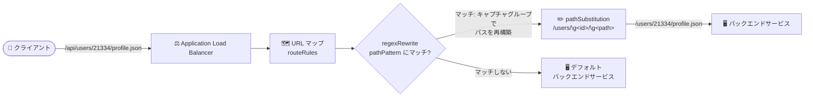

# Cloud Load Balancing: 正規表現 URL リライト (regexRewrite) が GA

**リリース日**: 2026-10-27

**サービス**: Cloud Load Balancing

**機能**: URL マップのルートルールにおける正規表現 URL リライト (regexRewrite)

**ステータス**: GA (一般提供)

📊 [このアップデートのインフォグラフィックを見る](https://takech9203.github.io/google-cloud-news-summary/20261027-cloud-load-balancing-regex-url-rewrites-ga.html)

## 概要

Application Load Balancer の URL マップにおいて、ルートルールの正規表現 URL リライト (`regexRewrite`) が一般提供 (GA) になりました。正規表現パターンによるリライトアクションを使用して、リクエストをバックエンドに転送する前に、URL パスのコンポーネントを置換・削除できます。

`regexRewrite` では、RE2 構文の正規表現 (`pathPattern`) で受信リクエストパスの一部をキャプチャし、置換文字列 (`pathSubstitution`) でキャプチャグループを参照しながらパスを再構築します。名前付きキャプチャグループ (`(?<name>re)`) を `\g<name>` で参照する方式と、`\1` や `\2` のような番号参照の両方に対応しています。

本機能は、グローバル外部・リージョン外部・クロスリージョン内部・リージョン内部の各 Application Load Balancer で利用できます。2026 年 10 月 12 日にはホストルール・ルートルールの正規表現「マッチャー」(regexMatch) が GA になっており、今回の `regexRewrite` の GA により、マッチングとリライトの両方で正規表現を活用した柔軟なトラフィック制御が可能になりました。

**アップデート前の課題**

- URL リライトの手段は `pathPrefixRewrite` (プレフィックス置換) と `pathTemplateRewrite` (ワイルドカードを使ったパステンプレート) に限られ、正規表現による細かなパターンマッチングとパス再構築を GA 機能として利用できなかった
- パスの途中のコンポーネントを条件付きで抽出・並べ替え・結合するような複雑な変換は、テンプレート構文では表現が難しいケースがあった

**アップデート後の改善**

- RE2 構文の正規表現でパスの任意の部分をキャプチャし、置換文字列で自由に再構築 (置換・削除・並べ替え・結合) できるようになった
- 名前付きキャプチャグループ (`(?<name>re)`) と番号参照 (`\1` など) の両方で、可読性の高いリライト定義が可能になった
- GA となったことで、本番環境のワークロードで正規表現リライトを利用しやすくなった

## アーキテクチャ図



クライアントのリクエストパスを URL マップの `regexRewrite` が RE2 正規表現で評価し、キャプチャグループを使って再構築したパスでバックエンドサービスへ転送する流れを示しています。

## サービスアップデートの詳細

### 主要機能

1. **正規表現によるパスマッチング (`pathPattern`)**
   - `pathMatchers[].routeRules[].routeAction.urlRewrite.regexRewrite.pathPattern` フィールドに RE2 構文の正規表現を指定
   - 受信リクエストパスの一部をキャプチャグループ `(...)` で捕捉できる
   - 名前付きキャプチャグループは `(?<name>re)` または `(?P<name>re)` の形式で定義

2. **キャプチャグループを使ったパス再構築 (`pathSubstitution`)**
   - `pathSubstitution` フィールドで、バックエンドサービスに送信する前のパスを再構築
   - 名前付きグループは `\g<name>`、番号付きグループは `\1` や `\2` で参照
   - 名前付きグループ `(?<name>re)` は番号でも名前でも参照可能

3. **幅広い Application Load Balancer での GA 提供**
   - グローバル外部 Application Load Balancer
   - リージョン外部 Application Load Balancer
   - クロスリージョン内部 Application Load Balancer
   - リージョン内部 Application Load Balancer

## 技術仕様

### regexRewrite の仕様

| 項目 | 詳細 |
|------|------|
| 設定フィールド | `pathMatchers[].routeRules[].routeAction.urlRewrite.regexRewrite` |
| パターン構文 | RE2 構文 (URL マップで許可される演算子には制限あり) |
| キャプチャグループ参照 | 名前付き `\g<name>`、番号付き `\1`, `\2` など |
| キャプチャグループ数の上限 | `pathSubstitution` で参照できるのは最大 8 個 (いずれも `pathPattern` で定義が必要) |
| フィールド長の上限 | `pathPattern`、`pathSubstitution` ともに最大 250 文字 |
| 排他制約 | 1 つのルートルールに指定できる URL リライトアクションは 1 つのみ。`regexRewrite` は `pathPrefixRewrite`、`pathTemplateRewrite` と併用不可 |
| 非対応プロダクト | 従来の (Classic) Application Load Balancer は正規表現をサポートしない |

### リライト動作の例

- 受信リクエストの URL パス: `/api/users/21334/profile.json`
- `pathPattern`: `/api/users/(?<id>\d+)/(?<path>[a-z]+\.json)`
- `pathSubstitution`: `/users/\g<id>/\g<path>`
- バックエンドに送信されるパス: `/users/21334/profile.json`

### URL マップ設定例 (YAML)

公式ドキュメントに記載されている設定例です。`/region/us-central1/bucket/my-bucket/stage/dev/object.pdf` のようなリクエスト URL を `/us-central1/my-bucket-dev/object.pdf` にリライトしてからバックエンドサービスにプロキシします。

```yaml
defaultService: projects/example-project/regions/us-central1/backendServices/default-bs
name: regex-rewrite-url-map
pathMatchers:
- name: region-matcher
  defaultService: projects/example-project/regions/us-central1/backendServices/default-bs
  routeRules:
  - matchRules:
    - prefixMatch: /region/
    priority: 1
    service: projects/example-project/regions/us-central1/backendServices/rewrite-bs
    routeAction:
      urlRewrite:
        regexRewrite:
          pathPattern: "/region/(?<reg>[a-z0-9-]+)/bucket/(?<bkt>[a-z0-9-]+)/stage/(?<stg>[a-z0-9-]+)/object\\.pdf"
          pathSubstitution: "/\\g<reg>/\\g<bkt>-\\g<stg>/object.pdf"
```

- `matchRules.prefixMatch`: ルールの適用対象を `/region/` で始まるパスに限定
- `pathPattern`: 名前付きキャプチャグループでリージョン (`reg`)、バケット名 (`bkt`)、ステージ名 (`stg`) を捕捉
- `pathSubstitution`: 捕捉した値を `\g<name>` で参照し、新しいパスを構築

## メリット

### ビジネス面

- **アプリケーション改修なしの URL 構造変換**: ロードバランサー側でパス変換を完結できるため、バックエンドやクライアントの URL 変更を伴うマイグレーションを段階的に進めやすい
- **GA による本番利用の安心感**: GA となったことで、本番ワークロードでの採用判断がしやすくなった

### 技術面

- **柔軟なパス再構築**: プレフィックス置換やテンプレート構文では難しかった、パスコンポーネントの抽出・並べ替え・結合・削除を 1 つの正規表現で表現できる
- **可読性の高い定義**: 名前付きキャプチャグループにより、リライトルールの意図が設定から読み取りやすい
- **既存の regexMatch との組み合わせ**: 2026 年 10 月 12 日に GA となった正規表現マッチャーと合わせ、マッチングからリライトまで RE2 ベースで統一的に設計できる

## デメリット・制約事項

### 制限事項

- Classic Application Load Balancer は正規表現をサポートしない
- 正規表現は RE2 構文で記述する必要があり、URL マップで許可される演算子には制限がある (RE2 specifications for URL maps を参照)
- 1 つのルートルールに指定できる URL リライトアクションは 1 つのみで、`regexRewrite` は `pathPrefixRewrite` や `pathTemplateRewrite` と併用できない
- `pathSubstitution` で参照できるキャプチャグループは最大 8 個
- `pathPattern` と `pathSubstitution` はそれぞれ最大 250 文字

### 考慮すべき点

- 正規表現の誤りはルーティング不具合に直結するため、パターンとキャプチャグループの動作を事前に十分検証する必要がある
- 既に `pathPrefixRewrite` や `pathTemplateRewrite` を使用しているルートルールに追加する場合は、排他制約を踏まえてどのリライト方式を使うか設計を見直す必要がある

## ユースケース

### ユースケース 1: API パス構造の変換 (バージョン・階層の付け替え)

**シナリオ**: 公開 API のパス (`/api/users/{id}/profile.json`) と、バックエンドの内部パス (`/users/{id}/profile.json`) の構造が異なる。バックエンドを改修せずにロードバランサーでパスを変換したい。

**実装例**:
```yaml
routeAction:
  urlRewrite:
    regexRewrite:
      pathPattern: "/api/users/(?<id>\\d+)/(?<path>[a-z]+\\.json)"
      pathSubstitution: "/users/\\g<id>/\\g<path>"
```

**効果**: クライアント向けの URL を変えずにバックエンドの内部パス構造へ変換でき、アプリケーション側の改修が不要になる。

### ユースケース 2: パスコンポーネントの並べ替え・結合によるルーティング集約

**シナリオ**: `/region/{region}/bucket/{bucket}/stage/{stage}/object.pdf` のような複数のパスコンポーネントを持つリクエストを、バックエンドが期待する `/{region}/{bucket}-{stage}/object.pdf` 形式に変換して転送したい。

**効果**: 複数のパスコンポーネントの抽出と結合 (`\g<bkt>-\g<stg>`) を 1 つのルートルールで実現でき、バックエンド側での変換処理が不要になる。

## 料金

このアップデートに固有の追加料金はリリースノートに記載されていません。Cloud Load Balancing の料金体系は公式の料金ページを参照してください。

- [Cloud Load Balancing の料金](https://cloud.google.com/vpc/network-pricing)

## 利用可能リージョン

以下の Application Load Balancer で利用可能です。

- グローバル外部 Application Load Balancer
- リージョン外部 Application Load Balancer
- クロスリージョン内部 Application Load Balancer
- リージョン内部 Application Load Balancer

## 関連サービス・機能

- **正規表現マッチャー (regexMatch)**: 2026 年 10 月 12 日に GA。URL パス・HTTP ヘッダー・クエリパラメータの正規表現マッチングが可能で、今回の `regexRewrite` と組み合わせてマッチングからリライトまで正規表現で統一できる
- **pathTemplateRewrite (パステンプレートリライト)**: ワイルドカード構文 (`{var=*}`, `{var=**}`) と名前付き変数によるリライト。`regexRewrite` の代替手段だが、同一ルートルールでの併用は不可
- **Cloud Service Mesh**: URL マップのパステンプレートマッチングなど、同様のルーティング機能を共有するサービス

## 参考リンク

- 📊 [インフォグラフィック](https://takech9203.github.io/google-cloud-news-summary/20261027-cloud-load-balancing-regex-url-rewrites-ga.html)
- [公式リリースノート (Cloud Load Balancing)](https://docs.cloud.google.com/load-balancing/docs/release-notes)
- [ドキュメント: Regular expression URL rewrites for route rules](https://docs.cloud.google.com/load-balancing/docs/url-map-concepts#regex-url-rewrite)
- [ドキュメント: RE2 specifications for URL maps](https://docs.cloud.google.com/load-balancing/docs/re2-support)
- [料金ページ](https://cloud.google.com/vpc/network-pricing)

## まとめ

Application Load Balancer の URL マップで正規表現による URL リライト (`regexRewrite`) が GA となり、RE2 のキャプチャグループを使った柔軟なパスの置換・削除・並べ替えがロードバランサー層で完結できるようになりました。10 月 12 日に GA となった正規表現マッチャーと合わせて、URL マップによるトラフィック制御の表現力が大きく向上しています。既存の `pathPrefixRewrite` や `pathTemplateRewrite` では表現しきれないリライト要件を持つ場合は、RE2 構文の制限とフィールド長・キャプチャグループ数の上限を確認のうえ、`regexRewrite` への移行を検討することを推奨します。

---

**タグ**: Cloud Load Balancing, Application Load Balancer, URL マップ, regexRewrite, URL リライト, RE2, GA, ネットワーキング
