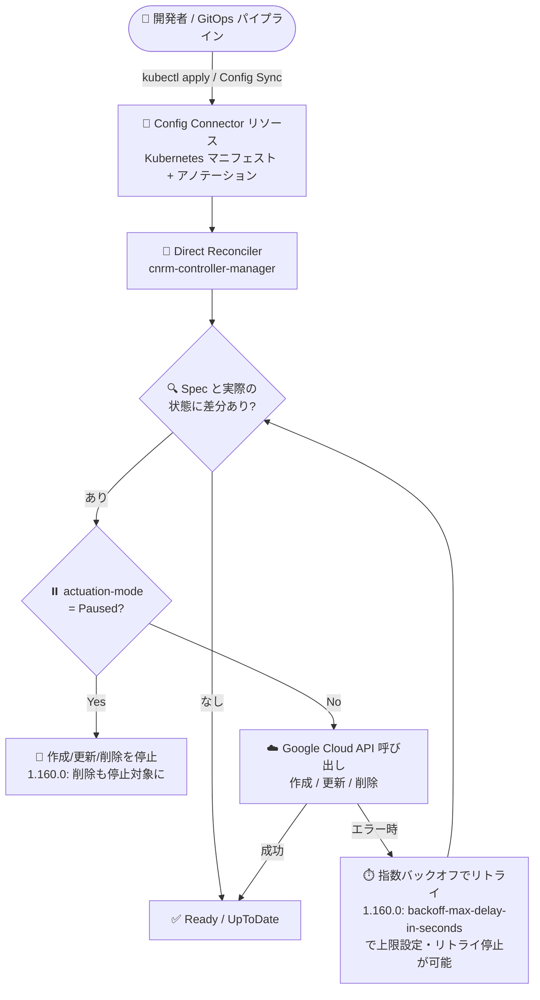

# Config Connector: バージョン 1.160.0 リリース

**リリース日**: 2026-10-27

**サービス**: Config Connector

**機能**: バージョン 1.160.0 (新規 Alpha リソース 21 種、新規フィールド、backoff/actuation 制御の強化、バグ修正)

**ステータス**: Announcement / Feature (Alpha リソースを含む)

📊 [このアップデートのインフォグラフィックを見る](https://takech9203.github.io/google-cloud-news-summary/20261027-config-connector-1-160-0.html)

## 概要

Config Connector バージョン 1.160.0 がリリースされた。Config Connector は Kubernetes のアドオン (オープンソース) であり、CRD (Custom Resource Definition) とコントローラを通じて Google Cloud リソースを宣言的に管理できる。今回のリリースでは、Direct Reconciler を使用する 21 種類の新しい Alpha リソースが追加され、Managed Service for Apache Kafka の Connect クラスタ、NetApp Volumes、Migration Center、Knowledge Catalog (データリネージ・データプロダクト)、Agent Search (Discovery Engine)、Service Extensions、Workload Manager、Storage Insights など、幅広いサービスを Kubernetes マニフェストで管理できるようになった。

運用面でも重要な機能強化が 2 つ含まれる。1 つ目は、`cnrm.cloud.google.com/backoff-max-delay-in-seconds` アノテーションにより、Direct コントローラの指数バックオフの最大遅延上限とリトライ停止をリソース単位で設定できるようになったこと。2 つ目は、`cnrm.cloud.google.com/actuation-mode: Paused` アノテーションが付与された個別リソースに対して、削除操作も停止 (halt) するよう resource actuation が更新されたことである。これにより、メンテナンス中や調査中のリソースを誤って削除するリスクを低減できる。

さらに、`ComputeNetworkFirewallPolicy` や `SQLSSLCert` など 6 リソースにオプトイン方式の直接 reconciliation サポートが追加されたほか、`AlloyDBCluster` の誤検知差分、`ComputeRouterNAT` の作成・削除動作の不一致、`EssentialContactsContact` の 409 エラーなど 6 件のバグ修正が含まれる。GitOps で Google Cloud インフラを管理するプラットフォームチームが主な対象となる。

**アップデート前の課題**

- Kafka Connect クラスタ、NetApp Volumes の Active Directory 構成、Migration Center のソース・プリファレンスセット、Agent Search のスキーマ・セッション・サイトマップなどは Config Connector のリソースとして提供されておらず、gcloud CLI や Terraform など Kubernetes 外のツールで個別に管理する必要があった
- Direct コントローラの reconciliation エラー時の指数バックオフは最大 2 分の固定上限で、リソース単位で遅延上限の調整やリトライの停止ができず、API クォータの消費や大量のエラーリトライを制御しにくかった
- `cnrm.cloud.google.com/actuation-mode: Paused` を設定しても削除操作は停止対象ではなく、Kubernetes オブジェクトの削除が Google Cloud リソースの削除につながる可能性があった
- `AlloyDBCluster` のテイクオーバーや再 reconciliation 時に labels / initialUser / network で誤検知の差分が発生していたほか、`ArtifactRegistryRepository` の Terraform ベースコントローラから Direct コントローラへの移行時に cleanupPolicies で差分が発生していた

**アップデート後の改善**

- 21 種類の新しい Alpha リソース (Direct Reconciler) により、Kafka Connect、NetApp Volumes、Migration Center、Knowledge Catalog、Agent Search、Service Extensions、Workload Manager などを Kubernetes マニフェストで宣言的に管理できるようになった
- `cnrm.cloud.google.com/backoff-max-delay-in-seconds` アノテーションで Direct コントローラの最大バックオフ遅延の上限設定とリトライ停止がリソース単位で可能になった
- `cnrm.cloud.google.com/actuation-mode: Paused` が設定された個別リソースでは削除操作も停止されるようになり、意図しないリソース削除を防げるようになった
- `ComputeNetworkFirewallPolicy`、`ComputeProjectMetadata`、`FirebaseHostingSite`、`NetworkServicesEdgeCacheService`、`OSLoginSSHPublicKey`、`SQLSSLCert` の 6 リソースで、API を変更せずにオプトインで直接 reconciliation を利用できるようになった
- 直接コントローラとレガシーコントローラ間の動作不一致 (`ComputeRouterNAT`) や移行時の差分 (`ArtifactRegistryRepository`)、誤検知差分 (`AlloyDBCluster`、`MemorystoreInstance`) などが修正され、Direct コントローラへの移行の安全性が向上した

## アーキテクチャ図



Config Connector の reconciliation フローを示す。1.160.0 では `actuation-mode: Paused` 時に削除操作も停止されるようになり、エラー時の指数バックオフはアノテーションで最大遅延上限とリトライ停止を制御できるようになった。

## サービスアップデートの詳細

### 主要機能

1. **新規 Alpha リソース (Direct Reconciler、21 種類)**
   - データ / 分析: `DataLineageProcess`、`DataplexDataProduct` (Knowledge Catalog)、`StorageInsightsReportConfig` (Cloud Storage レポート)
   - AI / 会話系: `CCInsightsAnalysisRule` (Customer Experience Insights)、`DialogflowKnowledgeBase` (Dialogflow ES)、`DiscoveryEngineSchema` / `DiscoveryEngineSession` / `DiscoveryEngineSitemap` (Agent Search)
   - メッセージング / 移行: `ManagedKafkaConnectCluster` (Managed Service for Apache Kafka Connect クラスタ)、`MigrationCenterPreferenceSet` / `MigrationCenterSource` (Migration Center)
   - ストレージ: `NetAppActiveDirectory` / `NetAppHostGroup` (NetApp Volumes)
   - ネットワーク: `NetworkConnectivityTransport`、`NetworkSecurityMirroringEndpointGroupAssociation` (パケットミラーリング)、`NetworkServicesLBEdgeExtension` / `NetworkServicesLBTrafficExtension` (Service Extensions)、`NetworkServicesServiceLBPolicy` (Cloud Service Mesh)
   - 運用: `ConfigDeploymentGroup` (Infrastructure Manager)、`SaaSServiceMgmtUnit` (App Lifecycle Manager)、`WorkloadManagerEvaluation` (Workload Manager)

2. **新規フィールド**
   - `BigtableTable`: `spec.columnFamily[].type` のサポートを追加 (カラムファミリーの値型を指定可能に)
   - `MemorystoreInstance`: `spec.gcsSource` のサポートを追加 (Cloud Storage からのデータインポート構成)
   - `MonitoringDashboard`: ダッシュボードウィジェットの `timeSeriesQuery.opsAnalyticsQuery` のサポートを追加 (ログ分析クエリをダッシュボードに表示)

3. **新機能: バックオフとリトライの制御**
   - `cnrm.cloud.google.com/backoff-max-delay-in-seconds` アノテーションで、Direct コントローラの指数バックオフの最大遅延上限を設定可能
   - 同アノテーションによるリトライの停止 (retry halting) もサポート

4. **新機能: Paused リソースの削除停止**
   - 個別リソースに `cnrm.cloud.google.com/actuation-mode: Paused` が設定されている場合、削除操作も停止するよう resource actuation を更新
   - リソース単位の actuation 一時停止 (1.158.0 で導入) の保護範囲が削除操作にまで拡大

5. **Reconciliation の改善 (オプトインの直接 reconciliation)**
   - `ComputeNetworkFirewallPolicy`、`ComputeProjectMetadata`、`FirebaseHostingSite`、`NetworkServicesEdgeCacheService`、`OSLoginSSHPublicKey`、`SQLSSLCert` に直接 reconciliation サポートを追加
   - API は変更なし。`alpha.cnrm.cloud.google.com/reconciler: direct` アノテーションの付与でオプトイン利用

6. **バグ修正 (6 件)**
   - `AlloyDBCluster` (#13963): Direct コントローラでのテイクオーバー・再 reconciliation 時の labels / initialUser / network の誤検知差分を修正
   - `ArtifactRegistryRepository` (#13873): Terraform ベースコントローラから Direct コントローラへの切り替え時に cleanupPolicies / cleanupPolicyDryRun で発生していた移行差分を修正
   - `ComputeRouterNAT` (#13787): Direct コントローラとレガシーコントローラ間の作成時デフォルト・削除動作の不一致を修正
   - `ComputeSecurityPolicy` (#12775): `rateLimitOptions.enforceOnKeyConfigs` 使用時のエラーを修正
   - `EssentialContactsContact` (#13845): 409 ALREADY_EXISTS エラーを修正
   - `MemorystoreInstance` (#13962): maintenanceVersion のドリフトを修正

## 技術仕様

### 1.160.0 で追加・強化されたアノテーション

| アノテーション | 対象 | 動作 |
|------|------|------|
| `cnrm.cloud.google.com/backoff-max-delay-in-seconds` | Direct コントローラのリソース | 指数バックオフの最大遅延上限を秒単位で設定。リトライの停止 (halting) も可能。従来はエラー時のバックオフ上限が最大 2 分の固定だった |
| `cnrm.cloud.google.com/actuation-mode: Paused` | 個別リソース | 作成・更新に加えて、1.160.0 からは削除操作も停止。リソース単位の actuation 一時停止は 1.158.0 で導入 |
| `alpha.cnrm.cloud.google.com/reconciler: direct` | 直接 reconciliation 対応リソース | Terraform / DCL ベースのコントローラから Direct コントローラへオプトインで切り替え。API は不変 |

### Direct Reconciler (Direct コントローラ) の特徴

新規リソースはすべて Direct コントローラで実装されている。

| 項目 | 詳細 |
|------|------|
| 実装 | Kubernetes controller-runtime + Google Cloud Go SDK による直接 API 呼び出し |
| リソース消費 | Terraform / DCL の変換オーバーヘッドがなく CPU・メモリ消費を削減 |
| レイテンシ | Google Cloud エンドポイントへの直接操作により reconciliation の収束が高速 |
| 可観測性 | `cnrm-controller-manager` ログに構造化された差分 (structured diff) を出力 |
| 状態参照 | `status.observedState` に Google Cloud API が返すサーバー側の状態を反映 |

すべての Config Connector リソースは Kubernetes API グループ `cnrm.cloud.google.com` に属する。

## 設定方法

### 前提条件

1. Config Connector がクラスタにインストールされていること (バージョン 1.160.0 へのアップグレードが必要)
2. Config Connector の IAM サービスアカウントに、管理対象リソース (Kafka、NetApp Volumes、Migration Center など) を操作する権限が付与されていること
3. Alpha リソースを使用する場合は、Alpha ステータスであることを理解した上で検証環境から利用すること

### 手順

#### ステップ 1: 新しい CRD の確認

```bash
# Config Connector が管理する CRD の一覧を確認
kubectl get crds --selector cnrm.cloud.google.com/managed-by-kcc=true
```

アップグレード後、`ManagedKafkaConnectCluster` などの新しいリソースタイプが CRD として登録されていることを確認する。

#### ステップ 2: バックオフ制御・actuation 一時停止アノテーションの設定

```yaml
apiVersion: sql.cnrm.cloud.google.com/v1beta1
kind: SQLInstance
metadata:
  name: my-instance
  annotations:
    # 指数バックオフの最大遅延上限を 600 秒に設定
    cnrm.cloud.google.com/backoff-max-delay-in-seconds: "600"
    # メンテナンス中は actuation (作成・更新・削除) を一時停止
    cnrm.cloud.google.com/actuation-mode: Paused
spec:
  # ...
```

`actuation-mode: Paused` を設定している間は、Kubernetes オブジェクトを削除しても Google Cloud 側の削除操作が停止される。作業完了後にアノテーションを削除または変更して actuation を再開する。

#### ステップ 3: 直接 reconciliation のオプトイン (任意)

```yaml
apiVersion: compute.cnrm.cloud.google.com/v1beta1
kind: ComputeNetworkFirewallPolicy
metadata:
  name: my-firewall-policy
  annotations:
    alpha.cnrm.cloud.google.com/reconciler: direct
spec:
  # ... (API は変更なし)
```

リソースの `status.condition` が `Ready: True` になれば、Google Cloud 側のリソースが作成・同期されている。各リソースの具体的なフィールド定義は、対応する CRD (`kubectl describe crd`) または[リソースリファレンス](https://docs.cloud.google.com/config-connector/docs/reference/resources)で確認できる。

## メリット

### ビジネス面

- **管理対象の大幅な拡大**: 21 種類の新リソースにより、データ基盤 (Knowledge Catalog)、移行 (Migration Center)、AI エージェント (Agent Search、Dialogflow)、ストレージ (NetApp Volumes) まで GitOps での一元管理の範囲が広がり、ツールの分断による運用コストを削減できる
- **誤削除リスクの低減**: `actuation-mode: Paused` が削除操作にも適用されるため、GitOps パイプラインの誤操作やマニフェストの誤削除が本番リソースの削除につながるリスクを抑制できる

### 技術面

- **リトライ動作の制御性向上**: `backoff-max-delay-in-seconds` によりリソース単位でバックオフ上限とリトライ停止を調整でき、API クォータの消費やエラー時の負荷を細かく制御できる
- **Direct コントローラ移行の安全性向上**: `ArtifactRegistryRepository` の移行差分や `ComputeRouterNAT` の動作不一致の修正により、レガシーコントローラから Direct コントローラへの移行時の予期しない差分・動作変化が減少した
- **ドリフト誤検知の解消**: `AlloyDBCluster` や `MemorystoreInstance` の誤検知差分・ドリフト修正により、不要な reconciliation や差分アラートが減り運用ノイズが低減する

## デメリット・制約事項

### 制限事項

- 新規追加された 21 リソースはいずれも Alpha ステータスであり、API が変更される可能性があるため本番環境での利用は慎重に判断する必要がある
- 既存リソースの直接 reconciliation (`alpha.cnrm.cloud.google.com/reconciler: direct`) はオプトインかつ alpha アノテーションであり、挙動の検証を経てから適用することが推奨される

### 考慮すべき点

- `actuation-mode: Paused` 中は Google Cloud 側の実リソースと Kubernetes マニフェストの状態が乖離し得るため、一時停止の運用ルール (期間、解除手順) を定めておく必要がある
- `backoff-max-delay-in-seconds` でリトライを停止 (halt) した場合、エラーが自動回復しなくなるため、監視 (Events、cnrm-controller-manager ログ) と組み合わせて利用すべきである
- Config Connector の reconciliation は Config Connector の IAM サービスアカウントの権限で実行されるため、新しいリソースタイプを利用する際は対応する権限の付与が必要

## ユースケース

### ユースケース 1: Kafka Connect クラスタの GitOps 管理

**シナリオ**: データプラットフォームチームが、Managed Service for Apache Kafka の Connect クラスタ (BigQuery や外部システムとの連携コネクタの実行基盤) を、Kafka クラスタやアプリケーションと同じ Git リポジトリ・Kubernetes マニフェストで管理したい。

**実装例**:
```yaml
# ManagedKafkaConnectCluster リソースを Kubernetes マニフェストとして定義し、
# Config Sync などで Git リポジトリから自動適用する
# (フィールド定義は kubectl describe crd で確認)
```

**効果**: Kafka 本体と Connect クラスタの構成が Git で一元管理され、環境間の一貫性確保と変更履歴の追跡が容易になる。

### ユースケース 2: メンテナンス時の削除保護

**シナリオ**: 本番の Cloud SQL インスタンスや AlloyDB クラスタに対する調査・メンテナンス中に、GitOps パイプラインからの意図しない変更や削除を確実に防ぎたい。

**効果**: 対象リソースに `cnrm.cloud.google.com/actuation-mode: Paused` を付与するだけで、作成・更新に加えて削除操作も停止されるため、メンテナンスウィンドウ中の安全性が向上する。

### ユースケース 3: API クォータに配慮したリトライ制御

**シナリオ**: 大量の Config Connector リソースを管理するクラスタで、一部リソースの継続的なエラーによるリトライが Google Cloud API のクォータを圧迫している。

**効果**: 該当リソースに `backoff-max-delay-in-seconds` を設定してバックオフ上限を引き上げる、またはリトライを停止することで、API 呼び出し頻度を制御しクォータ消費を抑制できる。

## 料金

Config Connector 自体はオープンソースの Kubernetes アドオンとして無料で提供される。Config Connector で作成・管理する Google Cloud リソース (Managed Service for Apache Kafka、NetApp Volumes、Migration Center など) には、各サービスの通常料金が適用される。詳細は各サービスの料金ページを参照。

- [Managed Service for Apache Kafka の料金](https://cloud.google.com/managed-service-for-apache-kafka/pricing)
- [NetApp Volumes の料金](https://cloud.google.com/netapp-volumes/pricing)

## 関連サービス・機能

- **GKE / Config Controller**: Config Connector の実行基盤。Config Controller はマネージドな Config Connector 環境を提供する
- **Config Sync**: Git リポジトリのマニフェストをクラスタに同期する GitOps ツール。Config Connector と組み合わせてインフラの GitOps 管理を実現する
- **Managed Service for Apache Kafka**: `ManagedKafkaConnectCluster` で Connect クラスタが管理対象となる
- **NetApp Volumes**: `NetAppActiveDirectory` / `NetAppHostGroup` で管理対象となるファイルストレージサービス
- **Migration Center**: `MigrationCenterSource` / `MigrationCenterPreferenceSet` で管理対象となる移行計画サービス
- **Agent Search (Discovery Engine)**: `DiscoveryEngineSchema` / `DiscoveryEngineSession` / `DiscoveryEngineSitemap` で管理対象となる検索・推薦サービス
- **Service Extensions / Cloud Service Mesh**: `NetworkServicesLBEdgeExtension` / `NetworkServicesLBTrafficExtension` / `NetworkServicesServiceLBPolicy` の対象サービス

## 参考リンク

- 📊 [インフォグラフィック](https://takech9203.github.io/google-cloud-news-summary/20261027-config-connector-1-160-0.html)
- [公式リリースノート](https://docs.cloud.google.com/release-notes#October_27_2026)
- [Config Connector リリースノート](https://docs.cloud.google.com/config-connector/docs/release-notes)
- [Config Connector 概要](https://docs.cloud.google.com/config-connector/docs/overview)
- [Reconciliation の概念 (バックオフ・reconcile 間隔)](https://docs.cloud.google.com/config-connector/docs/concepts/reconciliation)
- [Config Connector リソースリファレンス](https://docs.cloud.google.com/config-connector/docs/reference/resources)
- [k8s-config-connector (GitHub)](https://github.com/GoogleCloudPlatform/k8s-config-connector)

## まとめ

Config Connector 1.160.0 は、21 種類の新しい Alpha リソースによる管理対象の大幅な拡大に加え、`backoff-max-delay-in-seconds` によるリトライ制御と `actuation-mode: Paused` 時の削除停止という、運用の安全性・制御性を高める実用的な機能強化が中心のリリースである。GitOps で Google Cloud インフラを管理しているチームは、削除保護とバックオフ制御のアノテーションを運用手順に組み込みつつ、Direct コントローラ関連のバグ修正 (AlloyDBCluster、ComputeRouterNAT、ArtifactRegistryRepository など) の恩恵を受けるためにアップグレードを計画することを推奨する。

---

**タグ**: Config Connector, Kubernetes, GitOps, Direct Reconciler, Managed Service for Apache Kafka, NetApp Volumes, Migration Center, Agent Search, Service Extensions, Alpha
