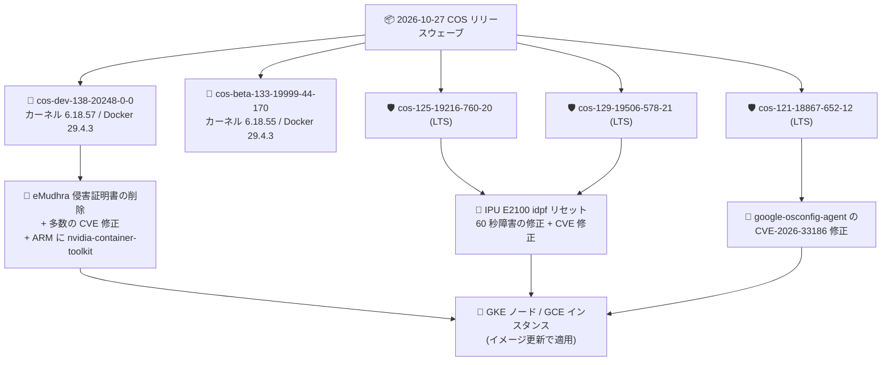

# Container-Optimized OS: 2026 年 10 月 27 日パッチリリース (cos-dev-138 / LTS 125・129・121 / beta-133)

**リリース日**: 2026-10-27

**サービス**: Container-Optimized OS

**機能**: 全アクティブマイルストーンへの一斉パッチリリース (セキュリティ修正・証明書削除・バグ修正・新機能)

**ステータス**: Change / Fixed / Security

📊 [このアップデートのインフォグラフィックを見る](https://takech9203.github.io/google-cloud-news-summary/20261027-container-optimized-os-october-patch-releases.html)

## 概要

2026 年 10 月 27 日、Container-Optimized OS (COS) の 5 つのイメージマイルストーンに対して新しいイメージが一斉にリリースされました。対象は開発版の cos-dev-138、ベータ版の cos-beta-133、そして本番利用向け LTS の cos-125、cos-129、cos-121 です。GKE ノードや Compute Engine 上のコンテナワークロードの基盤 OS として COS を利用しているユーザーに広く関係するリリースウェーブです。

今回のリリースで特に注目すべきは、**eMudhra 中間証明書の侵害 (compromise) の影響を受けた証明書の削除**です。cos-dev-138 では `app-misc/ca-certificates` (v20260816.3.125) と `dev-libs/nss` (v3.131.1) のアップグレードにより、該当する証明書がルートストアから削除されました。このほか、Linux カーネル、Docker、Kubernetes、sudo、glibc、Go、Python、nvidia-container-toolkit など広範なコンポーネントに対する多数の CVE 修正、IPU E2100 における idpf ファンクションリセット後の 60 秒間の障害 (outage) の修正、AMD CPUID faulting の KVM 仮想化サポート追加、ARM イメージへの nvidia-container-toolkit 追加といった機能強化が含まれています。

**アップデート前の課題**

- eMudhra 中間証明書の侵害の影響を受けた証明書が COS イメージの証明書ストア (ca-certificates / NSS) に残存していた
- Linux カーネル、Docker、Kubernetes、sudo (CVE-2026-82474)、glibc (CVE-2026-5435)、openssl (CVE-2024-4741) など多数のコンポーネントに未修正の CVE が存在していた
- IPU E2100 環境で idpf ファンクションリセット後に PFGEN_RSTAT の誤読により 60 秒間の障害が発生していた
- ARM イメージには nvidia-container-toolkit が含まれていなかった
- KVM 仮想化で AMD CPUID faulting がサポートされていなかった

**アップデート後の改善**

- eMudhra 侵害の影響を受けた証明書が削除され、侵害された証明書チェーンを信頼するリスクが解消された (cos-dev-138)
- 各マイルストーンでコンポーネントの CVE 修正が適用され、イメージ更新のみでセキュリティ態勢を改善できる
- IPU E2100 の idpf リセット起因の 60 秒障害が修正された (cos-125 / cos-129)
- ARM イメージに nvidia-container-toolkit が追加され、ARM + NVIDIA GPU 構成のコンテナ実行が容易になった (cos-dev-138)
- KVM 仮想化における AMD CPUID faulting がサポートされた (cos-dev-138)

## アーキテクチャ図



開発版 (dev)・ベータ版 (beta)・LTS 3 系統の全アクティブマイルストーンに同日パッチが提供され、ユーザーはノードのイメージを更新するだけで証明書削除・CVE 修正・バグ修正を適用できます。

## サービスアップデートの詳細

### リリースされたイメージの一覧

| イメージ | 系統 | カーネル | Docker | Containerd |
|----------|------|----------|--------|------------|
| cos-dev-138-20248-0-0 | 開発版 (dev) | COS-6.18.57 | v29.4.3 | v2.4.1 |
| cos-beta-133-19999-44-170 | ベータ版 (beta) | COS-6.18.55 | v29.4.3 | v2.4.1 |
| cos-129-19506-578-21 | LTS (〜2028 年 7 月) | COS-6.12.113 | v27.5.1 | v2.2.7 |
| cos-125-19216-760-20 | LTS (〜2028 年 2 月) | COS-6.12.113 | v27.5.1 | v2.2.7 |
| cos-121-18867-652-12 | LTS (〜2027 年 3 月) | COS-6.6.159 | v27.5.1 | v2.0.10 |

### cos-dev-138-20248-0-0 (開発版)

今回のウェーブで最も変更量が多いリリースです。

| 分類 | 主な内容 |
|------|----------|
| 証明書 (重要) | `app-misc/ca-certificates` v20260816.3.125 / `dev-libs/nss` v3.131.1 へアップグレードし、**eMudhra 中間証明書の侵害の影響を受けた証明書を削除** |
| 新機能 | KVM 仮想化での AMD CPUID faulting サポート追加、ARM イメージへの nvidia-container-toolkit 追加 |
| コンポーネント更新 | Linux カーネル v6.18.57、sys-apps/casfs v0.1.24、cos-gpu-installer v2.7.11、toolbox v20261020、vim v9.2.1152、glibc v2.41-r5 |
| セキュリティ (主要) | カーネル (CVE-2026-99999)、Docker (CVE-2026-39831、CVE-2026-46595)、Kubernetes (CVE-2026-39832、CVE-2026-46595)、sudo (CVE-2026-82474)、glibc (CVE-2026-5435)、openssl (CVE-2024-4741)、nvidia-container-toolkit (CVE-2026-39833) ほか |
| ランタイム更新 | Go v1.26.10 (CVE-2026-111943 ほか)、Python v3.13.15/v3.13.16 (CVE-2026-15308、CVE-2026-19445) |
| エージェント類 | guest-agent、google-guest-agent、google-osconfig-agent、node-problem-detector、cri-tools、cos-extensions の CVE 修正 (cos-extensions は 22 件の CVE を一括修正) |

### cos-125-19216-760-20 (LTS)

| 分類 | 主な内容 |
|------|----------|
| バグ修正 (重要) | **IPU E2100 で idpf ファンクションリセット後に PFGEN_RSTAT の誤読により発生していた 60 秒間の障害を修正** |
| セキュリティ | google-osconfig-agent (CVE-2026-33186)、sudo (CVE-2026-82474) |
| コンポーネント更新 | google-guest-configs v20261025.00 |
| その他 | ランタイム sysctl 値の微調整 (fs.epoll.max_user_watches、kernel.threads-max、net.ipv4.tcp_mem など) |

### cos-129-19506-578-21 (LTS)

| 分類 | 主な内容 |
|------|----------|
| バグ修正 (重要) | **IPU E2100 の idpf ファンクションリセット起因の 60 秒障害を修正** (cos-125 と同一の修正) |
| セキュリティ | dev-libs/expat (CVE-2026-77214) |
| コンポーネント更新 | google-guest-configs v20261025.00 |
| その他 | ランタイム sysctl 値の微調整 |

### cos-121-18867-652-12 (LTS)

| 分類 | 主な内容 |
|------|----------|
| セキュリティ | google-osconfig-agent (CVE-2026-33186) |
| コンポーネント更新 | google-guest-configs v20261025.00 |
| その他 | ランタイム sysctl 値の微調整 |

### cos-beta-133-19999-44-170 (ベータ版)

| 分類 | 主な内容 |
|------|----------|
| コンポーネント更新 | google-guest-configs v20261025.00 |

## 技術仕様

### COS マイルストーンのライフサイクル

| ステージ | 期間 | 内容 |
|----------|------|------|
| Development (cos-dev) | 約 4 か月 | 主要パッケージの更新・新機能の追加。月次または必要に応じてリリース |
| Stabilization (cos-beta) | 約 2 か月 | 機能凍結、テストと安定化 |
| Production (cos-{M}-lts) | 26 か月 | 本番向け。セキュリティ修正と本番障害の修正を優先的に提供 |
| Deprecation | - | イメージファミリーが削除され、修正の提供が終了 |

LTS マイルストーンのサポート期限 (公式ドキュメントより): COS 133 は 2028 年 11 月、COS 129 は 2028 年 7 月、COS 125 は 2028 年 2 月、COS 121 は 2027 年 3 月。

### イメージの取得例

```bash
# LTS イメージファミリーから最新イメージを確認
gcloud compute images describe-from-family cos-125-lts --project cos-cloud
gcloud compute images describe-from-family cos-129-lts --project cos-cloud
gcloud compute images describe-from-family cos-121-lts --project cos-cloud

# 特定イメージの指定 (x86)
gcloud compute instances create my-instance \
  --image cos-125-19216-760-20 \
  --image-project cos-cloud
```

## メリット

### ビジネス面

- **サプライチェーン / PKI リスクの低減**: eMudhra 中間証明書侵害の影響を受けた証明書が削除され、侵害された CA を信頼し続けるリスクを排除できる
- **コンプライアンス対応**: sudo、glibc、Docker、Kubernetes などの既知 CVE が修正済みのイメージへ更新することで、脆弱性管理の要件を満たしやすくなる

### 技術面

- **可用性の改善**: IPU E2100 環境における idpf リセット後の 60 秒障害が解消され、ネットワーク断の影響を受けていたワークロードの安定性が向上する (cos-125 / cos-129)
- **ARM GPU 対応の強化**: ARM イメージに nvidia-container-toolkit が追加され、ARM ベースの GPU ワークロード構築が容易になる (cos-dev-138)
- **仮想化機能の拡張**: KVM での AMD CPUID faulting サポートにより、AMD CPU 上のネスト仮想化ユースケースでの制御性が向上する (cos-dev-138)

## デメリット・制約事項

### 制限事項

- eMudhra 侵害証明書の削除や新機能 (AMD CPUID faulting、ARM への nvidia-container-toolkit) は今回のリリースでは cos-dev-138 に含まれるもので、LTS 系統の今回のイメージには含まれない
- cos-dev / cos-beta は開発・検証用であり、本番ワークロードには LTS ファミリーの利用が推奨される

### 考慮すべき点

- 修正の適用にはノード (GKE ノードプールまたは GCE インスタンス) のイメージ更新・再作成が必要
- 削除された証明書に依存した外部接続 (eMudhra 系列の証明書を提示するエンドポイントへの TLS 接続) がある場合、イメージ更新後に接続が失敗する可能性があるため事前確認が必要
- LTS のランタイム sysctl 既定値 (fs.epoll.max_user_watches、kernel.threads-max、net.ipv4.tcp_mem など) がわずかに変更されており、limits ぎりぎりで運用しているワークロードは確認が望ましい

## ユースケース

### ユースケース 1: GKE ノードプールのセキュリティパッチ適用

**シナリオ**: GKE で COS ノードイメージ (cos_containerd) を利用しており、sudo (CVE-2026-82474) や google-osconfig-agent (CVE-2026-33186) の脆弱性指摘に対応したい。

**実装例**:
```bash
# ノード自動アップグレードを有効化してパッチを自動適用
gcloud container node-pools update my-pool \
  --cluster my-cluster \
  --location asia-northeast1 \
  --enable-autoupgrade
```

**効果**: GKE のノード自動アップグレードにより、修正済み COS イメージがロールアウトされ、手動対応なしで CVE 修正を取り込める。

### ユースケース 2: IPU E2100 環境のネットワーク安定化

**シナリオ**: cos-125 / cos-129 ベースのノードで IPU E2100 を利用しており、idpf ファンクションリセット時に約 60 秒のネットワーク断が発生していた。

**効果**: cos-125-19216-760-20 または cos-129-19506-578-21 へ更新することで、PFGEN_RSTAT の誤読に起因する 60 秒障害が解消される。

## 料金

Container-Optimized OS イメージ自体の追加ライセンス料金に関する公式情報は本リリースノートには含まれていません。実行環境 (Compute Engine / GKE) の料金が適用されます。詳細は [Compute Engine の料金ページ](https://cloud.google.com/compute/pricing) および [GKE の料金ページ](https://cloud.google.com/kubernetes-engine/pricing) を参照してください。

## 関連サービス・機能

- **Google Kubernetes Engine (GKE)**: COS はデフォルトのノードイメージ (cos_containerd)。ノード自動アップグレードで今回の修正を取り込める
- **Compute Engine**: cos-cloud プロジェクトのイメージファミリー (cos-dev / cos-beta / cos-{M}-lts) から COS インスタンスを作成
- **OS Config (google-osconfig-agent)**: 今回 CVE 修正が適用されたゲストエージェントの 1 つ。パッチ管理・構成管理に利用
- **Container Threat Detection / Security Command Center**: ノード OS の脆弱性管理と組み合わせてコンテナ環境のセキュリティ態勢を強化

## 参考リンク

- 📊 [インフォグラフィック](https://takech9203.github.io/google-cloud-news-summary/20261027-container-optimized-os-october-patch-releases.html)
- [公式リリースノート (COS)](https://cloud.google.com/container-optimized-os/docs/release-notes)
- [cos-dev リリースノート](https://cloud.google.com/container-optimized-os/docs/release-notes/dev)
- [COS milestone 129 リリースノート](https://cloud.google.com/container-optimized-os/docs/release-notes/m129)
- [COS milestone 125 リリースノート](https://cloud.google.com/container-optimized-os/docs/release-notes/m125)
- [COS milestone 121 リリースノート](https://cloud.google.com/container-optimized-os/docs/release-notes/m121)
- [COS バージョニングとライフサイクル](https://cloud.google.com/container-optimized-os/docs/concepts/versioning)

## まとめ

COS の全アクティブマイルストーンに対する定例的なパッチウェーブですが、eMudhra 中間証明書侵害への対応 (cos-dev-138) と IPU E2100 の 60 秒障害修正 (cos-125 / cos-129) は運用影響の大きい修正です。本番環境で COS LTS を利用している場合は、GKE ノード自動アップグレードの有効化、または該当 LTS イメージへの計画的な更新を推奨します。

---

**タグ**: Container-Optimized OS, COS, GKE, セキュリティ, CVE, LTS, eMudhra, カーネル, Docker, Kubernetes
