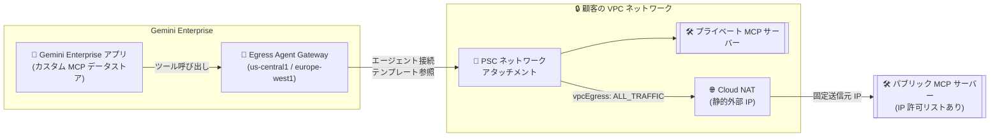

# Gemini Enterprise: カスタム MCP サーバー向け VPC 接続と静的 IP エグレス

**リリース日**: 2026-10-27

**サービス**: Gemini Enterprise

**機能**: カスタム MCP サーバー データストア向け VPC 接続および静的 IP エグレス

**ステータス**: GA (一般提供)

📊 [このアップデートのインフォグラフィックを見る](https://takech9203.github.io/google-cloud-news-summary/20261027-gemini-enterprise-vpc-connectivity-mcp-servers.html)

## 概要

Gemini Enterprise で、カスタム Model Context Protocol (MCP) サーバー データストア向けの Virtual Private Cloud (VPC) 接続が一般提供 (GA) になりました。Agent Gateway (us-central1 および europe-west1 でサポート) を経由してアウトバウンドのツールトラフィックをルーティングすることで、VPC ネットワーク内にプライベートにホストされた MCP サーバーへ Gemini Enterprise から安全にアクセスできます。

プライベート MCP サーバーのホスティングには、Private Service Connect (PSC) ネットワーク アタッチメントとエージェント接続テンプレート (agent connectivity template) を使用します。さらに、パブリックにホストされた MCP サーバーに対しても、Cloud NAT の静的外部 IP アドレスを経由してトラフィックをルーティングできるため、接続先サーバー側で厳格な IP 許可リストを運用している場合にも対応できます。

このアップデートは、標準コネクタが提供されていない社内システムやレガシーシステムを MCP 経由で Gemini Enterprise に統合したい企業、特にプライベート ネットワーク内のツールや IP 許可リストで保護された外部 SaaS/オンプレミスの MCP サーバーを利用したい企業向けの機能です。

**アップデート前の課題**

- デフォルトでは Gemini Enterprise はプライベート ネットワーク内にホストされたリソースにアクセスできなかった
- パブリック MCP サーバーへのアクセスは Google 管理ネットワーク経由で行われるため、送信元 IP アドレスが固定されず、接続先サーバー側で IP ベースのファイアウォール許可リストを構成できなかった
- オンプレミスやマルチクラウド環境にデプロイされた MCP サーバーのアクションをハイブリッド ネットワーク経由で安全に利用する手段がなかった

**アップデート後の改善**

- PSC ネットワーク アタッチメントとエージェント接続テンプレートにより、パブリック IP を持たない VPC 内のプライベート MCP サーバーをホストし、Gemini Enterprise から利用できるようになった
- Cloud NAT に予約した静的外部 IPv4 アドレスを割り当てることで、パブリック MCP サーバーへのリクエストの送信元 IP を固定でき、接続先での IP 許可リスト運用が可能になった
- ハイブリッド ネットワーク経由で、マルチクラウドやオンプレミス環境のプライベート MCP サーバーのアクションにも接続できるようになった
- Agent Gateway 経由のエグレスでは、カスタム TLS トラスト アンカー (`tlsConfig`) を構成することでプライベート CA や自己署名証明書も利用できるようになった

## アーキテクチャ図



Gemini Enterprise のツール呼び出しトラフィックが Agent Gateway と PSC ネットワーク アタッチメント経由で顧客の VPC に注入され、VPC 内のプライベート MCP サーバーへ直接、またはCloud NAT の静的 IP 経由でパブリック MCP サーバーへルーティングされる構成を示しています。

## サービスアップデートの詳細

### 主要機能

1. **プライベート ネットワーク ホスティング**
   - パブリック IP アドレスを持たない VPC 内のプライベート MCP サーバーに、Egress Agent Gateway 経由で接続可能
   - Agent Gateway が PSC ネットワーク アタッチメントを使用して VPC 内に Private Service Connect インターフェースをデプロイし、エグレスを実現
   - プライベート ドメイン名 (例: `mcp.cymbal.internal`) は、Cloud DNS のプライベート DNS ピアリング (`dnsPeeringConfig`) で名前解決

2. **パブリック MCP サーバー向け静的 IP エグレス**
   - エージェント接続テンプレートで `vpcEgress` を `ALL_TRAFFIC` に設定し、インターネット向けリクエストを VPC 経由でルーティング
   - ネットワーク アタッチメントのサブネットに Cloud NAT を構成し、予約済み静的外部 IPv4 アドレスを割り当てることで送信元 IP を固定
   - 接続先 MCP サーバー側で IP ベースのファイアウォール許可リストを構成可能

3. **宣言的な接続定義 (エージェント接続テンプレート)**
   - 使用するネットワーク アタッチメント、プライベートに解決するドメイン、VPC 経由でルーティングするトラフィックを宣言的に定義
   - Egress Agent Gateway がテンプレートを参照してカスタム MCP サーバーに到達
   - オプションで Certificate Manager の TrustConfig を参照し、プライベート CA や自己署名証明書の TLS 検証に対応

4. **ハイブリッド / マルチクラウド接続**
   - マルチクラウドやオンプレミス環境にデプロイされたプライベート MCP サーバーのアクションにハイブリッド ネットワーク経由で接続
   - VPC に注入されたトラフィックは VPC ルートテーブル (デフォルト インターネット ゲートウェイ ルートやネクストホップ ファイアウォール アプライアンスなど) に従う

## 技術仕様

### 必要なリソース

| リソース | 説明 |
|------|------|
| プライベート VPC ネットワーク | Gemini Enterprise に接続したいインフラとワークロードを含む VPC |
| Agent Gateway + 接続テンプレート | us-central1 または europe-west1 のリージョナル Egress Agent Gateway。接続テンプレートで PSC インターフェース用ネットワーク アタッチメント、DNS ピアリング、VPC エグレス ルーティング モードを指定 |
| PSC ネットワーク アタッチメント | Agent Gateway が VPC 内に PSC インターフェースをデプロイするために使用 |
| TrustConfig (任意) | プライベート CA / 自己署名証明書の TLS 検証用 (Certificate Manager) |
| プライベート MCP サーバー (プライベート ホスティング時) | VPC 内で稼働し、StreamableHTTP トランスポートを使用する MCP 実装サーバー |
| パブリック MCP サーバー (静的 IP エグレス時) | パブリック エンドポイントで到達可能な MCP サーバー。静的外部 IPv4 からのリクエストを要求 |
| 認証サーバー (任意) | プライベート MCP サーバーが OAuth 2.0 認証を要求する場合に VPC 内で稼働 |

### ネットワーク アタッチメント用サブネットの要件

| 項目 | 詳細 |
|------|------|
| リージョン | アプリのロケーションに一致: global / us マルチリージョン アプリは us-central1、eu マルチリージョン アプリは europe-west1 |
| IP アドレス範囲 | 最低 /28 |
| Private Google Access | 有効化が必要 |
| 排他利用 | 他のネットワーク アタッチメントで未使用であること |

### VPC エグレス モード

| モード | 動作 |
|------|------|
| `PRIVATE_RANGES_ONLY` | プライベート IP 範囲 (RFC 1918、RFC 6598、クラス E、private/restricted.googleapis.com など) 宛てのトラフィックのみ VPC に注入。インターネット向けは Agent Gateway から直接 |
| `ALL_TRAFFIC` | すべてのアウトバウンド トラフィック (パブリック インターネット、外部 SaaS API 含む) を VPC 経由でルーティング。静的 IP エグレスと VPC Service Controls にはこのモードが必要 |

### 制限事項

- **トランスポート**: 旧来の Server-Sent Events (SSE) は非サポート。StreamableHTTP トランスポートのみ対応
- **TLS 証明書**: 公的に信頼された CA による署名が原則必須。Agent Gateway 経由のプライベート MCP サーバーのみ、接続テンプレートの `tlsConfig` でプライベート CA / 自己署名証明書を利用可能
- **アクション数**: パフォーマンス維持のため、カスタム MCP サーバー データストアで有効化するアクションは同時 100 個まで推奨
- **Agent Gateway バインド**: 1 つの Gemini Enterprise アプリがバインドできるエグレス Agent Gateway は 1 つ (複数アプリで同一ゲートウェイの共有は可能)
- **データストアのスコープ**: スタンドアロンのカスタム MCP サーバー データストアをアプリにリンクすることは不可。アプリ内の「Connected Data Stores」で直接作成が必要
- **プロキシ対象**: Agent Gateway が管理するのはカスタム MCP サーバー、アクション コネクタ、エージェントへのクエリ時アウトバウンド ツール実行のみ。生成モデル推論、ナレッジ データストア検索 (RAG)、組み込みアシスタント ツール、コネクタの取り込みジョブはプロキシされない。Gemini Enterprise への受信 (インバウンド) トラフィックも非サポート
- **テンプレートの変更**: 接続テンプレートは Agent Gateway から参照されている間はインプレース変更不可。`networkAttachment` は構成後は不変

## 設定方法

### 前提条件

1. カスタム MCP データストアの作成をブロックする組織ポリシー制約のオーバーライド
2. MCP サーバー URL・認可 URL・トークン URL の FQDN を許可エグレス FQDN (`allowedEgressFqdns`) に追加
3. プロジェクト強制または VPC Service Controls 保護下の場合、許可データソースに `custom_mcp` を追加
4. Gemini Enterprise アプリの Agent Gateway へのバインドを組織ポリシーで許可
5. データストア作成者に Discovery Engine Editor (`roles/discoveryengine.editor`) を付与
6. ネットワーク アタッチメント作成プロジェクトで Compute Engine API の有効化と Compute Network Admin (`roles/compute.networkAdmin`) の付与 (Shared VPC の場合はホスト プロジェクトのサブネットに対する `roles/compute.networkUser`)

### 手順

#### ステップ 1: PSC ネットワーク アタッチメントの作成

Google Cloud コンソールの「Network attachments」ページで、要件を満たすサブネット (リージョン一致、/28 以上、Private Google Access 有効) を指定し、「Automatically accept all connections」を選択して作成します。作成後のリソース URI (`projects/PROJECT_ID/regions/LOCATION/networkAttachments/ATTACHMENT_NAME`) を控えます。

#### ステップ 2: エージェント接続テンプレートの作成

```bash
gcloud network-services agent-connectivity-templates import CONNECTIVITY_TEMPLATE_NAME \
  --source="agw-connectivity-template.yaml" \
  --location=LOCATION
```

YAML でネットワーク アタッチメント、DNS ピアリング (`dnsPeeringConfig`)、VPC エグレス モード (`vpcEgress`) を定義します。静的 IP エグレスの場合は `vpcEgress: ALL_TRAFFIC` を設定します。

#### ステップ 3: Agent Gateway の作成

```yaml
# my-agent-gateway-vpc-egress.yaml
name: AGENT_GATEWAY_NAME
protocols:
- MCP
googleManaged:
  governedAccessPath: AGENT_TO_ANYWHERE
  agentConnectivityTemplate: projects/AGENT_GATEWAY_PROJECT_NUMBER/locations/LOCATION/agentConnectivityTemplates/CONNECTIVITY_TEMPLATE_NAME
registries:
- AGENT_REGISTRY_PATH
```

```bash
gcloud network-services agent-gateways import AGENT_GATEWAY_NAME \
  --source="my-agent-gateway-vpc-egress.yaml" \
  --location=LOCATION
```

Agent Gateway のエグレスはデフォルトでブロックされるため、ゲートウェイを対象とする認可ポリシー (authorization policy) のバインドも必要です。静的 IP エグレスの場合は、ネットワーク アタッチメントのサブネットに静的外部 IP を割り当てた Cloud NAT を構成します。

#### ステップ 4: カスタム MCP サーバー データストアの作成

Gemini Enterprise アプリの「Connected Data Stores」から「Custom MCP Server」を追加し、「Route egress through Agent Gateway」チェックボックスを選択します。エンジン リソース名 (`projects/PROJECT_NUMBER/locations/LOCATION/collections/default_collection/engines/APP_ID`) を入力してエグレス先を指定します。

#### ステップ 5: 構成の検証

```bash
# ゲートウェイが接続テンプレートを参照しているか確認
gcloud network-services agent-gateways describe AGENT_GATEWAY_NAME \
  --location=LOCATION --project=AGENT_GATEWAY_PROJECT_ID

# ネットワーク アタッチメントの接続が ACCEPTED か確認
gcloud compute network-attachments describe ATTACHMENT_NAME \
  --region=LOCATION --project=PROJECT_ID
```

HTTP 403 はゲートウェイへの認可ポリシー未バインド、HTTP 503 は DNS ピアリング設定・Private Google Access・ファイアウォール ルールの不備が主な原因です。

## メリット

### ビジネス面

- **レガシー / 社内システムの AI 統合**: 標準コネクタが存在しない社内システムやレガシーシステムを、カスタム MCP サーバー経由で Gemini Enterprise のエージェントから安全に利用できる
- **セキュリティ ポリシーへの準拠**: 送信元 IP の固定により、厳格な IP 許可リストを要求する外部パートナーや SaaS のセキュリティ要件を満たしながら AI 活用を進められる

### 技術面

- **パブリック公開不要**: MCP サーバーに パブリック IP を付与せず VPC 内でプライベートにホストでき、攻撃対象領域を削減できる
- **宣言的なエグレス管理**: 接続テンプレートにより DNS ピアリング、エグレス モード、TLS 設定を宣言的に一元管理できる
- **プライベート CA 対応**: Agent Gateway 経由であれば、カスタム TLS トラスト アンカーにより社内 CA や自己署名証明書を使った TLS 検証が可能
- **VPC Service Controls 連携**: `ALL_TRAFFIC` モードと restricted.googleapis.com への解決を組み合わせることで、サービス境界による保護を適用できる

## デメリット・制約事項

### 制限事項

- Agent Gateway のサポート リージョンは us-central1 と europe-west1 のみ
- SSE トランスポート非対応 (StreamableHTTP のみ)
- 1 アプリにつきバインドできるエグレス Agent Gateway は 1 つ
- 接続テンプレートの `networkAttachment` と `tlsConfig.trustConfig` は構成後は不変。設定変更には新しいテンプレート (場合によっては新しいゲートウェイ) の作成が必要

### 考慮すべき点

- Agent Gateway がプロキシするのはクエリ時のツール実行トラフィックのみ。モデル推論や RAG 検索、コネクタ取り込みは VPC を経由しない点をネットワーク設計で考慮する
- `ALL_TRAFFIC` モードではすべてのアウトバウンドが VPC に注入されるため、デフォルト ルート (0.0.0.0/0) や Cloud NAT、ファイアウォールなどルーティングとセキュリティの管理責任は利用者側にある
- Shared VPC 構成では、最小権限の観点からネットワーク アタッチメントをサービス プロジェクト側に作成する方式が推奨される (ホスト プロジェクト側に作成すると `roles/compute.networkAdmin` 相当の高い権限が必要)
- 組織ポリシー (許可エグレス FQDN、許可データソース、ゲートウェイ バインド制限) の事前整備が必要

## ユースケース

### ユースケース 1: VPC 内のプライベート MCP サーバーで社内業務ツールを公開

**シナリオ**: 社内の在庫管理システムの API を MCP サーバーとして VPC 内 (パブリック IP なし) にデプロイし、Gemini Enterprise のエージェントから在庫照会・更新のアクションを実行させたい。

**実装例**:
```yaml
# 接続テンプレート (抜粋): プライベート ドメインの DNS ピアリング
egressNetworkConfig:
  networkAttachment: projects/PROJECT_ID/regions/us-central1/networkAttachments/mcp-attachment
dnsPeeringConfig:
  domains:
  - corp.internal.   # 末尾のドット必須
```

**効果**: MCP サーバーをインターネットに公開することなく、Gemini Enterprise から社内システムのアクションを安全に実行できる。社内 CA の証明書も TrustConfig 経由で検証可能。

### ユースケース 2: IP 許可リスト必須の外部 SaaS MCP サーバーへの接続

**シナリオ**: 外部パートナーが提供する MCP サーバーが、セキュリティ要件として接続元の静的 IP アドレスの事前登録を要求している。

**効果**: `vpcEgress: ALL_TRAFFIC` と Cloud NAT の静的外部 IPv4 アドレスにより、Gemini Enterprise からのツール呼び出しが常に固定 IP から送信され、パートナー側の IP 許可リストに登録するだけで接続を許可できる。

### ユースケース 3: オンプレミス / マルチクラウドの MCP サーバーとのハイブリッド接続

**シナリオ**: オンプレミスのデータセンターで稼働する業務システムを MCP サーバー化し、Cloud Interconnect / VPN 経由で Gemini Enterprise から利用したい。

**効果**: VPC に注入されたトラフィックが VPC ルートテーブルに従ってハイブリッド ネットワークへルーティングされるため、オンプレミスや他クラウドの MCP サーバーのアクションも Gemini Enterprise のエージェントから実行できる。

## 料金

今回のリリースノートおよび確認したドキュメントには、本機能固有の料金情報は記載されていません。Gemini Enterprise 本体の料金に加えて、構成で使用する Cloud NAT、静的外部 IP アドレス、Cloud DNS などのネットワーク リソースには各サービスの料金が適用される点に留意してください。詳細は各料金ページを参照してください。

- [Gemini Enterprise の料金](https://cloud.google.com/gemini-enterprise/pricing)
- [Cloud NAT の料金](https://cloud.google.com/nat/pricing)
- [VPC の料金 (外部 IP アドレスなど)](https://cloud.google.com/vpc/pricing)

## 利用可能リージョン

Agent Gateway 経由のエグレス ルーティングは **us-central1** および **europe-west1** でサポートされています。

- global / us マルチリージョンの Gemini Enterprise アプリ: us-central1 にネットワーク アタッチメントとゲートウェイを作成
- eu マルチリージョンのアプリ: europe-west1 に作成

## 関連サービス・機能

- **Agent Gateway (Gemini Enterprise エージェント プラットフォーム)**: エグレス トラフィックの統制ポイント。接続テンプレートを参照してツール呼び出しを VPC にルーティング
- **Private Service Connect (ネットワーク アタッチメント)**: Agent Gateway が VPC 内に PSC インターフェースをデプロイするための接続点
- **Cloud NAT**: 静的外部 IPv4 アドレスによる決定論的なインターネット エグレスを提供
- **Cloud DNS (プライベート DNS ピアリング)**: VPC 内のプライベート ドメイン名の解決 (`roles/dns.peer` と `dnsPeeringConfig` で構成)
- **Certificate Manager (TrustConfig)**: プライベート CA / 自己署名証明書のカスタム トラスト アンカー定義
- **VPC Service Controls**: `ALL_TRAFFIC` モードと組み合わせてサービス境界によるエージェント通信の保護を実現
- **Shared VPC**: ホスト プロジェクトのサブネットを参照したクロスプロジェクト構成に対応

## 参考リンク

- 📊 [インフォグラフィック](https://takech9203.github.io/google-cloud-news-summary/20261027-gemini-enterprise-vpc-connectivity-mcp-servers.html)
- [公式リリースノート](https://cloud.google.com/release-notes#October_27_2026)
- [ドキュメント: カスタム MCP サーバー データストアの VPC 接続の前提条件](https://docs.cloud.google.com/gemini/enterprise/docs/connectors/custom-mcp-server/set-up-vpc-custom-mcp-server)
- [ドキュメント: カスタム MCP サーバー データストアのセットアップ](https://docs.cloud.google.com/gemini/enterprise/docs/connectors/custom-mcp-server/set-up-custom-mcp-server)
- [ドキュメント: Agent Gateway の VPC 接続のセットアップ](https://docs.cloud.google.com/gemini-enterprise-agent-platform/govern/gateways/set-up-vpc-connectivity)
- [Codelab: Agent Gateway all-traffic VPC egress と Cloud NAT 静的 IP による外部 MCP サーバー接続](https://codelabs.developers.google.com/agw-ge-egress-vpc-all-traffic)
- [料金ページ (Gemini Enterprise)](https://cloud.google.com/gemini-enterprise/pricing)

## まとめ

カスタム MCP サーバーの VPC 接続と静的 IP エグレスの GA により、Gemini Enterprise のエージェントがプライベート ネットワーク内の社内ツールや IP 許可リストで保護された外部 MCP サーバーへ、エンタープライズのネットワーク セキュリティ要件を満たしながらアクセスできるようになりました。標準コネクタがない社内システムの AI 統合を検討している場合は、まず組織ポリシー (許可エグレス FQDN、許可データソース) の整備と、us-central1 / europe-west1 での PSC ネットワーク アタッチメント + Agent Gateway の構成から着手することを推奨します。

---

**タグ**: Gemini Enterprise, MCP, Agent Gateway, VPC, Private Service Connect, Cloud NAT, 静的IP, ネットワーキング, セキュリティ, GA
