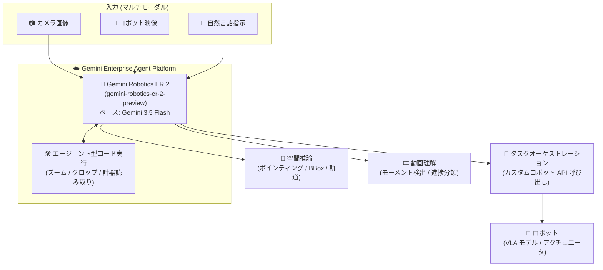

# Gemini Enterprise Agent Platform: Gemini Robotics ER 2 (Preview)

**リリース日**: 2026-10-27

**サービス**: Gemini Enterprise Agent Platform

**機能**: Gemini Robotics ER 2 (gemini-robotics-er-2-preview)

**ステータス**: Preview

📊 [このアップデートのインフォグラフィックを見る](https://takech9203.github.io/google-cloud-news-summary/20261027-gemini-robotics-er-2-preview.html)

## 概要

Gemini Enterprise Agent Platform で、ロボティクス向けの身体性推論 (Embodied Reasoning) モデル **Gemini Robotics ER 2** (`gemini-robotics-er-2-preview`) が Preview として利用可能になりました。Gemini Robotics ER 2 は Gemini 3.5 Flash をベースに構築されたビジョン言語モデル (VLM) で、ロボットが物理世界を正確に認識・推論するための機能に特化しています。

このモデルは、空間推論 (ポインティング、物体追跡、バウンディングボックス、軌道生成)、エージェント型コード実行 (画像のズーム / クロップ、計器の読み取り、シーンへの注釈付け)、タスクオーケストレーション (カスタムロボット API と組み合わせた長時間タスクの遂行)、動画理解 (モーメント検出、進捗分類) をサポートします。VLA (Vision-Language-Action) モデルを使ったロボットのエージェント的なオーケストレーションや、タスク成功判定を含むロボット映像の理解が主なターゲットです。

Google Gen AI SDK から `enterprise=True` でクライアントを初期化し、Google Cloud の認証情報を使って自社の Google Cloud プロジェクトから呼び出せるため、エンタープライズ環境でロボティクスアプリケーションを構築する開発者・企業が対象ユーザーです。なお、本機能は Generative AI Preview 提供であり、Pre-GA Offerings Terms および Additional Terms for Generative AI Preview Products が適用されますが、顧客は本 Preview を本番・商用目的で利用することを選択できます。

**アップデート前の課題**

- 旧世代モデルの Gemini Robotics ER 1.6 (`gemini-robotics-er-1.6-preview`) は 2026 年 8 月 31 日に非推奨 (deprecated) となっており、後継モデルへの移行が必要だった
- 空間推論、動画のモーメント検出・進捗分類、複数ロボットのオーケストレーション、複数ステップのツール利用には改善の余地があった

**アップデート後の改善**

- Gemini 3.5 Flash ベースの新モデルにより、空間推論、動画モーメント検出、動画進捗分類、マルチロボットオーケストレーション、マルチステップツール利用が改善された
- Gemini Enterprise Agent Platform 上で、Google Cloud の認証情報 (自社プロジェクト) を使ってロボティクス特化モデルを呼び出せるようになった
- Thinking、構造化出力、コンテキストキャッシュ、Function Calling、コード実行、Grounding (Google Search / Google Maps)、Computer Use (Preview) などプラットフォームの機能と組み合わせて利用できる

## アーキテクチャ図



カメラ画像・映像・自然言語指示を入力として受け取った Gemini Robotics ER 2 が、コード実行ツールを活用しながら空間推論・動画理解を行い、カスタムロボット API を通じて実際のロボット (VLA モデル) をオーケストレーションする構成です。

## サービスアップデートの詳細

### 主要機能

1. **空間推論 (Spatial Reasoning)**
   - 画像・動画内の物体へのポインティング (0-1000 に正規化された [y, x] 座標で返答)、動画フレーム間での物体追跡
   - 2D バウンディングボックスによる物体検出、ロボットアームの動作を導く軌道 (ウェイポイント列) の生成

2. **エージェント型コード実行 (Agentic Code Execution)**
   - コード実行ツールを使って画像のズーム / クロップなどの画像操作を行い、認識精度を向上
   - 計器 (インストゥルメント) の読み取りやシーンへの注釈付けに対応

3. **タスクオーケストレーション (Task Orchestration)**
   - 空間推論とカスタムロボット API (Function Calling) を組み合わせ、長時間 (long-horizon) タスクを遂行
   - VLA モデルを用いたロボットのエージェント的なオーケストレーションや、マルチロボットオーケストレーションに対応

4. **動画理解 (Video Understanding)**
   - 連続した動画フィードからのモーメント検出 (moment finding) と進捗分類 (progress classification)
   - タスクの進捗理解や成功判定 (success detection) を含むロボット映像の理解

## 技術仕様

### モデル仕様 (gemini-robotics-er-2-preview)

| 項目 | 詳細 |
|------|------|
| モデル ID | `gemini-robotics-er-2-preview` |
| ベースモデル | Gemini 3.5 Flash |
| 入力トークン上限 | 131,072 |
| 出力トークン上限 | 65,536 |
| サポート機能 | Thinking、システム指示、構造化出力、コンテキストキャッシュ (暗黙的 / 明示的) |
| ツール | Grounding (Google Search / Google Maps)、コード実行、Function Calling、URL コンテキスト、Computer Use (Preview) |
| API | GenerateContent API、Count Tokens API (Interactions API / Live API / Chat Completions API は非対応) |
| 非サポート | RAG Engine、チューニング、Agentic video understanding、Provisioned Throughput、バッチ推論、固定クォータ |
| 消費オプション | Standard PayGo (従量課金) |
| 提供リージョン | Global (`global`) |
| デフォルトクォータ | 250 RPM / プロジェクト (クォータ階層により 200〜300 RPM) |
| リリース日 / ステージ | 2026 年 10 月 27 日 / Preview |

### 利用例 (空間推論: ポインティング)

公式ドキュメントのコード例では、0-1000 に正規化された [y, x] 座標で物体位置を JSON 形式で返すようプロンプトで指示します。Gemini Enterprise Agent Platform のガイドでは、Google Gen AI SDK のクライアントを `enterprise=True` で初期化し、Google Cloud の認証情報で認証します。

```json
[
  {"point": [376, 508], "label": "small banana"},
  {"point": [270, 786], "label": "green plastic bowl"},
  {"point": [488, 775], "label": "metal measuring cup"}
]
```

## 設定方法

### 前提条件

1. 課金が有効な Google Cloud プロジェクト
2. Agent Platform API の有効化 (コンソールの「Deploy example app」利用時に必要)
3. Google Gen AI SDK と Google Cloud 認証情報のセットアップ

### 手順

#### ステップ 1: Agent Studio / Model Garden で試す

Google Cloud コンソールの Agent Studio でモデル `gemini-robotics-er-2-preview` を選択してプロンプトを試行できます。Model Garden からもモデル情報を確認できます。

#### ステップ 2: Google Gen AI SDK から呼び出す

```python
from google import genai
from google.genai import types

# Gemini Enterprise Agent Platform のガイドでは enterprise=True で初期化し、
# Google Cloud 認証情報で認証する
client = genai.Client(enterprise=True)

with open("my-image.png", "rb") as f:
    image_bytes = f.read()

prompt = """
Point to no more than 10 items in the image.
The answer should follow the json format:
[{"point": [y, x], "label": <label1>}, ...].
The points are in [y, x] format normalized to 0-1000.
"""

response = client.models.generate_content(
    model="gemini-robotics-er-2-preview",
    contents=[
        types.Part.from_bytes(data=image_bytes, mime_type="image/png"),
        prompt,
    ],
    config=types.GenerateContentConfig(
        thinking_config=types.ThinkingConfig(thinking_level="high")
    ),
)
print(response.text)
```

空間推論タスクでは `thinking_level` を指定して推論の深さを制御できます (公式例では pointing に `high`、バウンディングボックス検出に `low` を使用)。

## メリット

### ビジネス面

- **本番・商用利用が可能な Preview**: Generative AI Preview offering として、顧客は本番・商用目的での利用や生成出力の第三者開示を選択でき、Cloud Data Processing Addendum に基づく個人データの処理も可能
- **エンタープライズ基盤での利用**: 自社の Google Cloud プロジェクト・認証情報・課金体系 (Standard PayGo) の下でロボティクス特化モデルを利用できる

### 技術面

- **ロボティクス特化の推論能力**: 汎用 VLM では難しい、正規化座標でのポインティング、軌道生成、動画からの進捗分類・成功判定といった身体性推論に特化
- **プラットフォーム機能との統合**: Thinking、構造化出力、コンテキストキャッシュ、Function Calling、コード実行などを組み合わせた長時間タスクのオーケストレーションが可能

## デメリット・制約事項

### 制限事項

- Preview 提供のため「as is」での提供となり、サポートが限定される場合がある (Pre-GA Offerings Terms 適用)
- RAG Engine、チューニング、Agentic video understanding、Live API、Interactions API、Chat Completions API は非対応
- Provisioned Throughput、バッチ推論、固定クォータは利用不可 (Standard PayGo のみ)
- 提供リージョンは Global のみ
- デフォルトクォータは 250 RPM / プロジェクト (クォータ階層により 200〜300 RPM)

### 考慮すべき点

- **プライバシー通知**: Robotics モデルは動作のために映像・音声データを利用する。識別可能な人物の個人データ (音声、画像、肖像) が収集されうる運用を行う場合、事前の通知と同意の取得が必要で、顔のぼかしなどのデータ最小化手法の利用が求められる
- Gemini Developer API 側にはリアルタイムストリーミング向けの `gemini-robotics-er-2-streaming-preview` が存在するが、Gemini Enterprise Agent Platform で Preview 提供されるのは `gemini-robotics-er-2-preview` (Live API 非対応)
- Gemini Robotics ER 1.6 は 2026 年 8 月 31 日に非推奨となっているため、利用中の場合はモデル ID を `gemini-robotics-er-2-preview` に置き換えて移行する

## ユースケース

### ユースケース 1: ロボットアームによるピック & プレース

**シナリオ**: 作業台上の物体をカメラで認識し、ロボットアームで指定の場所に移動させる。

**実装例**:
```
プロンプト例 (公式ドキュメントより):
"Generate a trajectory for the robotic arm to pick up the red pen
 and place it in the organizer. Return a list of waypoints as JSON:
 [{"step": <int>, "point": [y, x], "action": <description>}, ...]
 where coordinates are normalized to 0-1000."
```

**効果**: 対象物体の位置特定から中間ウェイポイントを含む軌道生成までをモデルが行い、ロボット制御系に渡せる構造化データ (JSON) を取得できる。

### ユースケース 2: ロボット作業映像の進捗監視・成功判定

**シナリオ**: ロボットの作業映像を継続的に解析し、タスクの進捗状況を分類して完了 (成功) を検出する。

**効果**: 動画理解 (モーメント検出・進捗分類) により、長時間タスクの監視や成功判定を自動化できる。

### ユースケース 3: カスタムロボット API を使った長時間タスクのオーケストレーション

**シナリオ**: 空間推論と Function Calling (カスタムロボット API) を組み合わせ、複数ステップにまたがるタスクを計画・実行する。複数ロボットの連携 (マルチロボットオーケストレーション) も対象。

**効果**: モデルがタスクを分解し、適切な順序でロボット API を呼び出すことで、long-horizon タスクの自動遂行が可能になる。

## 料金

Standard PayGo (トークン単位の従量課金) で提供されます。具体的な単価は公式料金ページを参照してください。

- [Gemini Robotics の料金 (Gemini Enterprise Agent Platform)](https://cloud.google.com/gemini-enterprise-agent-platform/generative-ai/pricing#gemini-robotics)

## 利用可能リージョン

- Global (`global`) のみ

最新のリージョン情報は [Model availability](https://docs.cloud.google.com/gemini-enterprise-agent-platform/resources/locations) を参照してください。

## 関連サービス・機能

- **Agent Studio / Model Garden**: コンソール上でモデルのプロンプト試行やモデル情報の確認が可能
- **Function Calling / コード実行**: タスクオーケストレーションとエージェント型ビジョン (計器読み取り・画像操作) の基盤となるツール群
- **コンテキストキャッシュ**: 暗黙的 / 明示的キャッシュに対応し、繰り返し入力されるコンテキストのコスト最適化が可能
- **Grounding (Google Search / Google Maps)**: 外部情報に基づく応答のグラウンディングに対応
- **Gemini Developer API 版 Gemini Robotics ER 2**: Google AI Studio / Gemini API 経由でも同モデルが利用可能 (ストリーミング版 `gemini-robotics-er-2-streaming-preview` あり)

## 参考リンク

- 📊 [インフォグラフィック](https://takech9203.github.io/google-cloud-news-summary/20261027-gemini-robotics-er-2-preview.html)
- [公式リリースノート](https://docs.cloud.google.com/release-notes#October_27_2026)
- [Gemini Robotics ER 2 概要 (開発者ガイド)](https://docs.cloud.google.com/gemini-enterprise-agent-platform/models/gemini/gemini-robotics-er)
- [Gemini Robotics ER 2 モデル情報 (技術仕様)](https://docs.cloud.google.com/gemini-enterprise-agent-platform/models/gemini/robotics-er-2)
- [空間推論ガイド](https://docs.cloud.google.com/gemini-enterprise-agent-platform/models/gemini/gemini-robotics-er/spatial)
- [タスクオーケストレーションガイド](https://docs.cloud.google.com/gemini-enterprise-agent-platform/models/gemini/gemini-robotics-er/orchestration)
- [動画理解ガイド](https://docs.cloud.google.com/gemini-enterprise-agent-platform/models/gemini/gemini-robotics-er/video-understanding)
- [Gemini Robotics ER 2 モデルカード (Google DeepMind)](https://deepmind.google/models/model-cards/gemini-robotics-er-2/)
- [Google DeepMind ブログ (発表記事)](https://blog.google/innovation-and-ai/models-and-research/google-deepmind/gemini-robotics-er-2/)
- [料金ページ](https://cloud.google.com/gemini-enterprise-agent-platform/generative-ai/pricing#gemini-robotics)

## まとめ

Gemini Robotics ER 2 の Preview 提供により、Gemini 3.5 Flash ベースの身体性推論モデルを Gemini Enterprise Agent Platform 上 (自社の Google Cloud プロジェクト) から利用できるようになりました。空間推論・エージェント型コード実行・タスクオーケストレーション・動画理解を組み合わせたロボティクスアプリケーションの構築を検討している場合は、Agent Studio でのプロンプト試行から始め、非推奨となった ER 1.6 利用者はモデル ID の置き換えによる移行を進めることを推奨します。

---

**タグ**: Gemini Enterprise Agent Platform, Gemini Robotics ER 2, Robotics, VLM, Embodied Reasoning, Preview, 空間推論, タスクオーケストレーション, 動画理解
