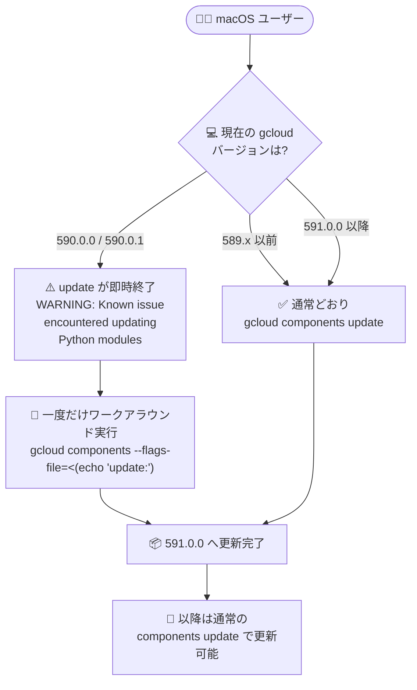

# Cloud SDK: Google Cloud CLI 591.0.0 リリース (macOS 更新不具合の修正と多数の GA 昇格)

**リリース日**: 2026-10-27

**サービス**: Cloud SDK (Google Cloud CLI)

**機能**: Google Cloud CLI 591.0.0 (Breaking Changes + 機能昇格)

**ステータス**: GA (一部機能は Beta)

📊 [このアップデートのインフォグラフィックを見る](https://takech9203.github.io/google-cloud-news-summary/20261027-google-cloud-cli-591-0-0.html)

## 概要

Google Cloud CLI バージョン 591.0.0 がリリースされた。本リリースの最重要項目は **Breaking Changes として告知された macOS 上の `gcloud components update` 不具合の修正**である。バージョン 590.0.0 / 590.0.1 では、macOS で `gcloud components update` を実行すると "WARNING: Known issue encountered updating Python modules" と出力した直後に処理が停止・即時終了してしまい、最新リリースへの更新が一切できない状態になっていた。591.0.0 でこの問題自体は修正されたが、**不具合は 590.0.0 / 590.0.1 のインストール済み環境側に残存する**ため、該当バージョンで止まっているユーザーは一度だけワークアラウンドコマンドの実行が必要となる。

機能面では、Agent Registry の `skills` / `publishers` / `findings` コマンド群、Cloud Dataproc のフレキシブル構成フラグ、Network Security の WildFire 分析コマンド群と `server-tls-policies` の create/update など、多数のコマンド・フラグが GA に昇格した。また、バンドルされる Python が 3.14.9 に更新され、Cloud Bigtable のタイムスタンプ粒度指定、Cloud IAM の Workload Identity プロバイダー向け新フラグ、GKE のノード無停止更新モードなど、幅広いサービスの CLI 機能が追加されている。

対象ユーザーは gcloud CLI を利用するすべてのエンジニアだが、特に **macOS で 590.0.0 / 590.0.1 を利用中のユーザーは即時の対応が必要**である。

**アップデート前の課題**

- macOS で gcloud CLI 590.0.0 / 590.0.1 を利用している場合、`gcloud components update` が "WARNING: Known issue encountered updating Python modules" を出力して即終了し、最新版への更新が不可能だった
- Agent Registry の `skills` / `skills revisions` / `publishers` / `findings` コマンド群は GA 前のトラックでしか利用できなかった
- Dataproc のフレキシブル構成フラグ (`--master-flexible-config` など) や Network Security の WildFire 分析関連コマンド、`server-tls-policies` の create/update は GA 提供ではなく、本番運用での利用に慎重な判断が必要だった
- Bigtable テーブルのタイムスタンプ粒度を gcloud から指定する手段がなかった

**アップデート後の改善**

- `gcloud components update` の macOS 不具合が 591.0.0 で修正され、590.x で止まった環境も一度のワークアラウンド実行で復旧できるようになった
- バンドル Python が 3.14.9 に更新された
- Agent Registry、Dataproc フレキシブル構成、Network Security (WildFire 分析 / server-tls-policies) など多数のコマンド・フラグが GA となり、本番環境で安心して利用できるようになった
- Bigtable の `--timestamp-granularity`、IAM の `--discovery-uri` / `--actor-providers`、GKE の `--node-config-update-mode` など、新しい構成オプションが CLI から利用可能になった

## アーキテクチャ図



macOS で gcloud components update が止まる問題への対応フロー。590.0.0 / 590.0.1 で止まっている環境のみ、一度だけワークアラウンドコマンドの実行が必要となる。

## サービスアップデートの詳細

### Breaking Changes: macOS での components update 不具合の修正

1. **問題の内容**
   - macOS 上で `gcloud components update` を実行すると、"WARNING: Known issue encountered updating Python modules" と出力した直後に処理が停止・即時終了し、最新リリースへ更新できなかった
   - この不具合は 590.0.0 と 590.0.1 のリリースに含まれており、該当バージョンのインストール済み環境にはバグが残存する

2. **ワークアラウンド (590.0.0 / 590.0.1 で止まっている場合のみ)**
   - 次のコマンドを一度だけ実行する

   ```bash
   gcloud components --flags-file=<(echo 'update:')
   ```

3. **影響範囲**
   - 589.0.0 以前、または 591.0.0 以降から更新するユーザーは影響を受けず、通常どおり `gcloud components update` を実行できる
   - ワークアラウンドが必要なのは、現在 590.0.0 または 590.0.1 で止まっているインストール環境のみ
   - 本件は [Issue Tracker (issue 578071727)](https://issuetracker.google.com/issues/578071727) で追跡されている

### 主要機能 (GA 昇格)

1. **Agent Registry コマンド群の GA 昇格**
   - `gcloud agent-registry skills`、`gcloud agent-registry skills revisions`、`gcloud agent-registry publishers`、`gcloud agent-registry findings` の各コマンドグループが GA に昇格

2. **Cloud Dataproc: フレキシブル構成フラグの GA 昇格**
   - `gcloud dataproc clusters create` および `gcloud dataproc workflow-templates set-managed-cluster` で `--master-flexible-config`、`--worker-flexible-config`、`--secondary-worker-flexible-config` が GA に昇格
   - `gcloud dataproc clusters update` でも `--worker-flexible-config`、`--secondary-worker-flexible-config` が GA に昇格

3. **Network Security: WildFire 分析と server-tls-policies の GA 昇格**
   - `gcloud network-security security-profiles wildfire-analysis` の `add-override` / `update-override` / `delete-override` / `add-inline-ml-exception` / `delete-inline-ml-exception` コマンドが GA に昇格
   - `gcloud network-security firewall-endpoints create|update` の WildFire 関連フラグが GA に昇格
   - `gcloud network-security firewall-endpoints wildfire-verdict-change-requests` コマンドグループ (`create` / `get` / `list`) が GA に昇格
   - `gcloud network-security server-tls-policies create` および `update` が GA に昇格

4. **Compute Engine: --identity-type フラグの昇格とサーキットブレーカー設定**
   - `gcloud compute instances create|update` と `gcloud compute instance-templates create` の `--identity-type` フラグが beta / GA トラックに昇格
   - `gcloud compute backend-services create|update` にサーキットブレーカー関連フラグ (`--circuit-breakers-max-connections`、`--circuit-breakers-max-pending-requests`、`--circuit-breakers-max-requests`、`--circuit-breakers-max-requests-per-connection`、`--circuit-breakers-max-retries`、update には `--no-circuit-breakers`) を追加
   - `gcloud beta compute instance-groups managed update-instances` に `--allowed-actions` フラグを追加 (`restart-in-place` を含む許可アクションを指定可能)。`create` / `update` には `--update-policy-allowed-actions` を追加 (beta)

### その他の機能追加・変更

1. **Google Cloud CLI 本体**
   - バンドルされる Python を 3.14.9 に更新

2. **Cloud Bigtable**
   - `gcloud bigtable instances tables create` および `gcloud bigtable tables create` に `--timestamp-granularity` フラグを追加 (`millis` または `micros`)。マイクロ秒粒度は Enterprise Plus インスタンスのみサポート

3. **Cloud IAM**
   - `gcloud iam workload-identity-pools providers create-oidc|update-oidc` に `--discovery-uri` フラグを追加 (IdP がデフォルトの well-known パスを使用しない場合にカスタム OIDC ディスカバリ URI を指定)
   - 同コマンドに `--actor-providers` フラグを追加 (同一プール内のプロバイダーに対し、ID 委任用のアクタートークン発行を許可)

4. **Kubernetes Engine**
   - `gcloud container node-pools update` に `--node-config-update-mode` フラグを追加。ノードのライブ更新をトリガーでき、サポートされる値は `LIVE_UPDATE_WITHOUT_DRAIN`

5. **Secure Source Manager (beta 昇格)**
   - `gcloud beta source-manager branch-rules` / `hooks` / `issues` / `issues comments` / `pull-requests` / `pull-requests comments` の各コマンドグループが beta に昇格

6. **Workspace Key Access (新規 beta)**
   - `gcloud beta workspace-key-access` コマンドグループを追加。Workspace Key Access のエンドポイント、設定、オペレーションを管理

7. **App Engine**
   - `gcloud beta app migrate-to-run` が、表示する `service.yaml` 内の環境変数値をマスクするように変更。保存される `service.yaml` ファイルには元の値が保持される

8. **Database Migration**
   - `gcloud database-migration conversion-workspaces create|update` に `--ai-processing-location` フラグを追加。Gemini 機能が変換ワークスペースのデータを処理するロケーションを設定でき、空の値を渡すと設定済みロケーションを削除できる

## 技術仕様

### macOS 不具合の影響マトリクス

| 現在のバージョン | 影響 | 必要な対応 |
|------|------|------|
| 589.0.0 以前 | 影響なし | 通常どおり `gcloud components update` |
| 590.0.0 / 590.0.1 | 更新が停止・即時終了 | 一度だけ `gcloud components --flags-file=<(echo 'update:')` を実行 |
| 591.0.0 以降 | 影響なし (修正済み) | 通常どおり `gcloud components update` |

### 新フラグの主な仕様

| フラグ / コマンド | サービス | トラック | 内容 |
|------|------|------|------|
| `--timestamp-granularity` (millis / micros) | Cloud Bigtable | - | テーブルのタイムスタンプ粒度を指定。micros は Enterprise Plus のみ |
| `--discovery-uri` / `--actor-providers` | Cloud IAM | - | Workload Identity Pool の OIDC プロバイダー構成を拡張 |
| `--node-config-update-mode` (LIVE_UPDATE_WITHOUT_DRAIN) | Kubernetes Engine | - | ノードをドレインせずにライブ更新 |
| `--allowed-actions` (restart-in-place など) | Compute Engine (MIG) | beta | update-instances で許可するアクションを指定 |
| `--ai-processing-location` | Database Migration | - | Gemini 機能のデータ処理ロケーションを指定 |

## 設定方法

### 前提条件

1. gcloud CLI がインタラクティブインストーラー、静的バージョン、Homebrew などパッケージマネージャー以外の方法でインストールされていること (apt / yum 経由の場合はコンポーネントマネージャーが無効のため、パッケージマネージャーで更新する)
2. 現在のバージョンを `gcloud version` で確認できること

### 手順

#### ステップ 1: 現在のバージョンを確認

```bash
gcloud version
```

Google Cloud SDK のバージョンが 590.0.0 または 590.0.1 かどうかを確認する。

#### ステップ 2a: 590.0.0 / 590.0.1 で止まっている場合 (macOS)

```bash
gcloud components --flags-file=<(echo 'update:')
```

一度だけ上記のワークアラウンドを実行し、591.0.0 へ更新する。

#### ステップ 2b: それ以外のバージョンの場合

```bash
gcloud components update
```

通常どおり更新コマンドを実行する。

#### ステップ 3: 更新後の確認

```bash
gcloud version
```

バージョンが 591.0.0 以降になっていることを確認する。以降は通常の `gcloud components update` で更新できる。

## メリット

### ビジネス面

- **本番利用の安心感**: Agent Registry、Dataproc フレキシブル構成、WildFire 分析、server-tls-policies など多数の機能が GA となり、SLA を重視する本番環境でも採用しやすくなった
- **更新パスの復旧**: macOS ユーザーが最新のセキュリティ修正や機能を受け取れない状態が解消され、CLI を常に最新に保つ運用が再開できる

### 技術面

- **ランタイムの最新化**: バンドル Python が 3.14.9 に更新された
- **きめ細かな構成**: Bigtable のタイムスタンプ粒度、バックエンドサービスのサーキットブレーカー、GKE のドレインなしノード更新など、CLI から指定できる構成の幅が広がった
- **ID 連携の柔軟性向上**: Workload Identity Pool の OIDC プロバイダーでカスタムディスカバリ URI やアクタートークン発行の許可を設定できるようになった

## デメリット・制約事項

### 制限事項

- 590.0.0 / 590.0.1 で止まっている macOS 環境は、自動では復旧せず、一度だけワークアラウンドコマンドの手動実行が必要
- Bigtable のマイクロ秒粒度 (`micros`) は Enterprise Plus インスタンスのみサポート
- `--allowed-actions` / `--update-policy-allowed-actions` (Compute Engine MIG) や Secure Source Manager の新コマンド群、Workspace Key Access は beta トラックでの提供

### 考慮すべき点

- CI/CD やチーム内の開発端末で 590.0.0 / 590.0.1 が使われていないか棚卸しし、必要に応じてワークアラウンドの周知を行う
- apt / yum でインストールした環境では `gcloud components update` 自体が使えないため、各パッケージマネージャー経由で更新する
- GKE の `--node-config-update-mode` は現時点でサポートされる値が `LIVE_UPDATE_WITHOUT_DRAIN` のみである

## ユースケース

### ユースケース 1: macOS 開発端末の一斉復旧

**シナリオ**: 社内の macOS 開発端末の多くが gcloud CLI 590.0.0 / 590.0.1 で止まっており、最新機能やセキュリティ更新を受け取れていない。

**実装例**:
```bash
# バージョン確認
gcloud version

# 590.0.0 / 590.0.1 の場合のみ一度だけ実行
gcloud components --flags-file=<(echo 'update:')

# 以降は通常どおり
gcloud components update
```

**効果**: 更新が止まっていた端末が 591.0.0 以降に復旧し、以降は通常の更新フローに戻れる。

### ユースケース 2: GKE ノード設定のドレインなし更新

**シナリオ**: ノードプールの設定変更のたびにノードのドレインが発生し、ワークロードの再スケジュールによる影響が課題になっている。

**実装例**:
```bash
gcloud container node-pools update NODE_POOL_NAME \
  --cluster=CLUSTER_NAME \
  --node-config-update-mode=LIVE_UPDATE_WITHOUT_DRAIN
```

**効果**: ドレインを伴わないライブ更新をトリガーでき、ワークロードへの影響を抑えてノード設定を反映できる。

### ユースケース 3: Workload Identity Federation でカスタム OIDC ディスカバリを利用

**シナリオ**: 社内 IdP がデフォルトの well-known パスで OIDC ディスカバリドキュメントを公開しておらず、Workload Identity Federation の構成ができなかった。

**実装例**:
```bash
gcloud iam workload-identity-pools providers update-oidc PROVIDER_ID \
  --workload-identity-pool=POOL_ID \
  --location=global \
  --discovery-uri=https://idp.example.com/custom/.well-known/openid-configuration
```

**効果**: 非標準パスの IdP でも Workload Identity Federation を構成できる。

## 料金

Google Cloud CLI 自体の利用は無料。CLI から操作する各 Google Cloud サービス (Bigtable、Dataproc、GKE など) にはそれぞれのサービス料金が適用される。詳細は各サービスの料金ページを参照。

- [Google Cloud の料金](https://cloud.google.com/pricing)

## 関連サービス・機能

- **Cloud Bigtable**: `--timestamp-granularity` によるタイムスタンプ粒度の指定 (Enterprise Plus でマイクロ秒対応)
- **Cloud Dataproc**: フレキシブル構成フラグの GA 昇格によるクラスタ構成の柔軟化
- **Cloud IAM (Workload Identity Federation)**: カスタム OIDC ディスカバリ URI とアクタートークン発行許可の構成
- **Compute Engine (バックエンドサービス / MIG)**: サーキットブレーカー設定と update-instances の許可アクション指定
- **Kubernetes Engine**: ドレインなしのノードライブ更新
- **Network Security (Cloud NGFW)**: WildFire 分析コマンド群と server-tls-policies の GA 提供
- **Secure Source Manager**: branch-rules / hooks / issues / pull-requests コマンド群の beta 提供

## 参考リンク

- 📊 [インフォグラフィック](https://takech9203.github.io/google-cloud-news-summary/20261027-google-cloud-cli-591-0-0.html)
- [公式リリースノート (2026-10-27)](https://docs.cloud.google.com/release-notes#October_27_2026)
- [Google Cloud CLI リリースノート](https://cloud.google.com/sdk/docs/release-notes)
- [Issue Tracker: gcloud components update が macOS で停止する問題 (578071727)](https://issuetracker.google.com/issues/578071727)
- [gcloud CLI コンポーネントの管理](https://docs.cloud.google.com/sdk/docs/components)
- [gcloud components update リファレンス](https://docs.cloud.google.com/sdk/gcloud/reference/components/update)

## まとめ

Google Cloud CLI 591.0.0 は、macOS で更新が完全に止まる重大な不具合の修正と、Agent Registry や Dataproc、Network Security を中心とした多数の GA 昇格を含むリリースである。590.0.0 / 590.0.1 で止まっている macOS 環境では `gcloud components --flags-file=<(echo 'update:')` を一度実行して復旧させることを最優先で実施してほしい。あわせて、GA 昇格したコマンド群の本番採用や、GKE のドレインなしノード更新などの新機能の活用を検討するとよい。

---

**タグ**: Cloud SDK, gcloud CLI, Breaking Change, macOS, GA, Agent Registry, Dataproc, Network Security, Compute Engine, GKE, Bigtable, IAM
