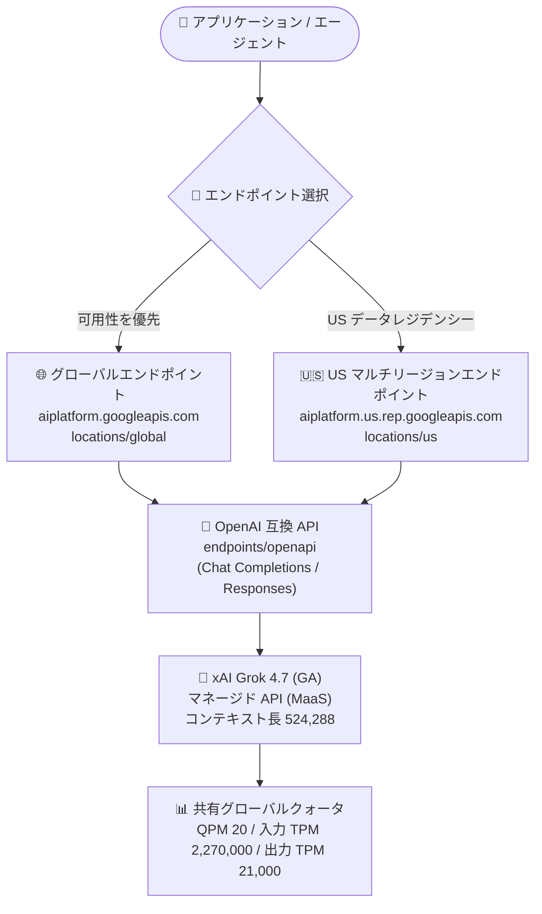

# Gemini Enterprise Agent Platform: xAI Grok 4.7 が一般提供 (GA) 開始

**リリース日**: 2026-10-27

**サービス**: Gemini Enterprise Agent Platform

**機能**: xAI Grok 4.7 の一般提供 (グローバルエンドポイントおよび US マルチリージョンエンドポイント)

**ステータス**: GA (一般提供)

📊 [このアップデートのインフォグラフィックを見る](https://takech9203.github.io/google-cloud-news-summary/20261027-grok-4-7-ga.html)

## 概要

xAI の Grok 4.7 (`grok-4.7`) が、Gemini Enterprise Agent Platform 上で一般提供 (GA) となり、グローバルエンドポイントと US マルチリージョンエンドポイントの両方で本番環境での利用が可能になりました。Grok 4.7 は、コーディングやナレッジワーク向けに構築された xAI の高性能モデルで、難易度の高いタスクに長く取り組み、自身の出力を検証する特性を持ちます。

Grok 4.7 は Gemini Enterprise Agent Platform のマネージド API (Model as a Service) として提供されるため、インフラの構築やモデルのホスティングを行うことなく、Google Cloud のエンドポイント経由で直接呼び出せます。テキストと画像の入力に対応し、Function calling、構造化出力、Reasoning をサポートします。コンテキスト長は 524,288 トークンです。

本番環境で Google Cloud の契約・課金・セキュリティ基盤のもとにサードパーティの最先端モデルを利用したい企業や、米国内でのデータレジデンシー要件 (US マルチリージョン) と高可用性 (グローバルエンドポイント) を使い分けたいユーザーが対象です。

**アップデート前の課題**

- GA 前の段階では、本番 (production) ワークロードでの利用を前提としたステータスではなく、SLA を求める企業利用には採用しにくかった
- 米国内にデータレジデンシーを維持しながら高可用性で Grok 4.7 を利用するための、本番利用可能なエンドポイント構成が明確でなかった

**アップデート後の改善**

- Grok 4.7 が GA となり、本番環境での利用が正式にサポートされた
- グローバルエンドポイント (`locations/global`) と US マルチリージョンエンドポイント (`aiplatform.us.rep.googleapis.com`) の両方で利用可能になり、可用性重視とデータレジデンシー重視の構成を選択できるようになった
- マネージド API として、OpenAI 互換の Chat Completions API / Responses API で即座に呼び出せる

## アーキテクチャ図



アプリケーションはグローバルエンドポイントまたは US マルチリージョンエンドポイントのいずれかを選択して、OpenAI 互換 API 経由でマネージドの Grok 4.7 を呼び出します。両エンドポイントへのリクエストは、ベースモデル単位の同一グローバルクォータを消費します。

## サービスアップデートの詳細

### 主要機能

1. **Grok 4.7 の一般提供 (GA)**
   - モデル ID: `grok-4.7`
   - 本番環境での利用が正式にサポートされるステータスに昇格
   - コーディングとナレッジワーク向けに構築され、難しいタスクに長時間取り組み、自身の成果物を検証する特性を持つ

2. **2 種類のエンドポイントでの提供**
   - **グローバルエンドポイント**: リクエストはモデルがサポートする任意のリージョンから処理され、全体的な可用性が向上しエラーが減少する
   - **US マルチリージョンエンドポイント**: 米国という広域ジオグラフィ内でデータレジデンシーを維持しながら、高可用性でモデルにアクセスできる (ML 処理は US マルチリージョン内)

3. **OpenAI 互換 API での呼び出し**
   - Grok モデルは OpenAI 互換の Chat Completions API と Responses API を使用
   - リクエストパスには `endpoints/openapi` を使用 (例: `https://aiplatform.us.rep.googleapis.com/v1/projects/PROJECT_ID/locations/us/endpoints/openapi/responses`)
   - Server-Sent Events (SSE) によるストリーミング応答に対応

## 技術仕様

### モデル仕様

| 項目 | 詳細 |
|------|------|
| モデル ID | `grok-4.7` |
| ローンチステージ | GA |
| 入力 | テキスト、画像 |
| 出力 | テキスト |
| コンテキスト長 | 524,288 トークン |
| サポートされる機能 | Function calling、構造化出力 (Structured output)、Reasoning |
| 未サポート | Batch predictions (Preview 機能のため対象外) |
| 利用タイプ | Fixed quota (サポート) / Standard pay-as-you-go・Provisioned Throughput (Preview 機能のため未サポート) |
| モデル提供場所 | US マルチリージョン、グローバルエンドポイント |
| ML 処理 | US マルチリージョン |

### クォータ (マルチリージョン / グローバルエンドポイント共通)

| 項目 | 値 |
|------|-----|
| QPM (1 分あたりのクエリ数) | 20 |
| 入力 TPM (1 分あたりの入力トークン数) | 2,270,000 |
| 出力 TPM (1 分あたりの出力トークン数) | 21,000 |

Grok モデルのクォータはエンドポイント単位ではなく、ベースモデル単位の単一グローバルクォータです。グローバルエンドポイントと US マルチリージョンエンドポイントへのリクエストは同じ上限を消費します。関連するクォータ名は以下のとおりです。

- `global_generate_content_requests_per_minute_per_project_per_base_model` (QPM)
- `global_generate_content_input_tokens_per_minute_per_base_model` (入力 TPM)
- `global_generate_content_output_tokens_per_minute_per_base_model` (出力 TPM)

## 設定方法

### 前提条件

1. Google Cloud プロジェクトで Gemini Enterprise Agent Platform を利用できること
2. Model Garden の Grok 4.7 モデルカードからモデルへのアクセスを有効化していること
3. 認証用のクレデンシャル (例: Application Default Credentials) が設定されていること

### 手順

#### ステップ 1: エンドポイントを選択する

```bash
# グローバルエンドポイントを使用する場合
export ENDPOINT="aiplatform.googleapis.com"
export LOCATION="global"

# US マルチリージョンエンドポイントを使用する場合 (US データレジデンシー)
# export ENDPOINT="aiplatform.us.rep.googleapis.com"
# export LOCATION="us"
```

可用性を最優先する場合はグローバルエンドポイント、米国内でのデータレジデンシーが必要な場合は US マルチリージョンエンドポイントを選択します。

#### ステップ 2: OpenAI 互換 API で Grok 4.7 を呼び出す

```bash
export PROJECT_ID="YOUR_PROJECT_ID"

curl -X POST \
  -H "Authorization: Bearer $(gcloud auth application-default print-access-token)" \
  -H "Content-Type: application/json" \
  "https://${ENDPOINT}/v1/projects/${PROJECT_ID}/locations/${LOCATION}/endpoints/openapi/responses" \
  -d '{
    "model": "grok-4.7",
    "input": "Why is the sky blue?"
  }'
```

Grok モデルは OpenAI 互換の Chat Completions API / Responses API を使用するため、リクエストパスには `endpoints/openapi` を指定します。ストリーミング応答 (SSE) を使用するとエンドユーザーの体感レイテンシを低減できます。

## メリット

### ビジネス面

- **本番利用の正式サポート**: GA ステータスにより、エンタープライズの本番ワークロードで Grok 4.7 を採用する際の信頼性が担保される
- **ベンダー選択肢の拡大**: Google Cloud の契約・課金・ガバナンスの枠組みの中で、Gemini、Anthropic Claude、Meta のモデルに加えて xAI の最新モデルを利用できる

### 技術面

- **可用性とデータレジデンシーの両立**: グローバルエンドポイントで可用性を高めるか、US マルチリージョンエンドポイントで米国内のデータレジデンシーを維持するかを選択できる
- **OpenAI 互換 API**: Chat Completions / Responses API 互換のため、既存の OpenAI 互換クライアントからの移行が容易
- **大規模コンテキスト**: 524,288 トークンのコンテキスト長により、大規模なコードベースや長文ドキュメントを扱える

## デメリット・制約事項

### 制限事項

- Batch predictions は未サポート (Preview 機能のため対象外)
- Standard pay-as-you-go および Provisioned Throughput は未サポート (Preview 機能)。利用タイプは Fixed quota のみサポート
- クォータはベースモデル単位の単一グローバルクォータであり、グローバルエンドポイントと US マルチリージョンエンドポイントで共有される (QPM 20、入力 TPM 2,270,000、出力 TPM 21,000)
- ML 処理は US マルチリージョンで行われる。EU マルチリージョンエンドポイントでは提供されていない

### 考慮すべき点

- xAI モデルは Google 製品ではなく、Service Specific Terms の「Separate Offerings」条項およびモデルカードに記載された別途の規約が適用される
- サービス性能維持のため、最大クォータはアカウントによって異なる場合があり、場合によってはアクセスが制限されることがある
- グローバルエンドポイントの使用を制限したい場合は、組織ポリシー制約 `constraints/gcp.restrictEndpointUsage` でブロックできる

## ユースケース

### ユースケース 1: コーディングエージェントのバックエンドモデル

**シナリオ**: 大規模コードベースを対象としたコード生成・レビューエージェントを構築する。難しいタスクに時間をかけて取り組み、自身の成果物を検証する Grok 4.7 の特性と、524,288 トークンのコンテキスト長を活用する。

**実装例**:
```bash
curl -X POST \
  -H "Authorization: Bearer $(gcloud auth application-default print-access-token)" \
  -H "Content-Type: application/json" \
  "https://aiplatform.googleapis.com/v1/projects/${PROJECT_ID}/locations/global/endpoints/openapi/responses" \
  -d '{
    "model": "grok-4.7",
    "input": "このリポジトリのコードをレビューし、改善点を構造化して出力してください。..."
  }'
```

**効果**: Function calling と構造化出力により、ツール呼び出しを伴うエージェントワークフローや、後続処理で扱いやすい JSON 形式の出力を本番品質で実現できる。

### ユースケース 2: 米国内データレジデンシー要件のあるナレッジワーク支援

**シナリオ**: 米国内でのデータ処理が求められる企業が、社内ドキュメントの分析・要約・調査支援に Grok 4.7 を利用する。US マルチリージョンエンドポイント (`aiplatform.us.rep.googleapis.com`) を使用し、ML 処理を US マルチリージョン内に維持する。

**効果**: データレジデンシー要件を満たしながら、単一リージョン障害の影響を受けにくい高可用性構成で最先端モデルを利用できる。

## 料金

Grok 4.7 の料金は Gemini Enterprise Agent Platform の生成 AI 料金ページに記載されています。エンドポイントタイプ (グローバル / マルチリージョン) によって料金が異なる場合があります。詳細は公式料金ページを参照してください。

- [Gemini Enterprise Agent Platform Generative AI Pricing](https://cloud.google.com/gemini-enterprise-agent-platform/generative-ai/pricing)

## 利用可能リージョン

| エンドポイント | 詳細 |
|---------------|------|
| グローバルエンドポイント | `aiplatform.googleapis.com` / `locations/global` |
| US マルチリージョンエンドポイント | `aiplatform.us.rep.googleapis.com` / `locations/us` |

ML 処理は US マルチリージョンで行われます。EU マルチリージョンエンドポイントでは Grok 4.7 は提供されていません (EU マルチリージョンは Anthropic Claude モデル向け)。

## 関連サービス・機能

- **Model Garden**: Grok 4.7 のモデルカードが公開されており、モデルへのアクセス有効化の入口となる
- **xAI Grok モデルファミリー**: Grok 4.6 (GA)、Grok 4.3 (Preview)、Grok 4.20 Reasoning / Non-reasoning (Preview) も同プラットフォームでマネージド API として利用可能
- **パートナーモデル (Anthropic Claude、Meta など)**: 同様にグローバル / マルチリージョンエンドポイントで提供され、用途に応じたモデル選択が可能
- **組織ポリシー (`constraints/gcp.restrictEndpointUsage`)**: グローバル API エンドポイントの利用を組織レベルで制限し、リージョナル / マルチリージョンエンドポイントの使用を強制できる

## 参考リンク

- 📊 [インフォグラフィック](https://takech9203.github.io/google-cloud-news-summary/20261027-grok-4-7-ga.html)
- [公式リリースノート](https://cloud.google.com/release-notes)
- [Grok 4.7 モデルドキュメント](https://docs.cloud.google.com/gemini-enterprise-agent-platform/models/partner-models/grok/grok-4-7)
- [xAI Grok モデル一覧](https://docs.cloud.google.com/gemini-enterprise-agent-platform/models/partner-models/grok)
- [パートナーモデルの利用 (エンドポイント解説)](https://docs.cloud.google.com/gemini-enterprise-agent-platform/models/partner-models/use-partner-models)
- [料金ページ](https://cloud.google.com/gemini-enterprise-agent-platform/generative-ai/pricing)

## まとめ

xAI Grok 4.7 が Gemini Enterprise Agent Platform で GA となり、グローバルエンドポイントと US マルチリージョンエンドポイントの両方で本番利用が可能になりました。コーディングやナレッジワーク向けの高性能モデルを、可用性重視またはデータレジデンシー重視の構成で選択できます。サードパーティモデルの採用を検討している場合は、Model Garden のモデルカードからアクセスを有効化し、OpenAI 互換 API での検証から始めることを推奨します。

---

**タグ**: Gemini Enterprise Agent Platform, xAI, Grok 4.7, GA, Model Garden, MaaS, グローバルエンドポイント, マルチリージョン, 生成AI
