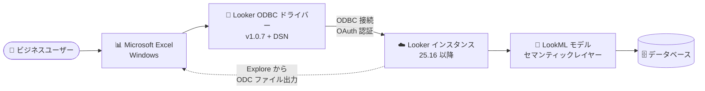

# Looker: Looker-Excel Connector ODBC ドライバー バージョン 1.0.7 リリース

**リリース日**: 2026-10-27

**サービス**: Looker

**機能**: Looker-Excel Connector ODBC ドライバー 1.0.7

**ステータス**: Feature (新バージョン提供開始)

📊 [このアップデートのインフォグラフィックを見る](https://takech9203.github.io/google-cloud-news-summary/20261027-looker-excel-connector-odbc-1-0-7.html)

## 概要

Looker-Excel Connector で使用する ODBC ドライバーの最新バージョン 1.0.7 がダウンロード可能になりました。Looker-Excel Connector は、Looker の Explore で作成したクエリを Microsoft Excel が認識できる形式 (ODC ファイル) としてエクスポートし、Windows 版 Excel から Looker のガバナンスが効いたデータに直接アクセスできるようにする機能です。

ODBC ドライバーは Looker-Excel Connector を利用する各ユーザーのローカルマシンにインストールするソフトウェアで、ODBC 互換クライアント (Excel など) から Looker インスタンスをあたかも SQL データベースのように扱えるようにします。Excel で日常的にデータ分析を行うビジネスユーザーが、Looker のセマンティックレイヤーを経由した一貫性のあるデータを Excel 上で利用するための基盤コンポーネントです。

なお、バージョン 1.0.7 での個別の変更点 (修正内容・改善点) は Release Notes には記載されていないため、詳細は [Looker-Excel Connector のドキュメント](https://docs.cloud.google.com/looker/docs/excel-connector) を参照してください。

## アーキテクチャ図

Excel は、ローカルにインストールした ODBC ドライバーと DSN を介して Looker インスタンスに接続し、Explore からエクスポートした ODC ファイルを開くことで LookML モデル経由のデータを取得します。

## サービスアップデートの詳細

### 主要機能

1. **ODBC ドライバー 1.0.7 の提供開始**
   - Looker-Excel Connector 用 ODBC ドライバーの最新バージョンがダウンロード可能になった
   - Windows 64-bit / 32-bit の両アーキテクチャ向けインストーラーが提供される

2. **Looker-Excel Connector の役割 (再掲)**
   - Explore のギアメニューに表示される「Open in Excel」オプションから、クエリを ODC ファイルとしてエクスポート
   - ODBC ドライバーがインストールされていれば、ODC ファイルを Windows 版 Excel で直接開ける
   - 初回オープン時に DSN (Data Source Name) を作成し、Looker インスタンス情報と認証資格情報を保存する

## 技術仕様

### 利用要件

| 項目 | 詳細 |
|------|------|
| クライアント OS | Windows (64-bit または 32-bit) |
| Looker バージョン | 25.16 以降 |
| インスタンス設定 | Microsoft Excel BI コネクタの有効化 (Admin > BI Connectors、または Manage OAuth Clients の Application Library) |
| ユーザー権限 | 対象 LookML モデルに対する `explore` 権限を含むユーザーロール |
| 前提ソフトウェア | ODBC マネージャー (Windows 標準の「ODBC データソース」) |

## 設定方法

### 手順

#### ステップ 1: ODBC ドライバー 1.0.7 のダウンロードとインストール

[Looker-Excel Connector ドキュメント](https://docs.cloud.google.com/looker/docs/excel-connector#install-driver) から、使用する Windows のアーキテクチャ (64-bit / 32-bit) に対応した最新インストーラーをダウンロードし、画面の指示に従ってインストールします。「Windows によって PC が保護されました」ダイアログが表示された場合は「詳細情報」→「実行」を選択します。

#### ステップ 2: DSN の作成

インストール後、初めて ODC ファイルを開くと、Windows が DSN の作成を求めます。DSN には Looker インスタンス情報と認証資格情報が保存され、以降 Excel などの ODBC クライアントから再利用できます。

## メリット

### ビジネス面

- **使い慣れた Excel での分析**: ビジネスユーザーが Looker のガバナンスされたデータを Excel 上でそのまま活用できる
- **データの一貫性**: LookML モデル (セマンティックレイヤー) を経由するため、CSV エクスポートのような手作業に比べて指標定義のブレが起きにくい

### 技術面

- **最新ドライバーの利用**: 最新バージョン 1.0.7 を利用することで、ドライバーの修正・改善を取り込める
- **標準 ODBC インターフェース**: Looker インスタンスを SQL データベースのように扱えるため、Windows 標準の ODBC 管理ツールで構成できる

## デメリット・制約事項

### 制限事項

- Windows PC 専用 (macOS は対象外)
- Looker 25.16 以降のインスタンスが必要
- 利用者ごとにローカルマシンへのドライバーインストールが必要

### 考慮すべき点

- Looker 管理者による Microsoft Excel BI コネクタの有効化が前提
- 1.0.7 の個別の変更内容は Release Notes に記載がないため、更新前にドキュメントで最新情報を確認することを推奨

## 関連サービス・機能

- **Looker BI Connectors**: Excel 以外にも各種 BI ツールとの接続を管理する Looker の設定機能
- **LookML モデル**: ODBC 経由のアクセスでもセマンティックレイヤーとして機能し、指標定義の一貫性を担保

## 参考リンク

- 📊 [インフォグラフィック](https://takech9203.github.io/google-cloud-news-summary/20261027-looker-excel-connector-odbc-1-0-7.html)
- [公式リリースノート](https://docs.cloud.google.com/release-notes#October_27_2026)
- [Looker-Excel Connector ドキュメント](https://docs.cloud.google.com/looker/docs/excel-connector)
- [Looker BI Connectors ドキュメント](https://docs.cloud.google.com/looker/docs/bi-connectors)

## まとめ

Looker-Excel Connector 用 ODBC ドライバーの最新バージョン 1.0.7 が提供開始されました。Looker-Excel Connector を利用している組織は、各ユーザーのローカル環境のドライバーを最新版へ更新することを推奨します。更新手順と最新のダウンロードリンクは公式ドキュメントを参照してください。

---

**タグ**: Looker, Excel, ODBC, BI Connector, Windows
