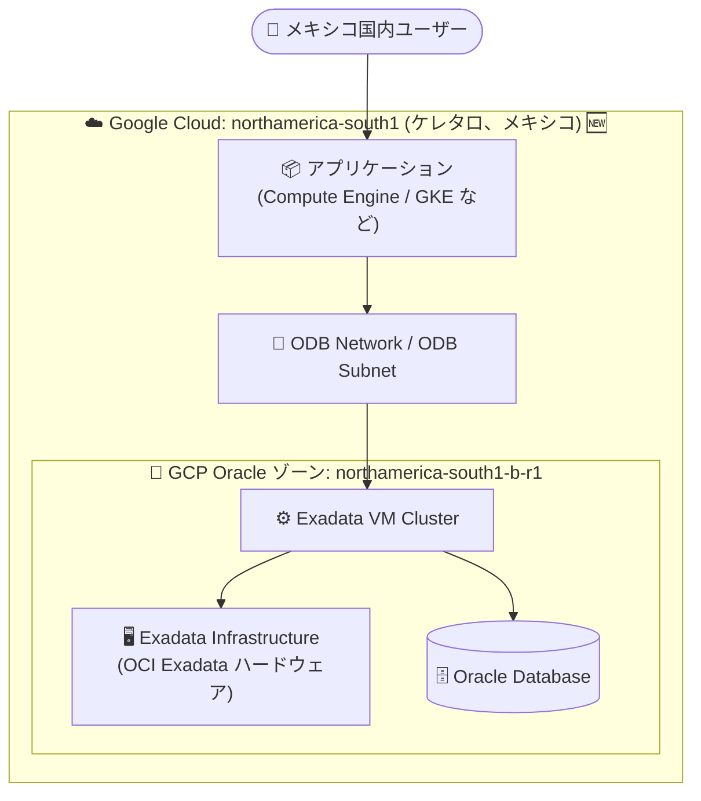

# Oracle Database@Google Cloud: Exadata Database Service が northamerica-south1 (ケレタロ、メキシコ) リージョンで利用可能に

**リリース日**: 2026-10-27

**サービス**: Oracle Database@Google Cloud

**機能**: Exadata Database Service の northamerica-south1 (Querétaro, Mexico) リージョン対応

**ステータス**: Feature (リージョン拡張)

📊 [このアップデートのインフォグラフィックを見る](https://takech9203.github.io/google-cloud-news-summary/20261027-oracle-database-google-cloud-queretaro-region.html)

## 概要

Oracle Database@Google Cloud の Exadata Database Service が、新たに northamerica-south1 (ケレタロ、メキシコ) リージョンで利用可能になりました。公式ドキュメントのリージョン一覧には、ゾーン `northamerica-south1-b-r1` が Exadata Database Service の対応ゾーンとして追加されています。

Oracle Database@Google Cloud は、Google と Oracle のパートナーシップにより、Google Cloud のデータセンター内に設置された OCI (Oracle Cloud Infrastructure) の Exadata ハードウェア上で Oracle Database サービスを稼働させるサービスです。ワークロードは Google Cloud 内に配置され、Exadata システムとの間を最小限のレイテンシで接続できます。Google Cloud がコアインフラ、ネットワーク、物理・ネットワークセキュリティ、ハードウェアモニタリングを提供します。

今回のリージョン追加により、メキシコ国内にデータを配置する必要がある企業 (データレジデンシー要件を持つ金融・公共系ワークロードなど) や、メキシコおよび中南米のユーザーに近い場所で Oracle データベースを低レイテンシで提供したい企業が、Exadata Database Service を利用できるようになります。

**アップデート前の課題**

- 北米エリアで Exadata Database Service を利用できるリージョンは、カナダ (モントリオール、トロント) と米国 (アイオワ、北バージニア、ソルトレイクシティ) に限られており、メキシコ国内のリージョンは選択できなかった
- メキシコにデータレジデンシー要件があるワークロードは、Oracle Database@Google Cloud の Exadata Database Service を国内リージョンで展開できなかった
- メキシコ国内のアプリケーションからは、国外リージョンのデータベースへのアクセスによるレイテンシが発生していた

**アップデート後の改善**

- northamerica-south1 (ケレタロ、メキシコ) リージョンのゾーン `northamerica-south1-b-r1` で Exadata Infrastructure および Exadata VM Cluster を作成できるようになった
- メキシコ国内にデータを保持したまま Oracle Database ワークロードを Google Cloud 上で稼働できるようになった
- メキシコ国内のアプリケーションと同一リージョンにデータベースを配置でき、レイテンシを低減できるようになった

## アーキテクチャ図

northamerica-south1 リージョンに新設された GCP Oracle ゾーン内に Exadata Infrastructure と Exadata VM Cluster を作成し、同一リージョンのアプリケーションから ODB Network 経由で低レイテンシにアクセスする構成です。

## サービスアップデートの詳細

### 主要機能

1. **northamerica-south1 リージョンでの Exadata Database Service 提供開始**
   - ゾーン `northamerica-south1-b-r1` で Exadata Infrastructure インスタンスと Exadata VM Cluster を作成可能
   - Google Cloud コンソール、gcloud CLI、Oracle Database@Google Cloud API から管理可能

2. **継続的なリージョン拡張の一環**
   - Oracle Database@Google Cloud は 2025 年以降、東京・大阪・ムンバイ・シドニー・サンパウロ・ロンドンなど世界各地へリージョンを継続的に拡大中
   - 今回のケレタロ追加により、Exadata Database Service はメキシコを含む北米 6 リージョンで利用可能に

## 技術仕様

### Exadata Database Service のリソースとスコープ

| 項目 | 詳細 |
|------|------|
| 新規対応リージョン | northamerica-south1 (Querétaro, Mexico) |
| 新規対応ゾーン | northamerica-south1-b-r1 |
| ゾーンリソース | Exadata Infrastructure、Exadata VM Cluster、ODB Network / ODB Subnet |
| 配置の制約 | ODB Network、Exadata Infrastructure、Exadata VM Cluster は同一リージョン・同一ゾーンに作成する必要がある |
| リージョン/ゾーンの選択 | Exadata Infrastructure 作成時に選択。作成後の変更は不可 |

### Exadata Database Service 対応リージョン (北米、2026-10-27 時点)

| リージョン | ロケーション | ゾーン |
|------|------|------|
| northamerica-northeast1 | モントリオール、カナダ | northamerica-northeast1-a-r1 |
| northamerica-northeast2 | トロント、カナダ | northamerica-northeast2-a-r2 |
| **northamerica-south1** 🆕 | **ケレタロ、メキシコ** | **northamerica-south1-b-r1** |
| us-central1 | アイオワ | us-central1-a-r1 |
| us-east4 | 北バージニア | us-east4-a-r2, us-east4-b-r1 |
| us-west3 | ソルトレイクシティ | us-west3-a-r1 |

## 設定方法

### 前提条件

1. Oracle Database@Google Cloud の利用開始 (注文/購入) 手続きが完了していること ([Purchase and billing](https://docs.cloud.google.com/oracle/database/docs/purchase-and-billing) を参照)
2. northamerica-south1 リージョンのゾーン `northamerica-south1-b-r1` に ODB Network / ODB Subnet を作成済みであること (ネットワーク設定の詳細は[公式ドキュメント](https://docs.cloud.google.com/oracle/database/docs/configure-vpc)を参照)

### 手順

#### ステップ 1: Exadata Infrastructure インスタンスの作成

1. Google Cloud コンソールで「Exadata Database Service」ページに移動
2. 「Exadata Infrastructure」セクションで「作成」をクリック
3. インスタンスの詳細で、Region に `northamerica-south1`、GCP Oracle ゾーンに `northamerica-south1-b-r1` を選択 (リージョン/ゾーンの選択は作成後に変更不可)
4. マシン構成 (Exadata Infrastructure モデル、データベースサーバー数、ストレージサーバー数) とメンテナンス設定を指定して作成

なお、利用可能なマシン構成は選択したリージョン・ゾーンによって異なる場合があります。

#### ステップ 2: Exadata VM Cluster の作成

ODB Network および Exadata Infrastructure と同一リージョン・ゾーンに Exadata VM Cluster を作成します。Exadata Database 自体の作成は OCI 側で行います。

## メリット

### ビジネス面

- **データレジデンシー対応**: メキシコ国内にデータを保持する要件のあるワークロードを、Google Cloud 上の Oracle Database で実現できる
- **中南米市場への展開**: メキシコおよび周辺地域のユーザーに近い場所でサービスを提供でき、ユーザー体験を向上できる

### 技術面

- **低レイテンシ**: 同一リージョン内のアプリケーション (Compute Engine、GKE など) からデータベースへ最小限のレイテンシでアクセス可能
- **統合管理**: Google Cloud コンソール、gcloud CLI、API から Exadata リソースを作成・管理でき、IAM によるアクセス制御や Cloud Monitoring/Logging による監視と統合される

## デメリット・制約事項

### 制限事項

- 本リージョン追加の対象は Exadata Database Service であり、公式ドキュメントのリージョン一覧 (確認時点) では、Base Database Service、Exadata Database Service on Exascale Infrastructure、Autonomous AI Database Service、Goldengate は northamerica-south1 に記載されていない
- Exadata Database Service 用のゾーンは `northamerica-south1-b-r1` の 1 ゾーンのみ

### 考慮すべき点

- Exadata Infrastructure のリージョン/ゾーン選択は作成後に変更できないため、配置計画を事前に確定させる必要がある
- ODB Network、Exadata Infrastructure、Exadata VM Cluster は同一リージョン・同一ゾーンに作成する必要がある
- 利用可能なマシン構成 (Exadata Infrastructure モデルなど) はリージョン・ゾーンにより異なる場合がある

## ユースケース

### ユースケース 1: メキシコ国内のデータレジデンシー要件への対応

**シナリオ**: メキシコの金融機関が、顧客データを国内に保持する要件のもとで、オンプレミスの Oracle Database (Exadata) を Google Cloud に移行したい。

**効果**: northamerica-south1 リージョンに Exadata Infrastructure を配置することで、データを国内に保持したまま、Google Cloud のインフラ・ネットワーク・セキュリティ・監視機能を活用した運用に移行できる。

### ユースケース 2: メキシコ国内アプリケーションの低レイテンシ化

**シナリオ**: メキシコ国内ユーザー向けのアプリケーションを northamerica-south1 の Compute Engine / GKE で稼働させており、データベースだけが国外リージョンにあるためレイテンシが課題になっている。

**効果**: アプリケーションと同一リージョンに Exadata VM Cluster を配置し、ODB Network 経由で接続することで、データベースアクセスのレイテンシを低減できる。

## 料金

Oracle Database@Google Cloud の料金は、注文 (購入) 手続きに基づいて課金されます。詳細は公式の購入・課金ドキュメントを参照してください。

- [Purchase and billing](https://docs.cloud.google.com/oracle/database/docs/purchase-and-billing)

## 利用可能リージョン

Exadata Database Service は、今回追加された northamerica-south1 (ケレタロ、メキシコ) を含め、東京、大阪、シドニー、メルボルン、ムンバイ、デリー、モントリオール、トロント、アイオワ、北バージニア、ソルトレイクシティ、サンパウロ、ロンドン、フランクフルト、ミラノ、トリノの各リージョンで利用可能です (確認時点)。

最新の対応リージョン・ゾーンは公式ドキュメントを参照してください。

- [Supported regions and zones](https://docs.cloud.google.com/oracle/database/docs/regions-and-zones)

## 関連サービス・機能

- **ODB Network / ODB Subnet**: Oracle Database@Google Cloud リソースへの接続を管理するネットワークリソース。Exadata リソースと同一リージョン・ゾーンに作成する
- **Identity and Access Management (IAM)**: Exadata Infrastructure などへのユーザー・グループのアクセス管理に統合利用
- **Cloud Monitoring / Cloud Logging**: Oracle Database@Google Cloud リソースのメトリクスとログによる監視・トラブルシューティング
- **Compute Engine / GKE**: 同一リージョンに配置するアプリケーション実行基盤として組み合わせて利用

## 参考リンク

- 📊 [インフォグラフィック](https://takech9203.github.io/google-cloud-news-summary/20261027-oracle-database-google-cloud-queretaro-region.html)
- [公式リリースノート](https://docs.cloud.google.com/oracle/database/docs/release-notes)
- [Supported regions and zones](https://docs.cloud.google.com/oracle/database/docs/regions-and-zones)
- [Oracle Database@Google Cloud 概要](https://docs.cloud.google.com/oracle/database/docs/overview)
- [Exadata Infrastructure インスタンスの作成](https://docs.cloud.google.com/oracle/database/docs/create-instances)
- [Purchase and billing](https://docs.cloud.google.com/oracle/database/docs/purchase-and-billing)

## まとめ

Oracle Database@Google Cloud の Exadata Database Service がメキシコのケレタロ (northamerica-south1) リージョンに対応し、メキシコ国内でのデータレジデンシー要件への対応や、国内アプリケーションからの低レイテンシなデータベースアクセスが可能になりました。メキシコ・中南米向けに Oracle ワークロードの Google Cloud 移行を検討している場合は、公式ドキュメントで対応ゾーン (`northamerica-south1-b-r1`) と利用可能なマシン構成を確認のうえ、配置計画を検討することを推奨します。

---

**タグ**: Oracle Database@Google Cloud, Exadata Database Service, リージョン拡張, northamerica-south1, メキシコ, データレジデンシー
