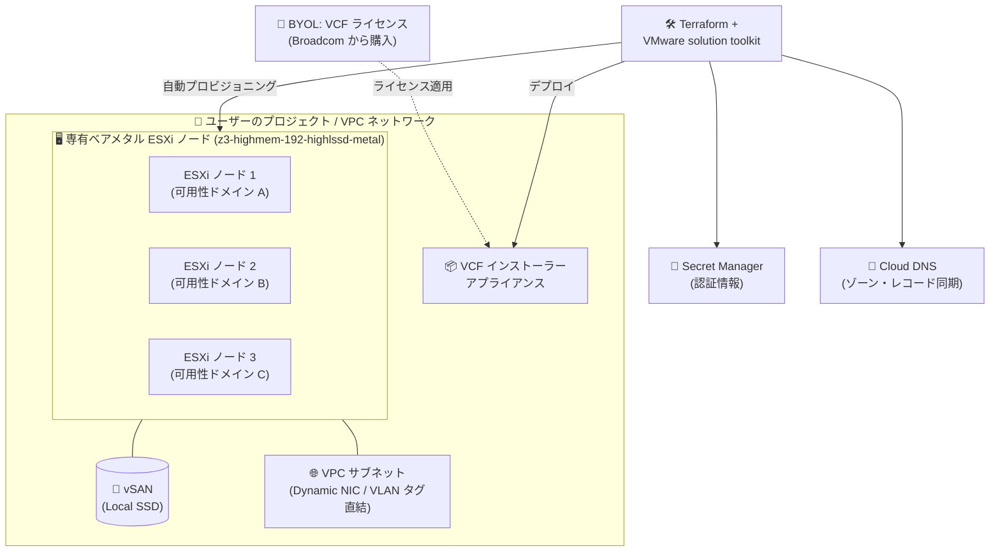

# Google Cloud VMware Engine: VMware solution on Google Cloud が一般提供 (GA)

**リリース日**: 2026-10-27

**サービス**: Google Cloud VMware Engine

**機能**: VMware solution on Google Cloud (ベアメタル Compute Engine 上の VMware Cloud Foundation / BYOL)

**ステータス**: GA (一般提供)

📊 [このアップデートのインフォグラフィックを見る](https://takech9203.github.io/google-cloud-news-summary/20261027-vmware-engine-vmware-solution-ga.html)

## 概要

VMware solution on Google Cloud が一般提供 (GA) になりました。VMware solution は、ユーザー自身の VPC ネットワーク内にある専有ベアメタル Compute Engine インスタンス上で、VMware Cloud Foundation (VCF) をデプロイ・構成・管理できる新しいモデルです。ライセンスは Bring Your Own License (BYOL) モデルを採用しており、Broadcom から購入した VCF サブスクリプションを持ち込んで利用します。

従来のマネージド型 VMware Engine (プライベートクラウド) とは異なり、VMware solution では専有ベアメタル ESXi ノード (`z3-highmem-192-highlssd-metal`) をユーザー自身のプロジェクト内に直接プロビジョニングします。ノード準備から VCF インストーラーアプライアンスのデプロイまでを Terraform と VMware solution toolkit で自動化できるため、Infrastructure as Code による再現性の高い VCF 環境構築が可能です。

このアップデートは、Broadcom のライセンスモデル変更 (2025 年 10 月以降、VMware Engine の VCF ライセンス込みノードの新規販売終了、BYOL への移行) を背景に、VCF サブスクリプションを自社で保有する企業が Google Cloud 上で VMware 環境をより直接的にコントロールしたいケースに応えるものです。今後の VMware solution のリリースノートは、専用の VMware solution リリースノートページで公開されます。

**アップデート前の課題**

- Broadcom のライセンスモデル変更により、2025 年 10 月 15 日以降 Google Cloud は VCF ライセンス込みの VMware Engine ノードを新規販売できなくなり、BYOL を前提としたデプロイモデルの選択肢が求められていた
- 従来の VMware Engine プライベートクラウドは Google 管理のインフラ上で動作するため、ESXi ノードをユーザー自身のプロジェクト・VPC 内に直接配置して管理する構成は選択できなかった
- VMware Engine 環境と VPC 内の Google Cloud サービスとの接続にはプライベートサービスアクセスなどの構成が関係し、ネットワーク設計に考慮が必要だった

**アップデート後の改善**

- 専有ベアメタル ESXi ノード (`z3-highmem-192-highlssd-metal`) を、削除保護と vSAN 用 Local SSD ストレージ付きでユーザー自身のプロジェクト内に直接プロビジョニングできるようになった
- ノード準備、Secret Manager への認証情報保存、vSwitch と Dynamic NIC のネットワーキング、Cloud DNS ゾーン・レコード同期、vSAN ストレージ初期化、VCF インストーラーアプライアンスのデプロイを、Terraform と VMware solution toolkit で自動化できるようになった
- vSAN フォールトドメインに対応したスプレッドプレースメントポリシーにより、ノードを分離されたアベイラビリティドメインに分散配置して高可用性を確保できるようになった
- ESXi ノードと VLAN タグ付き Dynamic NIC を、プライベートサービスアクセスのピアリングなしで VPC サブネットに直接接続できるようになった

## アーキテクチャ図

Terraform と VMware solution toolkit がユーザーのプロジェクト内に専有ベアメタル ESXi ノードをプロビジョニングし、Secret Manager・Cloud DNS と連携しながら vSAN と VCF インストーラーアプライアンスを自動構成します。ノードはスプレッドプレースメントポリシーで複数の可用性ドメインに分散され、VPC サブネットに直接接続されます。

## サービスアップデートの詳細

### 主要機能

1. **専有ベアメタル ESXi ノードの直接プロビジョニング**
   - `z3-highmem-192-highlssd-metal` ベアメタルインスタンスをユーザー自身のプロジェクト内に直接プロビジョニング
   - 削除保護 (deletion protection) と、vSAN 用の Local SSD ストレージを備える

2. **Terraform と VMware solution toolkit による自動化**
   - ノード準備、Secret Manager への認証情報保存、vSwitch と Dynamic NIC のネットワーキング構成を自動化
   - Cloud DNS ゾーン・レコードの同期、vSAN ストレージの初期化、VCF インストーラーアプライアンスのデプロイまでを自動化

3. **可用性ドメインをまたいだ高可用性構成**
   - スプレッドプレースメントポリシーを使用して、ノードを分離されたアベイラビリティドメインに分散配置
   - 配置は vSAN フォールトドメインと整合しており、ローカライズされた障害の影響を最小化

4. **VPC サブネットへの直接接続**
   - ESXi ノードと VLAN タグ付き Dynamic NIC を VPC サブネットに直接接続
   - プライベートサービスアクセスのピアリングが不要

5. **BYOL (Bring Your Own License) モデル**
   - Broadcom から購入した VCF サブスクリプションを持ち込んで利用
   - VMware Engine の BYOL ライセンス管理 (2026 年 10 月 1 日 GA) では、Cloud Billing アカウントレベルでポータブル VCF ライセンスキーを登録・管理可能

## 技術仕様

### ベアメタルノード (z3-highmem-192-highlssd-metal)

Compute Engine のストレージ最適化 Z3 ファミリーのベアメタルマシンタイプを使用します。

| 項目 | 詳細 |
|------|------|
| マシンタイプ | `z3-highmem-192-highlssd-metal` (ベアメタル) |
| ストレージ | Local SSD (vSAN 用)、Hyperdisk 最大 32 ボリューム (Hyperdisk Balanced 16 / Hyperdisk Extreme 16) |
| ネットワークドライバ | Intel IDPF LAN PF デバイスドライバ (Z3 ベアメタルインスタンスの要件) |
| ネットワーク帯域 | Z3 は標準で最大 100 Gbps、Tier_1 ネットワーキングで最大 200 Gbps |
| 配置 | スプレッドプレースメントポリシーで最大 8 つのアベイラビリティドメインに分散可能 (Compute Engine の仕様) |

### 従来モデルとの比較 (Compare VMware Engine models)

| 観点 | VMware Engine (プライベートクラウド) | VMware solution (今回 GA) |
|------|-------------------------------------|---------------------------|
| インフラ管理 | Google がベアメタルインフラと VMware プラットフォームのデプロイ・運用を管理 | ユーザーが自身のプロジェクト内のベアメタルノード上で VCF をデプロイ・構成・管理 |
| ノード配置 | Google 管理環境のプライベートクラウド | ユーザーのプロジェクト / VPC 内の専有ベアメタル Compute Engine インスタンス |
| ネットワーク接続 | VPC との間はネイティブ VPC ネットワーキング経由 | ESXi ノードと Dynamic NIC を VPC サブネットに直接接続 (プライベートサービスアクセス ピアリング不要) |
| ライセンス | BYOL (2025 年 10 月 15 日以降、ライセンス込みノードの新規販売は終了) | BYOL (Broadcom から購入した VCF サブスクリプション) |
| 自動化 | コンソール / API によるプライベートクラウド作成 | Terraform + VMware solution toolkit |

詳細は公式ドキュメントの「Compare VMware Engine models」を参照してください。

## 設定方法

### 前提条件

1. Broadcom (または認定リセラー) から購入した VMware Cloud Foundation (VCF) サブスクリプション (BYOL)
2. ベアメタルノードを配置する Google Cloud プロジェクトと VPC ネットワーク
3. Terraform と VMware solution toolkit の実行環境

### 手順の概要

リリースノートに記載されたデプロイフローの概要は以下のとおりです。詳細な手順は公式ドキュメント「VMware solution on Google Cloud overview」を参照してください。

#### ステップ 1: ベアメタル ESXi ノードのプロビジョニング

`z3-highmem-192-highlssd-metal` ノードを、削除保護と vSAN 用 Local SSD 付きでプロジェクト内にプロビジョニングします。スプレッドプレースメントポリシーを適用し、vSAN フォールトドメインに合わせてノードを複数の可用性ドメインに分散配置します。

#### ステップ 2: Terraform + VMware solution toolkit による自動構成

Terraform と VMware solution toolkit を使用して、以下を自動化します。

- ノード準備
- Secret Manager への認証情報の保存
- vSwitch と Dynamic NIC のネットワーキング構成
- Cloud DNS ゾーンとレコードの同期
- vSAN ストレージの初期化
- VCF インストーラーアプライアンスのデプロイ

#### ステップ 3: VCF のインストールと VPC 接続

デプロイされた VCF インストーラーアプライアンスを使用して VCF をインストールします。ESXi ノードと VLAN タグ付き Dynamic NIC は、プライベートサービスアクセスのピアリングなしで VPC サブネットに直接接続されます。

## メリット

### ビジネス面

- **BYOL によるライセンス投資の活用**: Broadcom から購入済みの VCF サブスクリプションを Google Cloud 上でそのまま活用でき、ライセンスモデル変更後の移行パスが明確になる
- **既存の VMware 運用資産の継続利用**: VCF ベースの運用スキル・プロセスを維持しながら、Google Cloud のインフラとサービスを利用できる

### 技術面

- **Infrastructure as Code による再現性**: Terraform と toolkit によりノード準備から VCF インストーラーデプロイまでを自動化でき、環境構築の再現性と効率が向上する
- **自プロジェクト内での直接コントロール**: ESXi ノードがユーザーのプロジェクト / VPC 内に存在するため、Secret Manager、Cloud DNS などの Google Cloud サービスと直接統合できる
- **シンプルなネットワーク構成**: プライベートサービスアクセスのピアリングが不要で、VPC サブネットへ直接接続できる
- **高可用性設計**: スプレッドプレースメントポリシーと vSAN フォールトドメインの整合により、ハードウェア障害の影響範囲を限定できる

## デメリット・制約事項

### 考慮すべき点

- BYOL モデルのため、VCF ライセンスは Broadcom (または認定リセラー) から別途購入する必要がある
- 従来のマネージド型 VMware Engine プライベートクラウドとは異なり、VCF のデプロイ・構成・管理はユーザー自身の責任範囲となる (運用体制の検討が必要)
- 使用できるノードタイプはリリースノート上では `z3-highmem-192-highlssd-metal` が示されており、要件に応じたサイジングは公式ドキュメントで確認が必要
- どちらのモデルが適するかは「Compare VMware Engine models」ドキュメントで比較・検討することが推奨される

## ユースケース

### ユースケース 1: Broadcom ライセンスモデル変更後の VCF 環境新規構築

**シナリオ**: VCF サブスクリプションを Broadcom から直接購入している企業が、オンプレミス VMware 環境の拡張先・移行先として Google Cloud 上に新規 VCF 環境を構築する。

**効果**: 保有する VCF ライセンスを BYOL で活用しつつ、Terraform による自動化で VCF 環境を再現性高く構築できる。ノードは自社プロジェクト内にあるため、ガバナンスやネットワークポリシーを自社の VPC 設計に沿って適用できる。

### ユースケース 2: VPC ネイティブな VMware ワークロードと Google Cloud サービスの統合

**シナリオ**: VMware 上のワークロードから Cloud DNS、Secret Manager などの Google Cloud サービスを密に利用したいが、プライベートサービスアクセスのピアリング設計を避けたい。

**効果**: ESXi ノードと Dynamic NIC が VPC サブネットに直接接続されるため、ピアリングを介さずシンプルなネットワーク構成で Google Cloud サービスと統合できる。

## 料金

VMware solution は BYOL モデルのため、VCF ライセンス費用は Broadcom から購入するサブスクリプションに基づきます。Google Cloud 側の費用は、専有ベアメタル Compute Engine インスタンス (`z3-highmem-192-highlssd-metal`) や関連リソース (ネットワーク、Cloud DNS、Secret Manager など) の利用料金が発生します。具体的な料金は以下の公式ページを参照してください。

- [Compute Engine の料金](https://cloud.google.com/compute/all-pricing)
- [VMware Engine の料金](https://docs.cloud.google.com/vmware-engine/pricing)

なお、VMware Engine の BYOL ライセンスは Cloud Billing アカウントレベルで管理され、ノードの CPU コア容量に対して適用されます (Google Cloud インフラ利用料、ストレージ・バックアップ、IP アドレス・アウトバウンド転送などには適用されません)。

## 利用可能リージョン

リリースノートには GA 時点の対応リージョンの記載がありません。最新の提供状況は公式ドキュメント「VMware solution on Google Cloud overview」を参照してください。

## 関連サービス・機能

- **Compute Engine (Z3 ベアメタルインスタンス)**: `z3-highmem-192-highlssd-metal` が ESXi ノードの基盤。Local SSD、Hyperdisk、最大 200 Gbps (Tier_1) のネットワーク帯域をサポート
- **スプレッドプレースメントポリシー**: インスタンスを分離されたアベイラビリティドメイン (最大 8 つ) に分散し、局所的障害の影響を低減。vSAN フォールトドメインと整合させて利用
- **Secret Manager**: VCF 環境の認証情報を安全に保存
- **Cloud DNS**: VCF 環境の DNS ゾーンとレコードを同期
- **VMware Engine (プライベートクラウド)**: Google がインフラを管理する従来のマネージドモデル。要件に応じて VMware solution と使い分ける
- **VMware Engine BYOL ライセンス管理**: Cloud Billing アカウントレベルでポータブル VCF ライセンスキーを登録・管理 (2026 年 10 月 1 日 GA)

## 参考リンク

- 📊 [インフォグラフィック](https://takech9203.github.io/google-cloud-news-summary/20261027-vmware-engine-vmware-solution-ga.html)
- [公式リリースノート](https://docs.cloud.google.com/release-notes#October_27_2026)
- [Google Cloud VMware Engine 概要](https://docs.cloud.google.com/vmware-engine/docs/overview)
- [VMware Engine ライセンス管理 (BYOL)](https://docs.cloud.google.com/vmware-engine/docs/license-management)
- [Z3 ストレージ最適化マシンシリーズ](https://docs.cloud.google.com/compute/docs/storage-optimized-machines)
- [プレースメントポリシーの概要](https://docs.cloud.google.com/compute/docs/instances/placement-policies-overview)
- [VMware Engine の料金](https://docs.cloud.google.com/vmware-engine/pricing)

## まとめ

VMware solution on Google Cloud の GA により、BYOL の VCF サブスクリプションを使って、ユーザー自身の VPC 内の専有ベアメタル Compute Engine インスタンス上に VCF 環境を構築する選択肢が正式に利用可能になりました。Broadcom のライセンスモデル変更後の VMware 環境戦略を検討している組織は、「Compare VMware Engine models」で従来のマネージド型 VMware Engine との違いを確認し、自社の運用体制とライセンス状況に合ったモデルを選定することを推奨します。

---

**タグ**: #VMwareEngine #VMwareSolution #VCF #BYOL #BareMetal #ComputeEngine #GA #Terraform #vSAN
