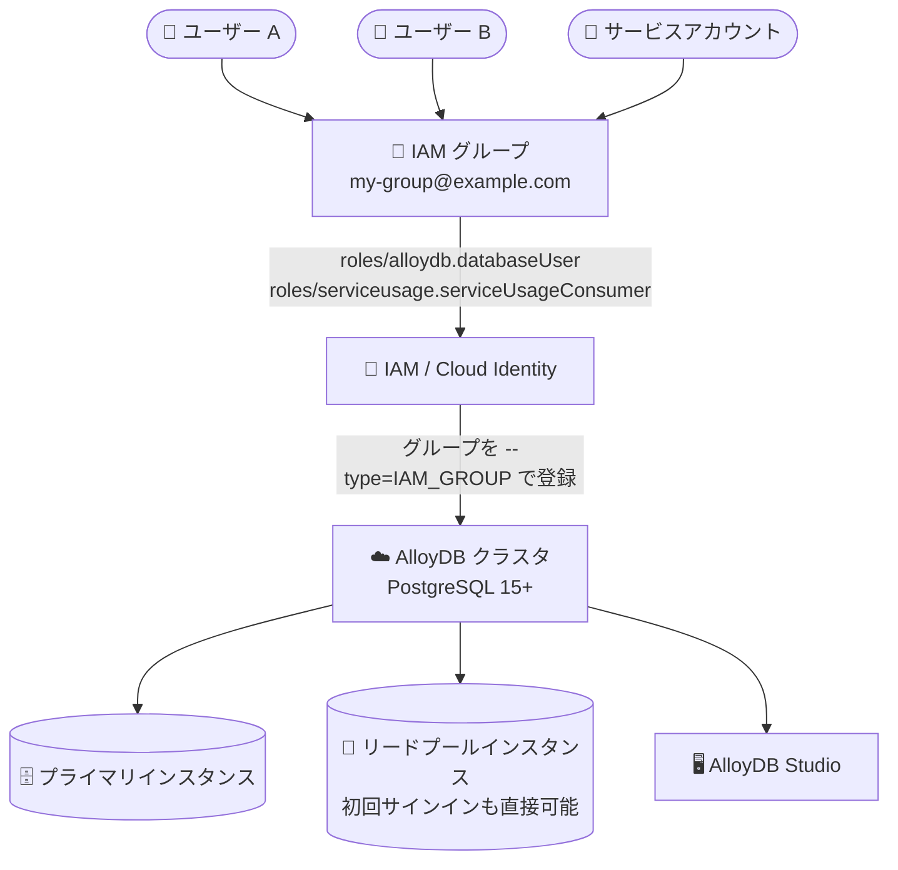

# AlloyDB for PostgreSQL: IAM グループ認証が一般提供 (GA)

**リリース日**: 2026-10-28

**サービス**: AlloyDB for PostgreSQL

**機能**: IAM グループ認証 (IAM group authentication)

**ステータス**: GA (一般提供)

📊 [このアップデートのインフォグラフィックを見る](https://takech9203.github.io/google-cloud-news-summary/20261028-alloydb-iam-group-authentication-ga.html)

## 概要

AlloyDB for PostgreSQL において、Identity and Access Management (IAM) グループ認証が一般提供 (GA) となりました。PostgreSQL 15 以降を実行する新規および既存の AlloyDB クラスタで利用できます。IAM グループ (Cloud Identity グループなど) をクラスタに追加することで、グループのメンバーであるユーザーやサービスアカウントが個別登録なしで認証できるようになり、データベースのロールと権限をグループ単位で一元管理できます。

グループ認証は、プライマリインスタンスとリードプールインスタンスの両方に対応しており、プライマリインスタンスへ先に接続することなく、リードプールインスタンスへ直接初回サインインすることも可能です。また、Cloud SQL for PostgreSQL のバックアップから AlloyDB へ移行・リストアする際に、個別 IAM ユーザーと IAM グループユーザーの構成がマッピング・保持されます。

このアップデートの対象ユーザーは、多数の開発者やアプリケーションが AlloyDB にアクセスする環境で、データベースユーザー管理の運用負荷を削減したいデータベース管理者・セキュリティ管理者です。

**アップデート前の課題**

- 個別 IAM 認証では、IAM ユーザーやサービスアカウントを 1 件ずつクラスタに追加し、アカウントごとに権限を管理する必要があった
- メンバーの入れ替わり (入社・異動・退職など) のたびに、クラスタレベルでユーザーの追加・削除を行う必要があった
- 複数の IAM ユーザーに対する PostgreSQL のロール・権限を、ユーザーまたはサービスアカウント単位で個別に更新する必要があった

**アップデート後の改善**

- IAM グループをクラスタに追加するだけで、グループの全メンバー (ユーザーおよびサービスアカウント) が認証権限を継承し、個別追加が不要になった
- グループへのメンバー追加・削除だけで、AlloyDB クラスタ横断のログイン権限とデータベース権限の付与・剥奪が可能になった
- グループメンバーはプライマリインスタンス、リードプールインスタンス、AlloyDB Studio に直接サインインでき、リードプールインスタンスへの初回サインインもプライマリ経由なしで可能になった
- Cloud SQL for PostgreSQL のバックアップからの移行時に、個別および IAM グループユーザーの構成が保持されるようになった

## アーキテクチャ図



IAM グループをクラスタに 1 回登録するだけで、グループメンバー全員が個別の IAM 認証情報を使ってプライマリインスタンス・リードプールインスタンス・AlloyDB Studio にサインインできます。権限管理はグループ単位で行われ、監査ログには個人単位のアクティビティが記録されます。

## サービスアップデートの詳細

### 主要機能

1. **グループ単位のデータベースユーザー管理**
   - IAM グループをクラスタに追加すると、グループ内の全ユーザー・サービスアカウントが認証権限を継承する
   - グループへのメンバー追加で IAM ロールとデータベース権限を自動継承し、グループからの削除でログイン権限と権限を剥奪できる
   - 新規・既存クラスタの両方で、手動のクラスタパッチなしに有効化できる

2. **リードプールインスタンスへの直接サインイン**
   - グループメンバーはプライマリインスタンス、リードプールインスタンス、AlloyDB Studio に直接サインイン可能
   - 初回サインインでも、先にプライマリインスタンスへ接続することなくリードプールインスタンスに直接接続できる
   - 初回サインイン時に、AlloyDB がそのプリンシパル用のデータベースアカウントを自動作成する

3. **Cloud SQL for PostgreSQL からの移行時のユーザー構成保持**
   - Cloud SQL for PostgreSQL のバックアップから AlloyDB クラスタをリストア・移行する際、個別 IAM ユーザーと IAM グループユーザーの構成をマッピングして保持する

4. **個人単位の監査証跡**
   - IAM ロールと権限はグループレベルで割り当てられるが、サインインは共有アカウントではなく各自の IAM アカウントと認証情報で行う
   - 各ユーザー・サービスアカウントのサインインとデータベースアクティビティは監査ログに個別に記録される

## 技術仕様

### IAM グループ認証の要件

| 項目 | 詳細 |
|------|------|
| 対応データベースバージョン | PostgreSQL 15 以降 (POSTGRES_15+) |
| 必要なデータベースフラグ | `alloydb.iam_authentication` と `alloydb.iam_group_authentication` を両方 `on` に設定 |
| 必要な IAM ロール | `roles/alloydb.databaseUser` および `roles/serviceusage.serviceUsageConsumer` (グループに付与) |
| 必要な権限 | `alloydb.users.login` (AlloyDB Database User ロールに含まれる) |
| 認証方式 | 一時的な認証トークン (パスワード不要) |
| 接続要件 | SSL 接続必須 (非暗号化接続は拒否) |
| クラスタあたりのグループ数上限 | 最大 200 グループ (非アクティブなグループも上限にカウント) |
| グループ名の制限 | 63 文字以内 (超える場合は有効な名前の親グループ配下にネストして対応) |

### 認証方式の比較

| 項目 | 組み込みデータベース認証 | IAM データベース認証 |
|------|------------------------|---------------------|
| 認証方法 | パスワード | 一時的な認証トークン |
| ネットワーク暗号化 | SSL 必須ではない | SSL 必須 |
| ユーザー管理 | 手動 | IAM による一元管理 |

## 設定方法

### 前提条件

1. PostgreSQL 15 以降を実行する AlloyDB クラスタ
2. IAM グループ (例: Cloud Identity グループ) が作成済みであること
3. パスワード関連のデータベースフラグ (最小文字数などのポリシー) が緩和または無効化されていること

### 手順

#### ステップ 1: データベースフラグの有効化

インスタンスで以下の 2 つのデータベースフラグを `on` に設定します。

- `alloydb.iam_authentication`
- `alloydb.iam_group_authentication`

#### ステップ 2: IAM グループへのロール付与

グループアカウントに `roles/alloydb.databaseUser` と `roles/serviceusage.serviceUsageConsumer` のロールを割り当てます。

#### ステップ 3: グループをクラスタに追加

```bash
gcloud alloydb users create GROUP_EMAIL \
  --cluster=CLUSTER \
  --region=REGION \
  --type=IAM_GROUP
```

`GROUP_EMAIL` には IAM グループの完全なメールアドレス (例: `my-group@example.com`) を指定します。

#### ステップ 4: グループへのデータベース権限付与

psql から GRANT 文を実行し、個別ユーザーではなくグループに権限を付与します。

```sql
GRANT SELECT ON TABLE_NAME TO "GROUP_NAME";
```

グループ名は特殊文字を含むため、ダブルクォートで囲みます。

## メリット

### ビジネス面

- **運用負荷の削減**: ユーザーの入れ替わりに対してグループメンバーシップの変更だけで対応でき、クラスタレベルでの個別ユーザー追加・削除が不要になる
- **ガバナンスの強化**: IAM ポリシーによる一元的なアクセス管理と、個人単位の監査ログによる説明責任の両立が可能

### 技術面

- **パスワードレス認証**: 一時的な認証トークンを使用するため、データベースパスワードの管理・ローテーションが不要
- **リードプールへの直接接続**: 初回サインインを含め、リードプールインスタンスへプライマリ経由なしで接続可能
- **移行時の構成保持**: Cloud SQL for PostgreSQL バックアップからの移行時に IAM ユーザー・グループ構成が自動的にマッピング・保持される
- **自動アカウント作成**: メンバーの初回サインイン時に AlloyDB がデータベースアカウントを自動作成する

## デメリット・制約事項

### 制限事項

- PostgreSQL 15 (POSTGRES_15) 以降のデータベースバージョンでのみサポート
- IAM データベース認証でのサインインは SSL 接続のみ (非暗号化接続は拒否される)
- インスタンスごとに 1 分あたりのサインインクォータがあり、成功・失敗の両方がカウントされる (超過時はサインインが一時的に利用不可)
- クラスタに追加できる IAM グループは最大 200 個
- サービスアカウントの短縮プリンシパル (`.gserviceaccount.com` サフィックスを除いたメールアドレス) は 63 文字以内である必要がある
- 同一クラスタ上で、グループに属するアカウントを個別 IAM ユーザー (`ALLOYDB_IAM_USER`) として重複追加できない。既存の個別 IAM ユーザーはグループから権限を継承しないため、グループ認証に移行するには個別ユーザーを削除する必要がある
- マネージド接続プーリングおよび PgBouncer 接続では未サポート
- フェデレーテッド ID では未サポート
- パスワード関連のデータベースフラグ (最小文字数・数字・最小長のポリシー) の緩和または無効化が必要

### 考慮すべき点

- Cloud Identity グループのメンバーシップ変更の反映には約 15 分かかり、さらに IAM 変更の伝播時間も加わる
- グループからユーザーを削除しても、他のグループメンバーシップ経由でサインイン権限を持つ場合は新規セッションを作成できる (ただし元のグループ由来のデータベース権限は失われる)
- IAM で `roles/alloydb.databaseUser` を剥奪した場合や Cloud Identity でグループを削除した場合は、AlloyDB クラスタからも対応するグループユーザーを削除してアクセスを完全に除去する必要がある

## ユースケース

### ユースケース 1: 開発チーム単位のデータベースアクセス管理

**シナリオ**: 数十名規模の開発チームが AlloyDB 上の分析用データベースに読み取りアクセスする。メンバーの異動が頻繁にあり、個別ユーザー管理の負荷が高い。

**実装例**:
```bash
# チームのグループをクラスタに追加
gcloud alloydb users create dev-team@example.com \
  --cluster=analytics-cluster \
  --region=asia-northeast1 \
  --type=IAM_GROUP
```
```sql
-- グループに読み取り権限を付与
GRANT SELECT ON sales_data TO "dev-team@example.com";
```

**効果**: 異動時は Cloud Identity グループのメンバーシップを変更するだけで、AlloyDB 側の操作なしにアクセス権の付与・剥奪が完結する。監査ログには個人単位の操作が記録される。

### ユースケース 2: Cloud SQL for PostgreSQL から AlloyDB への移行

**シナリオ**: IAM 認証を利用している Cloud SQL for PostgreSQL 環境を、バックアップ経由で AlloyDB に移行する。

**効果**: 移行時に個別 IAM ユーザーと IAM グループユーザーの構成がマッピング・保持されるため、移行後にユーザーを再設定する手間が削減される。

### ユースケース 3: 既存の個別 IAM ユーザーのグループ認証への移行

**シナリオ**: すでに個別 IAM 認証で運用しているクラスタで、ユーザー管理をグループ単位に統合したい。

**効果**: ユーザーをグループに追加し、グループをクラスタに登録・ロール付与・権限付与した上で、既存の個別ユーザーをクラスタから削除する。次回サインイン時に AlloyDB がグループユーザーとしてアカウントを再作成する。

## 料金

IAM グループ認証機能自体に関する追加料金の記載はリリースノートおよび参照したドキュメントでは確認できませんでした。AlloyDB の料金詳細は公式料金ページを参照してください。

- [AlloyDB for PostgreSQL 料金](https://cloud.google.com/alloydb/pricing)

## 利用可能リージョン

リージョン固有の制限はリリースノートに記載されていません。PostgreSQL 15 以降を実行する新規および既存の AlloyDB クラスタで利用可能です。

## 関連サービス・機能

- **Cloud Identity**: IAM グループの作成・管理に使用。グループメンバーシップの変更が AlloyDB のアクセス権に反映される
- **IAM (Identity and Access Management)**: `roles/alloydb.databaseUser` などのロールをグループに付与し、アクセスを一元管理する
- **Cloud SQL for PostgreSQL**: バックアップからの AlloyDB への移行時に、IAM ユーザー・グループ構成が保持される
- **AlloyDB Studio**: Google Cloud コンソール内の SQL エディタ。グループメンバーが直接サインイン可能
- **Cloud Audit Logs**: 個人単位のサインインとデータベースアクティビティを記録し、誰がどの操作を行ったかを検証できる

## 参考リンク

- 📊 [インフォグラフィック](https://takech9203.github.io/google-cloud-news-summary/20261028-alloydb-iam-group-authentication-ga.html)
- [公式リリースノート](https://cloud.google.com/alloydb/docs/release-notes)
- [IAM データベース認証の概要](https://docs.cloud.google.com/alloydb/docs/database-users/iam-authentication)
- [IAM 認証の管理](https://docs.cloud.google.com/alloydb/docs/database-users/manage-iam-auth)
- [Cloud SQL for PostgreSQL から AlloyDB への移行](https://docs.cloud.google.com/alloydb/docs/migrate-cloud-sql-to-alloydb)
- [料金ページ](https://cloud.google.com/alloydb/pricing)

## まとめ

AlloyDB for PostgreSQL の IAM グループ認証が GA となり、グループ単位でのデータベースアクセス管理が本番環境で利用できるようになりました。リードプールインスタンスへの直接初回サインインや Cloud SQL for PostgreSQL 移行時の構成保持にも対応しており、ユーザー管理の運用負荷を大きく削減できます。PostgreSQL 15 以降のクラスタを運用している場合は、個別 IAM ユーザーからグループ認証への移行を検討することを推奨します。

---

**タグ**: AlloyDB, PostgreSQL, IAM, 認証, セキュリティ, GA, Cloud Identity, データベース
