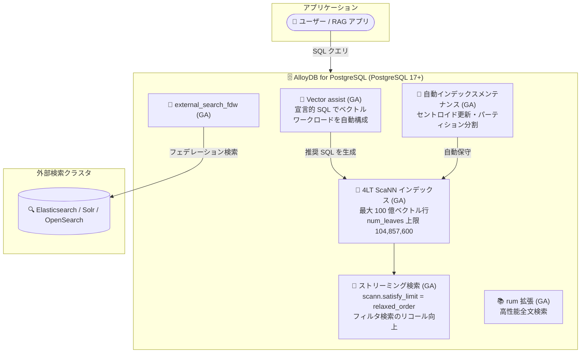

# AlloyDB for PostgreSQL: AlloyDB AI / ベクトル検索機能群の GA (4 レベルツリー ScaNN インデックスほか)

**リリース日**: 2026-10-28

**サービス**: AlloyDB for PostgreSQL

**機能**: 4 レベルツリー (4LT) ScaNN インデックス、Vector assist、external_search_fdw、rum 拡張などのベクトル検索・全文検索機能群

**ステータス**: GA (一般提供開始) + Fixed (4LT インデックス構築時のメモリ見積もり改善は Preview)

📊 [このアップデートのインフォグラフィックを見る](https://takech9203.github.io/google-cloud-news-summary/20261028-alloydb-scann-4lt-vector-search-ga.html)

## 概要

AlloyDB for PostgreSQL において、AlloyDB AI およびベクトル検索に関する複数の機能が一般提供 (GA) になりました。中核となるのは、`alloydb_scann` 拡張が PostgreSQL 17 以降でサポートする **4 レベルツリー (4LT: Four-Level Tree) ScaNN ベクトルインデックス**です。これにより**最大 100 億 (10 billion) 行のベクトルデータを持つテーブル**に対するベクトル検索が可能になります。4LT ScaNN インデックスは自動インデックスメンテナンスにも対応しました。

このほか、`scann.satisfy_limit` パラメータを `relaxed_order` に設定することで有効になるストリーミング機能 (フィルタ付き検索のリコール改善)、ベクトルワークロードのデプロイ・管理を宣言的 SQL フレームワークで簡素化する **Vector assist**、PostgreSQL 17 以降での `num_leaves` 上限の 30,000,000 から 104,857,600 への引き上げ、Elasticsearch / Solr / OpenSearch へのフェデレーション検索を可能にする **external_search_fdw 拡張**、高性能全文検索のための **rum 拡張**のサポートが同時に GA となりました。

あわせて、ScaNN 4 レベルツリーインデックス構築時のメモリ使用量見積もりの精度が向上し、メモリ制限の適用と制約条件下でのメモリ見積もり改善により、out-of-memory (OOM) エラーを防止してインデックス構築の安定性が改善されました (この機能は Preview です)。大規模なベクトル検索基盤を PostgreSQL 互換データベース上に構築したいエンジニアや、RAG (検索拡張生成) ワークロードを運用する組織にとって重要なアップデートです。

**アップデート前の課題**

- 4 レベルツリー ScaNN インデックスは Preview 段階であり、10 億〜100 億行規模のテーブルに対するベクトルインデックスを GA 品質で利用できなかった
- `num_leaves` の最大値は 30,000,000 に制限されており、超大規模データセットでのパーティション分割の細かさに上限があった
- フィルタ条件付きのベクトル検索では、スキャンしたリーフパーティション内で十分な件数が見つからない場合に、クエリの LIMIT 句を満たす結果を得られずリコールが低下することがあった
- ベクトルワークロードの構築には、埋め込み生成・インデックスパラメータ・クエリチューニングを手動で設計する必要があった
- Elasticsearch / Solr / OpenSearch などの外部検索クラスタのデータを検索するには、データのコピーや移動、アプリケーション側での統合が必要だった
- 4LT インデックス構築時にメモリ見積もりが不正確な場合、OOM エラーでインデックス構築が失敗することがあった

**アップデート後の改善**

- PostgreSQL 17 以降で 4LT ScaNN インデックスが GA となり、最大 100 億ベクトル行のテーブルをサポート。自動インデックスメンテナンスにも対応し、データ増加に応じたセントロイドの分析・更新、大きな外れ値パーティションの分割が自動化された
- `num_leaves` の最大値が 104,857,600 に拡大 (PostgreSQL 17 以降)
- `scann.satisfy_limit = relaxed_order` により、LIMIT 句を満たす結果が見つかるまで追加のリーフパーティションを探索し続けるストリーミング機能が有効になり、フィルタ付き検索のリコールが向上。`scann.enable_parallel_satisfy_limit` フラグで並列プロセススキャンにも適用可能
- Vector assist により、埋め込み生成・クエリ最適化・インデックス作成 (HNSW などのベクトルタイプ) を含む本番品質のベクトル検索セットアップを宣言的に構築可能になった
- `external_search_fdw` 拡張により、Elasticsearch / Solr / OpenSearch の外部検索クラスタにデータベースから直接クエリ可能になった
- rum 拡張により、位置情報をインデックスに直接保存した高速なフレーズ検索・関連度ランキングが可能になった (PostgreSQL 17 以前)
- 4LT インデックス構築時のメモリ見積もり精度向上と OOM 防止により、インデックス構築の安定性が改善 (Preview)

## アーキテクチャ図



AlloyDB 内でベクトル検索 (4LT ScaNN)・全文検索 (rum)・外部検索クラスタへのフェデレーション検索 (external_search_fdw) を統合的に実行できる構成を示しています。Vector assist はベクトルワークロードの構成を推奨 SQL として生成し、自動インデックスメンテナンスがインデックスの品質を維持します。

## サービスアップデートの詳細

### 主要機能

1. **4 レベルツリー (4LT) ScaNN ベクトルインデックス (GA)**
   - `alloydb_scann` 拡張が PostgreSQL 17 以降で 4 レベルツリーの ScaNN ベクトルインデックスをサポート
   - 最大 100 億 (10B) ベクトル行のテーブルに対応。10 億〜100 億行のテーブルには 4 レベルインデックスが推奨される
   - インデックス作成時に `max_num_levels = 3` (セントロイド 3 レベル + リーフレベル) を指定して作成

2. **自動インデックスメンテナンス (GA)**
   - 4LT ScaNN インデックスで `auto_maintenance` オプションが利用可能
   - データセットの増加に応じて AlloyDB がセントロイドを分析・更新し、大きな外れ値パーティションを分割。QPS と検索結果品質を自動的に改善

3. **ストリーミング機能 (scann.satisfy_limit = relaxed_order) (GA)**
   - 有効化すると、クエリの LIMIT 句を満たす十分な結果が見つかるまで、ベクトルスキャンが追加のリーフパーティションを探索し続ける
   - フィルタ条件付き検索のリコールが向上
   - `scann.enable_parallel_satisfy_limit` データベースフラグを `on` にすると並列プロセススキャンにも適用可能

4. **Vector assist (GA)**
   - ベクトル検索ワークロードのデプロイと管理のための宣言的 SQL フレームワーク
   - 対象テーブル・テキストカラム・目標リコールなどの要件 (vector spec) を SQL 関数 (`vector_assist.define_spec`) で宣言すると、自動チューニングアルゴリズムが最適化された SQL 推奨 (説明付き) を生成
   - 埋め込み生成、クエリ最適化、HNSW などのインデックス作成を含む本番品質のベクトル検索セットアップを支援

5. **num_leaves 上限の引き上げ**
   - PostgreSQL 17 以降の AlloyDB インスタンスで、ScaNN インデックス構築時の `num_leaves` の最大サポート値が 30,000,000 から 104,857,600 に増加

6. **external_search_fdw 拡張 (GA)**
   - 外部検索クラスタに接続し、データベースから直接そのデータをクエリ可能
   - 対応する検索ソース: Elasticsearch、Solr、OpenSearch

7. **rum 拡張 (GA)**
   - PostgreSQL 17 以前で高性能な全文検索操作をサポート
   - 標準の GIN インデックスを拡張し、位置情報をインデックスに直接保存することで、テーブルデータにアクセスせずに高速なフレーズ検索と関連度ランキングを実行可能

8. **4LT インデックス構築時のメモリ見積もり改善 (Preview)**
   - ScaNN 4 レベルツリーインデックス構築時のメモリ使用量見積もりがより正確になり、OOM エラーを防止
   - メモリ制限の適用と制約条件下でのメモリ見積もり改善により、インデックス構築の安定性が向上

## 技術仕様

### ScaNN インデックスのツリーレベル選択指針

| テーブルのベクトル行数 | 推奨ツリーレベル数 |
|------|------|
| 0〜1,000 万行 | 2 レベル |
| 1,000 万〜1 億行 | リコール優先: 2 レベル / 構築時間優先: 3 レベル |
| 1 億〜10 億行 | リコール優先: 3 レベル / 構築時間優先: 4 レベル |
| 10 億〜100 億行 | 4 レベル |

### 主要パラメータ

| 項目 | 詳細 |
|------|------|
| `max_num_levels` | K-means クラスタリングツリーのセントロイドレベル最大数。`3` で 4 レベルインデックス |
| `num_leaves` | パーティション数。PostgreSQL 17 以降は最大 104,857,600、PostgreSQL 16 以前は最大 30,000,000 |
| `quantizer` | `SQ8` (デフォルト、リコール損失は通常 1〜2% 未満) / `AH` (Preview、SQ8 比最大 4 倍圧縮) / `FLAT` (リコール 99% 以上) |
| `auto_maintenance` | 自動メンテナンスの有効化。`ON` / `OFF` (デフォルト) |
| `scann.satisfy_limit` | `relaxed_order` でストリーミング機能を有効化し、フィルタ検索のリコールを改善 |
| `scann.enable_parallel_satisfy_limit` | `on` で並列プロセススキャンにもストリーミングを適用 |
| `scann.num_leaves_to_search` | 検索するパーティションの絶対数。デフォルトは `num_leaves` の 1% |
| `scann.pre_reordering_num_neighbors` | 再順序付け段階で考慮する候補近傍数 |

### Vector assist の制限事項

- PostgreSQL 17 以降のみサポート
- インデックスタイプは HNSW と IVFFlat のみサポート (ScaNN インデックスタイプは非サポート)
- 埋め込み自動生成はテキスト埋め込みモデルのみサポート (マルチモーダル埋め込みが必要な場合は `google_ml_integration` 拡張などで事前に埋め込みを生成)

## 設定方法

### 前提条件

1. PostgreSQL 17 以降の AlloyDB インスタンス (4LT ScaNN / Vector assist / `num_leaves` 上限拡大の場合)
2. ScaNN インデックス作成時の OOM を避けるため、`maintenance_work_mem` と `shared_buffers` データベースフラグをマシンメモリ合計より小さい値に設定
3. rum 拡張の作成には `alloydbsuperuser` データベースロールが必要

### 手順

#### ステップ 1: 4 レベルツリー ScaNN インデックスの作成

```sql
CREATE EXTENSION IF NOT EXISTS alloydb_scann;

CREATE INDEX my_scann_index ON my_table
USING scann (embedding_column cosine)
WITH (
  mode = 'MANUAL',
  num_leaves = NUM_LEAVES_VALUE,  -- 例: power(行数, 3/4) を起点に調整
  quantizer = 'SQ8',
  auto_maintenance = ON,           -- 自動インデックスメンテナンスを有効化
  max_num_levels = 3               -- 4 レベルツリー
);
```

`max_num_levels = 3` により 4 レベルツリーインデックスが作成されます。`auto_maintenance = ON` で自動メンテナンスが有効になります。

#### ステップ 2: ストリーミング機能の有効化

```sql
-- セッション単位でストリーミング機能を有効化
SET scann.satisfy_limit = relaxed_order;

-- 並列プロセススキャンにも適用する場合はデータベースフラグを設定
-- scann.enable_parallel_satisfy_limit = on
```

フィルタ条件付きベクトル検索で、LIMIT 句を満たすまで追加のリーフパーティションを探索するようになります。

#### ステップ 3: rum 拡張による全文検索インデックスの作成 (任意)

```sql
CREATE EXTENSION IF NOT EXISTS rum;

ALTER TABLE documents ADD COLUMN search_vector tsvector
  GENERATED ALWAYS AS (to_tsvector('english', content)) STORED;

CREATE INDEX idx_docs_rum ON documents
USING rum (search_vector rum_tsvector_ops);
```

位置情報がインデックスに保存されるため、テーブルアクセスなしで高速なフレーズ検索・関連度ランキングが可能です。

## メリット

### ビジネス面

- **超大規模 RAG / セマンティック検索の実現**: 最大 100 億ベクトル行まで GA 品質でサポートされるため、エンタープライズ規模のナレッジベースや商品カタログの検索基盤を PostgreSQL 互換データベース上に統合できる
- **運用コストの削減**: 自動インデックスメンテナンスと Vector assist により、ベクトル検索基盤のチューニング・保守にかかる専門的な作業が削減される
- **既存検索基盤の活用**: external_search_fdw により、既存の Elasticsearch / Solr / OpenSearch 資産をデータ移行なしに AlloyDB から直接活用できる

### 技術面

- **リコールの改善**: `relaxed_order` ストリーミングにより、フィルタ付き検索でも LIMIT を満たすまで探索が継続され、検索品質が向上
- **スケーラビリティの向上**: `num_leaves` 上限が約 3.5 倍 (30,000,000 → 104,857,600) に拡大し、超大規模データセットでより細かいパーティション分割が可能
- **インデックス構築の安定化**: メモリ見積もり精度の向上とメモリ制限の適用により、4LT インデックス構築時の OOM エラーを防止 (Preview)
- **検索機能の統合**: ベクトル検索 (ScaNN)、全文検索 (rum)、外部検索 (FDW) を単一データベースの SQL で統合的に扱える

## デメリット・制約事項

### 制限事項

- 4LT ScaNN インデックス、Vector assist、`num_leaves` 上限拡大 (104,857,600) は PostgreSQL 17 以降が必要 (PostgreSQL 16 以前の `num_leaves` 上限は 30,000,000)
- Vector assist は HNSW / IVFFlat インデックスのみ対応し、ScaNN インデックスタイプは非サポート
- Vector assist の埋め込み自動生成はテキスト埋め込みモデルのみ対応
- rum 拡張は PostgreSQL 17 以前でのサポートと Release Notes に記載
- 4LT インデックス構築時のメモリ見積もり改善は Preview であり、Pre-GA 利用規約が適用される

### 考慮すべき点

- ScaNN インデックスの `auto_maintenance` はデフォルト `OFF` のため、自動メンテナンスを利用する場合は明示的に有効化が必要
- `scann.satisfy_limit = relaxed_order` は追加のリーフパーティションを探索するため、リコールと引き換えに探索コストが増加する可能性がある。チューニングのベストプラクティスを確認のうえ設定すること
- インデックス構築前に `maintenance_work_mem` / `shared_buffers` の適切な設定が引き続き推奨される
- 行数に応じたツリーレベルと `num_leaves` の選択 (4 レベルの場合は `power(行数, 3/4)` が起点) がリコールと構築時間のバランスに影響する

## ユースケース

### ユースケース 1: 100 億ベクトル規模のエンタープライズ RAG 基盤

**シナリオ**: 全社のドキュメント・ナレッジを埋め込みベクトル化して保存し、生成 AI アプリケーションから低レイテンシで類似検索したい。データ量は数十億〜100 億ベクトル行に達する。

**実装例**:
```sql
CREATE INDEX kb_scann_idx ON knowledge_base
USING scann (embedding cosine)
WITH (mode='MANUAL', num_leaves = 5623413, -- power(1e10, 3/4) 起点で調整
      quantizer='SQ8', auto_maintenance=ON, max_num_levels=3);

SET scann.satisfy_limit = relaxed_order;
SELECT doc_id, title FROM knowledge_base
WHERE category = 'engineering'
ORDER BY embedding <=> $1 LIMIT 10;
```

**効果**: 100 億行規模でも GA 品質のベクトル検索が可能になり、フィルタ条件付きでもストリーミング機能により LIMIT を満たす結果を取得できる。自動メンテナンスによりデータ増加後も検索品質が維持される。

### ユースケース 2: 既存 Elasticsearch 資産とのフェデレーション検索

**シナリオ**: ログ・商品カタログを Elasticsearch で運用しているが、トランザクションデータは AlloyDB にある。両者を結合した検索をデータコピーなしで実行したい。

**効果**: `external_search_fdw` により Elasticsearch のインデックスを外部テーブルとして SQL から直接クエリでき、AlloyDB のリレーショナルデータと組み合わせた検索がデータ移動なしに実現できる。

### ユースケース 3: Vector assist による検索アプリの迅速なプロトタイピング

**シナリオ**: セマンティック検索機能を新規アプリに追加したいが、埋め込みモデル選定やインデックスチューニングの知見が少ない。

**効果**: vector spec (対象テーブル、テキストカラム、目標リコールなど) を SQL で宣言するだけで、埋め込み生成・インデックス作成・クエリ最適化の推奨 SQL が説明付きで生成され、レビュー・修正しながら本番品質のセットアップを短期間で構築できる。

## 料金

今回 GA となった機能は AlloyDB の拡張機能・データベースフラグとして提供されます。AlloyDB for PostgreSQL の料金は vCPU・メモリ・ストレージ・ネットワークの使用量に基づきます。詳細は料金ページを参照してください。

- [AlloyDB for PostgreSQL 料金](https://cloud.google.com/alloydb/pricing)

## 利用可能リージョン

Release Notes にリージョン固有の記載はありません。AlloyDB for PostgreSQL が利用可能なリージョンについては[公式ドキュメント](https://cloud.google.com/alloydb/docs/locations)を参照してください。

## 関連サービス・機能

- **Vertex AI**: `google_ml_integration` 拡張経由で埋め込み生成モデル (例: text-embedding-005) を呼び出し、AlloyDB 内で埋め込みを生成できる
- **AlloyDB columnar engine**: ScaNN インデックスをカラム型エンジンにロードしてベクトル検索をさらに高速化できる
- **Secret Manager**: external_search_fdw で外部検索クラスタの認証情報を安全に管理する際に使用 (AlloyDB Omni ドキュメントに記載)
- **AlloyDB Omni**: Vector assist や external_search_fdw は AlloyDB Omni でも提供されている
- **BM25 インデックス**: rum 拡張と並ぶ全文検索の選択肢として、PostgreSQL 17 以降で BM25 関連度ランキングが利用可能

## 参考リンク

- 📊 [インフォグラフィック](https://takech9203.github.io/google-cloud-news-summary/20261028-alloydb-scann-4lt-vector-search-ga.html)
- [公式リリースノート](https://cloud.google.com/alloydb/docs/release-notes)
- [ScaNN インデックスの作成](https://docs.cloud.google.com/alloydb/docs/ai/create-scann-index)
- [ベクトルインデックスのチューニング](https://docs.cloud.google.com/alloydb/docs/ai/tune-indexes)
- [ScaNN インデックスリファレンス](https://docs.cloud.google.com/alloydb/docs/reference/ai/scann-index-reference)
- [ベクトルインデックスの自動メンテナンス](https://docs.cloud.google.com/alloydb/docs/ai/maintain-vector-indexes)
- [Vector assist 概要](https://docs.cloud.google.com/alloydb/docs/ai/vector-assist-overview)
- [RUM インデックスの作成と管理](https://docs.cloud.google.com/alloydb/docs/ai/create-rum-index)
- [全文検索の概要](https://docs.cloud.google.com/alloydb/docs/ai/full-text-search-overview)
- [料金ページ](https://cloud.google.com/alloydb/pricing)

## まとめ

AlloyDB のベクトル検索が 4 レベルツリー ScaNN インデックスの GA により最大 100 億ベクトル行までスケールし、自動メンテナンス・ストリーミング検索・Vector assist・外部検索連携・rum 全文検索を含む包括的な検索プラットフォームとしての完成度が大きく向上しました。大規模な RAG やセマンティック検索基盤を検討している場合は、PostgreSQL 17 以降のインスタンスで 4LT ScaNN インデックスと `scann.satisfy_limit = relaxed_order` の評価を開始し、行数に応じたツリーレベルと `num_leaves` の設計指針を確認することを推奨します。

---

**タグ**: #AlloyDB #PostgreSQL #ScaNN #VectorSearch #AlloyDBAI #RAG #GA #FullTextSearch #Elasticsearch #OpenSearch
