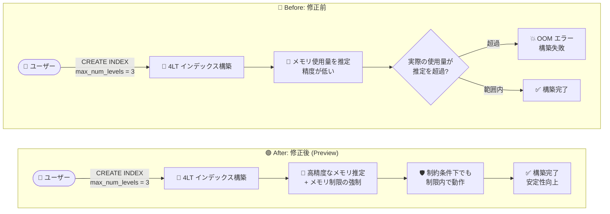

# AlloyDB for PostgreSQL: ScaNN 4 レベルツリーインデックス構築時のメモリ使用量推定の改善と OOM エラー防止

**リリース日**: 2026-10-28

**サービス**: AlloyDB for PostgreSQL

**機能**: ScaNN 4 レベルツリー (4LT) インデックス構築時のメモリ使用量推定の精度向上と OOM エラー防止

**ステータス**: Preview (Fixed)

📊 [このアップデートのインフォグラフィックを見る](https://takech9203.github.io/google-cloud-news-summary/20261028-alloydb-scann-index-memory-estimation.html)

## 概要

AlloyDB for PostgreSQL において、ScaNN 4 レベルツリー (4LT) ベクトルインデックスを構築する際のメモリ使用量推定がより正確になり、Out-of-Memory (OOM) エラーを防止する修正がリリースされました。この修正により、メモリ制限の適用 (enforcing memory limits) と、メモリが制約された環境下でのメモリ推定の改善を通じて、インデックス構築の安定性が向上します。本機能は Preview として提供されます。

同日 (2026 年 10 月 28 日) に 4LT ScaNN インデックス自体は PostgreSQL 17 以降で GA となり、最大 100 億行のベクトルデータに対応しました (詳細は関連レポート「AlloyDB ScaNN 4LT ベクトル検索 GA」を参照)。4LT インデックスは 10 億〜100 億行規模の超大規模ベクトルデータセットを対象とするため、インデックス構築時には K-means クラスタリングツリーの学習に大量のメモリを消費します。本修正は、こうした大規模インデックス構築をメモリ逼迫時でも安定して完了させるための改善であり、大規模ベクトル検索基盤を AlloyDB 上で運用するデータベース管理者や AI アプリケーション開発者が対象です。

**アップデート前の課題**

4LT インデックスの構築では、構築プロセスが実際に必要とするメモリ量の見積もりが不正確になるケースがありました。

- 4LT インデックス構築時のメモリ使用量の推定精度が低く、特にメモリが制約された (constrained) 状況で実際の使用量が見積もりを超過することがあった
- メモリ超過が発生すると、長時間かかる大規模インデックスの構築が OOM エラーで失敗するリスクがあった
- ユーザー側で `maintenance_work_mem` や `shared_buffers` をマシンの総メモリより小さく設定するなどの対策はあったが、構築プロセス側でのメモリ制限の強制が不十分だった

**アップデート後の改善**

- インデックス構築時のメモリ使用量推定がより正確になり、実際の消費量との乖離が縮小された
- 構築プロセスにメモリ制限が適用 (enforce) されるようになり、OOM エラーの発生が防止される
- メモリが制約された条件下でもインデックス構築が安定して完了するようになり、大規模ベクトルインデックス構築の信頼性が向上した

## アーキテクチャ図



修正前は 4LT インデックス構築時のメモリ推定が不正確で OOM による構築失敗のリスクがありましたが、修正後は高精度なメモリ推定とメモリ制限の強制により、メモリが制約された環境でも安定してインデックス構築が完了します。

## サービスアップデートの詳細

### 主要機能

1. **メモリ使用量推定の精度向上**
   - ScaNN 4 レベルツリーインデックス構築時のメモリ使用量をより正確に見積もる
   - 特にメモリが制約された (constrained) 条件下での推定精度が改善され、見積もりと実消費量の乖離による予期しない失敗を防ぐ

2. **メモリ制限の強制 (Enforcing memory limits) による OOM 防止**
   - インデックス構築プロセスがメモリ制限を遵守するよう強制され、Out-of-Memory エラーの発生を防止する
   - 長時間を要する大規模インデックス構築が途中で失敗するリスクを低減する

3. **インデックス構築の安定性向上**
   - 10 億〜100 億行規模のデータセットを対象とする 4LT インデックスの構築を、限られたメモリリソースでも安定して完了できる
   - 同日 GA となった 4LT ScaNN インデックス (PostgreSQL 17 以降、最大 100 億ベクトル行) の実運用を支える品質改善

## 技術仕様

### ScaNN インデックスのツリーレベルとデータ規模の目安

| ベクトル行数 | 推奨されるツリーレベル |
|------|------|
| 0〜1,000 万行 | 2 レベル |
| 1,000 万〜1 億行 | 検索再現率優先: 2 レベル / 構築時間優先: 3 レベル |
| 1 億〜10 億行 | 検索再現率優先: 3 レベル / 構築時間優先: 4 レベル |
| 10 億〜100 億行 | 4 レベル |

### 4LT インデックスに関連する主なパラメータ

| 項目 | 詳細 |
|------|------|
| `max_num_levels` | K-means クラスタリングツリーのセントロイドレベルの最大数。`3` に設定すると 4 レベルツリーインデックスを作成 |
| `num_leaves` | インデックスのパーティション数。PostgreSQL 17 以降は最大 104,857,600 (PostgreSQL 16 以前は最大 30,000,000) |
| `maintenance_work_mem` | インデックス構築時に使用するメモリ。OOM を避けるため `shared_buffers` とあわせてマシン総メモリ未満に設定 |
| `max_parallel_maintenance_workers` | 並列インデックス構築のワーカー数。3/4 レベルインデックスや 1 億行超のデータセットで並列構築が発動しやすい |

## 設定方法

### 前提条件

1. AlloyDB for PostgreSQL クラスタ (4LT インデックスは PostgreSQL 17 以降で利用可能)
2. `alloydb_scann` 拡張機能が有効であること
3. OOM を避けるため、`maintenance_work_mem` と `shared_buffers` データベースフラグがマシンの総メモリより小さい値に設定されていること

### 手順

#### ステップ 1: alloydb_scann 拡張機能を有効化する

```sql
CREATE EXTENSION IF NOT EXISTS alloydb_scann;
```

#### ステップ 2: 4 レベルツリーインデックスを作成する

```sql
-- 例: 100 万行のテーブルに対する 4 レベルツリーインデックス
SET LOCAL scann.num_leaves_to_search = 100;
SET LOCAL scann.pre_reordering_num_neighbors = 50;

CREATE INDEX my_scann_index ON my_table
  USING scann (vector_column cosine)
  WITH (num_leaves = 31623, max_num_levels = 3);
```

`num_leaves` は `power(ROWS, 3/4)` を起点に設定します (100 万行の場合は約 31,623)。本修正により、構築プロセスのメモリ推定と制限の強制が改善されているため、メモリが限られた環境でも構築が安定します。

## メリット

### ビジネス面

- **大規模ベクトル検索基盤の信頼性向上**: 10 億行超のデータセットに対するインデックス構築が失敗しにくくなり、構築のやり直しによる時間・コストのロスを削減できる
- **インスタンスサイジングの柔軟性**: メモリ制約下でも構築が安定するため、構築のためだけに過剰なメモリを持つインスタンスを用意する必要性が下がる

### 技術面

- **OOM エラーの防止**: メモリ制限の強制により、インデックス構築プロセスが instance のメモリを使い尽くして失敗する事態を回避できる
- **正確なメモリ推定**: 構築前後のリソース計画 (maintenance_work_mem の設定など) が立てやすくなる
- **運用負荷の軽減**: 構築失敗時の再実行やトラブルシューティングの手間が減る

## デメリット・制約事項

### 制限事項

- 本修正 (メモリ推定の改善と OOM 防止) は Preview 段階であり、GA 前の機能として提供される
- 4LT インデックス自体は PostgreSQL 17 以降でのみ利用可能

### 考慮すべき点

- Preview 機能のため、本番環境への適用はテスト環境での検証後に行うことを推奨
- 従来どおり `maintenance_work_mem` と `shared_buffers` をマシン総メモリ未満に設定するベストプラクティスは引き続き有効
- メモリ制限が強制されることで、極端にメモリが不足する環境では構築時間が変化する可能性があるため、構築時間の計測を推奨

## ユースケース

### ユースケース 1: 数十億行規模の RAG 用ベクトルストアの構築

**シナリオ**: 大規模な社内ドキュメントや商品カタログのエンベディング (数十億ベクトル) を AlloyDB に格納し、RAG アプリケーションの検索基盤として 4LT ScaNN インデックスを構築する。

**実装例**:
```sql
CREATE INDEX docs_embedding_idx ON documents
  USING scann (embedding cosine)
  WITH (mode = 'MANUAL', num_leaves = 10000000, max_num_levels = 3);
```

**効果**: 長時間かかる大規模インデックス構築が OOM で途中失敗するリスクが減り、構築のやり直しなしで検索基盤を立ち上げられる。

### ユースケース 2: メモリに余裕のないインスタンスでのインデックス再構築

**シナリオ**: 本番ワークロードが動作しており空きメモリが限られるインスタンス上で、データ増加に伴い 3 レベルから 4 レベルツリーインデックスへ再構築する。

**効果**: メモリが制約された条件下でも推定精度とメモリ制限の強制によって構築が安定し、本番サービスへの影響 (OOM によるプロセス停止など) を避けられる。

## 料金

本修正自体に追加料金はありません。AlloyDB for PostgreSQL の通常の料金 (vCPU・メモリ・ストレージ・ネットワーク) が適用されます。詳細は [AlloyDB 料金ページ](https://cloud.google.com/alloydb/pricing) を参照してください。

## 関連サービス・機能

- **4LT ScaNN インデックス GA (同日発表)**: 本修正の対象である 4 レベルツリーインデックスは同日 PostgreSQL 17 以降で GA。最大 100 億ベクトル行に対応 (関連レポート: `2026-10-28-alloydb-scann-4lt-vector-search-ga.md`)
- **ScaNN インデックスの自動メンテナンス**: データ増加に応じてセントロイドの分析・更新やパーティション分割を自動実行し、QPS と検索品質を維持
- **AlloyDB カラムナエンジン**: ScaNN インデックスをカラムナエンジンにロードしてベクトル検索をさらに高速化
- **Cloud Monitoring**: インデックス構築中のメモリ使用量やインスタンスのリソース状況の監視に利用

## 参考リンク

- 📊 [インフォグラフィック](https://takech9203.github.io/google-cloud-news-summary/20261028-alloydb-scann-index-memory-estimation.html)
- [公式リリースノート](https://docs.cloud.google.com/release-notes#October_28_2026)
- [ScaNN インデックスの作成](https://docs.cloud.google.com/alloydb/docs/ai/create-scann-index)
- [ベクトルインデックスのチューニング](https://docs.cloud.google.com/alloydb/docs/ai/tune-indexes)
- [ScaNN インデックスのチューニングのベストプラクティス](https://docs.cloud.google.com/alloydb/docs/ai/best-practices-tuning-scann)
- [ScaNN インデックスリファレンス](https://docs.cloud.google.com/alloydb/docs/reference/ai/scann-index-reference)
- [料金ページ](https://cloud.google.com/alloydb/pricing)

## まとめ

今回の修正により、超大規模ベクトルデータセット向けの ScaNN 4 レベルツリーインデックスの構築が、メモリが制約された環境でも OOM エラーなく安定して完了するようになりました。同日 GA となった 4LT インデックスを本番運用する上での重要な品質改善です。10 億行規模のベクトル検索を AlloyDB で計画している場合は、`maintenance_work_mem` などのメモリ設定を確認した上で、テスト環境で 4LT インデックスの構築を検証することを推奨します。

---

**タグ**: AlloyDB, PostgreSQL, ScaNN, ベクトル検索, インデックス, OOM, メモリ管理, Preview, Fixed
