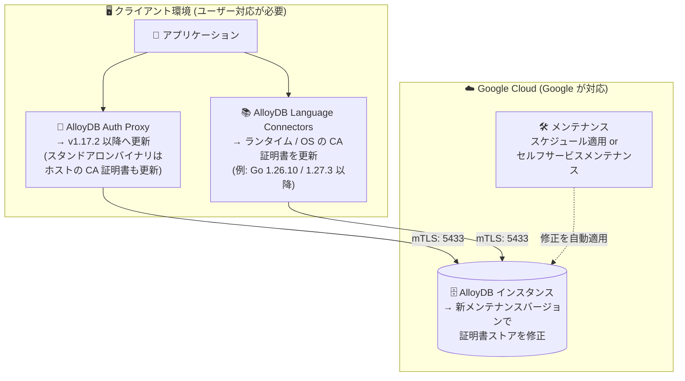

# AlloyDB for PostgreSQL: セキュリティ情報 GCP-2026-071 への対応 (eMudhra CA 証明書の侵害)

**リリース日**: 2026-10-28

**サービス**: AlloyDB for PostgreSQL

**機能**: セキュリティ情報 GCP-2026-071 に対応したマネージドコンポーネントの更新

**ステータス**: Security (セキュリティ修正)

📊 [このアップデートのインフォグラフィックを見る](https://takech9203.github.io/google-cloud-news-summary/20261028-alloydb-security-gcp-2026-071.html)

## 概要

セキュリティ情報 [GCP-2026-071](https://cloud.google.com/support/bulletins#gcp-2026-071) への対応として、Google は AlloyDB for PostgreSQL のマネージドコンポーネントを更新しています。証明書ストアに対する修正は新しいメンテナンスバージョンとして提供され、スケジュールされたメンテナンス時に AlloyDB が自動的に適用するため、AlloyDB が管理するインスタンスをユーザーが手動で更新する必要はありません。さらに、セルフサービスメンテナンスを実行することで、スケジュールされたメンテナンスを待たずに修正を適用することも可能です。

GCP-2026-071 (公開日: 2026-10-23、更新: 2026-10-27、CVE-2026-111943、重大度: Medium) は、eMudhra (emSign) の下位認証局 (CA) 証明書 8 件 (AAA Certificate Services によるクロス署名を含む) の秘密鍵が、不十分な暗号学的乱数 (弱いエントロピー) で生成されていたために再構成可能であると報告された問題です。この弱点により、ネットワークアクセスを持つリモート攻撃者が秘密鍵を復元して信頼された TLS 証明書を偽造し、これらの CA への信頼を削除していない TLS クライアント・コンテナ・SDK に対して中間者 (MitM) 攻撃を行うことが可能になります。Google Cloud のインフラストラクチャ自体は侵害されておらず、Google Cloud ワークロードに対する悪用の痕跡も確認されていません。

インスタンス側は Google が修正を配布する一方、AlloyDB への接続方式に応じてクライアント側の対応が必要です。AlloyDB Auth Proxy は v1.17.2 以降への更新、AlloyDB Language Connectors 利用時は言語ランタイムと OS の CA 証明書の更新 (例: Go 1.26.10 または 1.27.3 以降) が求められます。なお、同じ GCP-2026-071 への対応として Cloud SQL 側のアップデートも 2026-10-23 に公開されています (本リポジトリの Cloud SQL レポート参照)。

**アップデート前の課題**

- 侵害された eMudhra (emSign) 下位 CA を信頼したままの TLS クライアントは、外部 TLS 接続において MitM 傍受やトラフィック偽装のリスクに晒されていた
- AlloyDB Auth Proxy の旧バージョン (v1.17.2 未満) や、古い CA バンドルを含む言語ランタイム・OS は、侵害された CA への信頼を削除する修正を含んでいなかった

**アップデート後の改善**

- 証明書ストアの修正が新しいメンテナンスバージョンとして配布され、スケジュールされたメンテナンス時に AlloyDB が自動適用するため、マネージドインスタンスの手動更新が不要になった
- セルフサービスメンテナンスにより、スケジュールされたメンテナンスを待たずに修正を早期適用できる
- 更新版の AlloyDB Auth Proxy (v1.17.2 以降) と、更新済みのランタイム / OS CA 証明書により、クライアント側でも侵害された CA への信頼を排除できる

## アーキテクチャ図



AlloyDB への接続経路のうち、Google が管理するインスタンス側 (右) はメンテナンスバージョンで修正される一方、クライアント側 (左) の Auth Proxy や Language Connectors のランタイム / CA 証明書はユーザー自身による更新が必要です。

## サービスアップデートの詳細

### 主要なポイント

1. **マネージドインスタンスは Google が修正を配布**
   - 証明書ストアに対する修正は新しいメンテナンスバージョンとして提供される
   - スケジュールされたメンテナンス時に AlloyDB が自動適用するため、マネージドインスタンスの手動更新は不要
   - セルフサービスメンテナンスを実行すれば、スケジュールを待たずに修正を適用できる

2. **AlloyDB Auth Proxy 利用者はクライアント更新が必要**
   - AlloyDB Auth Proxy を v1.17.2 以降にアップグレードする
   - スタンドアロンのプロキシバイナリを実行している場合は、ホストの認証局 (CA) 証明書も更新する

3. **AlloyDB Language Connectors 利用者はランタイムと CA 証明書の更新が必要**
   - 言語ランタイムと OS の CA 証明書を更新する
   - 例: Go 1.26.10 または 1.27.3 以降

### 脆弱性の背景 (GCP-2026-071)

2026 年 10 月 17 日、セキュリティ研究者から eMudhra の下位 CA 証明書 8 件 (AAA Certificate Services によるクロス署名を含む) に関連する秘密鍵の侵害が Google に報告されました。これらの秘密鍵は不十分な暗号学的乱数で生成されており、攻撃者による再構成が可能です。該当 CA 証明書は信頼が取り消され、失効処理が進められています。AlloyDB のほか、Cloud SQL、gcloud CLI、GKE、Compute Engine、Cloud Run など多数の Google Cloud / Firebase プロダクトが影響対象として挙げられており、Google 管理環境では侵害された CA をブロック・不信頼化する事前対策が実施済みです。

## 技術仕様

### 接続方式ごとの必要な対応

| 接続方式 | 必要な対応 | 補足 |
|------|------|------|
| AlloyDB マネージドインスタンス | 対応不要 (Google が修正を配布) | 新メンテナンスバージョンをスケジュールメンテナンスで自動適用。セルフサービスメンテナンスで早期適用も可能 |
| AlloyDB Auth Proxy | v1.17.2 以降へアップグレード | スタンドアロンバイナリの場合はホストの CA 証明書更新も必要 |
| AlloyDB Language Connectors | 言語ランタイムと OS の CA 証明書を更新 | 例: Go 1.26.10 または 1.27.3 以降 |

### 脆弱性情報

| 項目 | 詳細 |
|------|------|
| セキュリティ情報 | GCP-2026-071 (公開日: 2026-10-23、更新: 2026-10-27) |
| CVE | CVE-2026-111943 |
| 重大度 | Medium |
| 内容 | eMudhra (emSign) 下位 CA 証明書 8 件の秘密鍵が弱いエントロピーで生成され、再構成可能。TLS 証明書の偽造と MitM 攻撃が可能 |
| インスタンス側の対応 | 新メンテナンスバージョンで証明書ストアを修正 (手動更新は不要) |
| サポート問い合わせ | Google Cloud サポートに Issue #576444463 を参照して連絡可能 |

## 設定方法

### 前提条件

1. 自環境での AlloyDB への接続方式 (Auth Proxy / Language Connectors / 直接接続) を把握していること
2. クラスタ・インスタンスの現在のメンテナンスバージョンを確認できること

### 手順

#### ステップ 1: インスタンスの現在のメンテナンスバージョンを確認

```bash
gcloud alloydb instances describe INSTANCE_ID \
  --cluster CLUSTER_ID \
  --region LOCATION_ID
```

レスポンスの `maintenanceVersionName` フィールドで、インスタンスが実行中のメンテナンスバージョンを確認します (例: `"maintenanceVersionName": "POSTGRES_16.20251015.04_00"`)。

#### ステップ 2: セルフサービスメンテナンスで修正を早期適用 (任意)

```bash
gcloud alloydb clusters update CLUSTER_ID \
  --region LOCATION_ID \
  --maintenance-version=latest
```

スケジュールされたメンテナンスを待たずに修正を適用したい場合は、セルフサービスメンテナンスでクラスタを最新バージョンに更新します。AlloyDB のメンテナンスはクラスタレベルで実行され、クラスタ内のインスタンスの更新順序は AlloyDB が決定します。デナイ期間 (deny period) はセルフサービスメンテナンスをブロックしません。

#### ステップ 3: AlloyDB Auth Proxy の更新

```bash
# 現在のバージョンを確認
alloydb-auth-proxy --version
```

AlloyDB Auth Proxy を v1.17.2 以降に更新します。スタンドアロンのプロキシバイナリを実行しているホストでは、OS の CA 証明書 (例: `ca-certificates` パッケージ) も更新します。

#### ステップ 4: AlloyDB Language Connectors 利用環境の更新

```bash
# 例: Go ランタイムを 1.26.10 / 1.27.3 以降に更新してリビルド
go version
```

Language Connectors (Java / Python / Go / Node.js) を利用しているアプリケーションでは、言語ランタイムと OS の CA 証明書を更新します。

## メリット

### ビジネス面

- **運用負荷の最小化**: マネージドインスタンス側の修正は Google が新メンテナンスバージョンとして配布するため、ユーザーは証明書ストアの手動更新作業が不要
- **リスクの早期低減**: セルフサービスメンテナンスがすでに利用可能なため、次回のスケジュールメンテナンスを待たずに修正を適用できる

### 技術面

- **多層的な修正**: インスタンス側 (メンテナンスバージョン) と接続経路 (Auth Proxy / Language Connectors のランタイム・CA 証明書) のそれぞれで侵害された CA への信頼を排除できる
- **影響の封じ込め**: Google Cloud インフラストラクチャ自体は侵害されておらず、Google 管理環境では侵害された CA をブロック・不信頼化する事前対策が実施済み

## デメリット・制約事項

### 考慮すべき点

- クライアント側コンポーネント (Auth Proxy、Language Connectors のランタイム / OS CA 証明書) の更新はユーザーの責任で実施する必要がある
- スタンドアロンのプロキシバイナリを使用している場合、プロキシ本体の更新に加えてホスト OS の CA 証明書更新も必要になる
- AlloyDB のメンテナンスはクラスタレベルで実行されるため、インスタンス単位での適用はできない (インスタンスごとの更新順序は AlloyDB が決定する)
- Compute Engine や GKE 上で自前管理している OS やカスタムコンテナイメージは、AlloyDB 側の対応とは別に、OS ベンダー経由でトラストストアを更新する必要がある (GCP-2026-071 の全般ガイダンス参照)

## ユースケース

### ユースケース 1: Auth Proxy 経由で AlloyDB に接続するアプリケーション

**シナリオ**: GCE / GKE 上のアプリケーションが AlloyDB Auth Proxy 経由で AlloyDB クラスタに接続している。

**実装例**:
```
1. Auth Proxy を v1.17.2 以降に更新 (コンテナの場合はイメージを差し替えてロールアウト)
2. スタンドアロンバイナリのホストでは OS の CA 証明書も更新
3. セルフサービスメンテナンスでクラスタに最新メンテナンスバージョンを早期適用
```

**効果**: 接続経路全体から侵害された CA への信頼を排除し、MitM リスクを低減できる。

### ユースケース 2: Language Connectors を組み込んだ Go アプリケーション

**シナリオ**: Cloud Run 上の Go アプリケーションが AlloyDB Go Connector で AlloyDB に接続している。

**実装例**:
```
1. Go 1.26.10 または 1.27.3 以降でリビルドして再デプロイ
2. コンテナのベースイメージの CA 証明書 (ca-certificates) も更新
```

**効果**: コンテナイメージに焼き込まれた古い CA バンドル経由のリスクを排除できる。

## 関連サービス・機能

- **AlloyDB Auth Proxy**: IAM 認可と mTLS で AlloyDB への接続を保護するクライアント。今回の更新対象 (v1.17.2 以降)
- **AlloyDB Language Connectors**: Java / Python / Go / Node.js 向けに TLS 1.3 の自動 mTLS と IAM 認可を提供するライブラリ。ランタイムと CA 証明書の更新が必要
- **AlloyDB セルフサービスメンテナンス**: スケジュールメンテナンスを待たずに最新メンテナンスバージョンを適用する機能。今回の修正の早期適用経路
- **Cloud SQL**: 同じ GCP-2026-071 の影響対象。Cloud SQL 側の対応は 2026-10-23 のリリースノートで公開済み (Auth Proxy 2.26.3+ など)
- **GKE / Compute Engine / Cloud Run**: GCP-2026-071 の影響を受ける他のプロダクト。自前管理の OS・コンテナイメージはトラストストアの更新が別途必要

## 参考リンク

- 📊 [インフォグラフィック](https://takech9203.github.io/google-cloud-news-summary/20261028-alloydb-security-gcp-2026-071.html)
- [公式リリースノート (AlloyDB)](https://docs.cloud.google.com/alloydb/docs/release-notes)
- [セキュリティ情報 GCP-2026-071](https://cloud.google.com/support/bulletins#gcp-2026-071)
- [AlloyDB Auth Proxy の概要](https://docs.cloud.google.com/alloydb/docs/auth-proxy/overview)
- [AlloyDB Language Connectors の概要](https://docs.cloud.google.com/alloydb/docs/language-connectors-overview)
- [セルフサービスメンテナンス](https://docs.cloud.google.com/alloydb/docs/self-service-maintenance)
- [メンテナンスの概要](https://docs.cloud.google.com/alloydb/docs/maintenance)

## まとめ

eMudhra 下位 CA の秘密鍵侵害 (GCP-2026-071 / CVE-2026-111943) に対し、AlloyDB では証明書ストアの修正が新メンテナンスバージョンとして配布され、スケジュールメンテナンスで自動適用されるため、インスタンス側のユーザー作業は不要です。急ぐ場合はセルフサービスメンテナンスで早期適用できます。一方、AlloyDB Auth Proxy (v1.17.2 以降) やスタンドアロンバイナリのホスト CA 証明書、Language Connectors のランタイム / OS CA 証明書 (例: Go 1.26.10 / 1.27.3 以降) といったクライアント側の更新はユーザーの対応が必須のため、自環境の接続方式を棚卸しして速やかに更新することを推奨します。

---

**タグ**: #AlloyDB #PostgreSQL #セキュリティ #GCP-2026-071 #CVE-2026-111943 #AuthProxy #LanguageConnectors #証明書 #メンテナンス
